# Branża 2: Odzież, Obuwie i Moda — Przepisy Produkcyjne i Bilans Masowo-Energetyczny

**Specyfikacja Inżynierii Procesowej i Bilansu Masowo-Energetycznego**  
*Załącznik Technologiczny do Game Design Document (GDD v5.0) oraz Katalogu Danych Gry*

---

## 1. Wstęp Inżynieryjny i Metodologia Bilansowa

Niniejsze opracowanie stanowi kompletną dokumentację technologiczną i inżynieryjną dla **Branży 2 (Odzież, Obuwie i Moda)** obejmującej 20 produktów końcowych (od Epoki 1 do Epoki 8). Dokument określa precyzyjne ścieżki konwersji surowców bazowych, półproduktów Poziomu 1 (L1), zaawansowanych komponentów Poziomu 2 i 3 (L2/L3) oraz wyrobów gotowych.

### 1.1. Zasady Bilansu Masowego i Energetycznego
Każdy proces produkcyjny w grze jest ściśle zbilansowany masowo i energetycznie:
1. **Zasada Zachowania Masy**:
   $$\sum m_{\text{surowców/komponentów}} = m_{\text{produktu}} + m_{\text{odpadów/ścinków}} + m_{\text{odparowania/strat procesowych}}$$
2. **Obieg Cyrkularny Ścinków i Odpadów**:
   * Ścinki bawełniane i wełniane trafiają jako szarpanka włókiennicza do produkcji filcu, czyściwa lub izolacji.
   * Odpady garbarskie (dwoina, ścinki skórzane) są surowcem do żelatyny przemysłowej, klejów skórnych lub kompostu.
   * Ścinki i wióry metali (stal, mosiądz, złoto) wracają w 100% do pieców hutniczych jako złom technologiczny.
   * Odpady termoplastyczne (poliester, poliamid) wracają do granularki.
3. **Bilans Energetyczny**:
   Energia technologiczna podawana jest w **kWh** w podziale na:
   * **Energię elektryczną ($E_e$)**: napęd wrzecion przędzalniczych, krosien, maszyn dziewiarskich, stębnówek, pras, laserów i systemów sterowania CNC.
   * **Energię cieplną ($E_c$)**: parowanie, pranie, autoklawy barwierskie, termofiksacja, suszenie, wulkanizacja oraz kraking petrochemiczny.

### 1.2. Triada Wymogów Produkcyjnych
Każdy węzeł produkcyjny definiowany jest przez triadę zasobów wymaganą w silniku gry:
1. **LUDZIE [R / M / E]**:
   * `[R]` **Robotnicy (Working Class)**: operatorzy krosien, szwaczki, garbarze, obuwnicy, pakowacze.
   * `[M]` **Specjaliści / Klasa Średnia (Middle Class)**: krojczy wzorcowi, technolodzy włókiennictwa, mistrzowie krawieccy, precyzyjni jubilerzy, mechanicy aparatury, automatycy.
   * `[E]` **Naukowcy / Inżynierowie / Projektanci (Elite)**: inżynierowie materiałowi, biochemicy włókien bionicznych, nanotechnolodzy, projektanci mikrosystemów elektronicznych.
2. **ENERGIA [kWh]**: Łączne zapotrzebowanie mocy elektrycznej i ciepła sieciowego na partię referencyjną oraz w przeliczeniu na 1 sztukę produktu.
3. **LICENCJA (Technologia)**: Wymagany węzeł badawczy z Drzewka Technologii (odkrywany za Punkty Nauki z Uniwersytetów / R&D).

---

## 2. Matryca Półproduktów L1 oraz L2/L3 dla Branży Odzieżowej

### 2.1. Półprodukty Poziomu 1 (L1)
| Kod L1 | Nazwa Półproduktu | Surowiec Wejściowy | Wydajność Masowa | Średnie Zużycie Energii | Główny Zakład |
| :--- | :--- | :--- | :---: | :---: | :--- |
| **L1-08** | Przędza Bawełniana | Bawełna Surowa (odziarniona) | 88% (12% odpady/krótkie włókna) | 3,2 kWh/kg | Przędzalnia Bawełny |
| **L1-09** | Przędza Wełniana | Wełna Potna (Owce) | 55% (45% tłuszczopot, piasek) | 4,8 kWh/kg | Przędzalnia Wełny Czesankowej |
| **L1-10** | Skóra Surowa Wyprawiona | Skóra Bydlęca Świeża (Rzeźnia) | 60% masy mokrej | 8,5 kWh/m² | Garbarnia Tradycyjna |
| **L1-11** | Guma Surowa | Kauczuk Naturalny (Lateks) | 92% (koagulacja i suszenie) | 2,4 kWh/kg | Zakład Obróbki Kauczuku |
| **L1-12** | Celuloza Drewna | Drewno Okrągłe (Sosna/Świerk) | 42% (roztwarzanie siarczanowe) | 4,0 kWh/kg | Celulozownia Przemysłowa |
| **L1-18** | Surówka Hutnicza | Ruda Żelaza + Węgiel Kamienny | 62% z rudy wysokoprocentowej | 4,5 kWh/kg | Huta Żelaza (Wielki Piec) |
| **L1-19** | Miedź Rafinowana | Ruda Miedzi (Hutnictwo/Elektroliza) | 25% z koncentratu | 6,0 kWh/kg | Huta i Rafineria Miedzi |
| **L1-20** | Aluminium Hutnicze | Boksyt (Proces Bayera + Halla) | 22% z boksytu | 14,0 kWh/kg | Huta Aluminium |
| **L1-21** | Złoto Czyste (próba 999) | Ruda Złota / Koncentrat | 0,001%–0,01% | 220 kWh/g | Zakład Rafinacji Metali Szlachetnych |
| **L1-25** | Frakcje Naftowe (Monomery) | Ropa Naftowa (Kraking parowy) | 78% frakcji chemicznych | 2,8 kWh/kg | Rafineria / Zakład Petrochemiczny |
| **L1-31** | Biomasa Przetworzona | Algi Morskie / Biomasa roślinna | 70% suchej biomasy | 1,8 kWh/kg | Bio-Rafineria Wodna |
| **L1-34** | Granulat Tworzyw rPET | Odpady Zmieszane (Butelki PET) | 82% (po myciu i regranulacji) | 1,6 kWh/kg | Miejski Zakład Recyklingu |
| **L1-23** | Tlenki Neodymu | Neodym i Ziemie Rzadkie | 12% z koncentratu | 45 kWh/kg | Zakład Separacji Pierwiastków |
| **L1-17** | Wafle Krzemowe | Piasek Kwarcowy (Krzem polikrystaliczny) | 15% z kwarcu | 180 kWh/kg | Huta Krzemu Elektronicznego |

### 2.2. Półprodukty Poziomu 2 i 3 (L2/L3)
| Kod L2/L3 | Nazwa Półproduktu | Składniki Wejściowe | Wydajność | Zużycie Energii | Zakład Przetwórczy |
| :--- | :--- | :--- | :---: | :---: | :--- |
| **L2-09** | Tkanina Bawełniana Wykończona | Przędza Bawełniana (L1-08) + Barwniki | 94% | 3,8 kWh/m² | Tkalnia i Wykończalnia Tkanin |
| **L2-10** | Tkanina Wełniana Wykończona | Przędza Wełniana (L1-09) + Folusz | 90% | 5,2 kWh/m² | Tkalnia Wełny i Sukiennictwo |
| **L2-11** | Tkanina Syntetyczna (Poliester) | Frakcje Naftowe (L1-25) | 91% | 6,5 kWh/kg | Zakład Włókien Chemicznych |
| **L2-12** | Włóknina Recyklingowana (rPET) | Granulat rPET (L1-34) | 93% | 2,8 kWh/kg | Przędzalnia Włókien rPET |
| **L2-13** | Płótno Techniczne i Drelich | Przędza Bawełniana (L1-08) (splot skośny) | 95% | 3,1 kWh/m² | Tkalnia Ciężkich Tkanin |
| **L2-14** | Skóra Galanteryjna i Obuwnicza | Skóra Wyprawiona (L1-10) + Barwniki/Woski | 85% | 4,2 kWh/m² | Wykończalnia Skór i Dwoiny |
| **L2-15** | Eko-Skóra Grzybowa (Mycelium) | Biomasa Przetworzona (L1-31) | 88% | 1,9 kWh/m² | Bio-Laboratorium Mykologiczne |
| **L2-16** | Guma Wulkanizowana Obuwnicza | Guma Surowa (L1-11) + Sadza + Siarka | 97% | 3,6 kWh/kg | Mieszalnia i Tłocznia Gumy |
| **L2-58A** | Nity, Guziki i Oczka Metalowe | Stal (L2-31) / Mosiądz (L2-33) | 92% | 2,1 kWh/kg | Tłocznia Elementów Drobnych |
| **L2-58B** | Zamki Błyskawiczne | Stal/Mosiądz + Taśma Bawełniana/PET | 95% | 1,4 kWh/m | Fabryka Pasmanterii Technicznej |
| **L2-57** | Przekładnie Zegarkowe i Sprężyny | Stal Nierdzewna + Mosiądz | 65% (obróbka skrawaniem) | 28,0 kWh/kg | Warsztat Mechaniki Precyzyjnej |
| **L2-44** | Barwniki i Pigmenty Włókiennicze | Chemikalia i Minerały (L1-29) | 85% | 4,5 kWh/kg | Fabryka Barwników Chemicznych |
| **L2-64** | Elastyczne Płytki i Sensory Ubieralne | Miedź + Polimer + Wafle Krzemowe | 80% | 42,0 kWh/m² | Zakład Mikroelektroniki Elastycznej |

---

## 3. Szczegółowe Receptury dla 20 Produktów Końcowych

---

### Produkt 1: Odzież Robocza z Drelichu/Denimu
*Ewolucja w grze: Epoka 1 (Drelich Fabryczny) $\to$ Epoka 4 (Jeansy Klasyczne) $\to$ Epoka 7 (Jeansy Cyrkularne Zero-Waste)*

#### A. Karta Identyfikacyjna Produktu
* **Partia Referencyjna**: 100 kompletów roboczych (bluza robocza + spodnie ogrodniczki / jeansy o podwójnym szwie).
* **Masa jednostkowa gotowego wyrobu**: 1,40 kg/kpl. (Masa partii: 140 kg).
* **Główny konsument w mieście**: Robotnicy `[R]` (Popyt stały w strefach przemysłowych, kopalniach i hutach).

#### B. Drzewo Przepływu Technologicznego
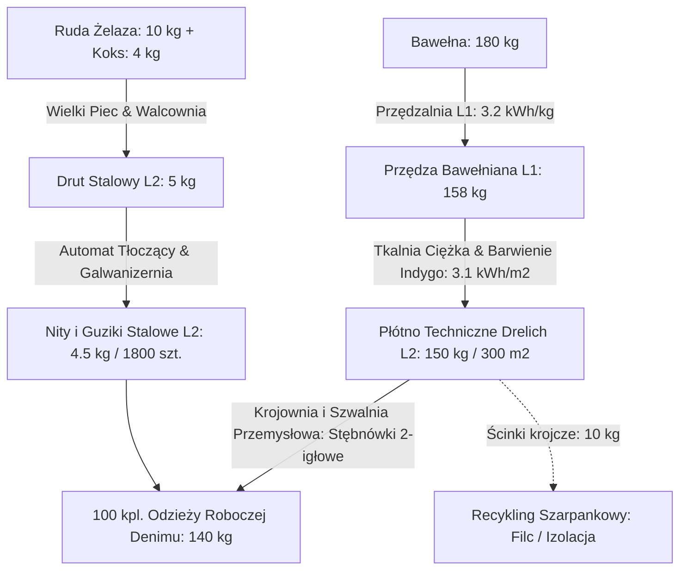

#### C. Bilans Masowo-Energetyczny Partii (100 kompletów)
| Poziom | Składnik / Proces | Wsad Masowy | Uzysk Masowy | Odpady / Ścinki | Zużycie Energii [kWh] |
| :--- | :--- | :---: | :---: | :---: | :---: |
| **Surowiec $\to$ L1** | Oczyszczanie i przędzenie bawełny | 180,0 kg bawełny | 158,4 kg przędzy | 21,6 kg (nasiona, pył) | 576 kWh (elektryczna) |
| **L1 $\to$ L2** | Tkanie drelichu skośnego (twill 3/1) | 158,4 kg przędzy | 150,0 kg tkaniny (300 m²) | 8,4 kg ścinki brzegowe | 465 kWh (przędzenie+krosna) |
| **L1 $\to$ L2** | Barwienie indygo i apretura | 150,0 kg tkaniny + 3 kg barwnika | 150,0 kg drelichu barwionego | 3,0 kg osady ściekowe | 320 kWh (para/ciepło) |
| **L1 $\to$ L2** | Produkcja nitów i guzików | 6,0 kg stali ciągnionej | 4,8 kg nitów (1800 szt.) | 1,2 kg wióry stalowe (recykling) | 15 kWh (tłoczenie) |
| **L2 $\to$ Końcowy** | Rozkrój tkaniny, szycie 3-igłowe, nitowanie | 150,0 kg drelichu + 4,8 kg nitów + 1,2 kg nici | 140,0 kg wyrobu gotowego | 16,0 kg ścinki krojcze (10,7%) | 140 kWh (szwalnia przemysłowa) |
| **SUMA ŁAŃCUCHA** | **Pełny proces (od surowca do wyrobu)** | **180 kg Bawełny + 10 kg Rudy** | **100 kpl. Odzieży Roboczej** | **27,2 kg tekstylne + 1,2 kg stal** | **1516 kWh** |

#### D. Triada Wymogów Produkcyjnych
* **Ludzie**: `[R]` 85% (operatorzy krosien, krojczy, szwaczki maszynowe), `[M]` 15% (mistrz linii, mechanik krosien). Łącznie: **45 roboczogodzin / 100 kpl.**
* **Energia**: **15,16 kWh / kpl.** (w tym 10,4 kWh energia elektryczna maszynowa, 4,76 kWh ciepło technologiczne).
* **Licencja**: *Tkalnictwo Mechaniczne (Era 1)* $\to$ *Nitowanie i Denim Masowy (Era 4)* $\to$ *Cyrkularna Odzież Robocza (Era 7)*.
* **Wskaźnik Eko-Etyki / Cyrkularność**: Trwałość: 85/100. Odzysk ścinków: 100% trafia na szarpankę do izolacji cieplnych. W Epoce 7: program odkupu zużytych jeansów z redukcją podatku miejskiego.

---

### Produkt 2: Koszule Bawełniane i Bielizna
*Ewolucja w grze: Epoka 1 (Koszule Płócienne Rzemieślnicze) $\to$ Epoka 3 (Bielizna Standaryzowana) $\to$ Epoka 6 (Bielizna z Bawełny Organicznej Fair-Trade)*

#### A. Karta Identyfikacyjna Produktu
* **Partia Referencyjna**: 100 zestawów (koszula męska/damska klasyczna + zestaw bielizny bawełnianej).
* **Masa jednostkowa gotowego wyrobu**: 0,45 kg/zestaw (Masa partii: 45 kg).
* **Główny konsument w mieście**: Wszystkie klasy `[R, M, E]` (Podstawowe dobro cywilizacyjne).

#### B. Drzewo Przepływu Technologicznego
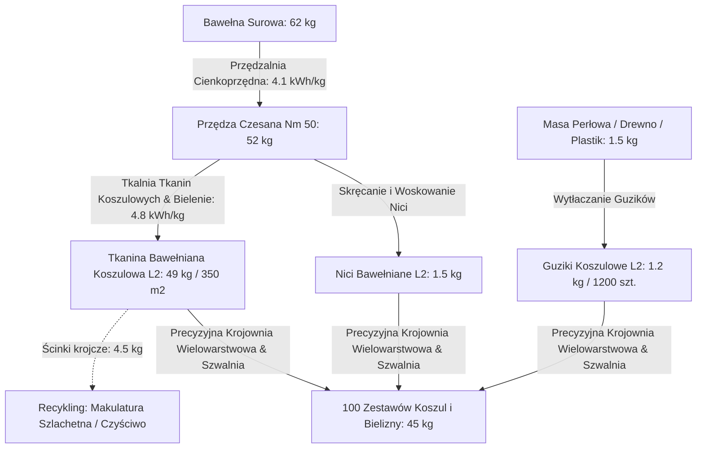

#### C. Bilans Masowo-Energetyczny Partii (100 zestawów)
| Poziom | Składnik / Proces | Wsad Masowy | Uzysk Masowy | Odpady / Ścinki | Zużycie Energii [kWh] |
| :--- | :--- | :---: | :---: | :---: | :---: |
| **Surowiec $\to$ L1** | Czesanie i przędzenie przędzy cienkiej | 62,0 kg bawełny | 52,0 kg przędzy czesanej | 10,0 kg wyczeski (do filcu) | 213 kWh |
| **L1 $\to$ L2** | Tkanie batystu i popeliny (130 g/m²) | 50,5 kg przędzy | 49,0 kg tkaniny (375 m²) | 1,5 kg ścinki brzegów | 185 kWh |
| **L1 $\to$ L2** | Bielenie tlenowe i merceryzacja | 49,0 kg surowej tkaniny | 49,0 kg tkaniny uszlachetnionej | 0,5 kg osady mydlane | 115 kWh (para wodna) |
| **L1 $\to$ L2** | Produkcja nici i guzików | 1,5 kg przędzy + 1,5 kg surowca | 2,7 kg (nici + 1200 guzików) | 0,3 kg pył i odpady | 18 kWh |
| **L2 $\to$ Końcowy** | Wykrawanie kołnierzyków, mankietów, stębnowanie | 49,0 kg tkaniny + dodatki | 45,0 kg koszul i bielizny | 4,9 kg ścinki krojcze (10%) | 110 kWh |
| **SUMA ŁAŃCUCHA** | **Pełny proces (od surowca do wyrobu)** | **63,5 kg Surowców** | **100 zestawów (45 kg)** | **16,7 kg (w 100% zawracane)** | **641 kWh** |

#### D. Triada Wymogów Produkcyjnych
* **Ludzie**: `[R]` 90% (szwaczki, prasowaczki), `[M]` 10% (krojczy precyzyjny, kontrola jakości). Łącznie: **32 roboczogodziny / 100 zestawów**.
* **Energia**: **6,41 kWh / zestaw**.
* **Licencja**: *Konfekcja Masowa (Era 1)* $\to$ *Automatyczne Szwalnie Wieloseryjne (Era 3)*.
* **Wskaźnik Eko-Etyki / Cyrkularność**: Trwałość: 65/100. Odzysk bawełny w Zakładzie Recyklingu na poziomie 92%.

---

### Produkt 3: Płaszcze i Garnitury Wełniane
*Ewolucja w grze: Epoka 1 (Krawiectwo Tradycyjne) $\to$ Epoka 3 (Garnitury Przemysłowe) $\to$ Epoka 7 (Wełna Regenerowana & Odpowiedzialna)*

#### A. Karta Identyfikacyjna Produktu
* **Partia Referencyjna**: 100 kompletów garniturowo-płaszczowych (marynarka, spodnie wełniane, wełniany płaszcz ocieplany).
* **Masa jednostkowa gotowego wyrobu**: 3,20 kg/kpl. (Masa partii: 320 kg).
* **Główny konsument w mieście**: Klasa Średnia `[M]` i Elita `[E]` (Generuje prestiż i wysoki wskaźnik zadowolenia w biurach i bankach).

#### B. Drzewo Przepływu Technologicznego
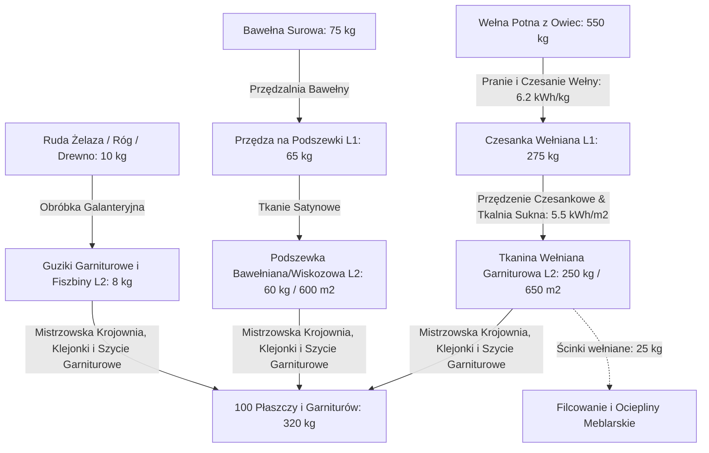

#### C. Bilans Masowo-Energetyczny Partii (100 kompletów)
| Poziom | Składnik / Proces | Wsad Masowy | Uzysk Masowy | Odpady / Ścinki | Zużycie Energii [kWh] |
| :--- | :--- | :---: | :---: | :---: | :---: |
| **Surowiec $\to$ L1** | Sortowanie, pranie w mydłach i odtłuszczanie wełny | 550,0 kg wełny potnej | 275,0 kg wełny czystej | 275,0 kg (lanolina, brud) | 825 kWh (gorąca woda/para) |
| **Surowiec $\to$ L1** | Przędzenie czesankowe przędzy sukienniczej | 275,0 kg czesanki | 258,0 kg przędzy czesankowej | 17,0 kg wyczeski krótkie | 640 kWh (elektryczna) |
| **L1 $\to$ L2** | Tkanie flauszu i tkaniny czesankowej (380 g/m²) | 258,0 kg przędzy | 250,0 kg tkaniny (650 m²) | 8,0 kg krajki i ścinki | 780 kWh (krosna) |
| **L1 $\to$ L2** | Foluszowanie, drapanie, dekatyzacja tkaniny | 250,0 kg tkaniny | 250,0 kg sukna dekatyzowanego | 0 kg (kondycjonowanie parą) | 360 kWh (para/ciepło) |
| **L1 $\to$ L2** | Produkcja podszewki bawełnianej i usztywnień | 65,0 kg przędzy bawełn. | 60,0 kg podszewki (600 m²) | 5,0 kg ścinki | 210 kWh |
| **L2 $\to$ Końcowy** | Formowanie termiczne (żelazka parowe), szycie krawieckie | 250 kg sukna + 60 kg podszewki + 8 kg dodatków | 320,0 kg gotowych garniturów i płaszczy | 28,0 kg ścinki i resztki pasmanterii | 520 kWh (szwalnia garniturowa) |
| **SUMA ŁAŃCUCHA** | **Pełny proces (od surowca do wyrobu)** | **625 kg Surowców naturalnych** | **100 kpl. Luksusowych (320 kg)** | **305 kg (w tym 275 kg lanolina/bio)** | **3335 kWh** |

#### D. Triada Wymogów Produkcyjnych
* **Ludzie**: `[R]` 40% (operatorzy pralnic i krosien), `[M]` 55% (krojczy modelowi, krawcy garniturowi), `[E]` 5% (mistrzowie konstrukcji odzieży). Łącznie: **95 roboczogodzin / 100 kpl.**
* **Energia**: **33,35 kWh / kpl.** (Wysokie zapotrzebowanie na parę technologiczną do folusza i prasowalnic).
* **Licencja**: *Krawiectwo Garniturowe (Era 1)* $\to$ *Przemysłowe Prasowanie Parowe (Era 2)*.
* **Wskaźnik Eko-Etyki / Cyrkularność**: Trwałość: 92/100 (Wysoka naprawialność u Serwisantów). Lanolina odzyskiwana jako surowiec dla Branży 5 (Kosmetyki).

---

### Produkt 4: Suknie Tradycyjne i Gorsety
*Status w grze: Epoka 1 (Dominujący luksus damski) $\to$ **[Wygasa całkowicie w Epoce 2 w wyniku rewolucji obyczajowej i emancypacji]***

#### A. Karta Identyfikacyjna Produktu
* **Partia Referencyjna**: 100 kompletów (suknia wiktoriańska z krynoliną + sznurowany gorset z fiszbinami stalowymi).
* **Masa jednostkowa gotowego wyrobu**: 2,80 kg/kpl. (Masa partii: 280 kg).
* **Główny konsument w mieście**: Elita `[E]` oraz Klasa Średnia `[M]` w Epoce 1.

#### B. Drzewo Przepływu Technologicznego
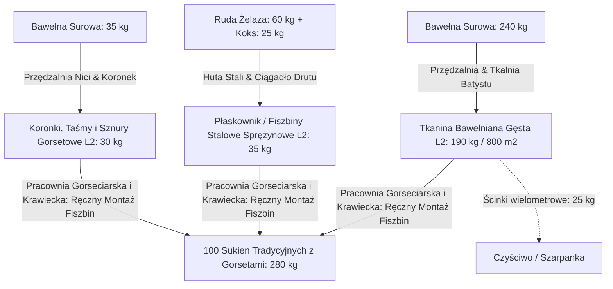

#### C. Bilans Masowo-Energetyczny Partii (100 kompletów)
| Poziom | Składnik / Proces | Wsad Masowy | Uzysk Masowy | Odpady / Ścinki | Zużycie Energii [kWh] |
| :--- | :--- | :---: | :---: | :---: | :---: |
| **Surowiec $\to$ L1** | Przędzenie i bielenie bawełny na sukno i żakardy | 275,0 kg bawełny | 230,0 kg przędzy | 45,0 kg wyczeski | 780 kWh |
| **Surowiec $\to$ L1** | Wytop stali i walcowanie drutu sprężystego | 60,0 kg rudy + koks | 36,0 kg stali sprężynowej | 24,0 kg żużel hutniczy | 195 kWh |
| **L1 $\to$ L2** | Tkanie krynolin, taft i batystów | 230,0 kg przędzy | 215,0 kg tkanin i koronek | 15,0 kg ścinki brzegowe | 710 kWh |
| **L1 $\to$ L2** | Hartowanie i profilowanie fiszbin gorsetowych | 36,0 kg drutu | 35,0 kg gotowych fiszbin | 1,0 kg opiłki stalowe | 65 kWh (hartowanie) |
| **L2 $\to$ Końcowy** | Ręczne pasowanie fiszbin, szycie wielowarstwowe | 215 kg tkanin + 35 kg fiszbin + nici | 280,0 kg gotowych sukien i gorsetów | 25,0 kg ścinki krojcze (10%) | 260 kWh |
| **SUMA ŁAŃCUCHA** | **Pełny proces (od surowca do wyrobu)** | **335 kg Bawełny + 60 kg Rudy** | **100 sukien i gorsetów (280 kg)** | **85,0 kg odpadów** | **2010 kWh** |

#### D. Triada Wymogów Produkcyjnych
* **Ludzie**: `[R]` 30%, `[M]` 70% (wyspecjalizowane gorseciarki, krawcowe sukien miarowych). Łącznie: **110 roboczogodzin / 100 kpl.**
* **Energia**: **20,10 kWh / kpl.**
* **Licencja**: *Konstrukcja Odzieży Epoki Wiktoriańskiej (Era 1)*.
* **Mechanika Wygasania**: W Epoce 2 popyt spada do zera; fabryki gorsetów muszą dokonać rekonwersji maszyn na *Sukienki Prêt-à-porter* lub zbankrutują.

---

### Produkt 5: Trzewiki i Buty Skórzane
*Ewolucja w grze: Epoka 1 (Szewstwo Rzemieślnicze) $\to$ Epoka 3 (Obuwie Wizytowe Klejone) $\to$ Epoka 7 (Obuwie Cyrkularne z Odnawialną Podeszwą)*

#### A. Karta Identyfikacyjna Produktu
* **Partia Referencyjna**: 100 par klasycznych trzewików skórzanych sznurowanych.
* **Masa jednostkowa gotowego wyrobu**: 1,30 kg/para (Masa partii: 130 kg).
* **Główny konsument w mieście**: Wszystkie klasy `[R, M, E]`.

#### B. Drzewo Przepływu Technologicznego
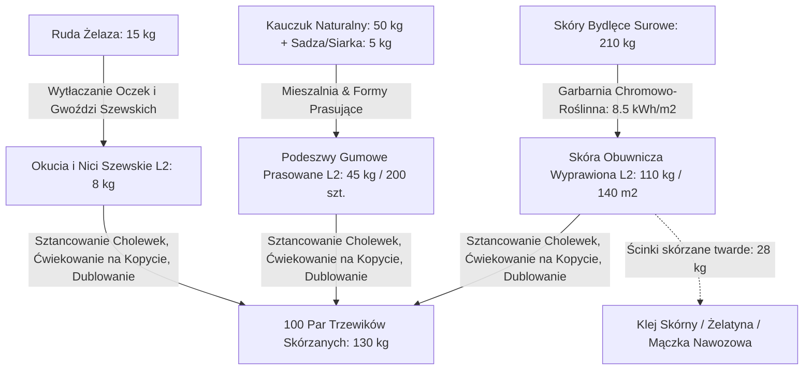

#### C. Bilans Masowo-Energetyczny Partii (100 par)
| Poziom | Składnik / Proces | Wsad Masowy | Uzysk Masowy | Odpady / Ścinki | Zużycie Energii [kWh] |
| :--- | :--- | :---: | :---: | :---: | :---: |
| **Surowiec $\to$ L1** | Wapnowanie, mizdrowanie i garbowanie skór | 210,0 kg skór mokrych | 125,0 kg skóry garbowanej | 85,0 kg mizdra i tłuszcz | 420 kWh (bębny garbarskie) |
| **L1 $\to$ L2** | Suszenie próżniowe, barwienie i natłuszczanie | 125,0 kg skóry | 110,0 kg skóry wierzchowej (140 m²) | 15,0 kg dwoina odpadowa | 310 kWh (próżnia/ciepło) |
| **Surowiec $\to$ L2** | Wulkanizacja i formowanie podeszew z bieżnikiem | 55,0 kg mieszanki gumowej | 45,0 kg podeszew (100 par) | 10,0 kg wypływki wulkanizacyjne | 165 kWh (prasy gorące) |
| **L1 $\to$ L2** | Produkcja gwoździ szewskich, oczek i nici lnianych | 15,0 kg stali + 5 kg lnu | 8,0 kg galanterii montażowej | 12,0 kg odpad metalurgiczny | 45 kWh |
| **L2 $\to$ Końcowy** | Wykrawanie cholewek (sztancowanie), ćwiekowanie, szycie podeszwy (metoda Goodyear) | 110 kg skóry + 45 kg podeszew + 8 kg dodatków | 130,0 kg gotowych trzewików | 28,0 kg ścinki skóry + 5 kg guma | 380 kWh (prasy, maszyny szyjące) |
| **SUMA ŁAŃCUCHA** | **Pełny proces (od surowca do wyrobu)** | **285 kg Surowców bazowych** | **100 par obuwia (130 kg)** | **155 kg odpadów (w tym 85 kg bio)** | **1320 kWh** |

#### D. Triada Wymogów Produkcyjnych
* **Ludzie**: `[R]` 70% (ćwiekarze, szwaczki cholewek), `[M]` 30% (wykrawacze skór, szewcy montażyści). Łącznie: **55 roboczogodzin / 100 par**.
* **Energia**: **13,20 kWh / para**.
* **Licencja**: *Szewstwo Przemysłowe i Garbarstwo (Era 1)* $\to$ *Montaż Obuwia Klejonego (Era 3)*.
* **Cyrkularność / Rola Serwisantów**: Trwałość: 80/100. Podeszwa Goodyear pozwala na 3-krotną wymianę zelówki u **Serwisantów Miejskich**, wydłużając żywotność produktu o 200% i redukując odpady miejskie o 60%.

---

### Produkt 6: Kapelusze Filcowe i Nakrycia Głowy
*Status w grze: Epoka 1 (Masowe nakrycie głowy każdego obywatela) $\to$ **[Wygasa całkowicie w Epoce 4 w związku ze zmianą mody i fryzur powojennych]***

#### A. Karta Identyfikacyjna Produktu
* **Partia Referencyjna**: 100 sztuk kapeluszy filcowych (typu melonik, fedora lub cylinder).
* **Masa jednostkowa gotowego wyrobu**: 0,22 kg/szt. (Masa partii: 22 kg).
* **Główny konsument w mieście**: Robotnicy `[R]` (kaszkiety) oraz Klasa Średnia i Elita `[M, E]` (cylindry, meloniki).

#### B. Drzewo Przepływu Technologicznego
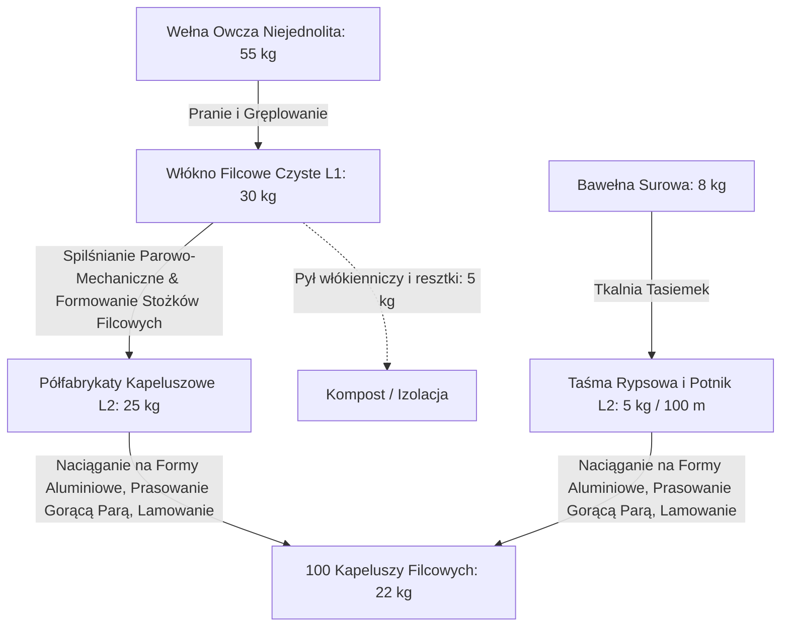

#### C. Bilans Masowo-Energetyczny Partii (100 sztuk)
| Poziom | Składnik / Proces | Wsad Masowy | Uzysk Masowy | Odpady / Ścinki | Zużycie Energii [kWh] |
| :--- | :--- | :---: | :---: | :---: | :---: |
| **Surowiec $\to$ L1** | Mycie, odtłuszczanie i gręplowanie wełny | 55,0 kg wełny | 30,0 kg runa filcowego | 25,0 kg brud i tłuszczopot | 90 kWh |
| **L1 $\to$ L2** | Spilśnianie (filcowanie wibracyjne w kwasie/parze) | 30,0 kg wełny czystej | 25,0 kg stożków filcowych | 5,0 kg okrawki | 140 kWh (wytwornica pary) |
| **Surowiec $\to$ L2** | Produkcja taśm wykończeniowych i potników | 8,0 kg bawełny/skóry | 5,0 kg potników i taśm | 3,0 kg ścinki | 25 kWh |
| **L2 $\to$ Końcowy** | Formowanie ciśnieniowe pod parą (140°C), sztywnienie szelakiem, lamowanie | 25 kg stożków + 5 kg taśm | 22,0 kg gotowych kapeluszy | 8,0 kg odcięte rondo i odpady | 115 kWh (prasy kapelusznicze) |
| **SUMA ŁAŃCUCHA** | **Pełny proces (od surowca do wyrobu)** | **63,0 kg Surowców** | **100 Kapeluszy (22 kg)** | **41,0 kg odpadów (bioodpady)** | **370 kWh** |

#### D. Triada Wymogów Produkcyjnych
* **Ludzie**: `[R]` 65% (formierze filcu), `[M]` 35% (modystki, formowanie rond). Łącznie: **28 roboczogodzin / 100 szt.**
* **Energia**: **3,70 kWh / szt.** (Głównie para technologiczna do zmiękczania filcu).
* **Licencja**: *Filcowanie Przemysłowe i Formowanie Parowe (Era 1)*.
* **Mechanika Wygasania**: Po Epoce 3 popyt drastycznie spada; fabryki muszą przestawić się na *Czapki Sportowe* lub *Kaski Ochronne*.

---

### Produkt 7: Zegarki Kieszonkowe / Mechaniczne
*Ewolucja w grze: Epoka 1 (Zegarek Kieszonkowy Nakręcany) $\to$ Epoka 2 (Zegarek Naręczny Mechaniczny) $\to$ Epoka 6 (Zegarmistrzostwo Luksusowe / Manufakturowe)*

#### A. Karta Identyfikacyjna Produktu
* **Partia Referencyjna**: 100 sztuk precyzyjnych zegarków mechanicznych z naciągiem sprężynowym.
* **Masa jednostkowa gotowego wyrobu**: 0,11 kg/szt. (Masa partii: 11 kg).
* **Główny konsument w mieście**: Elita `[E]` oraz zamożna Klasa Średnia `[M]` (Podnosi punktację prestiżu miejskiego).

#### B. Drzewo Przepływu Technologicznego
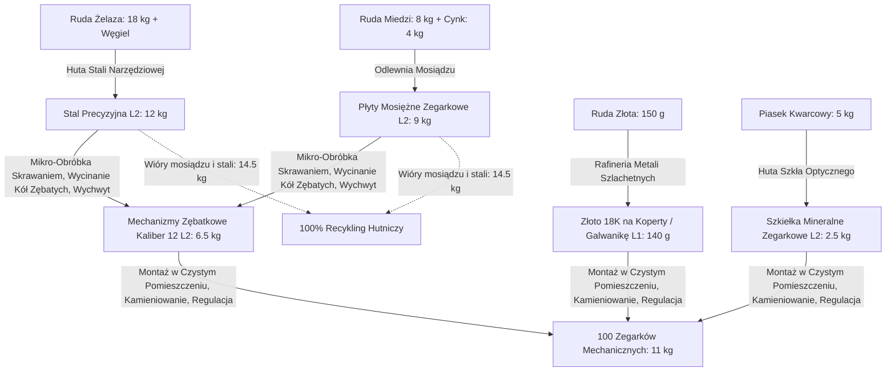

#### C. Bilans Masowo-Energetyczny Partii (100 sztuk)
| Poziom | Składnik / Proces | Wsad Masowy | Uzysk Masowy | Odpady / Ścinki | Zużycie Energii [kWh] |
| :--- | :--- | :---: | :---: | :---: | :---: |
| **Surowiec $\to$ L1/L2** | Wytop stali węglowej stopowej na sprężyny i osie | 18,0 kg rudy żelaza | 12,0 kg prętów stalowych | 6,0 kg żużel | 75 kWh |
| **Surowiec $\to$ L2** | Odlew i walcowanie mosiądzu zegarkowego | 12,0 kg miedź + cynk | 9,0 kg blachy mosiężnej | 3,0 kg zgary odlewnicze | 55 kWh |
| **Surowiec $\to$ L1** | Rafinacja złota na powłoki galwaniczne/koperty | 150 g złota surowego | 140 g złota próby 750 | 10 g straty chemiczne | 85 kWh |
| **Surowiec $\to$ L2** | Wytop i szlifowanie szkiełek kryształowych | 5,0 kg piasku kwarcowego | 2,5 kg szkiełek (100 szt.) | 2,5 kg stłuczka | 40 kWh |
| **L2 $\to$ L3** | Mikroskrawanie kół zębatych, balansu i kotwicy | 12 kg stali + 9 kg mosiądzu | 6,5 kg części mechanizmu | 14,5 kg mikro-wióry (złom 100%) | 380 kWh (mikro-tokarki) |
| **L3 $\to$ Końcowy** | Montaż ręczny pęsetami, oliwienie syntetyczne, kalibracja chodu | 6,5 kg mechanizmów + koperty + szkiełka | 11,0 kg gotowych zegarków | 0,2 kg opakowania montażowe | 120 kWh |
| **SUMA ŁAŃCUCHA** | **Pełny proces (od surowca do wyrobu)** | **35,15 kg Surowców metalicznych** | **100 Zegarków (11 kg)** | **24,15 kg (100% zawracane)** | **755 kWh** |

#### D. Triada Wymogów Produkcyjnych
* **Ludzie**: `[R]` 0%, `[M]` 75% (precyzyjni mechanicy, tokarze mikroskopowi), `[E]` 25% (mistrzowie zegarmistrzostwa, regulacja balansu). Łącznie: **160 roboczogodzin / 100 szt.**
* **Energia**: **7,55 kWh / szt.** (Czysta energia elektryczna, napęd precyzyjnych obrabiarek i oświetlenie bezpyłowe).
* **Licencja**: *Mechanika Precyzyjna i Wychwyty Zegarowe (Era 1)* $\to$ *Zminiaturyzowane Zegarki Naręczne (Era 2)*.
* **Cyrkularność i Trwałość**: Trwałość: 99/100 (Przekazywane z pokolenia na pokolenie, zerowy ślad odpadowy, 100% wartości złomu metali szlachetnych).

---

### Produkt 8: Torby, Paski i Galanteria Skórzana
*Ewolucja w grze: Epoka 1 (Rymarstwo Tradycyjne) $\to$ Epoka 4 (Galanteria Masowa ze Szwami Wzmacnianymi) $\to$ Epoka 7 (Galanteria z Eko-Skóry Grzybowej Mycelium)*

#### A. Karta Identyfikacyjna Produktu
* **Partia Referencyjna**: 100 sztuk asortymentu galanteryjnego (40 toreb podróżnych/miejskich, 60 pasków i portfeli skórzanych).
* **Masa jednostkowa średnia**: 0,95 kg/szt. (Masa partii: 95 kg).
* **Główny konsument w mieście**: Klasa Średnia `[M]` i Elita `[E]`.

#### B. Drzewo Przepływu Technologicznego
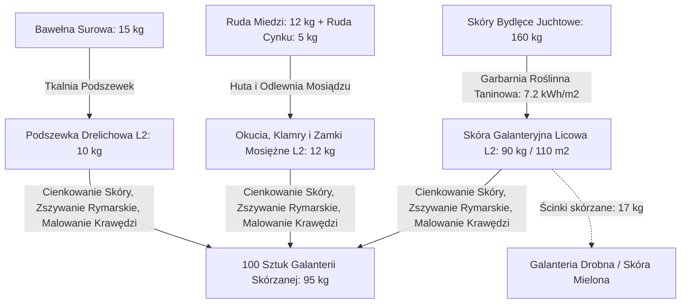

#### C. Bilans Masowo-Energetyczny Partii (100 sztuk)
| Poziom | Składnik / Proces | Wsad Masowy | Uzysk Masowy | Odpady / Ścinki | Zużycie Energii [kWh] |
| :--- | :--- | :---: | :---: | :---: | :---: |
| **Surowiec $\to$ L1** | Garbowanie taninami roślinnymi (kora dębu/mimoza) | 160,0 kg skór | 102,0 kg skóry surowej garbowanej | 58,0 kg resztki organiczne | 340 kWh |
| **L1 $\to$ L2** | Kondycjonowanie, natłuszczanie olejami rybimi i prasowanie | 102,0 kg skóry | 90,0 kg skóry juchtowej (110 m²) | 12,0 kg dwoina odpadowa | 210 kWh |
| **Surowiec $\to$ L2** | Wytop klamer mosiężnych, nitów i okuć | 17,0 kg rud metali | 12,0 kg okuć galanteryjnych | 5,0 kg żużel i zgary | 85 kWh |
| **Surowiec $\to$ L2** | Produkcja podszewki bawełnianej i nici woskowanych | 15,0 kg bawełny | 10,0 kg podszewki (120 m²) | 5,0 kg ścinki | 45 kWh |
| **L2 $\to$ Końcowy** | Wykrawanie formatek, ścienianie krawędzi (skiving), montaż okuć i szwów | 90 kg skóry + 12 kg mosiądzu + 10 kg podszewki | 95,0 kg gotowych toreb i pasków | 17,0 kg ścinki skórzane | 190 kWh (maszyny rymarskie) |
| **SUMA ŁAŃCUCHA** | **Pełny proces (od surowca do wyrobu)** | **192,0 kg Surowców** | **100 szt. Galanterii (95 kg)** | **97,0 kg (w tym 70 kg biodegradowalne)** | **870 kWh** |

#### D. Triada Wymogów Produkcyjnych
* **Ludzie**: `[R]` 50% (wykrawacze, montażyści okuć), `[M]` 50% (kaletnicy, precyzyjne szycie rymarskie). Łącznie: **48 roboczogodzin / 100 szt.**
* **Energia**: **8,70 kWh / szt.**
* **Licencja**: *Galanteria Skórzana i Kaletnictwo (Era 1)* $\to$ *Obróbka Biopolimerów Grzybowych (Era 7)*.
* **Alternatywa Epoki 7 (Mycelium)**: Zastąpienie skóry bydlęcej biomasą z grzybni redukuje zużycie wody o 95%, eliminując garbarstwo i podnosząc wskaźnik Eko-Etyki z 60 do 95 pkt.

---

### Produkt 9: Sukienki i Odzież Codzienna Prêt-à-porter
*Wprowadzenie w grze: Epoka 2 (Rewolucja masowej konfekcji damskiej i męskiej)*

#### A. Karta Identyfikacyjna Produktu
* **Partia Referencyjna**: 100 sztuk sukienek i kompletów miejskich prêt-à-porter według tabeli rozmiarów (S/M/L/XL).
* **Masa jednostkowa gotowego wyrobu**: 0,60 kg/szt. (Masa partii: 60 kg).
* **Główny konsument w mieście**: Klasa Średnia `[M]` oraz Robotnicy `[R]`.

#### B. Drzewo Przepływu Technologicznego
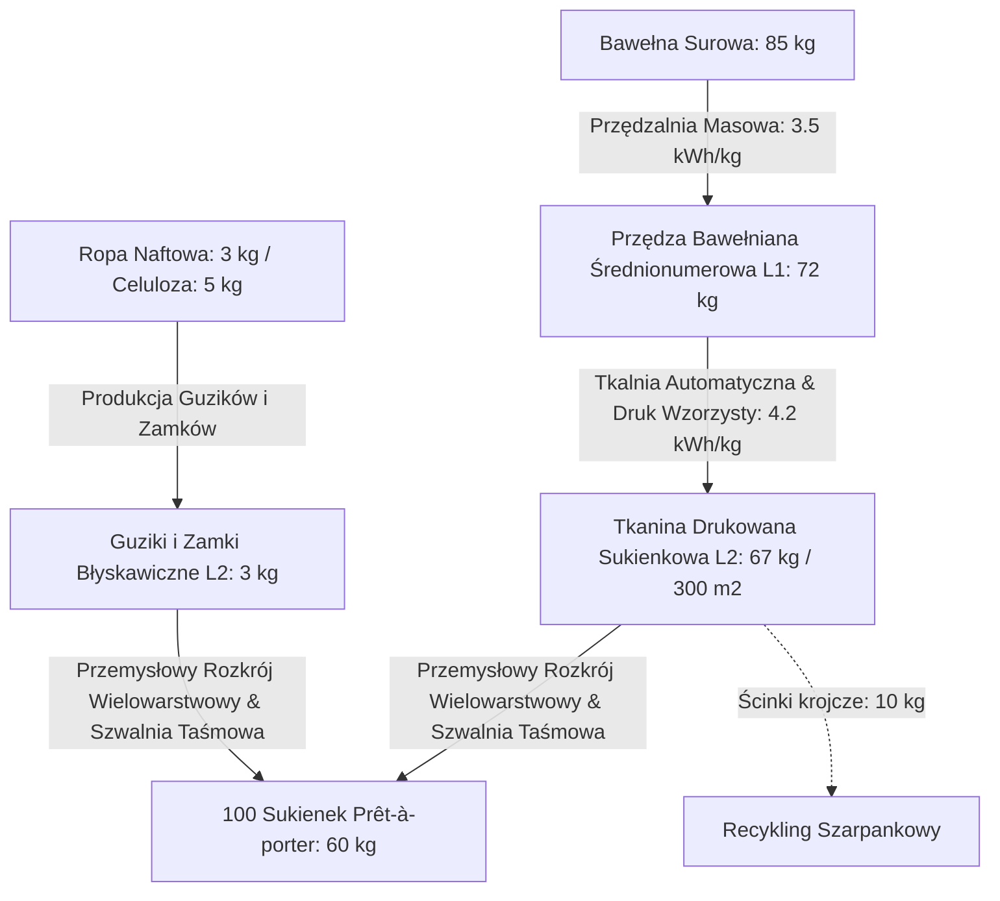

#### C. Bilans Masowo-Energetyczny Partii (100 sztuk)
| Poziom | Składnik / Proces | Wsad Masowy | Uzysk Masowy | Odpady / Ścinki | Zużycie Energii [kWh] |
| :--- | :--- | :---: | :---: | :---: | :---: |
| **Surowiec $\to$ L1** | Zgrzeblenie i przędzenie przędzy bawełnianej | 85,0 kg bawełny | 72,0 kg przędzy | 13,0 kg wyczeski | 252 kWh |
| **L1 $\to$ L2** | Tkanie perkalu i kretonu sukienkowego | 72,0 kg przędzy | 68,0 kg tkaniny surowej | 4,0 kg krajka | 230 kWh |
| **L1 $\to$ L2** | Druk rotacyjny barwnikami reaktywnymi i utrwalanie parowe | 68,0 kg tkaniny + barwniki | 67,0 kg tkaniny wykończonej | 1,0 kg płuczki | 185 kWh (ciepło suszenia) |
| **L1 $\to$ L2** | Wytop guzików i produkcja zamków | 5,0 kg surowców | 3,0 kg dodatków | 2,0 kg odpady formierskie | 25 kWh |
| **L2 $\to$ Końcowy** | Seryjny rozkrój nożem taśmowym, szwalnia potokowa | 67 kg tkaniny + 3 kg dodatków | 60,0 kg gotowych sukienek | 10,0 kg ścinki krojcze (14,9%) | 130 kWh (napęd stębnówek i overlocków) |
| **SUMA ŁAŃCUCHA** | **Pełny proces (od surowca do wyrobu)** | **90,0 kg Surowców** | **100 sztuk (60 kg)** | **30,0 kg odpadów (100% recykling)** | **822 kWh** |

#### D. Triada Wymogów Produkcyjnych
* **Ludzie**: `[R]` 85% (szwaczki linii potokowej, krojczy), `[M]` 15% (konstruktorzy szablonów odzieżowych, automatycy). Łącznie: **36 roboczogodzin / 100 szt.**
* **Energia**: **8,22 kWh / szt.**
* **Licencja**: *Masowa Standaryzacja Rozmiarów i Konfekcja (Era 2)*.
* **Wskaźnik Eko-Etyki / Cyrkularność**: Trwałość: 70/100. Odzież wyznacza standard demokratyzacji mody w Epoce 2, dając 2,5× wyższą wydajność niż krawiectwo miarowe.

---

### Produkt 10: Obuwie Gumowo-Tekstylne (Trampki / Sneakersy)
*Ewolucja w grze: Epoka 2 (Trampki Wulkanizowane) $\to$ Epoka 5 (Sneakersy Piankowe EVA/PU) $\to$ Epoka 7 (Sneakersy Biodegradowalne z Alg)*

#### A. Karta Identyfikacyjna Produktu
* **Partia Referencyjna**: 100 par klasycznych trampek gumowo-tekstylnych.
* **Masa jednostkowa gotowego wyrobu**: 0,80 kg/para (Masa partii: 80 kg).
* **Główny konsument w mieście**: Młodzież, Robotnicy `[R]`, Klasa Średnia `[M]`.

#### B. Drzewo Przepływu Technologicznego
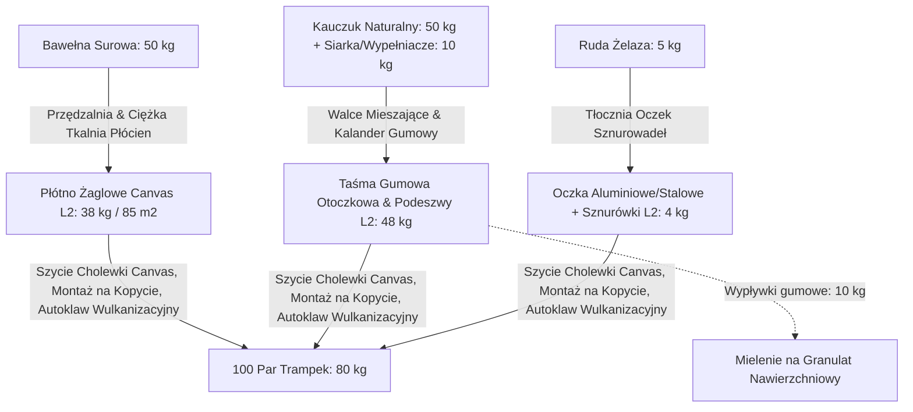

#### C. Bilans Masowo-Energetyczny Partii (100 par)
| Poziom | Składnik / Proces | Wsad Masowy | Uzysk Masowy | Odpady / Ścinki | Zużycie Energii [kWh] |
| :--- | :--- | :---: | :---: | :---: | :---: |
| **Surowiec $\to$ L1** | Przędzenie grubej przędzy bawełnianej na płótno | 50,0 kg bawełny | 42,0 kg grubej przędzy | 8,0 kg wyczeski | 145 kWh |
| **L1 $\to$ L2** | Tkanie gęstego płótna żaglowego (canvas 400 g/m²) | 42,0 kg przędzy | 38,0 kg płótna technicznego | 4,0 kg krajka | 135 kWh |
| **Surowiec $\to$ L2** | Mastikacja kauczuku na walcach i domieszkowanie siarką | 60,0 kg surowców gumowych | 55,0 kg mieszanki bieżnikowej | 5,0 kg pył i okrawki | 190 kWh (ciężkie walce) |
| **L2 $\to$ L3** | Wytłaczanie podeszew waflowych i taśmy foxing tape | 55,0 kg mieszanki | 48,0 kg podeszew i taśm | 7,0 kg ścinki surowej gumy (recykling) | 110 kWh |
| **L2 $\to$ Końcowy** | Montaż cholewki, nałożenie taśmy gumowej, wulkanizacja w autoklawie (145°C, 3 atm) | 38 kg canvas + 48 kg gumy + 4 kg dodatków | 80,0 kg gotowych trampek | 10,0 kg ścinki tkaniny i gumy | 360 kWh (para w autoklawie + prąd) |
| **SUMA ŁAŃCUCHA** | **Pełny proces (od surowca do wyrobu)** | **115,0 kg Surowców** | **100 par trampek (80 kg)** | **34,0 kg odpadów** | **940 kWh** |

#### D. Triada Wymogów Produkcyjnych
* **Ludzie**: `[R]` 80% (operatorzy pras wulkanizacyjnych, monterzy cholewek), `[M]` 20% (technolodzy elastomerów, kontrola autoklawu). Łącznie: **40 roboczogodzin / 100 par**.
* **Energia**: **9,40 kWh / para** (Wysoki udział energii cieplnej w piecach wulkanizacyjnych).
* **Licencja**: *Wulkanizacja Ciągła i Formowanie Gumy (Era 2)* $\to$ *Polimery Piankowe EVA (Era 5)*.
* **Ślad Odpadowy**: Trudny recykling wulkanizatu gumy z tkaniną w Epoce 2–4; w Epoce 6 odzysk poprzez kriogeniczne mielenie na granulat boiskowy (redukcja kar miejskich).

---

### Produkt 11: Pończochy i Odzież Nylonowa
*Wprowadzenie w grze: Epoka 3 (Rewolucja polimerów syntetycznych i petrochemii)*

#### A. Karta Identyfikacyjna Produktu
* **Partia Referencyjna**: 100 wielopaków (300 par ultracienkich rajstop/pończoch nylonowych 15–20 DEN).
* **Masa jednostkowa partii**: 0,08 kg/wielopak (Masa partii: 8,0 kg wyrobu gotowego).
* **Główny konsument w mieście**: Wszystkie klasy miejskie `[R, M, E]`.

#### B. Drzewo Przepływu Technologicznego
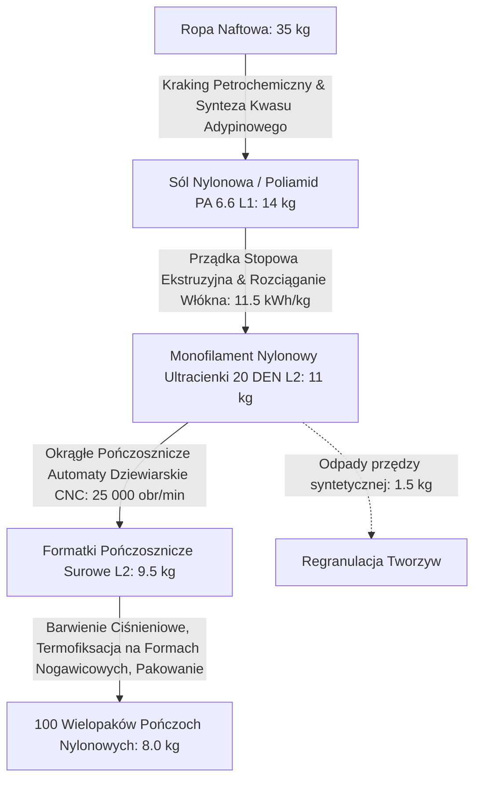

#### C. Bilans Masowo-Energetyczny Partii (100 wielopaków)
| Poziom | Składnik / Proces | Wsad Masowy | Uzysk Masowy | Odpady / Ścinki | Zużycie Energii [kWh] |
| :--- | :--- | :---: | :---: | :---: | :---: |
| **Surowiec $\to$ L1** | Kraking nafty, synteza heksametylenodiaminy i polimeryzacja | 35,0 kg ropy naftowej | 14,0 kg granulatu PA 6.6 | 21,0 kg ciężkie frakcje / gaz | 165 kWh (reaktory chemiczne) |
| **L1 $\to$ L2** | Ekstruzja przez dysze przędzalnicze (mikrootwory), chłodzenie i rozciąganie | 14,0 kg granulatu | 11,0 kg przędzy monofilamentowej | 3,0 kg zrosty i odpady głowicy | 125 kWh (grzałki + nawijarki) |
| **L2 $\to$ L3** | Szybkie dzianie na cylindrycznych maszynach pończoszniczych | 11,0 kg przędzy nylonowej | 9,5 kg surowych pończoch | 1,5 kg zaciągnięcia i ścinki | 110 kWh (precyzyjna mechanika) |
| **L3 $\to$ Końcowy** | Zszywanie palców, barwienie w bębnach i formowanie parowe (boarding) | 9,5 kg pończoch surowych + barwnik | 8,0 kg gotowych wyrobów spakowanych | 1,5 kg ścinki palcowe i odpady | 95 kWh (para termofiksacyjna) |
| **SUMA ŁAŃCUCHA** | **Pełny proces (od surowca do wyrobu)** | **35,0 kg Ropy Naftowej** | **100 wielopaków (8 kg)** | **27,0 kg odpadów (w tym 21 kg petro)** | **495 kWh** |

#### D. Triada Wymogów Produkcyjnych
* **Ludzie**: `[R]` 60% (pakowaczki, obsługa barwiarni), `[M]` 40% (mechanicy precyzyjnych maszyn dziewiarskich, technolodzy polimerów). Łącznie: **18 roboczogodzin / 100 wielopaków**.
* **Energia**: **4,95 kWh / wielopak** (lub 1,65 kWh/parę).
* **Licencja**: *Polimeryzacja Nylonu i Włókna Syntetyczne (Era 3)*.
* **Ślad Środowiskowy**: Niska trwałość (35/100 – podatność na "oczka"), generuje mikroplastik w miejskich oczyszczalniach ścieków. Obłożony opłatą ROP w późniejszych epokach.

---

### Produkt 12: Kurtki Przeciwdeszczowe i Puchowe
*Ewolucja w grze: Epoka 3 (Płaszcze Gumowane/Ortalion) $\to$ Epoka 5 (Kurtki Membranowe PTFE) $\to$ Epoka 7 (Kurtki z Membraną Biocyrkularną)*

#### A. Karta Identyfikacyjna Produktu
* **Partia Referencyjna**: 100 sztuk kurtek zimowych/przeciwdeszczowych z membraną i ociepleniem.
* **Masa jednostkowa gotowego wyrobu**: 1,20 kg/szt. (Masa partii: 120 kg).
* **Główny konsument w mieście**: Wszystkie klasy `[R, M, E]` (Konieczne przy surowych zimach i deszczach).

#### B. Drzewo Przepływu Technologicznego
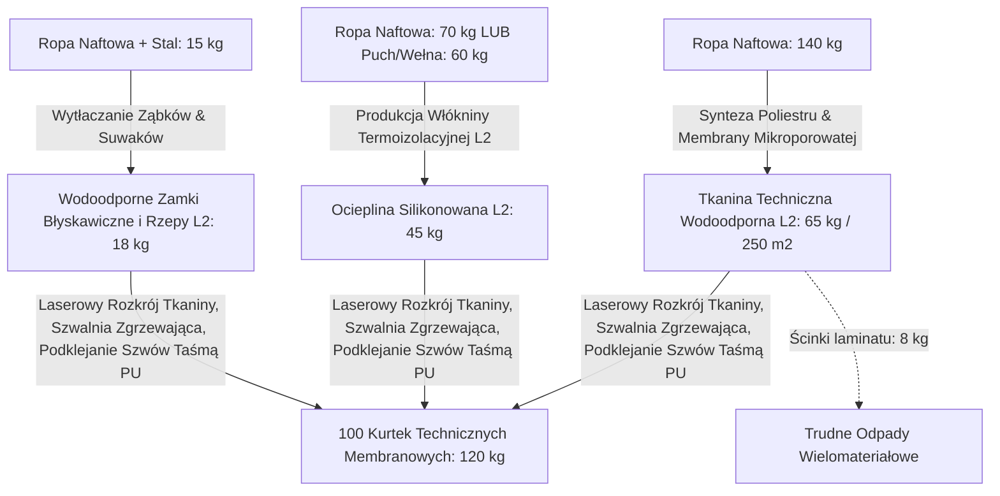

#### C. Bilans Masowo-Energetyczny Partii (100 sztuk)
| Poziom | Składnik / Proces | Wsad Masowy | Uzysk Masowy | Odpady / Ścinki | Zużycie Energii [kWh] |
| :--- | :--- | :---: | :---: | :---: | :---: |
| **Surowiec $\to$ L1** | Polimeryzacja PET i politetrafluoroetylenu (PTFE) | 140,0 kg ropy | 75,0 kg polimerów technicznych | 65,0 kg frakcje resztkowe | 420 kWh |
| **L1 $\to$ L2** | Tkanie gęstego ripstopu i laminacja membraną paroprzepuszczalną | 75,0 kg polimerów | 65,0 kg tkaniny 3-warstwowej (laminat) | 10,0 kg odpady brzegowe laminacji | 390 kWh (gorący kalander) |
| **L1 $\to$ L2** | Formowanie mikrowłókniny ocieplającej hollow-fiber | 50,0 kg poliestru | 45,0 kg puszystej ociepliny | 5,0 kg wyczeski | 145 kWh (tunele termobondingu) |
| **L1 $\to$ L2** | Produkcja wodoszczelnych zamków kostkowych i rzepów | 20,0 kg tworzywa + metal | 18,0 kg zamków (100 kompletów) | 2,0 kg odpady wtryskowe | 65 kWh |
| **L2 $\to$ Końcowy** | Rozkrój laserowy, pikowanie komór ocieplenia, podklejanie szwów gorącym powietrzem (320°C) | 65 kg tkaniny + 45 kg ociepliny + 18 kg zamków | 120,0 kg gotowych kurtek | 8,0 kg ścinki laminatu (odpad wielomateriałowy) | 480 kWh (zgrzewarki powietrzne + szwalnia) |
| **SUMA ŁAŃCUCHA** | **Pełny proces (od surowca do wyrobu)** | **225,0 kg Surowców chemicznych** | **100 kurtek (120 kg)** | **105,0 kg odpadów** | **1500 kWh** |

#### D. Triada Wymogów Produkcyjnych
* **Ludzie**: `[R]` 50% (szwaczki techniczne), `[M]` 45% (operatorzy zgrzewarek uszczelniających, technolodzy laminacji), `[E]` 5% (badania wodoszczelności i słupa wody). Łącznie: **65 roboczogodzin / 100 szt.**
* **Energia**: **15,00 kWh / szt.** (Duże zużycie energii na laminowanie i nadmuch gorącego powietrza do klejenia szwów).
* **Licencja**: *Laminowanie Tkanin i Membrany Mikroporowate (Era 3/4)*.
* **Cyrkularność**: W Epoce 4 trudny odpad; w Epoce 6 przejście na laminaty jednorodne (mono-materiał poliestrowy), co umożliwia 100% recykling chemiczny.

---

### Produkt 13: Biżuteria Klasyczna / Eko-Diamenty
*Ewolucja w grze: Epoka 2 (Złotnictwo Klasyczne) $\to$ Epoka 7 (Diamenty Laboratoryjne CVD & Urban Mining Złota)*

#### A. Karta Identyfikacyjna Produktu
* **Partia Referencyjna**: 100 pierścionków i kolii z oprawionymi kamieniami szlachetnymi.
* **Masa jednostkowa partii**: 0,025 kg/szt. (Masa partii: 2,5 kg wyrobu gotowego).
* **Główny konsument w mieście**: Elita `[E]` oraz Klasa Średnia `[M]` (Dobra luksusowe najwyższego rzędu).

#### B. Drzewo Przepływu Technologicznego
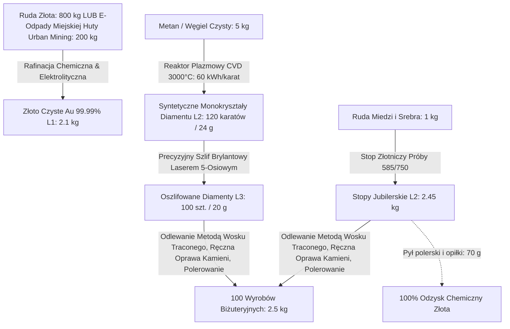

#### C. Bilans Masowo-Energetyczny Partii (100 sztuk)
| Poziom | Składnik / Proces | Wsad Masowy | Uzysk Masowy | Odpady / Ścinki | Zużycie Energii [kWh] |
| :--- | :--- | :---: | :---: | :---: | :---: |
| **Surowiec $\to$ L1** | Wydobycie i rafinacja złota (lub odzysk z płytek drukowanych PCB) | 200 kg e-odpadów / 800 kg rudy | 2,10 kg czystego złota | 197,9 kg skała płonna / zużyte PCB | 650 kWh |
| **Surowiec $\to$ L2** | Synteza diamentów w komorze plazmowej CVD (metan + wodór, mikrofale) | 5,0 kg węgla/gazu | 24,0 g diamentu surowego (120 ct) | 4,97 kg nieskrystalizowany gaz | 1440 kWh (reaktor plazmowy 24/7) |
| **L2 $\to$ L3** | Laserowe cięcie i szlifowanie fasetek brylantu (57 fasetek) | 24,0 g surowego diamentu | 20,0 g oszlifowanych brylantów (100 ct) | 4,0 g pył diamentowy (ścierniwo) | 85 kWh |
| **L1 $\to$ L2** | Przygotowanie stopu złota (próba 585: 58,5% Au, Cu, Ag) | 2,1 kg Au + 0,42 kg Cu/Ag | 2,52 kg granulatu jubilerskiego | 0,0 kg brak strat | 35 kWh |
| **L2/L3 $\to$ Końcowy** | Druk modeli 3D z żywicy, odlew w gipsie, czyszczenie, oprawa kamieni | 2,52 kg stopu + 20 g kamieni | 2,50 kg gotowej biżuterii | 40 g pył polerski (100% odzysku) | 180 kWh (piec odlewniczy, polerki) |
| **SUMA ŁAŃCUCHA** | **Pełny proces (od surowca do wyrobu)** | **206 kg Surowców i e-odpadów** | **100 sztuk biżuterii (2,5 kg)** | **Odpady metaliczne = 0% straty netto** | **2390 kWh** |

#### D. Triada Wymogów Produkcyjnych
* **Ludzie**: `[R]` 0%, `[M]` 60% (jubilerzy odlewnicy, grawerzy), `[E]` 40% (inżynierowie reaktorów plazmowych CVD, gemmolodzy, faseterzy laserowi). Łącznie: **80 roboczogodzin / 100 szt.**
* **Energia**: **23,90 kWh / szt.** (Bardzo wysoka energochłonność reaktora CVD, ale rekompensowana zerową emisją CO2 przy zasilaniu z OZE).
* **Licencja**: *Złotnictwo i Jubilerstwo Klasyczne (Era 2)* $\to$ *Plazmowa Synteza Diamentów CVD i Urban Mining (Era 7)*.
* **Wskaźnik Eko-Etyki**: W Epoce 2: niska etyka (trudne warunki kopalń złota w koloniach). W Epoce 7: Eko-Etyka 98/100 (złoto w 100% z recyklingu elektroniki, diamenty bezkonfliktowe z laboratorium).

---

### Produkt 14: Okulary Korekcyjne i Przeciwsłoneczne
*Wprowadzenie w grze: Epoka 3 (Optyka Okularowa i Tworzywa Termoplastyczne)*

#### A. Karta Identyfikacyjna Produktu
* **Partia Referencyjna**: 100 sztuk kompletnych okularów (oprawa z octanu celulozy/metalu + 2 soczewki korekcyjne/przeciwsłoneczne z powłoką antyrefleksyjną).
* **Masa jednostkowa gotowego wyrobu**: 0,045 kg/szt. (Masa partii: 4,5 kg).
* **Główny konsument w mieście**: Wszystkie klasy `[R, M, E]` (Wzrost popytu wraz z rozwojem edukacji, uniwersytetów i pracy biurowej).

#### B. Drzewo Przepływu Technologicznego
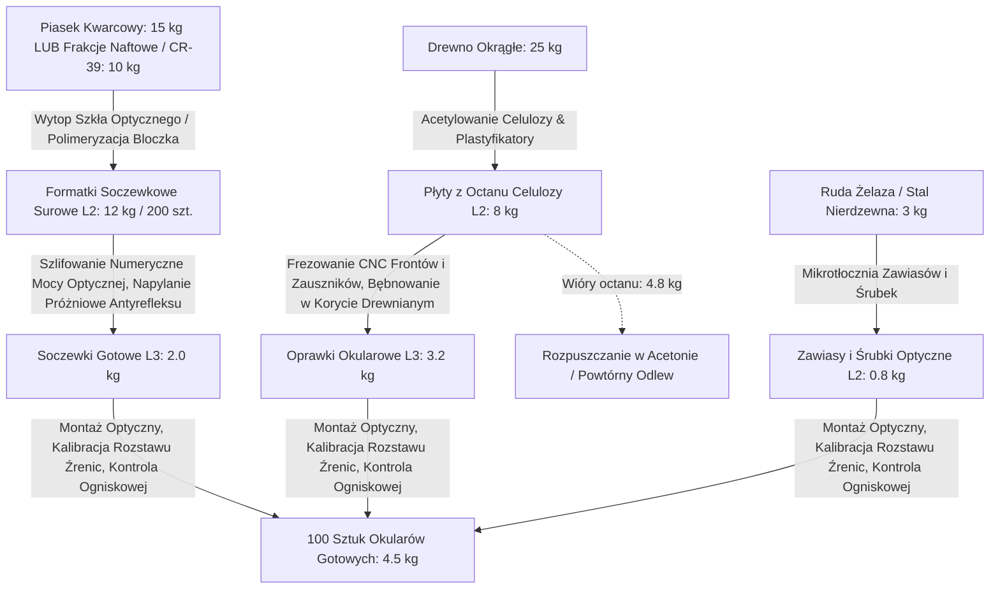

#### C. Bilans Masowo-Energetyczny Partii (100 sztuk)
| Poziom | Składnik / Proces | Wsad Masowy | Uzysk Masowy | Odpady / Ścinki | Zużycie Energii [kWh] |
| :--- | :--- | :---: | :---: | :---: | :---: |
| **Surowiec $\to$ L1** | Ekstrakcja celulozy z drewna i estryfikacja kwasem octowym | 25,0 kg drewna | 10,0 kg octanu celulozy | 15,0 kg lignina i kora | 85 kWh |
| **L1 $\to$ L2** | Prasowanie bloków octanowych i cięcie na płyty (wzór szylkretowy) | 10,0 kg octanu | 8,0 kg płyt oprawkowych | 2,0 kg odpady brzegowe | 60 kWh |
| **Surowiec $\to$ L2** | Odlew krążków optycznych z polimeru CR-39 lub kwarcu | 10,0 kg monomeru | 12,0 kg soczewek wstępnych | 0,5 kg wlewki | 95 kWh (polimeryzacja UV/termiczna) |
| **L2 $\to$ L3** | 5-osiowe frezowanie oprawek i polerowanie w bębnach z wiórkami orzecha | 8,0 kg płyt octanu | 3,2 kg gotowych frontów i zauszników | 4,8 kg wióry octanu (do regeneracji) | 110 kWh |
| **L2 $\to$ L3** | Generatorowe szlifowanie krzywizn soczewek i napylanie próżniowe PVD | 12,0 kg krążków | 2,0 kg gotowych soczewek (200 szt.) | 10,0 kg szlam szlifierski | 240 kWh (komora wysokiej próżni PVD) |
| **L3 $\to$ Końcowy** | Montaż soczewek w oprawie (na gorąco), wkręcanie zawiasów, justowanie | 3,2 kg opraw + 2 kg soczewek + 0,8 kg śrubki | 4,5 kg okularów | 1,5 kg straty montażowe i wadliwe | 45 kWh |
| **SUMA ŁAŃCUCHA** | **Pełny proces (od surowca do wyrobu)** | **38,0 kg Surowców** | **100 sztuk okularów (4,5 kg)** | **33,5 kg (wióry octanu zawracane)** | **635 kWh** |

#### D. Triada Wymogów Produkcyjnych
* **Ludzie**: `[R]` 20% (polerowanie wstępne, pakowanie), `[M]` 70% (optycy okularowi, operatorzy maszyn PVD i szlifierek diamentowych), `[E]` 10% (obliczenia optyczne, kontrola aberracji). Łącznie: **42 roboczogodziny / 100 szt.**
* **Energia**: **6,35 kWh / szt.**
* **Licencja**: *Szlifowanie Soczewek Precyzyjnych i Optyka Korekcyjna (Era 3)*.
* **Cyrkularność**: Wysoka naprawialność u miejskiego **Optyka / Serwisanta** (wymiana samych szkieł przy zachowaniu oprawki redukuje koszt konsumenta o 50% i generuje znikomy odpad).

---

### Produkt 15: Tanie Koszulki Fast Fashion
*Wprowadzenie w grze: Epoka 4 (Ekspansja petrochemicznej szybkiej mody) $\to$ **[Drastycznie opodatkowane i wypierane w Epoce 7 przez prawo o cyrkularności]***

#### A. Karta Identyfikacyjna Produktu
* **Partia Referencyjna**: 100 sztuk ultratanich t-shirtów poliestrowych z nadrukiem sitodrukowym/plastizolowym.
* **Masa jednostkowa gotowego wyrobu**: 0,16 kg/szt. (Masa partii: 16 kg).
* **Główny konsument w mieście**: Robotnicy `[R]` i uboższa część Klasy Średniej `[M]` (Niska cena, ale obniża wskaźnik Eko-Etyki korporacji).

#### B. Drzewo Przepływu Technologicznego
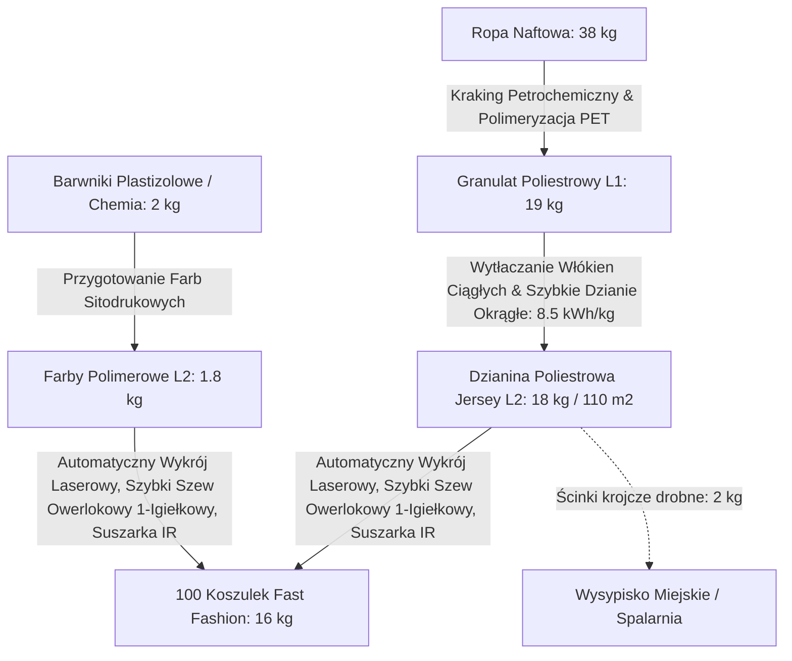

#### C. Bilans Masowo-Energetyczny Partii (100 sztuk)
| Poziom | Składnik / Proces | Wsad Masowy | Uzysk Masowy | Odpady / Ścinki | Zużycie Energii [kWh] |
| :--- | :--- | :---: | :---: | :---: | :---: |
| **Surowiec $\to$ L1** | Synteza tereftalanu dimetylu i glikolu etylenowego | 38,0 kg ropy | 19,0 kg granulatu PET | 19,0 kg gazy krakingowe i smoła | 120 kWh |
| **L1 $\to$ L2** | Przędzenie ze stopu i dzianie dzianiny jednołożyskowej jersey | 19,0 kg granulatu | 18,0 kg dzianiny surowej | 1,0 kg odpady przędzalnicze | 95 kWh |
| **L1 $\to$ L2** | Bielenie optyczne i pranie bez detergentów ekologicznych | 18,0 kg dzianiny | 18,0 kg dzianiny białej | 0 kg (ścieki chemiczne z ChZT) | 65 kWh (gorąca kąpiel) |
| **L2 $\to$ Końcowy** | Szybki rozkrój matrycowy, maszynowe zszywanie overlockiem bez ryglowania | 18,0 kg dzianiny + nici | 15,2 kg uszytych koszulek | 2,8 kg ścinki krojcze (brak recyklingu) | 45 kWh (linie zautomatyzowane) |
| **Końcowy** | Druk plastizolowy (PVC) i tunel wygrzewający na podczerwień (160°C) | 15,2 kg koszulek + 1,8 kg farb | 16,0 kg koszulek gotowych | 1,0 kg zużyte matryce i zmywacze | 55 kWh (promienniki IR) |
| **SUMA ŁAŃCUCHA** | **Pełny proces (od surowca do wyrobu)** | **40,0 kg Surowców petrochemicznych** | **100 koszulek Fast Fashion (16 kg)** | **24,0 kg odpadów (trudno biodegradowalne)** | **380 kWh** |

#### D. Triada Wymogów Produkcyjnych
* **Ludzie**: `[R]` 95% (tania siła robocza na akord), `[M]` 5% (nadzór linii). Łącznie: **12 roboczogodzin / 100 szt.** (Bardzo wysoki wyzysk pracy w Epoce 4).
* **Energia**: **3,80 kWh / szt.**
* **Licencja**: *Masowa Produkcja Szybkiej Mody i Dziewiarstwo Syntetyczne (Era 4)*.
* **Wskaźnik Eko-Etyki i Kary**: Trwałość dramatycznie niska: 30/100 (rozciąganie szwów po 3 praniach). W Epoce 6–8 produkt obłożony podatkiem od plastiku i karą za ślad odpadowy; w Epoce 7 wypierany przez koszulki rPET i bio-bawełnę.

---

### Produkt 16: Odzież Sportowa i Termoaktywna
*Wprowadzenie w grze: Epoka 5 (Era Funkcjonalnych Tekstyliów i Membran Aktywnych)*

#### A. Karta Identyfikacyjna Produktu
* **Partia Referencyjna**: 100 kompletów termoaktywnych (koszulka kompresyjna z długim rękawem + legginsy sportowe z panelami wentylacyjnymi).
* **Masa jednostkowa gotowego wyrobu**: 0,40 kg/kpl. (Masa partii: 40 kg).
* **Główny konsument w mieście**: Wszystkie klasy `[R, M, E]` (Popyt powiązany ze zdrowiem, sportem i rekreacją).

#### B. Drzewo Przepływu Technologicznego
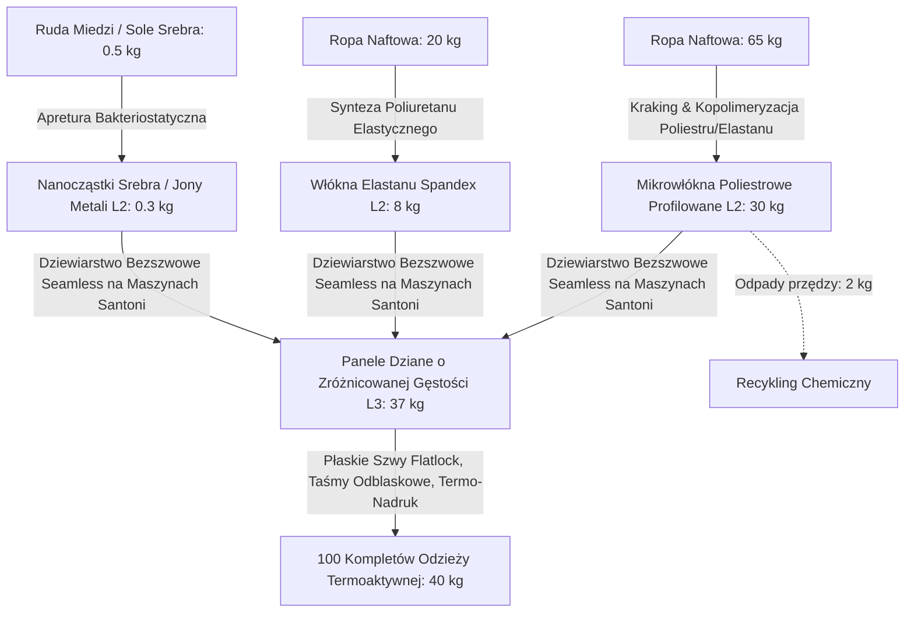

#### C. Bilans Masowo-Energetyczny Partii (100 kompletów)
| Poziom | Składnik / Proces | Wsad Masowy | Uzysk Masowy | Odpady / Ścinki | Zużycie Energii [kWh] |
| :--- | :--- | :---: | :---: | :---: | :---: |
| **Surowiec $\to$ L1** | Polimeryzacja politereftalanu etylenu i poliuretanu segmentowego | 85,0 kg ropy | 42,0 kg granulatów polimerowych | 43,0 kg frakcje gazowe/olejowe | 310 kWh |
| **L1 $\to$ L2** | Przędzenie mikrowłókien o przekroju 4-kanałowym (Coolmax) | 42,0 kg granulatu | 38,0 kg przędzy funkcyjnej (85% PES, 15% Elastan) | 4,0 kg zrosty stopowe | 240 kWh |
| **L2 $\to$ L3** | Bezszwowe dzianie cylindryczne (mapowanie stref potu) | 38,0 kg przędzy | 36,0 kg formatek seamless | 2,0 kg odcięte krajki | 210 kWh (maszyny wielosystemowe) |
| **L2 $\to$ L3** | Impregnacja jonami srebra (przeciwzapachowa) w autoklawie | 36,0 kg formatek + 0,3 kg jonów | 36,2 kg dzianiny bakteriostatycznej | 0,1 kg osad | 85 kWh (ciepło suszenia) |
| **L3 $\to$ Końcowy** | Łączenie płaskim szwem 4-igłowym (flatlock), wgrzewanie taśm elastycznych | 36,2 kg dzianiny + 4 kg taśmy/nici | 40,0 kg gotowych kompletów | 0,2 kg ścinki nici | 95 kWh |
| **SUMA ŁAŃCUCHA** | **Pełny proces (od surowca do wyrobu)** | **85,5 kg Surowców** | **100 kompletów (40 kg)** | **45,5 kg odpadów** | **940 kWh** |

#### D. Triada Wymogów Produkcyjnych
* **Ludzie**: `[R]` 40% (szwaczki maszyn flatlock), `[M]` 50% (programiści maszyn dziewiarskich bezszwowych, technolodzy włókien), `[E]` 10% (biomechanicy sportu, inżynierowie termodynamiki ciała). Łącznie: **28 roboczogodzin / 100 kpl.**
* **Energia**: **9,40 kWh / komplet**.
* **Licencja**: *Włókna Funkcjonalne i Dziewiarstwo Bezszwowe Seamless (Era 5)*.
* **Wskaźnik Eko-Etyki**: Trwałość: 80/100. Odzież podnosi poziom zadowolenia i zdrowia obywateli w mieście o +5%.

---

### Produkt 17: Walizki i Plecaki Podróżne
*Wprowadzenie w grze: Epoka 4 (Masowa turystyka i mobilność globalna)*

#### A. Karta Identyfikacyjna Produktu
* **Partia Referencyjna**: 100 sztuk (50 walizek kabinowych z poliwęglanu na kółkach + 50 plecaków trekkingowych z Cordury).
* **Masa jednostkowa średnia**: 2,60 kg/szt. (Masa partii: 260 kg).
* **Główny konsument w mieście**: Klasa Średnia `[M]` i Elita `[E]` (Konieczne do podróży między miastami na mapie świata).

#### B. Drzewo Przepływu Technologicznego
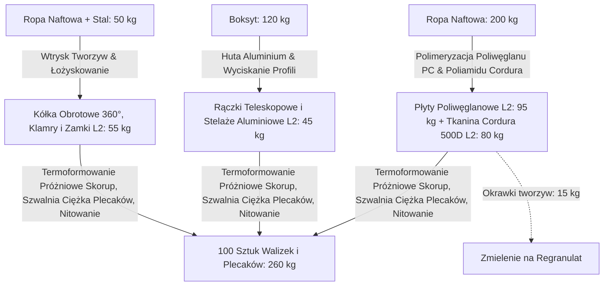

#### C. Bilans Masowo-Energetyczny Partii (100 sztuk)
| Poziom | Składnik / Proces | Wsad Masowy | Uzysk Masowy | Odpady / Ścinki | Zużycie Energii [kWh] |
| :--- | :--- | :---: | :---: | :---: | :---: |
| **Surowiec $\to$ L1** | Synteza poliwęglanu (bisfenol A + fosgen) i poliamidu 6.6 | 200,0 kg ropy | 185,0 kg tworzyw technicznych | 15,0 kg frakcje odpadowe | 620 kWh |
| **Surowiec $\to$ L2** | Elektroliza aluminium i wyciskanie rurek na stelaże | 120,0 kg boksytu | 45,0 kg profili aluminiowych | 75,0 kg czerwony szlam | 630 kWh (huta aluminium) |
| **L1 $\to$ L2** | Termoformowanie próżniowe skorup walizkowych (220°C) | 105,0 kg płyt PC | 90,0 kg skorup (100 połówek) | 15,0 kg okrawki brzegowe (regranulat) | 280 kWh (promienniki kwarcowe) |
| **L1 $\to$ L2** | Tkanie gęstej Cordury i powlekanie poliuretanem | 85,0 kg poliamidu | 80,0 kg tkaniny plecakowej | 5,0 kg ścinki | 210 kWh |
| **L2 $\to$ Końcowy** | Wtrysk kółek z poliuretanu, łożyskowanie, montaż zamków i nitowanie stelaży | Skorupy + Cordura + Alum + Akcesoria | 260,0 kg wyrobów gotowych | 15,0 kg ścinki tkaniny i wióry | 340 kWh (wtryskarki i montaż) |
| **SUMA ŁAŃCUCHA** | **Pełny proces (od surowca do wyrobu)** | **370,0 kg Surowców bazowych** | **100 sztuk bagażu (260 kg)** | **110,0 kg (w tym 75 kg szlam boksytowy)** | **2080 kWh** |

#### D. Triada Wymogów Produkcyjnych
* **Ludzie**: `[R]` 70% (operatorzy termoformierek, szwacze kaletnictwa ciężkiego), `[M]` 30% (konstruktorzy ergonomii stelaży, automatycy linii nitowania). Łącznie: **50 roboczogodzin / 100 szt.**
* **Energia**: **20,80 kWh / szt.** (Wysokie zużycie energii hutniczej na stelaże aluminiowe).
* **Licencja**: *Formowanie Termoplastyczne i Polimery Konstrukcyjne (Era 4)*.
* **Cyrkularność / Rola Serwisantów**: Trwałość: 85/100. Modułowe kółka i teleskopy naprawiane u miejskiego **Serwisanta** wydłużają czas eksploatacji walizki z 5 do 15 lat.

---

### Produkt 18: Odzież z Włókien Recyklingowanych rPET
*Wprowadzenie w grze: Epoka 6 (Cyrkularna Odpowiedzialność Ekologiczna)*

#### A. Karta Identyfikacyjna Produktu
* **Partia Referencyjna**: 100 sztuk bluz polarowych i kurtek z polaru rPET (100% poliester z recyklingu miejskich butelek plastikowych).
* **Masa jednostkowa gotowego wyrobu**: 0,55 kg/szt. (Masa partii: 55 kg).
* **Główny konsument w mieście**: Wszystkie klasy `[R, M, E]` (Generuje wysokie punkty Eko-Etyki i zadowolenie pro-ekologiczne).

#### B. Drzewo Przepływu Technologicznego
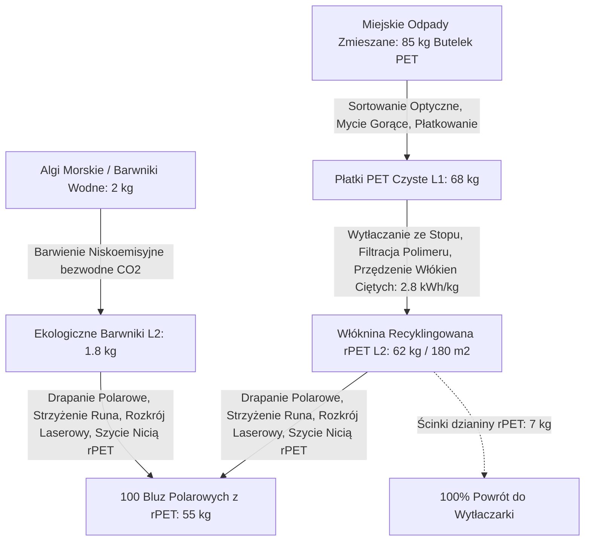

#### C. Bilans Masowo-Energetyczny Partii (100 sztuk)
| Poziom | Składnik / Proces | Wsad Masowy | Uzysk Masowy | Odpady / Ścinki | Zużycie Energii [kWh] |
| :--- | :--- | :---: | :---: | :---: | :---: |
| **Surowiec $\to$ L1** | Zbiórka odpadów butelkowych, mycie w ługu sodowym i płatkowanie | 85,0 kg butelek PET | 68,0 kg czystych płatków | 17,0 kg etykiety, korki PE, brud | 95 kWh |
| **L1 $\to$ L2** | Regranulacja, suszenie próżniowe i ekstruzja mikrowłókien rPET | 68,0 kg płatków | 62,0 kg przędzy ciętej rPET | 6,0 kg zanieczyszczenia polimeru na filtrach | 155 kWh (oszczędność 65% vs ropa) |
| **L2 $\to$ L3** | Dzianie dzianiny polarowej (fleece) i obustronne drapanie igłowe | 62,0 kg przędzy | 60,0 kg dzianiny surowej | 2,0 kg pył włókienniczy | 110 kWh |
| **L3 $\to$ L3** | Barwienie w nadkrytycznym dwutlenku węgla (scCO2 – zero ścieków wodnych) | 60,0 kg dzianiny + barwnik | 60,0 kg barwionego polaru | 0 kg (zamknięty obieg CO2) | 75 kWh (kompresja CO2) |
| **L3 $\to$ Końcowy** | Rozkrój optymalizowany algorytmem AI, szycie nićmi z przetopionego rPET | 60,0 kg polaru + 2 kg zamki rPET | 55,0 kg gotowych bluz | 7,0 kg ścinki (100% regranulacja) | 85 kWh |
| **SUMA ŁAŃCUCHA** | **Pełny proces (z odpadów miejskich do wyrobu)** | **85,0 kg Odpadów Plastikowych** | **100 bluz rPET (55 kg)** | **17 kg śmieci pierwotnych + 7 kg ścinek w obiegu** | **520 kWh** |

#### D. Triada Wymogów Produkcyjnych
* **Ludzie**: `[R]` 40% (obsługa sortowników i linii myjących), `[M]` 50% (operatorzy wytłaczarek i maszyn drapakowych), `[E]` 10% (analitycy czystości polimerów z recyklingu). Łącznie: **24 roboczogodziny / 100 szt.**
* **Energia**: **5,20 kWh / szt.** (O **65% mniej energii** niż przy użyciu pierwotnej ropy naftowej!).
* **Licencja**: *Mechaniczny i Chemiczny Recykling Włókien (Era 6)*.
* **Wskaźnik Eko-Etyki**: 94/100. Odciąża miejskie wysypisko o 85 kg plastiku na partię, generując ulgi w podatku ekologicznym korporacji.

---

### Produkt 19: Odzież Modułowa i Samonaprawiająca z Biowłókien
*Wprowadzenie w grze: Epoka 7 (Biomimetyka i Zamknięty Obieg Materiałowy)*

#### A. Karta Identyfikacyjna Produktu
* **Partia Referencyjna**: 100 kompletów odzieży modułowej (kurtka modułowa z odpinanymi rękawami i panelami termicznymi, wykonana z biopolimerów samoleczących mikrouszkodzenia).
* **Masa jednostkowa gotowego wyrobu**: 0,90 kg/kpl. (Masa partii: 90 kg).
* **Główny konsument w mieście**: Wszystkie klasy miejskie `[R, M, E]` (Szczególnie pożądana przez Eko-Świadomych obywateli).

#### B. Drzewo Przepływu Technologicznego
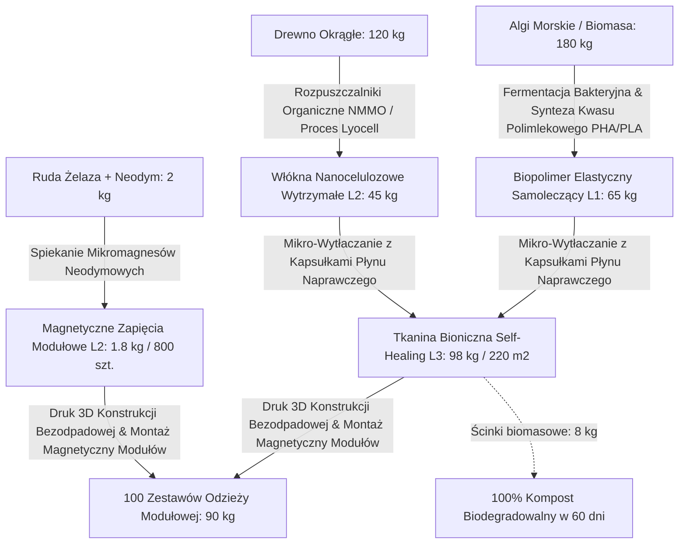

#### C. Bilans Masowo-Energetyczny Partii (100 kompletów)
| Poziom | Składnik / Proces | Wsad Masowy | Uzysk Masowy | Odpady / Ścinki | Zużycie Energii [kWh] |
| :--- | :--- | :---: | :---: | :---: | :---: |
| **Surowiec $\to$ L1** | Bioreaktor: fermentacja alg przez bakterie syntetyzujące polihydroksyalkaniany (PHA) | 180,0 kg alg mokrych | 65,0 kg biopolimeru czystego | 115,0 kg woda i biomasa pofermentacyjna (nawóz) | 180 kWh (mieszanie i napowietrzanie) |
| **Surowiec $\to$ L2** | Nietoksyczne roztwarzanie celulozy i przędzenie nanowłókien (Tencel/Lyocell) | 120,0 kg drewna | 45,0 kg nanowłókien celulozowych | 75,0 kg lignina (paliwo OZE) | 160 kWh (zamknięty obieg rozpuszczalnika 99,5%) |
| **Surowiec $\to$ L2** | Produkcja hermetycznych zapięć magnetycznych neodymowych | 2,0 kg stopu neodym-żelazo | 1,8 kg magnesów płaskich | 0,2 kg zgary szlifierskie | 45 kWh |
| **L1/L2 $\to$ L3** | Przędzenie hybrydowe z nanokapsułkami oleju roślinnego (reakcja na tlen naprawia rozcięcia) | 65 kg PHA + 45 kg celulozy | 98,0 kg bionicznej tkaniny samonaprawiającej | 12,0 kg odpady technologiczne | 195 kWh |
| **L3 $\to$ Końcowy** | Druk bezszwowy 3D i montaż magnetycznych konektorów modułowych | 98 kg tkaniny + 1,8 kg magnesów | 90,0 kg gotowej odzieży modułowej | 9,8 kg biokompostowalne ścinki (100% rozkład) | 140 kWh |
| **SUMA ŁAŃCUCHA** | **Pełny proces (od alg i drewna do wyrobu)** | **302,0 kg Odnawialnej Biomasy** | **100 kpl. Modułowych (90 kg)** | **199,8 kg (w 100% powracające do gleby)** | **720 kWh** |

#### D. Triada Wymogów Produkcyjnych
* **Ludzie**: `[R]` 10% (nadzór podajników), `[M]` 45% (programiści druku 3D odzieży), `[E]` 45% (biolodzy syntetyczni, inżynierowie materiałowi). Łącznie: **22 roboczogodziny / 100 kpl.**
* **Energia**: **7,20 kWh / komplet** (Zasilanie w 100% z miejskiego miksu OZE).
* **Licencja**: *Ekoprojektowanie Biomimetyczne i Biopolimery PHA (Era 7)*.
* **Cyrkularność**: Trwałość: 95/100 (Włókna po przecięciu samoczynnie łączą się pod wpływem ciepła ciała). Zużyty produkt po zakończeniu eksploatacji ulega biodegradacji w kompoście przydomowym w 90 dni, nie pozostawiając mikroplastiku.

---

### Produkt 20: Inteligentna Odzież Klimatyzowana (Smart-Textiles)
*Wprowadzenie w grze: Epoka 8 (Bionika, Nanotechnologia i Integracja Cyber-Fizyczna)*

#### A. Karta Identyfikacyjna Produktu
* **Partia Referencyjna**: 100 sztuk kombinezonów mikroklimatycznych Smart-Textiles (odzież ze zintegrowanymi elastycznymi ogniwami Peltiera chłodząco-grzewczymi, siecią bioczujników i mikrobaterią grafenową).
* **Masa jednostkowa gotowego wyrobu**: 1,10 kg/szt. (Masa partii: 110 kg).
* **Główny konsument w mieście**: Elita `[E]` oraz pracownicy stref ekstremalnych i służb ratunkowych.

#### B. Drzewo Przepływu Technologicznego
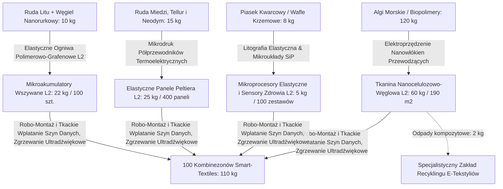

#### C. Bilans Masowo-Energetyczny Partii (100 kombinezonów)
| Poziom | Składnik / Proces | Wsad Masowy | Uzysk Masowy | Odpady / Ścinki | Zużycie Energii [kWh] |
| :--- | :--- | :---: | :---: | :---: | :---: |
| **Surowiec $\to$ L1** | Piroliza biomasy do nanorurek węglowych i grafenu | 120,0 kg alg/drewna | 62,0 kg kompozytu przewodzącego | 58,0 kg gazy syntezowe | 320 kWh |
| **Surowiec $\to$ L2** | Bezinwazyjna litografia elastyczna procesorów sterujących mikroklimatem | 8,0 kg kwarcu/krzemu | 5,0 kg cienkowarstwowych procesorów | 3,0 kg odpady chemiczne | 480 kWh (cleanroom klasa 10) |
| **Surowiec $\to$ L2** | Druk nanostrukturalnych modułów termoelektrycznych (efekt Peltiera) | 15,0 kg rzadkich metali | 25,0 kg paneli z folią termiczną | 2,0 kg zgary metaliczne | 360 kWh |
| **Surowiec $\to$ L2** | Produkcja zginanych baterii litowo-grafenowych w żelu | 10,0 kg litu i węgla | 22,0 kg bezpiecznych baterii wszywanych | 0,5 kg odpady elektrodowe | 210 kWh |
| **L2 $\to$ Końcowy** | Zrobotyzowane tkanie hybrydowe (wplatanie włókien przewodzących w osnowę), montaż próżniowy | 60 kg tkaniny + 5 kg chipy + 25 kg panele + 22 kg baterie | 110,0 kg gotowych kombinezonów | 2,0 kg ścinki wielokomponentowe | 580 kWh (roboty montażowe, laser) |
| **SUMA ŁAŃCUCHA** | **Pełny proces (od surowców high-tech do wyrobu)** | **153,0 kg Surowców zaawansowanych** | **100 kombinezonów (110 kg)** | **63,5 kg (w tym odpady krzemowe i chemiczne)** | **1950 kWh** |

#### D. Triada Wymogów Produkcyjnych
* **Ludzie**: `[R]` 0% (całkowita automatyzacja montażu), `[M]` 20% (technicy kalibracji mechatronicznej), `[E]` 80% (inżynierowie nanotechnologii, elektronicy odzieży, neuro-programiści). Łącznie: **30 roboczogodzin / 100 szt.**
* **Energia**: **19,50 kWh / kombinezon**.
* **Licencja**: *Elektronika Ubieralna i Mikroklimatyzacja Osobista (Era 8)*.
* **Wskaźnik Eko-Etyki i Recykling**: Trwałość: 98/100. Odzież autonomicznie chroni zdrowie obywatela przed falami upałów (+45°C) i mrozów (-30°C). Po zużyciu wymaga miejskiego **Zakładu Recyklingu E-Odpadów (Urban Mining)** w celu odzysku litu, neodymu i telluru.

---

## 4. Zbiorcza Matryca Inżynieryjna i Bilansowa Branży 2

Poniższa tabela stanowi bazę danych parametrów produkcyjnych dla silnika gry (Core Simulation Engine):

| # | Nazwa Produktu | Epoka Wprowadzenia | Wsad Surowcowy (na 1 szt.) | Półprodukty Kluczowe L1 & L2/L3 | Masa Gotowa [kg] | Energia Total [kWh/szt.] | Ludzie [R/M/E] | Wymagana Licencja Badawcza | Trwałość [0-100] |
| :-: | :--- | :-: | :--- | :--- | :-: | :-: | :-: | :--- | :-: |
| **1** | Odzież Robocza z Drelichu | Epoka 1 | 1,80 kg Bawełna + 0,1 kg Ruda Fe | Przędza Bawełniana, Drelich, Nity Stalowe | 1,40 | 15,16 | `[R]` 85% / `[M]` 15% | Tkalnictwo Mechaniczne | 85 |
| **2** | Koszule Bawełniane i Bielizna | Epoka 1 | 0,63 kg Bawełna | Przędza Czesana, Batyst/Popelina, Guziki | 0,45 | 6,41 | `[R]` 90% / `[M]` 10% | Konfekcja Masowa | 65 |
| **3** | Płaszcze i Garnitury Wełniane | Epoka 1 | 5,50 kg Wełna + 0,75 kg Bawełna | Przędza Wełniana, Sukno Czesankowe, Podszewka | 3,20 | 33,35 | `[R]` 40% / `[M]` 55% / `[E]` 5% | Krawiectwo Garniturowe | 92 |
| **4** | Suknie Tradycyjne i Gorsety | Epoka 1 *(Wygasa E2)* | 2,75 kg Bawełna + 0,6 kg Ruda Fe | Płótno Gęste, Fiszbiny Stalowe, Koronki | 2,80 | 20,10 | `[R]` 30% / `[M]` 70% | Gorseciarstwo Wiktoriańskie | 75 |
| **5** | Trzewiki i Buty Skórzane | Epoka 1 | 2,10 kg Skóra + 0,55 kg Kauczuk | Skóra Wyprawiona, Podeszwa Gumowa, Nici | 1,30 | 13,20 | `[R]` 70% / `[M]` 30% | Szewstwo Przemysłowe | 80 |
| **6** | Kapelusze Filcowe | Epoka 1 *(Wygasa E4)* | 0,55 kg Wełna + 0,08 kg Bawełna | Runo Filcowe, Stożki Filcowe, Taśma Rypsowa | 0,22 | 3,70 | `[R]` 65% / `[M]` 35% | Filcowanie Przemysłowe | 70 |
| **7** | Zegarki Kieszonkowe / Mech. | Epoka 1 | 0,18 kg Stal + 0,12 kg Mosiądz + Au | Mechanizm Zębaty, Sprężyny, Szkiełko, Koperta | 0,11 | 7,55 | `[M]` 75% / `[E]` 25% | Mechanika Precyzyjna | 99 |
| **8** | Torby, Paski i Galanteria | Epoka 1 | 1,60 kg Skóra + 0,17 kg Miedź/Zn | Skóra Juchtowa, Okucia Mosiężne, Drelich | 0,95 | 8,70 | `[R]` 50% / `[M]` 50% | Galanteria Skórzana | 85 |
| **9** | Sukienki Prêt-à-porter | Epoka 2 | 0,85 kg Bawełna | Przędza Bawełniana, Tkanina Perkalowa Druk | 0,60 | 8,22 | `[R]` 85% / `[M]` 15% | Standaryzacja Rozmiarów | 70 |
| **10** | Obuwie Gumowo-Tekstylne | Epoka 2 | 0,50 kg Bawełna + 0,60 kg Kauczuk | Płótno Canvas, Podeszwy Wulkanizowane | 0,80 | 9,40 | `[R]` 80% / `[M]` 20% | Wulkanizacja Ciągła | 60 |
| **11** | Pończochy i Odzież Nylonowa | Epoka 3 | 0,35 kg Ropa Naftowa | Poliamid PA 6.6, Monofilament Nylon 20 DEN | 0,08 | 4,95 | `[R]` 60% / `[M]` 40% | Polimeryzacja Nylonu | 35 |
| **12** | Kurtki Przeciwdeszczowe/Puch | Epoka 3 | 2,10 kg Ropa Naftowa | Tkanina Ripstop, Membrana PTFE, Ocieplina | 1,20 | 15,00 | `[R]` 50% / `[M]` 45% / `[E]` 5% | Laminowanie Tkanin | 75 |
| **13** | Biżuteria Klasyczna / Eko-Diamenty | Epoka 2 $\to$ E7 | 2,0 kg E-Złom (lub Ruda) + Węgiel | Złoto Rafinowane Au 585, Diament CVD | 0,025 | 23,90 | `[M]` 60% / `[E]` 40% | Synteza Diamentów CVD | 99 |
| **14** | Okulary Korekcyjne | Epoka 3 | 0,25 kg Drewno + 0,1 kg Piasek | Płyty Octanu Celulozy, Soczewki CR-39/PVD | 0,045 | 6,35 | `[R]` 20% / `[M]` 70% / `[E]` 10% | Szlifowanie Soczewek | 85 |
| **15** | Koszulki Fast Fashion | Epoka 4 *(Wypierane E7)* | 0,40 kg Ropa Naftowa | Dzianina Poliester Jersey, Farby Plastizol | 0,16 | 3,80 | `[R]` 95% / `[M]` 5% | Szybka Moda Syntetyczna | 30 |
| **16** | Odzież Termoaktywna | Epoka 5 | 0,85 kg Ropa Naftowa + Miedź/Ag | Mikrowłókna Coolmax, Spandex, Jony Srebra | 0,40 | 9,40 | `[R]` 40% / `[M]` 50% / `[E]` 10% | Włókna Funkcjonalne | 80 |
| **17** | Walizki i Plecaki Podróżne | Epoka 4 | 2,0 kg Ropa + 1,2 kg Boksyt | Poliwęglan PC, Cordura 500D, Profile Aluminiowe | 2,60 | 20,80 | `[R]` 70% / `[M]` 30% | Formowanie Tworzyw | 85 |
| **18** | Odzież z Recyklingu rPET | Epoka 6 | 0,85 kg Butelki Plastikowe PET | Płatki rPET, Włóknina Polarowa, Barwienie scCO2 | 0,55 | 5,20 | `[R]` 40% / `[M]` 50% / `[E]` 10% | Recykling Włókien | 85 |
| **19** | Odzież Modułowa Samonaprawiająca | Epoka 7 | 1,8 kg Algi + 1,2 kg Drewno | Biopolimery PHA, Nanoceluloza, Zapięcia NdFeB | 0,90 | 7,20 | `[R]` 10% / `[M]` 45% / `[E]` 45% | Ekoprojektowanie Biomimetyczne | 95 |
| **20** | Inteligentna Odzież Smart-Tex | Epoka 8 | 1,5 kg Biomasa + Krzem + Lit/Nd | Tkanina Nanowęglowa, SiP, Panele Peltiera, Baterie | 1,10 | 19,50 | `[R]` 0% / `[M]` 20% / `[E]` 80% | Elektronika Ubieralna | 98 |

---

## 5. Wytyczne Integracji dla Silnika Symulacji (Tick Engine)

1. **Przeliczanie Kosztów Energetycznych w Ticku Miesięcznym**:
   * Każda fabryka realizująca recepturę z Branży 2 pobiera z miejskiej sieci energetycznej iloczyn: $\text{WyprodukowaneSztuki} \times \text{Energia Total [kWh/szt.]}$.
   * W przypadku deficytu energii w mieście wydajność zakładu spada proporcjonalnie do poziomu zasilania (ang. *brownout*).
2. **Kwalifikacja Pracownicza**:
   * Zmiana profilu technologicznego (np. przejście z *Fast Fashion* w Epoce 4 na *Smart-Textiles* w Epoce 8) wymaga przebranżowienia załogi. Brak naukowców `[E]` uniemożliwia uruchomienie produkcji produktów 19 i 20.
3. **Generowanie i Zwrot Odpadów**:
   * Zgodnie ze wzorem z GDD, produkty o niskiej trwałości (np. *Fast Fashion* – Trwałość 30, *Nylon* – Trwałość 35) zasilają strumień Odpadów Zmieszanych w mieście w tempie 3-krotnie szybszym niż produkty trwałe (*Płaszcze Wełniane* – Trwałość 92, *Zegarki* – Trwałość 99).
   * Dostępność budynków **Serwisantów** w mieście obniża tempo wyrzucania produktów o 70%, stymulując lokalną gospodarkę naprawczą.
