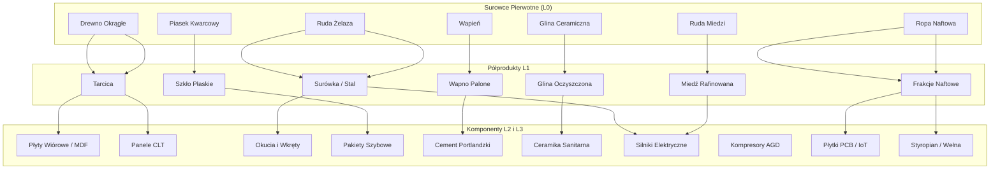
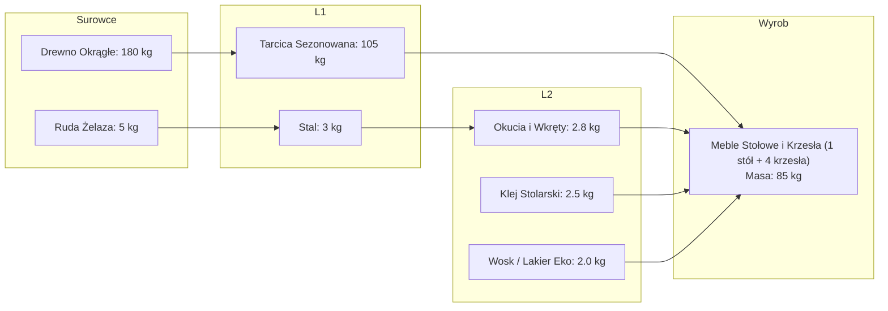
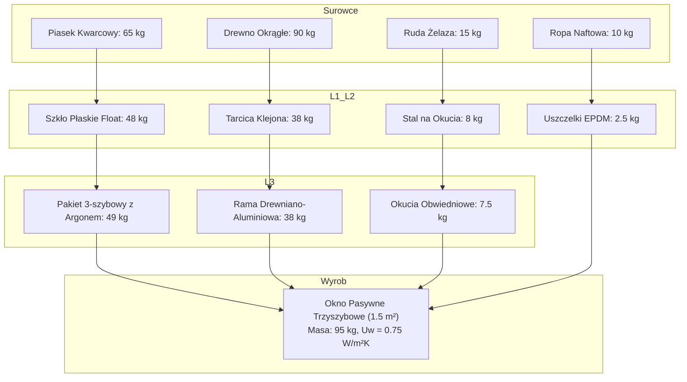
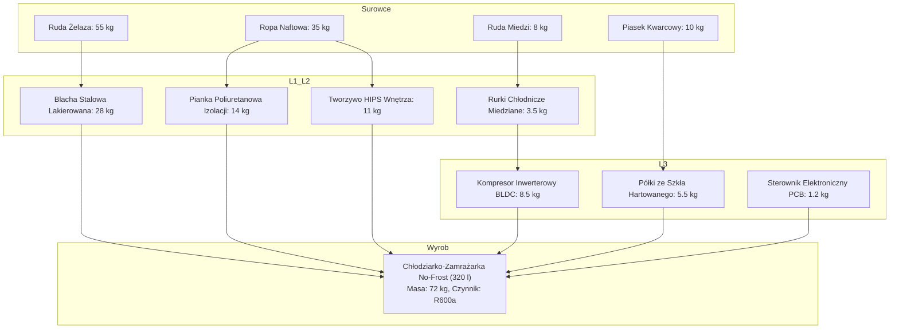
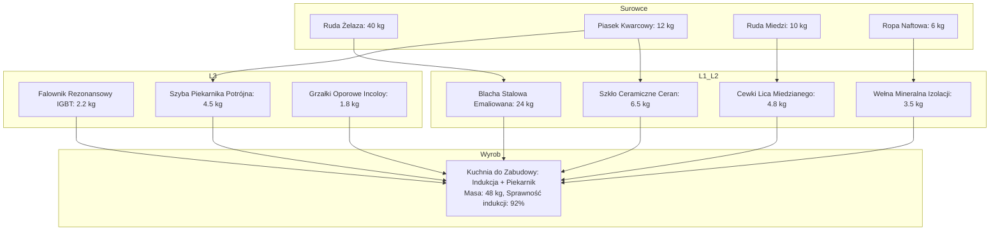
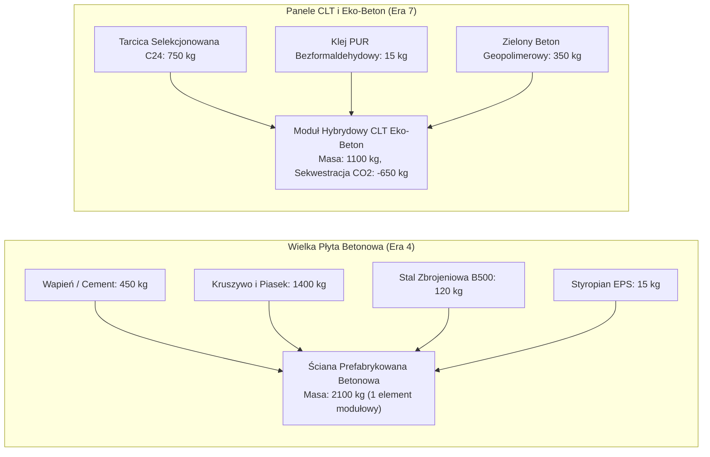
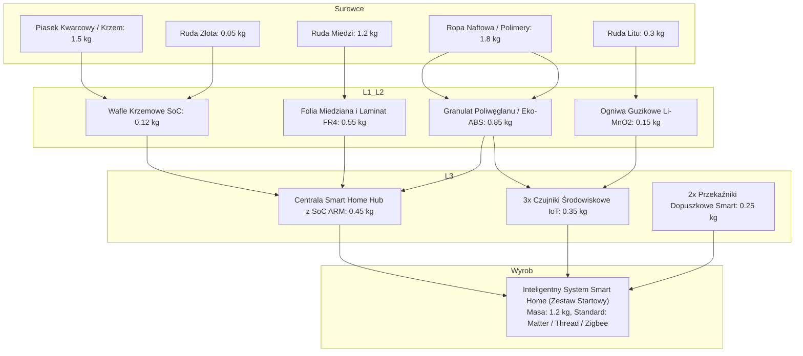

# Przepisy Produkcyjne i Bilans Masowo-Energetyczny: Branża 3 – Dom, Meble i Budownictwo
**Kompleksowa Specyfikacja Procesowa dla 20 Produktów Końcowych i Powiązanych Półproduktów (L1, L2, L3)**
*Projekt Symulacji Ekonomiczno-Ekologicznej "Sustainable Economy" (Epoki 1–8: 1880–2080)*

---

## 1. Wprowadzenie i Standardy Inżynierii Procesowej

Niniejszy dokument stanowi normatywną bazę danych technologicznych dla **Branży 3: Dom, Meble i Budownictwo**. Branża ta odpowiada za infrastrukturę bytową miast, zaspokajając fundamentalne potrzeby mieszkańców w zakresie schronienia, wyposażenia wnętrz, komfortu cieplnego, higieny oraz automatyzacji gospodarstw domowych.

### 1.1. Metodologia Bilansu Masowo-Energetycznego
Dla każdego procesu produkcyjnego obowiązuje ścisła zasada zachowania masy oraz bilansowania energii:
$$\sum m_{\text{wsad}} = \sum m_{\text{wyrób}} + \sum m_{\text{odpad użyteczny}} + \sum m_{\text{strata/emisja}}$$
* **Wsad materiałowy**: Wyrażony w jednostkach masy [kg] lub sztukach składowych o ściśle określonej masie jednostkowej.
* **Energia procesu**: Całkowita energia niezbędna do przetworzenia wsadu w produkt, rozbita na energię elektryczną ($E_{\text{el}}$) i energię cieplną ($E_{\text{ciep}}$) wyrażone w kilowatogodzinach [kWh].
* **Skumulowany ślad energetyczny (Cradle-to-Gate)**: Suma nakładów energii na etapie wydobycia surowców, rafinacji L1, syntezy komponentów L2/L3 oraz montażu końcowego.

### 1.2. Triada Wymogów Produkcyjnych
Każdy zakład i linia produkcyjna wymaga do działania zdefiniowanego zestawu zasobów:
1. **LUDZIE [R / M / E]**:
   * `[R]` **Robotnicy (Klasa Robotnicza)** – praca fizyczna, obsługa maszyn tartacznych, spawalniczych, montażowych i murarskich.
   * `[M]` **Specjaliści (Klasa Średnia)** – inżynierowie procesu, technolodzy drewna i ceramiki, kontrolerzy jakości, serwisanci mechatroniki.
   * `[E]` **Naukowcy / Elita Techniczna** – architekci systemowi, inżynierowie materiałowi, programiści IoT i systemów sterowania embedded.
2. **ENERGIA [kWh]**: Bezpośrednie zapotrzebowanie na energię z miejskiej sieci energetycznej (usługa Energetyki) przypadające na jednostkę kalkulacyjną wyrobu.
3. **LICENCJA**: Wymagany węzeł z Drzewka Technologii (odblokowywany za Punkty Nauki w R&D / na Uniwersytecie).

---

## 2. Biblioteka Bazowych Półproduktów Przemysłowych Branży 3

Przed zestawieniem 20 wyrobów końcowych zdefiniowano parametry wytwórcze kluczowych półproduktów poziomów L1 i L2/L3 wykorzystywanych w drzewach technologicznych Branży 3.

### 2.1. Półprodukty Drzewne i Drewnopochodne
* **Tarcica Obrobiona (L1)**:
  * *Wsad*: $1\text{ m}^3$ ($750\text{ kg}$) Drewna Okrągłego.
  * *Wyjście*: $0{,}65\text{ m}^3$ ($450\text{ kg}$) Tarcicy + $250\text{ kg}$ Trociny i zrębki (recykling do płyt wiórowych) + $50\text{ kg}$ kora (biomasa opałowa).
  * *Triada*: $2\text{ [R]}, 0\text{ [M]}, 0\text{ [E]}$; Energia: $45\text{ kWh}$ (w tym suszenie komorowe); Licencja: *Podstawowa Obróbka Drewna (Era 1)*.
* **Płyta Wiórowa / MDF Laminowana (L2)**:
  * *Wsad*: $100\text{ kg}$ Trocin/zrębków + $12\text{ kg}$ Żywic mocznikowo-formaldehydowych/syntetycznych + $3\text{ kg}$ Papieru dekoracyjnego.
  * *Wyjście*: $110\text{ kg}$ Płyty meblowej laminowanej + $5\text{ kg}$ odpadów technologicznych.
  * *Triada*: $2\text{ [R]}, 1\text{ [M]}, 0\text{ [E]}$; Energia: $65\text{ kWh}$ (prasa gorąca $180^\circ\text{C}$); Licencja: *Materiały Drewnopochodne (Era 4)*.
* **Drewno Konstrukcyjne Klejone CLT (L2/L3)**:
  * *Wsad*: $1000\text{ kg}$ Selekcjonowanej Tarcicy C24 + $20\text{ kg}$ Kleju poliuretanowego 1K PUR (bezformaldehydowego).
  * *Wyjście*: $990\text{ kg}$ Paneli CLT + $30\text{ kg}$ ścinek formatowych (do pelletu).
  * *Triada*: $3\text{ [R]}, 2\text{ [M]}, 0\text{ [E]}$; Energia: $85\text{ kWh}$ (prasa próżniowa/hydrauliczna); Licencja: *Zaawansowane Konstrukcje Drewniane (Era 7)*.

### 2.2. Półprodukty Hutnicze, Metalowe i Mechaniczne
* **Stal Walcowana / Profile (L1/L2)**:
  * *Wsad*: $1600\text{ kg}$ Rudy Żelaza + $500\text{ kg}$ Koksu (lub $1050\text{ kg}$ Złomu Stalowego w piecu łukowym EAF).
  * *Wyjście*: $1000\text{ kg}$ Stali surowej/profili + $350\text{ kg}$ żużla hutniczego (do cementu).
  * *Triada*: $4\text{ [R]}, 1\text{ [M]}, 0\text{ [E]}$; Energia: $650\text{ kWh/t}$ (EAF) lub $4500\text{ kWh/t}$ równoważnika koksowniczego; Licencja: *Wytop Stali (Era 1/2)*.
* **Okucia, Zawiasy i Elementy Złączne (L2)**:
  * *Wsad*: $105\text{ kg}$ Taśmy stalowej walcowanej + $2\text{ kg}$ Cynku galwanicznego.
  * *Wyjście*: $100\text{ kg}$ Zestawów okuć/wkrętów meblowych + $7\text{ kg}$ złomu wiórowego do przetopu.
  * *Triada*: $2\text{ [R]}, 1\text{ [M]}, 0\text{ [E]}$; Energia: $110\text{ kWh}$; Licencja: *Tłocznictwo i Galwanizacja (Era 2)*.
* **Silnik Elektryczny Indukcyjny / BLDC (L2)**:
  * *Wsad*: $4{,}5\text{ kg}$ Blach prądnicowych krzemowych + $1{,}8\text{ kg}$ Drutu nawojowego miedzianego + $0{,}8\text{ kg}$ Obudowy aluminiowej + $0{,}4\text{ kg}$ Magnesów neodymowych (dla BLDC).
  * *Wyjście*: $7{,}2\text{ kg}$ Gotowego silnika napędowego AGD + $0{,}3\text{ kg}$ odpadów skrawania.
  * *Triada*: $1\text{ [R]}, 2\text{ [M]}, 0\text{ [E]}$; Energia: $28\text{ kWh}$; Licencja: *Silniki Elektryczne Maszynowe (Era 3/4)*.
* **Agregat Kompresorowy Chłodniczy (L3)**:
  * *Wsad*: $6{,}0\text{ kg}$ Żeliwnego korpusu ciśnieniowego + $1{,}5\text{ kg}$ Tłoka i wału korbowego ze stali stopowej + Silnik elektryczny $180\text{ W}$ ($3{,}5\text{ kg}$) + $0{,}2\text{ kg}$ oleju syntetycznego POE.
  * *Wyjście*: $11{,}0\text{ kg}$ Hermetycznego kompresora chłodniczego + $0{,}2\text{ kg}$ wiórów stalowych.
  * *Triada*: $2\text{ [R]}, 2\text{ [M]}, 0\text{ [E]}$; Energia: $42\text{ kWh}$; Licencja: *Termodynamika Chłodnicza (Era 3)*.

### 2.3. Półprodukty Mineralne, Szklane i Chemiczne
* **Szkło Budowlane Płaskie Float (L1/L2)**:
  * *Wsad*: $600\text{ kg}$ Piasku kwarcowego + $200\text{ kg}$ Sody kalcynowanej + $150\text{ kg}$ Dolomitu/Wapienia + $250\text{ kg}$ Stłuczki szklanej.
  * *Wyjście*: $1000\text{ kg}$ Tafli szkła float (grubość $4\text{ mm}$, ok. $100\text{ m}^2$) + $200\text{ kg}$ emisji $CO_2$ dekarbonizacji.
  * *Triada*: $3\text{ [R]}, 1\text{ [M]}, 0\text{ [E]}$; Energia: $1400\text{ kWh/t}$ (piec wannowy $1550^\circ\text{C}$); Licencja: *Hutnictwo Szkła Float (Era 2)*.
* **Pakiet Szybowy Zespolony Trzyszybowy 4-16-4-16-4 (L3)**:
  * *Wsad*: $30\text{ kg}$ Szkła płaskiego niskoemisyjnego ($3\text{ tafle} \times 1\text{ m}^2$) + $1{,}5\text{ kg}$ Ciepłej ramki dystansowej z tworzywa/stali + $0{,}8\text{ kg}$ Kitu poliuretanowego/tiokołowego + $0{,}3\text{ m}^3$ Gazu szlachetnego Argonu.
  * *Wyjście*: $1\text{ m}^2$ Pakietu trzyszybowego ($Ug = 0{,}5\text{ W/m}^2\text{K}$, masa $32{,}5\text{ kg}$) + $0{,}3\text{ kg}$ stłuczki krawędziowej.
  * *Triada*: $2\text{ [R]}, 1\text{ [M]}, 0\text{ [E]}$; Energia: $18\text{ kWh/m}^2$; Licencja: *Pasywna Stolarka i Zespalanie Szkła (Era 6)*.
* **Cement Portlandzki CEM I (L2)**:
  * *Wsad*: $1350\text{ kg}$ Wapienia + $300\text{ kg}$ Gliny + $50\text{ kg}$ Gipsu regulatora czasu wiązania.
  * *Wyjście*: $1000\text{ kg}$ Klinkieru/Cementu zmielonego + $700\text{ kg}$ emisji procesowej $CO_2$.
  * *Triada*: $2\text{ [R]}, 1\text{ [M]}, 0\text{ [E]}$; Energia: $850\text{ kWh/t}$ (piec obrotowy $1450^\circ\text{C}$); Licencja: *Produkcja Spoiw Wiążących (Era 1/2)*.

---

## 3. Szczegółowe Receptury i Bilans 20 Produktów Końcowych Branży 3

---

### Produkt 1: Meble Drewniane Stołowe i Krzesła
*Klasyczne wyposażenie jadalni i salonu z litego drewna liściastego/iglastego.*

* **Jednostka kalkulacyjna**: 1 komplet (Stół rozkładany + 4 krzesła tapicerowane/drewniane, masa netto: $85{,}0\text{ kg}$).
* **Epoka wejścia**: Epoka 1 (1880–1905).
* **Ewolucja w Epoce 7**: *Meble z Drewna Odzyskanego (Circular Reclaimed Wood)* – zero świeżej tarcicy leśnej, 100% drewna z certyfikowanego demontażu miejskiego, kleje z białek roślinnych.
* **Drzewo Łańcucha Dostaw**:
  * *Poziom 0 (Surowce)*: Drewno Okrągłe Dębowe/Sosnowe ($180{,}0\text{ kg}$), Ruda Żelaza ($5{,}0\text{ kg}$), Oleje roślinne / żywice naturalne ($4{,}5\text{ kg}$).
  * *Poziom 1 (L1)*: Tarcica Sucha Sezonowana ($105{,}0\text{ kg}$), Stal konstrukcyjna ($3{,}0\text{ kg}$).
  * *Poziom 2 (L2)*: Formatki frezowane i toczone z tarcicy ($90{,}0\text{ kg}$), Wkręty i okucia stalowe ($2{,}8\text{ kg}$), Klej polioctanowy/kostny ($2{,}5\text{ kg}$), Lakier poliuretanowy wodorozcieńczalny ($2{,}0\text{ kg}$).
* **Bilans Masowy (1 kpl.)**:
  * *Wsad*: Tarcica ($105{,}0\text{ kg}$) + Okucia ($2{,}8\text{ kg}$) + Klej ($2{,}5\text{ kg}$) + Lakier ($2{,}0\text{ kg}$) = **$112{,}3\text{ kg}$**.
  * *Wyjście*: Komplet mebli gotowych = **$85{,}0\text{ kg}$**; Trociny i ścinki suche (do brykietu/płyt wiórowych) = **$24{,}8\text{ kg}$**; Ubytki lotne (odparowanie wody z lakieru/kleju) = **$2{,}5\text{ kg}$**.
* **Bilans Energetyczny**:
  * Obróbka skrawaniem i frezowanie CNC: $22{,}0\text{ kWh}_{\text{el}}$
  * Suszarnia lakiernicza i prasy klejarskie: $18{,}0\text{ kWh}_{\text{ciep}}$
  * Montaż i pakowanie: $4{,}5\text{ kWh}_{\text{el}}$
  * **Łącznie montaż końcowy**: **$44{,}5\text{ kWh}$** (Skumulowane Cradle-to-Gate: $185\text{ kWh}$).
* **Triada Wymogów Produkcyjnych**:
  * **Ludzie**: `3 [R], 1 [M], 0 [E]`
  * **Energia**: $44{,}5\text{ kWh}$ / komplet
  * **Licencja**: *Stolarstwo Przemysłowe i Gięcie Drewna (Era 1)*
* **Cyrkularność i Recykling**: Odzysk materiałowy drewna w 95% (po renowacji u Serwisanta meblowego lub mielenie na płyty wiórowe).

---

### Produkt 2: Łóżka i Materace
*Kompletny zestaw sypialniany: rama nośna z drewna/metalu oraz materac sprężynowo-piankowy o podwyższonej ergonomii.*

* **Jednostka kalkulacyjna**: 1 kpl. (Rama łóżka $160\times200\text{ cm}$ + materac kieszeniowy 7-strefowy, masa netto: $78{,}0\text{ kg}$).
* **Epoka wejścia**: Epoka 1 (1880–1905).
* **Drzewo Łańcucha Dostaw**:
  * *Poziom 0 (Surowce)*: Drewno Okrągłe ($80\text{ kg}$), Ruda Żelaza ($35\text{ kg}$), Owce / Bawełna ($15\text{ kg}$), Ropa Naftowa (w Epoce 4+: $22\text{ kg}$).
  * *Poziom 1 (L1)*: Tarcica ($48\text{ kg}$), Stal na drut sprężynowy ($22\text{ kg}$), Przędza Bawełniano-Wełniana ($12\text{ kg}$), Poliole i izocyjaniany PUR ($18\text{ kg}$).
  * *Poziom 2 (L2)*: Formatki ramy łóżka ($42\text{ kg}$), Sprężyny stalowe kieszeniowe pocket ($20\text{ kg}$), Pianka poliuretanowa HR ($16\text{ kg}$), Tkanina żakardowa pokrowca pikowana owatą ($8\text{ kg}$), Okucia ramy ($2\text{ kg}$).
* **Bilans Masowy (1 kpl.)**:
  * *Wsad*: Formatki drewniane ($45{,}0\text{ kg}$) + Sprężyny kieszeniowe w fizelinie ($21{,}0\text{ kg}$) + Pianka PUR ($16{,}5\text{ kg}$) + Pokrowiec tekstylny ($8{,}2\text{ kg}$) + Okucia ($2{,}1\text{ kg}$) = **$92{,}8\text{ kg}$**.
  * *Wyjście*: Gotowe łóżko z materacem = **$78{,}0\text{ kg}$**; Odpady cięcia pianki (wtórne spienianie) = **$3{,}5\text{ kg}$**; Ścinki drewna = **$6{,}0\text{ kg}$**; Ścinki tekstylne = **$5{,}3\text{ kg}$**.
* **Bilans Energetyczny**:
  * Produkcja sprężyn i zgrzewanie kieszeni: $16{,}0\text{ kWh}_{\text{el}}$
  * Spienianie i formatowanie bloków pianki: $24{,}0\text{ kWh}_{\text{el+ciep}}$
  * Szwalnia pokrowców i pikowanie: $6{,}5\text{ kWh}_{\text{el}}$
  * Montaż ramy i klejenie warstw materaca: $8{,}0\text{ kWh}_{\text{el}}$
  * **Łącznie montaż końcowy**: **$54{,}5\text{ kWh}$** (Cradle-to-Gate: $310\text{ kWh}$).
* **Triada Wymogów Produkcyjnych**:
  * **Ludzie**: `4 [R], 1 [M], 0 [E]`
  * **Energia**: $54{,}5\text{ kWh}$ / komplet
  * **Licencja**: *Tapicerstwo i Sprężyny Formatowe (Era 1)*
* **Cyrkularność i Recykling**: Zdejmowany pokrowiec do prania/recyklingu tekstylnego; sprężyny stalowe w 100% zdatne do ponownego przetopu hutniczego.

---

### Produkt 3: Szafy i Komody Modułowe
*Meble skrzyniowe do przechowywania, produkowane wielkoseryjnie w technologii płaskich paczek (Flat-pack RTA).*

* **Jednostka kalkulacyjna**: 1 trzydrzwiowa szafa garderobiana z szufladami (masa netto: $115{,}0\text{ kg}$).
* **Epoka wejścia**: Epoka 1 (jako szafy lite) $\to$ **Modernizacja w Epoce 4**: *Meble Modułowe Płaskopaczkowane*.
* **Drzewo Łańcucha Dostaw**:
  * *Poziom 0 (Surowce)*: Drewno Okrągłe / Trociny odpadowe ($150\text{ kg}$), Ruda Żelaza ($12\text{ kg}$), Ropa Naftowa (żywice i folie melaminowe: $15\text{ kg}$).
  * *Poziom 1 (L1)*: Tarcica i Zrębki ($120\text{ kg}$), Stal taśmowa walcowana ($8\text{ kg}$), Celuloza papierowa ($6\text{ kg}$).
  * *Poziom 2 (L2)*: Płyta wiórowa laminowana $18\text{ mm}$ ($102\text{ kg}$), Płyta pilśniowa tylna HDF $3\text{ mm}$ ($12\text{ kg}$), Zawiasy puszkowe ze spowalniaczem i prowadnice kulkowe ($5{,}5\text{ kg}$), Złącza mimośrodowe i kołki drewniane ($1{,}5\text{ kg}$), Karton opakowaniowy z tektury 5-warstwowej ($6{,}0\text{ kg}$).
* **Bilans Masowy (1 szt. w paczkach)**:
  * *Wsad*: Płyty laminowane i HDF ($120{,}0\text{ kg}$) + Zestaw okuć stalowych ($7{,}2\text{ kg}$) + Karton i przekładki EPS ($6{,}5\text{ kg}$) = **$133{,}7\text{ kg}$**.
  * *Wyjście*: Gotowa szafa w paczkach z kartonem = **$121{,}0\text{ kg}$** (w tym $115\text{ kg}$ mebel); Odpady z formatyzowania i okleinowania krawędzi ABS = **$12{,}7\text{ kg}$** (odbiór do elektrociepłowni/recyklingu).
* **Bilans Energetyczny**:
  * Rozkrój płyt piłami panelowymi i okleinowanie krawędzi PUR: $19{,}0\text{ kWh}_{\text{el}}$
  * Wiercenie wielowrzecionowe pod złącza mimośrodowe: $8{,}5\text{ kWh}_{\text{el}}$
  * Automatyczna linia sortująco-pakująca w kartony: $6{,}0\text{ kWh}_{\text{el}}$
  * **Łącznie montaż końcowy**: **$33{,}5\text{ kWh}$** (Cradle-to-Gate: $240\text{ kWh}$).
* **Triada Wymogów Produkcyjnych**:
  * **Ludzie**: `2 [R], 2 [M], 0 [E]`
  * **Energia**: $33{,}5\text{ kWh}$ / sztukę
  * **Licencja**: *Meble Płaskopaczkowane i Płyty Laminowane (Era 4)*
* **Cyrkularność i Recykling**: Konstrukcja w 100% rozbieralna; zużyte płyty mielone na wypełniacze lub odzyskiwane energetycznie.

---

### Produkt 4: Piece Węglowe i Kominki Żeliwne
*Ciężkie paleniska domowe na paliwa stałe, dominujące w ogrzewaniu miejskim do połowy XX wieku.*

* **Jednostka kalkulacyjna**: 1 piec żeliwny wolnostojący typu "Koza" z wkładem szamotowym (masa netto: $140{,}0\text{ kg}$).
* **Epoka wejścia**: Epoka 1 (1880–1905) $\to$ **[WYGASA W EPOCE 5: 1980–2005]** ze względu na zakazy antysmogowe i przejście na gaz/pomp ciepła.
* **Drzewo Łańcucha Dostaw**:
  * *Poziom 0 (Surowce)*: Ruda Żelaza ($210\text{ kg}$), Węgiel Kamienny Koksowy ($90\text{ kg}$), Glina Ogniotrwała Szamotowa ($40\text{ kg}$).
  * *Poziom 1 (L1)*: Surówka Odlewnicza Żeliwna ($125\text{ kg}$), Koks Odlewniczy ($35\text{ kg}$), Glina Oczyszczona ($30\text{ kg}$).
  * *Poziom 2 (L2)*: Odlewy żeliwne szare korpusu, rusztu i drzwiczek ($118\text{ kg}$), Cegła szamotowa wypalana ($28\text{ kg}$), Uszczelka sznurowa azbestowa/szklana ($0{,}8\text{ kg}$).
* **Bilans Masowy (1 piec)**:
  * *Wsad*: Płynne żeliwo odlewnicze ($130{,}0\text{ kg}$) + Wkładki szamotowe ($29{,}0\text{ kg}$) + Akcesoria montażowe ($1{,}5\text{ kg}$) = **$160{,}5\text{ kg}$**.
  * *Wyjście*: Gotowy piec kominkowy = **$140{,}0\text{ kg}$**; Zlewki hutnicze, układ wlewowy żeliwa (złom obiegowy do przetopu) = **$18{,}5\text{ kg}$**; Zgar i pyły = **$2{,}0\text{ kg}$**.
* **Bilans Energetyczny**:
  * Topienie żeliwa w żeliwiaku/piecu indukcyjnym ($1450^\circ\text{C}$): $145{,}0\text{ kWh}_{\text{ciep+el}}$
  * Oczyszczanie odlewów (śrutowanie) i frezowanie przylgni: $14{,}0\text{ kWh}_{\text{el}}$
  * Wypał kształtek szamotowych w cegielni ($1300^\circ\text{C}$): $32{,}0\text{ kWh}_{\text{ciep}}$
  * **Łącznie montaż końcowy**: **$191{,}0\text{ kWh}$** (Cradle-to-Gate: $890\text{ kWh}$).
* **Triada Wymogów Produkcyjnych**:
  * **Ludzie**: `5 [R], 0 [M], 0 [E]`
  * **Energia**: $191{,}0\text{ kWh}$ / sztukę
  * **Licencja**: *Odlewnictwo Ciężkie i Odlewy Żeliwne (Era 1)*
* **Cyrkularność i Recykling**: Złom żeliwny w 100% zdatny do bezstratnego przetopu hutniczego; generuje wysoki smog miejski w fazie eksploatacji.

---

### Produkt 5: Lampy Naftowe i Gazowe
*Oświetlenie płomieniowe wnętrz mieszkalnych przed powszechną elektryfikacją sieciową.*

* **Jednostka kalkulacyjna**: 1 mosiężna lampa stołowa naftowa z kloszem szklanym (masa netto: $2{,}4\text{ kg}$).
* **Epoka wejścia**: Epoka 1 (1880–1905) $\to$ **[WYGASA W EPOCE 2: 1905–1930]** w wyniku rewolucji żarówkowej Thomasa Edisona.
* **Drzewo Łańcucha Dostaw**:
  * *Poziom 0 (Surowce)*: Ruda Miedzi ($3{,}5\text{ kg}$), Ruda Cynku ($1{,}5\text{ kg}$), Piasek Kwarcowy ($1{,}8\text{ kg}$), Bawełna ($0{,}3\text{ kg}$).
  * *Poziom 1 (L1)*: Miedź Rafinowana ($1{,}2\text{ kg}$), Cynk Rafinowany ($0{,}6\text{ kg}$), Szkło Surowe ($1{,}0\text{ kg}$), Przędza Bawełniana ($0{,}2\text{ kg}$).
  * *Poziom 2 (L2)*: Mosiądz CuZn37 ($1{,}7\text{ kg}$), Klosz szklany dmuchany żaroodporny "Cylinder" ($0{,}75\text{ kg}$), Knot bawełniany tkany płaski ($0{,}05\text{ kg}$).
* **Bilans Masowy (1 szt.)**:
  * *Wsad*: Mosiądz taśmowy/odlewniczy ($2{,}0\text{ kg}$) + Szkło surowe do dmuchania ($1{,}1\text{ kg}$) + Knot bawełniany ($0{,}06\text{ kg}$) = **$3{,}16\text{ kg}$**.
  * *Wyjście*: Gotowa lampa naftowa = **$2{,}40\text{ kg}$**; Ścinki mosiądzu (do przetopu) = **$0{,}30\text{ kg}$**; Odlewka szklana odcięta = **$0{,}35\text{ kg}$**; Ścinki knota = **$0{,}01\text{ kg}$**; Emisje gazowe pieca = **$0{,}10\text{ kg}$**.
* **Bilans Energetyczny**:
  * Tłoczenie zbiornika mosiężnego i montaż palnika z pokrętłem zębatym: $3{,}2\text{ kWh}_{\text{el}}$
  * Dmuchanie i wyżarzanie odprężające szkła klosza: $6{,}8\text{ kWh}_{\text{ciep}}$
  * **Łącznie montaż końcowy**: **$10{,}0\text{ kWh}$** (Cradle-to-Gate: $48\text{ kWh}$).
* **Triada Wymogów Produkcyjnych**:
  * **Ludzie**: `3 [R], 0 [M], 0 [E]`
  * **Energia**: $10{,}0\text{ kWh}$ / sztukę
  * **Licencja**: *Oświetlenie Płomieniowe i Obróbka Mosiądzu (Era 1)*
* **Cyrkularność i Recykling**: Odzysk mosiądzu (100%) i stłuczki szklanej; całkowity brak komponentów z tworzyw sztucznych.

---

### Produkt 6: Zastawa Stołowa (Porcelana i Szkło)
*Zestaw naczyń stołowych ze szlachetnej ceramiki kaolinowej (porcelany twardej) oraz kieliszków ze szkła sodowo-wapiennego.*

* **Jednostka kalkulacyjna**: 1 serwis obiadowy dla 6 osób (24 elementy ceramiczne + 6 kieliszków szklanych, masa netto: $18{,}0\text{ kg}$).
* **Epoka wejścia**: Epoka 1 (1880–1905).
* **Drzewo Łańcucha Dostaw**:
  * *Poziom 0 (Surowce)*: Glina Kaolinowa ($16\text{ kg}$), Skaleń i Kwarc ($14\text{ kg}$), Piasek Kwarcowy szklarski ($6\text{ kg}$), Soda i Wapień ($2\text{ kg}$).
  * *Poziom 1 (L1)*: Kaolin Oczyszczony szlamowany ($13\text{ kg}$), Mączka Kwarcowo-Skaleniowa ($11\text{ kg}$), Szkło Surowe odbarwiane ($4{,}5\text{ kg}$).
  * *Poziom 2 (L2)*: Plastyczna masa porcelanowa ($22\text{ kg}$), Zawiesina szkliwa skaleniowego ($3\text{ kg}$), Płynne szkło kieliszkowe ($4{,}0\text{ kg}$).
* **Bilans Masowy (1 serwis)**:
  * *Wsad*: Masa porcelanowa ($22{,}0\text{ kg}$) + Szkliwo ($3{,}0\text{ kg}$) + Surówka szklarska ($4{,}2\text{ kg}$) = **$29{,}2\text{ kg}$**.
  * *Wyjście*: Gotowy serwis (talerze, miski, kieliszki) = **$18{,}0\text{ kg}$**; Odpady surowe masy (recyrkulacja na mokro) = **$4{,}5\text{ kg}$**; Ubytek masy (woda zarobowa i dehydroksylacja minerałów w piecu) = **$5{,}8\text{ kg}$**; Stłuczka szklana formowania = **$0{,}9\text{ kg}$**.
* **Bilans Energetyczny**:
  * Formowanie izostatyczne i odlewanie ciśnieniowe: $12{,}0\text{ kWh}_{\text{el}}$
  * Wypał biskwitowy ($950^\circ\text{C}$): $35{,}0\text{ kWh}_{\text{ciep}}$
  * Wypał ostry ze szkliwem ($1380^\circ\text{C}$ w atmosferze redukcyjnej): $68{,}0\text{ kWh}_{\text{ciep}}$
  * Automatyczne dmuchanie kieliszków i zatapianie krawędzi: $15{,}0\text{ kWh}_{\text{ciep+el}}$
  * **Łącznie montaż końcowy**: **$130{,}0\text{ kWh}$** (Cradle-to-Gate: $210\text{ kWh}$).
* **Triada Wymogów Produkcyjnych**:
  * **Ludzie**: `3 [R], 1 [M], 0 [E]`
  * **Energia**: $130{,}0\text{ kWh}$ / serwis
  * **Licencja**: *Ceramika Wysokotemperaturowa i Szkło Szlachetne (Era 1)*
* **Cyrkularność i Recykling**: Odsiecz i stłuczka w 100% zawracane do młynów kulowych; stłuczona ceramika gotowa stanowi trwałe kruszywo drogowe / szamot.

---

### Produkt 7: Narzędzia Ręczne i Warsztatowe (Elektronarzędzia)
*Narzędzia ślusarsko-stolarskie: od tradycyjnych młotków i pił do nowoczesnych akumulatorowych wiertarko-wkrętarek bezszczotkowych.*

* **Jednostka kalkulacyjna**: 1 walizkowy zestaw elektronarzędzi warsztatowych (Wiertarko-wkrętarka udarowa $18\text{ V}$ + 2 akumulatory Li-Ion + ładowarka + osprzęt, masa netto: $4{,}8\text{ kg}$).
* **Epoka wejścia**: Epoka 1 (narzędzia kute ręczne) $\to$ **Modernizacja w Epoce 4**: *Elektronarzędzia Sieciowe* $\to$ **Epoka 6**: *Elektronarzędzia Akumulatorowe Li-Ion Brushless*.
* **Drzewo Łańcucha Dostaw**:
  * *Poziom 0 (Surowce)*: Ruda Żelaza ($6{,}0\text{ kg}$), Ruda Miedzi ($1{,}8\text{ kg}$), Ropa Naftowa ($2{,}5\text{ kg}$), Ruda Litu ($0{,}8\text{ kg}$), Neodym ($0{,}15\text{ kg}$).
  * *Poziom 1 (L1)*: Stal Stopowa Cr-V ($3{,}0\text{ kg}$), Miedź Rafinowana ($0{,}9\text{ kg}$), Granulat Poliamidu PA6-GF30 ($1{,}8\text{ kg}$), Koncentrat Litu ($0{,}3\text{ kg}$).
  * *Poziom 2 (L2)*: Przekładnia planetarna ze stali hartowanej ($0{,}9\text{ kg}$), Silnik bezszczotkowy BLDC ($0{,}65\text{ kg}$), Obudowa z tworzywa z elastomerem TPE ($0{,}85\text{ kg}$), Płytka sterownika falownika PCB ($0{,}2\text{ kg}$), Pakiety 10 ogniw Li-Ion 18650 ($0{,}9\text{ kg}$), Walizka i osprzęt wierteł ($1{,}4\text{ kg}$).
* **Bilans Masowy (1 zestaw)**:
  * *Wsad*: Stal narzędziowa i przekładnia ($2{,}5\text{ kg}$) + Miedź uzwojeń ($0{,}5\text{ kg}$) + Tworzywa obudowy ($1{,}8\text{ kg}$) + Komponenty elektroniczne i ogniwa ($1{,}2\text{ kg}$) = **$6{,}0\text{ kg}$**.
  * *Wyjście*: Gotowy zestaw w walizce = **$4{,}8\text{ kg}$**; Odpady wtryskowe i wióry skrawania kół zębatych = **$1{,}15\text{ kg}$**; Strata procesowa = **$0{,}05\text{ kg}$**.
* **Bilans Energetyczny**:
  * Kucie matrycowe i hartowanie indukcyjne przekładni: $14{,}5\text{ kWh}_{\text{ciep+el}}$
  * Wtrysk ciśnieniowy korpusu dwukomponentowego: $6{,}2\text{ kWh}_{\text{el}}$
  * Zgrzewanie pakietów baterii i montaż SMT sterownika: $5{,}8\text{ kWh}_{\text{el}}$
  * Montaż końcowy i test pod obciążeniem: $3{,}5\text{ kWh}_{\text{el}}$
  * **Łącznie montaż końcowy**: **$30{,}0\text{ kWh}$** (Cradle-to-Gate: $165\text{ kWh}$).
* **Triada Wymogów Produkcyjnych**:
  * **Ludzie**: `2 [R], 2 [M], 0 [E]`
  * **Energia**: $30{,}0\text{ kWh}$ / zestaw
  * **Licencja**: *Mechatronika Precyzyjna i Baterie Wysokoprądowe (Era 4/6)*
* **Cyrkularność i Recykling**: Modułowa konstrukcja umożliwiająca wymianę szczotek/przełączników oraz regenerację ogniw w zakładach Serwisantów miejskich.

---

### Produkt 8: Stolarka Okienna i Drzwiowa Pasywna
*Certyfikowane okna energooszczędne do budownictwa pasywnego z ramami wielokomorowymi i potrójnymi pakietami szybowymi.*

* **Jednostka kalkulacyjna**: 1 dwuskrzydłowe okno fasadowe o powierzchni $1{,}50\text{ m}^2$ ($1230\times1480\text{ mm}$, masa netto: $95{,}0\text{ kg}$).
* **Epoka wejścia**: Epoka 1 (okna drewniane pojedyncze) $\to$ **Modernizacja w Epoce 6**: *Stolarka Pasywna Trzyszybowa (Uw $\le 0{,}8\text{ W/m}^2\text{K}$)*.
* **Drzewo Łańcucha Dostaw**:
  * *Poziom 0 (Surowce)*: Drewno Okrągłe Sosnowe ($90\text{ kg}$), Piasek Kwarcowy ($65\text{ kg}$), Ruda Żelaza ($15\text{ kg}$), Ropa Naftowa (uszczelki EPDM: $10\text{ kg}$).
  * *Poziom 1 (L1)*: Tarcica kantówka klejona ($42\text{ kg}$), Szkło Płaskie Float ($48\text{ kg}$), Stal na okucia ($8{,}5\text{ kg}$), Kauczuk syntetyczny ($3{,}0\text{ kg}$).
  * *Poziom 2/3 (L2/L3)*: Rama drewniana klejona 4-warstwowo profilowana ($38\text{ kg}$), Pakiet trzyszybowy z ciepłą ramką i argonem ($49\text{ kg}$), Okucia obwiedniowe antywyważeniowe RC2 ($7{,}5\text{ kg}$), Uszczelki wciskaniowe EPDM ($2{,}2\text{ kg}$).
* **Bilans Masowy (1 okno)**:
  * *Wsad*: Pakiet 3-szybowy ($49{,}5\text{ kg}$) + Profile ramy i skrzydła ($44{,}0\text{ kg}$) + Zestaw okuć ($7{,}8\text{ kg}$) + Uszczelki ($2{,}3\text{ kg}$) + Lakiery wodne ($1{,}5\text{ kg}$) = **$105{,}1\text{ kg}$**.
  * *Wyjście*: Gotowe okno zmontowane = **$95{,}0\text{ kg}$**; Wióry i ścinki kantówki = **$6{,}8\text{ kg}$**; Odpady szkła i uszczelek = **$2{,}1\text{ kg}$**; Odparowanie lakieru = **$1{,}2\text{ kg}$**.
* **Bilans Energetyczny**:
  * Precyzyjne czopowanie i frezowanie profili ramy: $14{,}0\text{ kWh}_{\text{el}}$
  * Zespalanie pakietu szybowego (mycie wodą demineralizowaną, prasa z argonem): $26{,}0\text{ kWh}_{\text{el}}$
  * Automatyczne okuwanie skrzydeł i szklenie pneumatyczne: $8{,}0\text{ kWh}_{\text{el}}$
  * **Łącznie montaż końcowy**: **$48{,}0\text{ kWh}$** (Cradle-to-Gate: $380\text{ kWh}$).
* **Triada Wymogów Produkcyjnych**:
  * **Ludzie**: `3 [R], 2 [M], 0 [E]`
  * **Energia**: $48{,}0\text{ kWh}$ / okno
  * **Licencja**: *Fizyka Cieplna Stolarki Pasywnej (Era 6)*
* **Cyrkularność i Recykling**: Redukuje zapotrzebowanie budynku na ogrzewanie o 40%; pakiet szybowy w 100% zdatny do przetopu na nowe szkło.

---

### Produkt 9: Żarówki Tradycyjne / LED
*Elektryczne źródła światła: od próżniowej żarówki wolframowej Edisona po półprzewodnikowe lampy LED z przetwornicą CCD.*

* **Jednostka kalkulacyjna**: 1 zbiorcze opakowanie źródeł światła LED (10 sztuk lamp LED A60 E27 $10\text{ W}$, masa łączna: $0{,}60\text{ kg}$).
* **Epoka wejścia**: Epoka 2 (1905–1930: Tradycyjne wolframowe) $\to$ **Epoka 5**: *Świetlówki kompaktowe CFL* $\to$ **Epoka 6**: *Oświetlenie Półprzewodnikowe LED*.
* **Drzewo Łańcucha Dostaw**:
  * *Poziom 0 (Surowce)*: Piasek Kwarcowy ($0{,}8\text{ kg}$), Boksyt ($0{,}7\text{ kg}$), Ruda Miedzi ($0{,}3\text{ kg}$), Ropa Naftowa ($0{,}4\text{ kg}$), Ruda Złota ($0{,}005\text{ kg}$).
  * *Poziom 1 (L1)*: Krzem Polikrystaliczny ($0{,}05\text{ kg}$), Aluminium Hutnicze ($0{,}32\text{ kg}$), Miedź Rafinowana ($0{,}12\text{ kg}$), Poliwęglan optyczny ($0{,}15\text{ kg}$).
  * *Poziom 2 (L2)*: Płytka MCPCB z 16 diodami SMD 2835 ($0{,}08\text{ kg}$), Radiator aluminiowy żeberkowy ciśnieniowy ($0{,}28\text{ kg}$), Płytka przetwornicy drivera IC ($0{,}06\text{ kg}$), Trzonek gwintowany E27 mosiężno-niklowy ($0{,}06\text{ kg}$), Klosz mleczny z poliwęglanu ($0{,}12\text{ kg}$).
* **Bilans Masowy (10 sztuk)**:
  * *Wsad*: Radiatory aluminiowe ($0{,}29\text{ kg}$) + Moduły MCPCB LED ($0{,}085\text{ kg}$) + Drivery z dławikiem ($0{,}065\text{ kg}$) + Trzonki E27 ($0{,}062\text{ kg}$) + Klosze ($0{,}125\text{ kg}$) + Klej silikonowy termoprzewodzący ($0{,}02\text{ kg}$) = **$0{,}647\text{ kg}$**.
  * *Wyjście*: 10 gotowych żarówek LED = **$0{,}600\text{ kg}$**; Odpady montażowe i taśmy komponentów SMT = **$0{,}047\text{ kg}$**.
* **Bilans Energetyczny**:
  * Montaż powierzchniowy SMT diod LED i lutowanie rozpływowe: $1{,}8\text{ kWh}_{\text{el}}$
  * Wtrysk ciśnieniowy i anodowanie radiatorów aluminiowych: $3{,}2\text{ kWh}_{\text{el}}$
  * Zgrzewanie ultradźwiękowe klosza i automatyczny test starzeniowy: $1{,}2\text{ kWh}_{\text{el}}$
  * **Łącznie montaż końcowy**: **$6{,}2\text{ kWh}$** / 10 sztuk (Cradle-to-Gate: $32\text{ kWh}$).
* **Triada Wymogów Produkcyjnych**:
  * **Ludzie**: `1 [R], 2 [M], 0 [E]`
  * **Energia**: $6{,}2\text{ kWh}$ / paczkę 10 szt.
  * **Licencja**: *Optoelektronika Półprzewodnikowa i Diody LED (Era 6)*
* **Cyrkularność i Recykling**: Zużycie energii o 85% niższe niż żarówek tradycyjnych; odzysk aluminium z radiatorów oraz złota i miedzi w zakładach Urban Mining.

---

### Produkt 10: Armatura Łazienkowa i Ceramika Sanitarna
*Wyposażenie higieniczne łazienek: bezkołnierzowa muszla WC/umywalka z ceramiki sanitarnej oraz chromowana bateria mosiężna.*

* **Jednostka kalkulacyjna**: 1 zestaw łazienkowy (Misa wisząca WC z deski duroplast + bateria umywalkowa stojąca z głowicą ceramiczną, masa netto: $28{,}5\text{ kg}$).
* **Epoka wejścia**: Epoka 2 (1905–1930) $\to$ **Modernizacja w Epoce 7**: *Systemy Zintegrowanego Odzysku Szarej Wody i Spłukiwania Próżniowego*.
* **Drzewo Łańcucha Dostaw**:
  * *Poziom 0 (Surowce)*: Glina Ceramiczna szlachetna / Kaolin ($32\text{ kg}$), Skaleń i Kreda ($10\text{ kg}$), Ruda Miedzi ($4\text{ kg}$), Ruda Cynku ($2\text{ kg}$), Ruda Chromu ($0{,}2\text{ kg}$).
  * *Poziom 1 (L1)*: Glinka Odlewnicza Oczyszczona ($26\text{ kg}$), Szkliwo Zirconium sanitarny ($3\text{ kg}$), Mosiądz CuZn40Pb2 ($2{,}2\text{ kg}$).
  * *Poziom 2 (L2)*: Odlew ceramiczny surowy szkliwiony ($26{,}5\text{ kg}$), Korpus baterii odlewany z mosiądzu ($1{,}6\text{ kg}$), Głowica ceramiczna $35\text{ mm}$ z tlenku glinu $Al_2O_3$ ($0{,}15\text{ kg}$), Deska sedesowa wolnoopadająca Duroplast ($2{,}0\text{ kg}$).
* **Bilans Masowy (1 zestaw)**:
  * *Wsad*: Lejny szlikier ceramiczny ($32{,}0\text{ kg}$) + Szkliwo natryskowe ($3{,}5\text{ kg}$) + Mosiądz ($2{,}0\text{ kg}$) + Tworzywo deski ($2{,}2\text{ kg}$) = **$39{,}7\text{ kg}$**.
  * *Wyjście*: Gotowy zestaw ceramiczno-armaturowy = **$28{,}5\text{ kg}$**; Odparowanie wody podczas suszenia form = **$7{,}5\text{ kg}$**; Zgar i wióry mosiądzu = **$0{,}35\text{ kg}$**; Odpad formierski gipsowy = **$3{,}35\text{ kg}$**.
* **Bilans Energetyczny**:
  * Odlewanie ciśnieniowe w formach polimerowych i suszenie: $14{,}0\text{ kWh}_{\text{el}}$
  * Wypał tunelowy ceramiki sanitarnej w temperaturze $1220^\circ\text{C}$: $88{,}0\text{ kWh}_{\text{ciep}}$
  * Obróbka skrawaniem korpusu baterii i polerowanie robotem: $8{,}5\text{ kWh}_{\text{el}}$
  * Galwaniczne nakładanie niklu i chromu: $11{,}5\text{ kWh}_{\text{el}}$
  * **Łącznie montaż końcowy**: **$122{,}0\text{ kWh}$** (Cradle-to-Gate: $290\text{ kWh}$).
* **Triada Wymogów Produkcyjnych**:
  * **Ludzie**: `3 [R], 1 [M], 0 [E]`
  * **Energia**: $122{,}0\text{ kWh}$ / zestaw
  * **Licencja**: *Inżynieria Sanitarna i Ceramika Szkląca (Era 2)*
* **Cyrkularność i Recykling**: Mosiądz armatury jest w 100% recyklingowalny; ceramika sanitaria charakteryzuje się trwałością przekraczającą 50 lat.

---

### Produkt 11: Grzejniki i Kotły Gazowe
*Urządzenia centralnego ogrzewania: dwufunkcyjny wiszący kocioł kondensacyjny oraz stalowe grzejniki płytowe.*

* **Jednostka kalkulacyjna**: 1 kocioł gazowy kondensacyjny $24\text{ kW}$ z palnikiem modulowanym (masa netto: $36{,}0\text{ kg}$).
* **Epoka wejścia**: Epoka 3 (1930–1955) $\to$ **[WYGASA W EPOCE 7: 2030–2055]** wypierany przez pompy ciepła i ciepło sieciowe z OZE.
* **Drzewo Łańcucha Dostaw**:
  * *Poziom 0 (Surowce)*: Ruda Żelaza ($45\text{ kg}$), Ruda Miedzi ($6\text{ kg}$), Boksyt ($8\text{ kg}$), Ropa Naftowa ($5\text{ kg}$).
  * *Poziom 1 (L1)*: Stal Kwasoodporna AISI 316L ($12\text{ kg}$), Stal Konstrukcyjna ($18\text{ kg}$), Miedź Rafinowana ($4\text{ kg}$), Aluminium ($3{,}5\text{ kg}$).
  * *Poziom 2 (L2)*: Spiralny wymiennik ciepła ze stali kwasoodpornej / stopu Al-Si ($11{,}5\text{ kg}$), Palnik gazowy ze stali żaroodpornej z elektrodą jonizacyjną ($2{,}2\text{ kg}$), Pompa obiegowa elektroniczna $PWM$ ($3{,}8\text{ kg}$), Zespół gazowy z silnikiem krokowym ($1{,}8\text{ kg}$), Płytka sterująca PCB w obudowie niepalnej ($1{,}5\text{ kg}$), Obudowa blaszana malowana proszkowo ($12{,}5\text{ kg}$).
* **Bilans Masowy (1 kocioł)**:
  * *Wsad*: Stal kwasoodporna i węglowa ($33{,}0\text{ kg}$) + Miedź rurek hydraulicznych ($4{,}2\text{ kg}$) + Komponenty mechaniczno-elektroniczne ($5{,}5\text{ kg}$) = **$42{,}7\text{ kg}$**.
  * *Wyjście*: Gotowy kocioł kondensacyjny = **$36{,}0\text{ kg}$**; Odpady wykrawania blachy i spawania TIG = **$6{,}4\text{ kg}$**; Strata procesowa = **$0{,}3\text{ kg}$**.
* **Bilans Energetyczny**:
  * Tłoczenie i laserowe spawanie wymiennika kwasoodpornego: $28{,}0\text{ kWh}_{\text{el}}$
  * Wykrawanie obudowy i linia malowania proszkowego ze schnięciem w $200^\circ\text{C}$: $22{,}0\text{ kWh}_{\text{el+ciep}}$
  * Montaż podzespołów, próba ciśnieniowa ($6\text{ bar}$) i test spalania: $12{,}0\text{ kWh}_{\text{el}}$
  * **Łącznie montaż końcowy**: **$62{,}0\text{ kWh}$** (Cradle-to-Gate: $340\text{ kWh}$).
* **Triada Wymogów Produkcyjnych**:
  * **Ludzie**: `2 [R], 3 [M], 0 [E]`
  * **Energia**: $62{,}0\text{ kWh}$ / kocioł
  * **Licencja**: *Technika Kondensacyjna i Spalanie Katalityczne (Era 3)*
* **Cyrkularność i Recykling**: Wysoka zawartość cennych metali: stal nierdzewna, mosiądz i miedź podlegają selektywnej zbiórce przez Serwisantów.

---

### Produkt 12: Lodówki i Chłodziarki Domowe
*Chłodziarko-zamrażarki domowe: od freonowych agregatów mechanicznych po próżniowo izolowane urządzenia z inwerterową sprężarką na izobutan.*

* **Jednostka kalkulacyjna**: 1 wolnostojąca chłodziarko-zamrażarka No-Frost o pojemności $320\text{ l}$ (masa netto: $72{,}0\text{ kg}$).
* **Epoka wejścia**: Epoka 3 (1930–1955: czynniki CFC/Freon) $\to$ **Epoka 5**: *Sprężarki energooszczędne i czynnik R600a* $\to$ **Modernizacja w Epoce 7**: *Lodówki Modułowe A+++ z panelami próżniowymi VIP*.
* **Drzewo Łańcucha Dostaw**:
  * *Poziom 0 (Surowce)*: Ruda Żelaza ($55\text{ kg}$), Ropa Naftowa ($35\text{ kg}$), Ruda Miedzi ($8\text{ kg}$), Piasek Kwarcowy ($10\text{ kg}$).
  * *Poziom 1 (L1)*: Blacha stalowa ocynkowana ($30\text{ kg}$), Tworzywa HIPS i ABS ($14\text{ kg}$), Poliol i Izocyjanian MDI ($15\text{ kg}$), Miedź Rafinowana ($4\text{ kg}$).
  * *Poziom 2/3 (L2/L3)*: Płaszcz zewnętrzny ze stali malowanej ($26\text{ kg}$), Wnętrze termoformowane z płyty HIPS ($10{,}5\text{ kg}$), Agregat kompresorowy inwerterowy BLDC ($8{,}5\text{ kg}$), Pianka sztywna PUR spieniana cyklopentanem ($13{,}5\text{ kg}$), Skraplacz i parownik z rurek miedziano-aluminiowych ($4{,}8\text{ kg}$), Półki ze szkła hartowanego ESG ($5{,}5\text{ kg}$), Sterownik mikroprocesorowy i oświetlenie LED ($1{,}2\text{ kg}$), Ekologiczny czynnik izobutan R600a ($0{,}06\text{ kg}$).
* **Bilans Masowy (1 lodówka)**:
  * *Wsad*: Blacha stalowa ($29{,}0\text{ kg}$) + Granulat HIPS ($12{,}0\text{ kg}$) + Komponenty pianki PUR ($14{,}5\text{ kg}$) + Kompresor i orurowanie ($14{,}0\text{ kg}$) + Szkło ($5{,}8\text{ kg}$) + Podzespoły elektryczne ($2{,}0\text{ kg}$) = **$77{,}3\text{ kg}$**.
  * *Wyjście*: Gotowa chłodziarka = **$72{,}0\text{ kg}$**; Odpady termoformowania wnętrza (mielone do regranulatu) = **$1{,}5\text{ kg}$**; Ścinki blachy = **$2{,}2\text{ kg}$**; Niewielkie ubytki gazów spieniających = **$1{,}6\text{ kg}$**.
* **Bilans Energetyczny**:
  * Termoformowanie próżniowe komory wewnętrznej: $9{,}5\text{ kWh}_{\text{el}}$
  * Formowanie obudowy i wtrysk pianki PUR pod wysokim ciśnieniem: $18{,}0\text{ kWh}_{\text{el+ciep}}$
  * Zgrzewanie układu chłodniczego, próżniowanie i napełnianie R600a: $8{,}5\text{ kWh}_{\text{el}}$
  * Hartowanie szkła na półki: $6{,}0\text{ kWh}_{\text{ciep}}$
  * Końcowy test chłodzenia w komorze klimatycznej: $7{,}0\text{ kWh}_{\text{el}}$
  * **Łącznie montaż końcowy**: **$49{,}0\text{ kWh}$** (Cradle-to-Gate: $395\text{ kWh}$).
* **Triada Wymogów Produkcyjnych**:
  * **Ludzie**: `3 [R], 2 [M], 0 [E]`
  * **Energia**: $49{,}0\text{ kWh}$ / lodówkę
  * **Licencja**: *Izolacje Poliuretanowe i Chłodnictwo Inwerterowe (Era 3/5)*
* **Cyrkularność i Recykling**: Obowiązkowy bezpieczny odzysk czynnika R600a i oleju sprężarkowego; 85% masy (stal, miedź, szkło, tworzywo wnętrza) trafia do ponownego obiegu.

---

### Produkt 13: Pralki Automatyczne
*Elektromechaniczne urządzenia piorące: bęben kwasoodporny, silnik bezszczotkowy z bezpośrednim napędem (Direct Drive) oraz programator cyfrowy.*

* **Jednostka kalkulacyjna**: 1 pralka ładowana od frontu, wsad $8\text{ kg}$ ($1400\text{ RPM}$, masa netto: $68{,}0\text{ kg}$).
* **Epoka wejścia**: Epoka 3 (1930–1955) $\to$ **Modernizacja w Epoce 7**: *Pralki Ultradźwiękowe Niskowodowe z mikrofiltracją mikrowłókien*.
* **Drzewo Łańcucha Dostaw**:
  * *Poziom 0 (Surowce)*: Ruda Żelaza ($60\text{ kg}$), Ruda Chromu i Niklu ($8\text{ kg}$), Wapień i Kruszywo ($25\text{ kg}$), Ruda Miedzi ($6\text{ kg}$), Ropa Naftowa ($15\text{ kg}$).
  * *Poziom 1 (L1)*: Stal Nierdzewna austenityczna AISI 304 ($14\text{ kg}$), Stal Konstrukcyjna ($22\text{ kg}$), Cement Portlandzki ($18\text{ kg}$), Polipropylen zbrojony włóknem szklanym PP-GF ($11\text{ kg}$), Miedź ($3\text{ kg}$).
  * *Poziom 2/3 (L2/L3)*: Bęben perforowany ze stali nierdzewnej tłoczony ($8{,}5\text{ kg}$), Wanna piorąca z kompozytu PP ($9{,}5\text{ kg}$), Przeciwwaga betonowa o podwyższonej gęstości ($24{,}0\text{ kg}$), Silnik inwerterowy Direct Drive ($6{,}2\text{ kg}$), Moduł programatora PCB z falownikiem ($1{,}4\text{ kg}$), Amortyzatory cierne i sprężyny zawieszenia ($2{,}2\text{ kg}$), Pompa odpływowa i elektrozawory ($1{,}6\text{ kg}$), Obudowa zewnętrzna blaszana z drzwiami szklanymi ($14{,}0\text{ kg}$).
* **Bilans Masowy (1 pralka)**:
  * *Wsad*: Stal nierdzewna i węglowa ($34{,}0\text{ kg}$) + Blok betonowy przeciwwagi ($24{,}0\text{ kg}$) + Tworzywa polimerowe ($13{,}5\text{ kg}$) + Miedź i elektronika ($4{,}5\text{ kg}$) = **$76{,}0\text{ kg}$**.
  * *Wyjście*: Gotowa pralka automatyczna = **$68{,}0\text{ kg}$**; Odpady wykrawania otworów bębna i ścinki obudowy (złom) = **$6{,}8\text{ kg}$**; Odpady wtryskowe wanny = **$1{,}2\text{ kg}$**.
* **Bilans Energetyczny**:
  * Głębokie tłoczenie i zgrzewanie laserowe bębna nierdzewnego: $16{,}5\text{ kWh}_{\text{el}}$
  * Wtrysk ciśnieniowy polimerowej wanny piorącej: $11{,}0\text{ kWh}_{\text{el}}$
  * Odlewanie i wibrowanie balastu betonowego: $3{,}5\text{ kWh}_{\text{el}}$
  * Montaż linii głównej, kalibracja wyważenia dynamicznego i test szczelności: $12{,}0\text{ kWh}_{\text{el}}$
  * **Łącznie montaż końcowy**: **$43{,}0\text{ kWh}$** (Cradle-to-Gate: $360\text{ kWh}$).
* **Triada Wymogów Produkcyjnych**:
  * **Ludzie**: `3 [R], 2 [M], 0 [E]`
  * **Energia**: $43{,}0\text{ kWh}$ / pralkę
  * **Licencja**: *Elektromechanika Domowa i Napędy Inwerterowe (Era 3/5)*
* **Cyrkularność i Recykling**: Możliwość regeneracji łożysk i uszczelnień przez Serwisantów zapobiega przedwczesnemu złomowaniu; wysoka zawartość recyklingowalnej stali szlachetnej.

---

### Produkt 14: Odkurzacze i Małe AGD (Roboty Sprzątające)
*Sprzęt do utrzymania czystości: od workowych odkurzaczy komutatorowych po autonomiczne roboty mopująco-odkurzające z nawigacją laserową LiDAR.*

* **Jednostka kalkulacyjna**: 1 autonomiczny robot sprzątający ze stacją dokującą samoopróżniającą (masa netto zestawu: $11{,}5\text{ kg}$).
* **Epoka wejścia**: Epoka 3 (odkurzacze tradycyjne) $\to$ **Modernizacja w Epoce 7**: *Roboty Sprzątające Autonomiczne z AI*.
* **Drzewo Łańcucha Dostaw**:
  * *Poziom 0 (Surowce)*: Ropa Naftowa ($12\text{ kg}$), Ruda Miedzi ($2{,}5\text{ kg}$), Ruda Litu ($0{,}8\text{ kg}$), Piasek Kwarcowy / Krzem ($0{,}6\text{ kg}$), Ruda Żelaza ($3\text{ kg}$).
  * *Poziom 1 (L1)*: Tworzywo ABS/rPET ($6{,}5\text{ kg}$), Miedź Rafinowana ($1{,}2\text{ kg}$), Ogniwa Li-Ion ($0{,}6\text{ kg}$), Wafle Krzemowe ($0{,}08\text{ kg}$), Stal sprężynowa ($1{,}5\text{ kg}$).
  * *Poziom 2/3 (L2/L3)*: Korpus z odpornego ABS z elastomerowymi zderzakami ($4{,}5\text{ kg}$), Miniaturowa turbina ssąca bezszczotkowa $25000\text{ RPM}$ ($0{,}8\text{ kg}$), Silniki napędowe kół z przekładniami planetarnymi ($0{,}9\text{ kg}$), Płytka główna z procesorem nawigacji SLAM ($0{,}35\text{ kg}$), Głowica skanera laserowego LiDAR ($0{,}25\text{ kg}$), Bateria Li-Ion $14{,}4\text{ V } 5200\text{ mAh}$ ($0{,}55\text{ kg}$), Stacja dokująca z pompą odsysającą kurz ($3{,}8\text{ kg}$), Filtry HEPA z mikrowłókien ($0{,}25\text{ kg}$).
* **Bilans Masowy (1 robot ze stacją)**:
  * *Wsad*: Tworzywa sztuczne ($7{,}5\text{ kg}$) + Zespoły silników i turbin ($2{,}8\text{ kg}$) + Moduły elektroniczne, baterie i optyka ($1{,}8\text{ kg}$) + Elementy stalowe ($1{,}2\text{ kg}$) = **$13{,}3\text{ kg}$**.
  * *Wyjście*: Gotowy robot ze stacją = **$11{,}5\text{ kg}$**; Odpady wtryskarek tworzyw = **$1{,}6\text{ kg}$**; Ścinki kabli i komponentów = **$0{,}2\text{ kg}$**.
* **Bilans Energetyczny**:
  * Wtrysk precyzyjny korpusu i kół z ogumieniem poliuretanowym: $8{,}5\text{ kWh}_{\text{el}}$
  * Produkcja pakietu bateryjnego z układem BMS: $4{,}8\text{ kWh}_{\text{el}}$
  * Kalibracja sensora LiDAR i montaż mikrosilników: $5{,}2\text{ kWh}_{\text{el}}$
  * Montaż końcowy i procedura testowa na torze przeszkód: $3{,}5\text{ kWh}_{\text{el}}$
  * **Łącznie montaż końcowy**: **$22{,}0\text{ kWh}$** (Cradle-to-Gate: $145\text{ kWh}$).
* **Triada Wymogów Produkcyjnych**:
  * **Ludzie**: `1 [R], 2 [M], 1 [E]`
  * **Energia**: $22{,}0\text{ kWh}$ / zestaw
  * **Licencja**: *Nawigacja Autonomiczna SLAM i Miniaturyzacja Napędów (Era 7)*
* **Cyrkularność i Recykling**: Oprogramowanie aktualizowane przez Wi-Fi (OTA); modułowa bateria i szczotki wymienne bez użycia narzędzi.

---

### Produkt 15: Kuchenki i Piekarniki (Indukcyjne)
*Zintegrowany sprzęt kuchenny: płyta indukcyjna ze szkła ceramicznego z cewkami miedzianymi oraz piekarnik elektryczny z pieczeniem parowym.*

* **Jednostka kalkulacyjna**: 1 zestaw do zabudowy (Płyta 4-polowa indukcyjna + Piekarnik elektryczny multifunkcyjny $71\text{ l}$, masa łączna: $48{,}0\text{ kg}$).
* **Epoka wejścia**: Epoka 3 (Kuchenki gazowe wolnostojące) $\to$ **Modernizacja w Epoce 6**: *Płyty Indukcyjne i Piekarniki Parowe*.
* **Drzewo Łańcucha Dostaw**:
  * *Poziom 0 (Surowce)*: Ruda Żelaza ($40\text{ kg}$), Piasek Kwarcowy ($12\text{ kg}$), Ruda Miedzi ($10\text{ kg}$), Ropa Naftowa ($6\text{ kg}$).
  * *Poziom 1 (L1)*: Stal Głęboko Tłoczona ($22\text{ kg}$), Szkło Surowe Ceramiczne ($7\text{ kg}$), Miedź Beztlenowa OFC ($5\text{ kg}$), Aluminium ($3\text{ kg}$).
  * *Poziom 2/3 (L2/L3)*: Płyta ze szkła witroceramicznego Ceran ($6{,}5\text{ kg}$), Cewki indukcyjne z drutu licowego wysokiej częstotliwości ($4{,}8\text{ kg}$), Generator impulsowy z tranzystorami IGBT i radiatorem ($3{,}2\text{ kg}$), Komora piekarnika emaliowana z prowadnicami teleskopowymi ($18{,}5\text{ kg}$), Drzwi piekarnika z pakietem 3 szyb refleksyjnych ($5{,}2\text{ kg}$), Wełna mineralna bezlepiszczowa ($3{,}5\text{ kg}$), Grzałki rurkowe Incoloy ($1{,}8\text{ kg}$), Wiązki kablowe i moduł dotykowy UI ($4{,}2\text{ kg}$).
* **Bilans Masowy (1 zestaw)**:
  * *Wsad*: Blacha stalowa i emalia ($24{,}5\text{ kg}$) + Szkło ceramiczne i float ($12{,}5\text{ kg}$) + Cewki miedziane i elektronika ($9{,}5\text{ kg}$) + Izolacja ($3{,}8\text{ kg}$) = **$50{,}3\text{ kg}$**.
  * *Wyjście*: Gotowa płyta i piekarnik = **$48{,}0\text{ kg}$**; Ścinki blach i odpad emalierski = **$2{,}1\text{ kg}$**; Strata procesowa = **$0{,}2\text{ kg}$**.
* **Bilans Energetyczny**:
  * Ceramizacja szkła witroceramicznego w piecu rolkowym ($900^\circ\text{C}$): $16{,}0\text{ kWh}_{\text{ciep}}$
  * Tłoczenie komory piekarnika i wypał emalii katalitycznej ($850^\circ\text{C}$): $21{,}0\text{ kWh}_{\text{ciep+el}}$
  * Nawijanie cewek litzowych i montaż tranzystorów IGBT z pastą termoprzewodzącą: $7{,}5\text{ kWh}_{\text{el}}$
  * Montaż końcowy i pomiary prądów upływu: $5{,}5\text{ kWh}_{\text{el}}$
  * **Łącznie montaż końcowy**: **$50{,}0\text{ kWh}$** (Cradle-to-Gate: $310\text{ kWh}$).
* **Triada Wymogów Produkcyjnych**:
  * **Ludzie**: `2 [R], 3 [M], 0 [E]`
  * **Energia**: $50{,}0\text{ kWh}$ / zestaw
  * **Licencja**: *Ogrzewanie Indukcyjne i Ceramika Szklana (Era 6)*
* **Cyrkularność i Recykling**: Sprawność grzejna 92% (wobec 45% dla kuchenki gazowej); stal emaliowana i miedź nawojowa w pełni odzyskiwalne w hucie.

---

### Produkt 16: Klimatyzatory Domowe
*Klimatyzatory ścienne typu Split z rewersyjną pompą ciepła powietrze-powietrze, filtrami elektrostatycznymi i falownikiem DC Inverter.*

* **Jednostka kalkulacyjna**: 1 klimatyzator Split $3{,}5\text{ kW}$ (Jednostka wewnętrzna ścienna + Jednostka zewnętrzna z agregatem, masa łączna: $42{,}0\text{ kg}$).
* **Epoka wejścia**: Epoka 4 (1955–1980) $\to$ **Modernizacja w Epoce 7**: *Klimatyzacja Niskoemisyjna z Naturalnym Czynnikiem R290 (Propan)*.
* **Drzewo Łańcucha Dostaw**:
  * *Poziom 0 (Surowce)*: Boksyt ($22\text{ kg}$), Ruda Miedzi ($14\text{ kg}$), Ruda Żelaza ($25\text{ kg}$), Ropa Naftowa ($12\text{ kg}$).
  * *Poziom 1 (L1)*: Aluminium Hutnicze ($10\text{ kg}$), Miedź Rafinowana ($7\text{ kg}$), Stal Ocynkowana ($15\text{ kg}$), Granulat Polipropylenu i HIPS ($7\text{ kg}$).
  * *Poziom 2/3 (L2/L3)*: Wymienniki ciepła lamelowe miedziano-aluminiowe ($11{,}5\text{ kg}$), Sprężarka rotacyjna inwerterowa Twin-Rotary ($9{,}8\text{ kg}$), Obudowa metalowa jednostki zewnętrznej lakierowana ($10{,}5\text{ kg}$), Obudowa estetyczna jednostki wewnętrznej z tworzywa ($4{,}8\text{ kg}$), Wentylator poprzeczny i osiowy z silnikami BLDC ($3{,}2\text{ kg}$), Płytka sterująca falownika DC z radiatorem ($1{,}4\text{ kg}$), Zawór rozprężny elektroniczny i 4-drogowy ($0{,}7\text{ kg}$), Ekologiczny czynnik chłodniczy R32/R290 ($0{,}8\text{ kg}$).
* **Bilans Masowy (1 zestaw split)**:
  * *Wsad*: Lamele aluminiowe i rury miedziane ($13{,}0\text{ kg}$) + Blacha i elementy stalowe ($22{,}0\text{ kg}$) + Tworzywo ($5{,}5\text{ kg}$) + Sprężarka i podzespoły ($6{,}5\text{ kg}$) = **$47{,}0\text{ kg}$**.
  * *Wyjście*: Gotowy klimatyzator Split = **$42{,}0\text{ kg}$**; Ścinki folii aluminiowej lameli = **$2{,}8\text{ kg}$**; Odcinki rur miedzianych = **$0{,}9\text{ kg}$**; Odpady wtrysku tworzyw = **$1{,}3\text{ kg}$**.
* **Bilans Energetyczny**:
  * Wykrawanie lameli aluminiowych i roztłaczanie rur miedzianych wymiennika: $14{,}5\text{ kWh}_{\text{el}}$
  * Lutowanie twarde w osłonie azotu układu ciśnieniowego: $11{,}0\text{ kWh}_{\text{ciep+el}}$
  * Próżniowanie, test helowy szczelności i dozowanie czynnika: $6{,}5\text{ kWh}_{\text{el}}$
  * Montaż obudów i test elektryczno-akustyczny: $6{,}0\text{ kWh}_{\text{el}}$
  * **Łącznie montaż końcowy**: **$38{,}0\text{ kWh}$** (Cradle-to-Gate: $295\text{ kWh}$).
* **Triada Wymogów Produkcyjnych**:
  * **Ludzie**: `2 [R], 3 [M], 0 [E]`
  * **Energia**: $38{,}0\text{ kWh}$ / klimatyzator
  * **Licencja**: *Obiegi Termodynamiczne Pomp Ciepła i Inwertery (Era 4/6)*
* **Cyrkularność i Recykling**: Bardzo wysoka zawartość wartościowych metali nieżelaznych (miedź, aluminium); 90% materiałów podlega przetopowi wtórnemu.

---

### Produkt 17: Prefabrykaty Budowlane (Wielka Płyta / CLT)
*Wielkowymiarowe elementy ścienne i stropowe do szybkiego montażu budynków mieszkalnych.*

* **Jednostka kalkulacyjna**: 1 modułowa ścienna płyta prefabrykowana o powierzchni $10\text{ m}^2$ ($masa netto: 2100\text{ kg}$ dla betonu E4; $1100\text{ kg}$ dla CLT E7).
* **Epoka wejścia**: Epoka 4 (1955–1980: Wielka Płyta Betonowa) $\to$ **Modernizacja w Epoce 7**: *Prefabrykaty z Drewna Klejonego CLT i Niskoemisyjnego Eko-Betonu*.
* **Drzewo Łańcucha Dostaw (Generacja Epoki 7 – Moduł Hybrydowy CLT/Eko-Beton)**:
  * *Poziom 0 (Surowce)*: Drewno Okrągłe Certyfikowane FSC ($1200\text{ kg}$), Popiół Lotny / Żużel Hutniczy ($250\text{ kg}$), Piasek i Kruszywo Płukane ($400\text{ kg}$), Wapno Palone ($60\text{ kg}$).
  * *Poziom 1 (L1)*: Tarcica Konstrukcyjna C24 ($750\text{ kg}$), Spoiwo geopolimerowe aktywowane alkalicznie ($180\text{ kg}$), Kruszywo recyklingowe z betonu ($350\text{ kg}$).
  * *Poziom 2/3 (L2/L3)*: Płyta CLT 5-warstwowa grubości $120\text{ mm}$ ($720\text{ kg}$), Warstwa fasadowa z betonu niskoemisyjnego zbrojonego włóknem bazaltowym ($350\text{ kg}$), Klej poliuretanowy 1K PUR ($15\text{ kg}$), Zintegrowane peszle elektroinstalacyjne i kotwy stalowe ($15\text{ kg}$).
* **Bilans Masowy (1 płyta hybrydowa $10\text{ m}^2$)**:
  * *Wsad*: Tarcica suszona komorowo ($760\text{ kg}$) + Eko-beton zarobowy świeży ($390\text{ kg}$) + Klej i łączniki ($22\text{ kg}$) = **$1172\text{ kg}$**.
  * *Wyjście*: Gotowa płyta prefabrykowana CLT = **$1100\text{ kg}$**; Odparowanie wody hydratacji betonu = **$40\text{ kg}$**; Ścinki otworów okiennych CLT (na belki i pellet) = **$32\text{ kg}$**.
* **Bilans Energetyczny**:
  * Czterostronne struganie lameli i prasa hydrauliczna CLT ($0{,}6\text{ N/mm}^2$): $42{,}0\text{ kWh}_{\text{el}}$
  * Przygotowanie i wibrowanie mieszanki geopolimerowej na stole uchylnym: $28{,}0\text{ kWh}_{\text{el}}$
  * Dojrzewanie cieplne w komorze naparzania niskotemperaturowej ($45^\circ\text{C}$): $65{,}0\text{ kWh}_{\text{ciep}}$
  * Wycinanie otworów instalacyjnych 5-osiowym centrum obróbczym CNC: $15{,}0\text{ kWh}_{\text{el}}$
  * **Łącznie montaż końcowy**: **$150{,}0\text{ kWh}$** / moduł (Dla Wielkiej Płyty E4: $420\text{ kWh}$ i gigantyczny ślad $CO_2$).
* **Triada Wymogów Produkcyjnych**:
  * **Ludzie**: `4 [R], 2 [M], 0 [E]`
  * **Energia**: $150{,}0\text{ kWh}$ / moduł $10\text{ m}^2$
  * **Licencja**: *Uprzemysłowienie Budownictwa Modułowego i Inżynieria CLT (Era 4/7)*
* **Cyrkularność i Recykling**: Moduł CLT wiąże (sekwestruje) trwale ponad $650\text{ kg } CO_2$; po rozbiórce budynku moduł może zostać użyty w całości w innej konstrukcji.

---

### Produkt 18: Materiały Termoizolacyjne (Styropian / Wełna / Bio)
*Płyty i maty izolacji cieplnej: od petrochemicznego polistyrenu ekspandowanego (EPS) po ognioodporne panele z hodowanej grzybni (Mycelium) i sprasowanej celulozy.*

* **Jednostka kalkulacyjna**: 1 paczka płyt termoizolacyjnych ($0{,}50\text{ m}^3$, np. 5 płyt $1000\times1000\times100\text{ mm}$, masa: $9{,}0\text{ kg}$ dla EPS E5 / $25{,}0\text{ kg}$ dla Bio-Panelu E7).
* **Epoka wejścia**: Epoka 5 (1980–2005: Styropian EPS i Wełna Skalna) $\to$ **Modernizacja w Epoce 7**: *Bio-Izolacja z Grzybni i Włókien Celulozowych*.
* **Drzewo Łańcucha Dostaw (Generacja Epoki 7 – Płyta Bio-Mycelium)**:
  * *Poziom 0 (Surowce)*: Odpady Rolnicze (słoma, łuski słonecznika: $22\text{ kg}$), Celuloza z makulatury miejskiej ($12\text{ kg}$), Zarodniki grzybni *Pleurotus ostreatus* ($0{,}8\text{ kg}$), Woda i sole mineralne ($8\text{ kg}$).
  * *Poziom 1 (L1)*: Sieczka słomiana pasteryzowana ($20\text{ kg}$), Włókno celulozowe defibrylowane ($10\text{ kg}$).
  * *Poziom 2/3 (L2/L3)*: Przerośnięty substrat mikologiczny ($28\text{ kg}$), Sole boru jako naturalny uniepalniacz ($0{,}5\text{ kg}$).
* **Bilans Masowy (1 paczka Bio-Izolacji)**:
  * *Wsad*: Pasteryzowany substrat organiczny ($28{,}0\text{ kg}$) + Zarodniki grzybni i inokulant ($1{,}2\text{ kg}$) + Uniepalniacz mineralny ($0{,}6\text{ kg}$) = **$29{,}8\text{ kg}$**.
  * *Wyjście*: Gotowe wysuszone płyty izolacyjne Mycelium = **$25{,}0\text{ kg}$**; Odparowanie wilgoci w piecu dezaktywującym = **$4{,}7\text{ kg}$**; Zmiotki formatowania krawędzi (do kompostu) = **$0{,}1\text{ kg}$**.
* **Bilans Energetyczny**:
  * Pasteryzacja parowa substratu rolniczego ($70^\circ\text{C}$): $12{,}0\text{ kWh}_{\text{ciep}}$
  * Inkubacja w ciemni z kontrolą wilgotności (wzrost grzybni przez 6 dni): $4{,}5\text{ kWh}_{\text{el}}$
  * Wygrzewanie i dezaktywacja termiczna grzybni ($85^\circ\text{C}$): $14{,}5\text{ kWh}_{\text{ciep}}$
  * Formowanie i pakowanie w papier biodegradowalny: $2{,}0\text{ kWh}_{\text{el}}$
  * **Łącznie montaż końcowy**: **$33{,}0\text{ kWh}$** / paczkę (Dla Styropianu EPS E5: $75\text{ kWh}$ energii chemicznej z ropy).
* **Triada Wymogów Produkcyjnych**:
  * **Ludzie**: `2 [R], 1 [M], 0 [E]`
  * **Energia**: $33{,}0\text{ kWh}$ / paczkę $0{,}5\text{ m}^3$
  * **Licencja**: *Biotworzywa i Bioizolacje Budowlane (Era 5/7)*
* **Cyrkularność i Recykling**: W 100% kompostowalny w glebie w ciągu 45 dni; współczynnik przewodzenia ciepła $\lambda = 0{,}036\text{ W/mK}$ dorównuje wełnie mineralnej bez jej szkodliwych pyłów.

---

### Produkt 19: Zmywarki Wodooszczędne
*Gospodarcze urządzenia zmywające: komora ze stali nierdzewnej, wymiennik ciepła akumulujący energię zrzutową oraz sensory zmętnienia wody.*

* **Jednostka kalkulacyjna**: 1 zmywarka wolnostojąca/do zabudowy $60\text{ cm}$ (14 kompletów naczyń, zużycie wody $8{,}5\text{ l/cykl}$, masa netto: $44{,}0\text{ kg}$).
* **Epoka wejścia**: Epoka 5 (1980–2005).
* **Drzewo Łańcucha Dostaw**:
  * *Poziom 0 (Surowce)*: Ruda Żelaza ($35\text{ kg}$), Ruda Chromu ($5\text{ kg}$), Ropa Naftowa ($14\text{ kg}$), Ruda Miedzi ($4\text{ kg}$).
  * *Poziom 1 (L1)*: Stal Kwasoodporna AISI 304 ($14\text{ kg}$), Stal Konstrukcyjna Cynkowana ($11\text{ kg}$), Tworzywo Polipropylen PP ($9\text{ kg}$), Miedź Rafinowana ($2\text{ kg}$).
  * *Poziom 2/3 (L2/L3)*: Komora myjąca głębokotłoczona ze stali szlachetnej ($11{,}5\text{ kg}$), Pompa myjąca zintegrowana z grzałką przepływową BLDC ($4{,}2\text{ kg}$), Zewnętrzny płaszcz wodny (wymiennik ciepła z PP) ($3{,}5\text{ kg}$), Zmiękczacz wody ze złożem jonowymiennym zeolitowym ($3{,}2\text{ kg}$), Kosze stalowe powlekane poliamidem Rilsan ($5{,}8\text{ kg}$), Ramiona spryskiwaczy z tworzywa ($0{,}8\text{ kg}$), Płytka sterująca ze sensorem mętności turbidity sensor ($1{,}2\text{ kg}$), Maty bitumiczne wygłuszenia komory ($8{,}5\text{ kg}$), Obudowa zewnętrzna ($6{,}5\text{ kg}$).
* **Bilans Masowy (1 zmywarka)**:
  * *Wsad*: Stal nierdzewna i ocynkowana ($27{,}0\text{ kg}$) + Tworzywa sztuczne ($10{,}5\text{ kg}$) + Maty wygłuszające ($8{,}8\text{ kg}$) + Silniki i kable ($4{,}2\text{ kg}$) = **$50{,}5\text{ kg}$**.
  * *Wyjście*: Gotowa zmywarka = **$44{,}0\text{ kg}$**; Ścinki blachy z tłoczenia komory = **$4{,}8\text{ kg}$**; Odpady wtrysku tworzyw = **$1{,}5\text{ kg}$**; Strata montażowa = **$0{,}2\text{ kg}$**.
* **Bilans Energetyczny**:
  * Tłoczenie komory i zgrzewanie punktowe żeber usztywniających: $14{,}0\text{ kWh}_{\text{el}}$
  * Zgrzewanie wibracyjne płaszcza wodnego z wymiennikiem: $6{,}5\text{ kWh}_{\text{el}}$
  * Nakładanie na gorąco mat bitumicznych do ścianek komory ($160^\circ\text{C}$): $9{,}0\text{ kWh}_{\text{ciep}}$
  * Montaż końcowy i pełny cykl testu wodnego z suszeniem zeolitowym: $8{,}5\text{ kWh}_{\text{el}}$
  * **Łącznie montaż końcowy**: **$38{,}0\text{ kWh}$** (Cradle-to-Gate: $275\text{ kWh}$).
* **Triada Wymogów Produkcyjnych**:
  * **Ludzie**: `2 [R], 2 [M], 0 [E]`
  * **Energia**: $38{,}0\text{ kWh}$ / zmywarkę
  * **Licencja**: *Hydraulika Niskozmienna i Suszenie Zeolitowe (Era 5)*
* **Cyrkularność i Recykling**: Wymienne elektrozawory i filtry; wskaźnik naprawialności 8,5/10; stal kwasoodporna w całości zawracana do hutnictwa.

---

### Produkt 20: Inteligentne Systemy Zarządzania Domem (Smart Home Hub)
*Zintegrowana centrala automatyki domowej (IoT Home Gateway) z zestawem czujników środowiskowych i modułów wykonawczych.*

* **Jednostka kalkulacyjna**: 1 zestaw startowy Smart Home (Centrala sterująca Hub Gateway + 3 czujniki środowiskowe Zigbee/Matter + 2 przekaźniki dopuszkowe, masa netto: $1{,}20\text{ kg}$).
* **Epoka wejścia**: Epoka 6 (2005–2030).
* **Drzewo Łańcucha Dostaw**:
  * *Poziom 0 (Surowce)*: Piasek Kwarcowy / Krzem czysty ($1{,}5\text{ kg}$), Ruda Miedzi ($1{,}2\text{ kg}$), Ruda Złota ($0{,}05\text{ kg}$), Ropa Naftowa ($1{,}8\text{ kg}$), Ruda Litu ($0{,}3\text{ kg}$).
  * *Poziom 1 (L1)*: Wafle krzemowe czyste ($0{,}12\text{ kg}$), Miedź elektrolityczna ($0{,}45\text{ kg}$), Złoto techniczne ($0{,}003\text{ kg}$), Poliwęglan bezhalogenowy ($0{,}75\text{ kg}$).
  * *Poziom 2/3 (L2/L3)*: Płytki drukowane 6-warstwowe HDI PCB z laminatu FR4 ($0{,}28\text{ kg}$), Wielordzeniowy procesor aplikacyjny ARM SoC z akceleratorem NPU ($0{,}04\text{ kg}$), Moduły radiowe wieloprotokołowe Thread/Zigbee/Wi-Fi 6 ($0{,}08\text{ kg}$), Obudowa z tworzywa rPET/PC z ekranem dotykowym OLED ($0{,}42\text{ kg}$), Baterie litowo-manganowe $CR2450$ ($0{,}12\text{ kg}$), Zasilacz impulsowy $12\text{ V } 2\text{ A}$ ($0{,}22\text{ kg}$).
* **Bilans Masowy (1 zestaw startowy)**:
  * *Wsad*: Podzespoły mikroelektroniczne i PCB ($0{,}45\text{ kg}$) + Tworzywa obudów ($0{,}55\text{ kg}$) + Zasilacz i okablowanie ($0{,}30\text{ kg}$) = **$1{,}30\text{ kg}$**.
  * *Wyjście*: Gotowy zestaw w pudełku z kartonu z recyklingu = **$1{,}20\text{ kg}$**; Odpady montażowe SMT i taśmy blisterowe = **$0{,}09\text{ kg}$**; Złocone zlewki lutownicze (odzysk) = **$0{,}01\text{ kg}$**.
* **Bilans Energetyczny**:
  * Precyzyjny montaż powierzchniowy SMT elementów 0201 i układów BGA: $5{,}2\text{ kWh}_{\text{el}}$
  * Lutowanie w piecu rozpływowym w atmosferze azotu ($245^\circ\text{C}$): $3{,}8\text{ kWh}_{\text{el}}$
  * Wgrywanie oprogramowania układowego (Firmware/OS) i parowanie radiowe: $2{,}0\text{ kWh}_{\text{el}}$
  * Kalibracja czujników temperatury, wilgotności i obecności w komorze testowej: $2{,}5\text{ kWh}_{\text{el}}$
  * **Łącznie montaż końcowy**: **$13{,}5\text{ kWh}$** (Cradle-to-Gate: $85\text{ kWh}$).
* **Triada Wymogów Produkcyjnych**:
  * **Ludzie**: `1 [R], 2 [M], 2 [E]`
  * **Energia**: $13{,}5\text{ kWh}$ / zestaw
  * **Licencja**: *Automatyka Budynkowa, IoT i Standardy Bezprzewodowe (Era 6)*
* **Cyrkularność i Recykling**: Zapewnia optymalizację energetyczną całego gospodarstwa domowego (redukcja zużycia ciepła i prądu w budynku o $25\text{–}35\%$); elektronika podlega zaawansowanemu odzyskowi metali szlachetnych (Urban Mining).

---

## 4. Matryca Zbiorcza Parametrów Inżynieryjnych Branży 3

Tabela syntetyczna zestawiająca wszystkie 20 produktów Branży 3, umożliwiająca bezpośrednią implementację algorytmów bilansujących w silniku symulacji:

| # | Produkt Końcowy | Epoka Startowa / Ewolucja | Jednostka Bazowa | Masa Netto [kg] | Wymogi Ludzkie [R / M / E] | Energia Końcowa [kWh] | Skumulowana En. Cradle-to-Gate [kWh] | Wskaźnik Recyklingu / Złomowania | Licencja Technologiczna |
| :-: | :--- | :---: | :---: | :---: | :---: | :---: | :---: | :---: | :--- |
| **1** | Meble Drewniane Stołowe i Krzesła | E1 $\to$ E7 (Drewno z odzysku) | 1 komplet (stół+4krz.) | 85,0 | `3 / 1 / 0` | 44,5 | 185 | 95% (Odzysk tarcicy) | Stolarstwo Przemysłowe |
| **2** | Łóżka i Materace | E1 $\to$ E4 (Pianki) | 1 zestaw (rama+mat.) | 78,0 | `4 / 1 / 0` | 54,5 | 310 | 80% (Stal + tekstylia) | Tapicerstwo Przemysłowe |
| **3** | Szafy i Komody Modułowe | E1 $\to$ E4 (Flat-pack) | 1 szafa (w paczkach) | 115,0 | `2 / 2 / 0` | 33,5 | 240 | 85% (Mielenie płyt / EAF) | Meble Płaskopaczkowane |
| **4** | Piece Węglowe i Kominki Żeliwne | E1 $\to$ **Wygasa E5** | 1 piec żeliwny | 140,0 | `5 / 0 / 0` | 191,0 | 890 | 100% (Przetop żeliwa) | Odlewnictwo Ciężkie |
| **5** | Lampy Naftowe i Gazowe | E1 $\to$ **Wygasa E2** | 1 lampa stołowa | 2,4 | `3 / 0 / 0` | 10,0 | 48 | 98% (Mosiądz + szkło) | Oświetlenie Płomieniowe |
| **6** | Zastawa Stołowa (Porcelana/Szkło)| E1 | 1 serwis (30 el.) | 18,0 | `3 / 1 / 0` | 130,0 | 210 | 90% (Kruszywo / stłuczka)| Ceramika Wysokotemperaturowa |
| **7** | Narzędzia Ręczne / Elektronarzędzia | E1 $\to$ E4 $\to$ E6 (Li-Ion) | 1 walizka z osprzętem | 4,8 | `2 / 2 / 0` | 30,0 | 165 | 92% (Urban Mining) | Mechatronika Precyzyjna |
| **8** | Stolarka Okienna i Drzwiowa Pasywna | E1 $\to$ E6 (Trzyszybowa) | 1 okno ($1{,}5\text{ m}^2$) | 95,0 | `3 / 2 / 0` | 48,0 | 380 | 88% (Stłuczka float + drewno)| Fizyka Stolarki Pasywnej |
| **9** | Żarówki Tradycyjne / LED | E2 $\to$ E5 $\to$ E6 (LED) | 10 sztuk lamp LED | 0,6 | `1 / 2 / 0` | 6,2 | 32 | 90% (Odzysk Al i PCB) | Optoelektronika LED |
| **10**| Armatura Łazienkowa i Sanitarna | E2 $\to$ E7 (Szara woda) | 1 zestaw (misa+bateria)| 28,5 | `3 / 1 / 0` | 122,0 | 290 | 95% (Mosiądz + ceramika) | Inżynieria Sanitarna |
| **11**| Grzejniki i Kotły Gazowe | E3 $\to$ **Wygasa E7** | 1 kocioł kondensacyjny | 36,0 | `2 / 3 / 0` | 62,0 | 340 | 96% (Kwasówka + miedź) | Technika Kondensacyjna |
| **12**| Lodówki i Chłodziarki Domowe | E3 $\to$ E5 $\to$ E7 (VIP/A+++) | 1 lodówka ($320\text{ l}$) | 72,0 | `3 / 2 / 0` | 49,0 | 395 | 85% (Odzysk R600a i stali)| Termodynamika Chłodnicza |
| **13**| Pralki Automatyczne | E3 $\to$ E7 (Ultradźwięki)| 1 pralka ($8\text{ kg}$) | 68,0 | `3 / 2 / 0` | 43,0 | 360 | 90% (Bęben AISI + silnik)| Elektromechanika Domowa |
| **14**| Odkurzacze / Roboty Sprzątające | E3 $\to$ E7 (LiDAR/AI) | 1 robot ze stacją | 11,5 | `1 / 2 / 1` | 22,0 | 145 | 82% (Wymienne moduły) | Autonomia SLAM i Sensoryka |
| **15**| Kuchenki i Piekarniki Indukcyjne | E3 $\to$ E6 (Indukcja) | 1 zestaw (płyta+piek.) | 48,0 | `2 / 3 / 0` | 50,0 | 310 | 94% (Miedź + stal) | Ogrzewanie Indukcyjne |
| **16**| Klimatyzatory Domowe | E4 $\to$ E7 (R290 Inverter)| 1 zestaw Split | 42,0 | `2 / 3 / 0` | 38,0 | 295 | 92% (Miedź i aluminium) | Pompy Ciepła Powietrze-Pow. |
| **17**| Prefabrykaty Budowlane (Wielka Płyta / CLT) | E4 $\to$ E7 (Moduły CLT) | 1 moduł ($10\text{ m}^2$) | 1100,0 | `4 / 2 / 0` | 150,0 | 680 | 100% (Wielokrotny montaż)| Prefabrykacja i Moduły CLT |
| **18**| Materiały Termoizolacyjne (EPS / Bio) | E5 $\to$ E7 (Mycelium) | 1 paczka ($0{,}5\text{ m}^3$) | 25,0 | `2 / 1 / 0` | 33,0 | 75 | 100% (Kompostowalne) | Biotworzywa Budowlane |
| **19**| Zmywarki Wodooszczędne | E5 | 1 zmywarka ($60\text{ cm}$) | 44,0 | `2 / 2 / 0` | 38,0 | 275 | 91% (Kwasówka AISI 304) | Hydraulika Niskozmienna |
| **20**| Smart Home Hub i Sensory | E6 | 1 zestaw startowy IoT | 1,2 | `1 / 2 / 2` | 13,5 | 85 | 80% (Urban Mining Au/Cu) | Automatyka Budynkowa IoT |

---

## 5. Wytyczne Implementacyjne dla Silnika Gry

1. **Współczynnik Zastępowalności i Wygasania Produktów (Obsolecence Rate)**:
   * **Produkt 4 (Piece Węglowe)**: Popyt spada gwałtownie od Epoki 4 (o 20% na epokę), a w Epoce 5 wchodzi miejski zakaz sprzedaży w miastach o stopniu Eko-Polityki powyżej 20%. Niezbędna konwersja fabryk na kotły lub grzejniki.
   * **Produkt 5 (Lampy Naftowe)**: Po wynalezieniu Żarówek (E2) popyt spada do zera w ciągu 5 lat symulacyjnych w miastach zelektryfikowanych.
   * **Produkt 11 (Kotły Gazowe)**: W Epoce 7 podlegają wyparciu przez pompy ciepła i miejskie sieci ciepłownicze.
2. **Korelacja z Sektorem Usług**:
   * Budynki mieszkalne wyposażone w **Produkt 8 (Okna Pasywne)**, **Produkt 18 (Bio-Izolacja)** oraz **Produkt 20 (Smart Home)** redukują miejskie zapotrzebowanie na moc z elektrowni (Usługa Energetyki) aż o **$55\text{–}65\%$**.
   * Zakłady **Serwisantów** (Usługa miejska nr 7) zwiększają żywotność produktów AGD (Produkty 12, 13, 14, 19) o **$100\%$**, zmniejszając o połowę tempo generowania strumienia Odpadów Zmieszanych w mieście.
3. **Pętla Miejskiego Recyklingu Drewna i Metali**:
   * Trociny i ścinki z Produktów 1, 3, 8 i 17 stanowią bezpośredni darmowy wsad do produkcji Płyt Wiórowych (L2) i Pelletu grzewczego.
   * Złom stalowy i miedziany z rozbiórki wycofanych z eksploatacji AGD i pieców wraca bezpośrednio do pieców łukowych EAF, redukując zużycie energii pierwotnej hutnictwa o **$75\%$** w porównaniu z wytopem z rudy.
