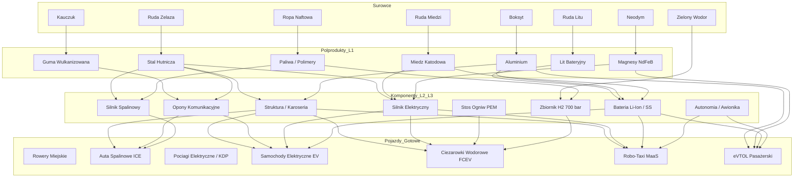

# Branża 4: Transport i Pojazdy – Receptury i Bilans Masowo-Energetyczny
**Załącznik Technologiczno-Procesowy do Silnika Symulacji Gospodarki Zrównoważonej (GDD v5.0)**

---

## 1. Wprowadzenie i Standardy Bilansowania Inżynieryjnego

Dokument definiuje kompletny zestaw zbalansowanych, realistycznych receptur produkcyjnych dla **Branży 4: Transport i Pojazdy** (Produkty 61–80 w uniwersum gry). Każdy proces został zweryfikowany pod kątem:
1. **Prawa Zachowania Masy**: $\sum \text{Masa Wsadu (Input)} = \text{Masa Produktu (Output)} + \text{Odpady Technologiczne / Złom Obiegowy}$.
2. **Bilansu Energetycznego**: Nakład energii elektrycznej i cieplnej w kilowatogodzinach [$\text{kWh}$] na jednostkę referencyjną procesu.
3. **Triady Wymogów Produkcyjnych**:
   * **Ludzie**: Zapotrzebowanie na etaty załogi w podziale na 3 klasy społeczne: `[R]` Robotnicy, `[M]` Specjaliści / Klasa Średnia, `[E]` Naukowcy / Inżynierowie.
   * **Energia [kWh]**: Przydział mocy z miejskiej sieci elektroenergetycznej lub ciepłowniczej.
   * **Licencja**: Wymagana technologia odblokowana w Drzewku Technologii lub patent z jednostki badawczo-rozwojowej (R&D).
4. **Hierarchii Łańcucha Dostaw**:
   $$\text{Surowce Bazowe (Kopalnie/Farmy)} \longrightarrow \text{Półprodukty L1 (Huty/Rafinerie)} \longrightarrow \text{Półprodukty L2/L3 (Komponenty)} \longrightarrow \text{Pojazd Końcowy}$$

---

## 2. Drzewo Materiałowe: Od Surowców do Półproduktów L1 i L2/L3

### 2.1. Półprodukty Poziomu 1 (L1) – Podstawowe Materiały Hutnicze i Chemiczne

#### L1-01: Surówka Hutnicza i Stal Węglowa (Huta Żelaza / Stalownia)
* **Wsad (Input)**:
  * Ruda Żelaza: $1\,600\text{ kg}$ (zawartość Fe ~62%)
  * Koks Przemysłowy (z Węgla Kamiennego): $500\text{ kg}$
  * Wapień (topnik): $200\text{ kg}$
* **Wynik (Output)**:
  * **Stal Węglowa**: $1\,000\text{ kg}$ (1 tona)
  * Żużel wielkopiecowy (surowiec dla cementowni): $450\text{ kg}$
  * Gaz wielkopiecowy / pyły: $850\text{ kg}$
* **Wymogi Triady**:
  * Ludzie: `12 [R], 2 [M], 0 [E]` na zmianę pieca
  * Energia: $1\,850\text{ kWh}$ / tonę stali (wielki piec + konwertor tlenowy BOF)
  * Licencja: *Maszyna Parowa i Hutnictwo Żelaza (Era 1)*
* *Ścieżka Cyrkularna (od Ery 2/7 - Piec Łukowy EAF / H2-DRI)*:
  * Wsad: $1\,050\text{ kg}$ Złomu Stalowego + $50\text{ kg}$ Wodoru Bazowego (DRI) $\to 1\,000\text{ kg}$ Zielonej Stali. Energia: $550\text{ kWh}$. Redukcja CO2: 92%. Licencja: *Zielona Stal Wodorowa (Era 7)*.

#### L1-02: Aluminium Hutnicze (Huta Aluminium – Proces Halla-Héroulta)
* **Wsad (Input)**:
  * Boksyt: $4\,000\text{ kg}$ (otrzymanie 2 t tlenku glinu Al2O3)
  * Węglan sodu / Woda przemysłowa: $200\text{ kg}$
  * Elektrody węglowe (anody): $450\text{ kg}$
* **Wynik (Output)**:
  * **Aluminium Hutnicze (Gąski/Wlewki)**: $1\,000\text{ kg}$
  * Czerwony szlam (odpad boksytowy): $2\,000\text{ kg}$
  * Emisje CO2 / gazy anodowe: $1\,650\text{ kg}$
* **Wymogi Triady**:
  * Ludzie: `8 [R], 4 [M], 1 [E]`
  * Energia: $14\,000\text{ kWh}$ / tonę aluminium (elektroliza wysokotemperaturowa)
  * Licencja: *Petrochemia, Tworzywa Sztuczne i Aluminium (Era 3)*
* *Ścieżka Cyrkularna*: Przetop złomu aluminiowego wymaga jedynie $700\text{ kWh}$ (oszczędność 95% energii).

#### L1-03: Miedź Rafinowana Elektrolitycznie (Huta i Rafineria Miedzi)
* **Wsad (Input)**:
  * Ruda Miedzi (siarczkowa/koncentrat): $3\,200\text{ kg}$
  * Kwas Siarkowy: $150\text{ kg}$
* **Wynik (Output)**:
  * **Katody Miedziane (Cu 99,99%)**: $1\,000\text{ kg}$
  * Żużel miedziowy i zgary: $1\,900\text{ kg}$
  * Szlam anodowy (źródło Złota i Srebra): $50\text{ kg}$
* **Wymogi Triady**:
  * Ludzie: `10 [R], 3 [M], 0 [E]`
  * Energia: $3\,800\text{ kWh}$ / tonę miedzi
  * Licencja: *Maszyna Parowa i Hutnictwo Żelaza (Era 1)*

#### L1-04: Guma Surowa i Wulkanizowana (Zakład Przetwórstwa Elastomerów)
* **Wsad (Input)**:
  * Kauczuk Naturalny (lateks): $700\text{ kg}$
  * Sadza Techniczna (z ropy naftowej): $250\text{ kg}$
  * Siarka i aktywatory (tlenek cynku, kwas stearynowy): $80\text{ kg}$
* **Wynik (Output)**:
  * **Guma Przemysłowa Wulkanizowana**: $1\,000\text{ kg}$
  * Odpady zlewkowe i ścinki: $30\text{ kg}$ (do ponownego uplastycznienia)
* **Wymogi Triady**:
  * Ludzie: `6 [R], 2 [M], 0 [E]`
  * Energia: $950\text{ kWh}$ / tonę mieszanki (miksery Banbury'ego, walcarki, kalandry)
  * Licencja: *Inżynieria Motoryzacyjna (Era 2)*

#### L1-05: Frakcje Naftowe i Paliwa (Rafineria Ropy Naftowej)
* **Wsad (Input)**:
  * Ropa Naftowa: $1\,000\text{ kg}$ (~1,18 m³)
* **Wynik (Output)**:
  * Benzyna Silnikowa: $420\text{ kg}$
  * Olej Napędowy (Diesel) i Nafta Lotnicza: $380\text{ kg}$
  * Ciężkie oleje opałowe, asfalty i frakcje petrochemiczne (monomery): $170\text{ kg}$
  * Gazy rafineryjne i straty: $30\text{ kg}$
* **Wymogi Triady**:
  * Ludzie: `6 [R], 6 [M], 1 [E]`
  * Energia: $480\text{ kWh}$ na 1 tonę przerobu ropy (destylacja rurowo-wieżowa + kraking)
  * Licencja: *Elektrownie Gazowe i Rafinerie Ropy (Era 3)*

#### L1-06: Wodór Bazowy (Elektrolizernia OZE / Reforming Parowy)
* **Wsad (Input)**:
  * Woda zdemineralizowana: $9\,000\text{ kg}$ (9 m³)
* **Wynik (Output)**:
  * **Zielony Wodór Sprężony (H2)**: $1\,000\text{ kg}$ (1 tona)
  * Czysty Tlen (O2 – gaz medyczny/przemysłowy): $8\,000\text{ kg}$
* **Wymogi Triady**:
  * Ludzie: `2 [R], 4 [M], 2 [E]`
  * Energia: $52\,000\text{ kWh}$ / tonę H2 (elektroliza PEM/alkaliczna, sprawność ~65%)
  * Licencja: *Gospodarka Wodorowa i Magazyny Energii Wielkiej Skali (Era 7)*

#### L1-07: Koncentrat Litu i Związki Bateryjne (Zakład Hydrometalurgiczny Litu)
* **Wsad (Input)**:
  * Ruda Litu (spodumen) lub solanka: $8\,000\text{ kg}$
  * Węglan sodu i Kwas solny: $1\,200\text{ kg}$
* **Wynik (Output)**:
  * **Wodorotlenek / Węglan Litu jakości bateryjnej**: $1\,000\text{ kg}$
  * Sole odpadowe i gips: $7\,500\text{ kg}$
* **Wymogi Triady**:
  * Ludzie: `5 [R], 5 [M], 2 [E]`
  * Energia: $6\,500\text{ kWh}$ / tonę litu bateryjnego
  * Licencja: *Automatyzacja Przemysłowa i Polimery (Era 4)*

#### L1-08: Tlenki Neodymu i Magnesy Trwałe (Zakład Separacji Pierwiastków Ziem Rzadkich)
* **Wsad (Input)**:
  * Ruda Neodymu i Metali Ziem Rzadkich: $10\,000\text{ kg}$
  * Chemikalia ekstrakcyjne i kwas fluorowodorowy: $2\,500\text{ kg}$
* **Wynik (Output)**:
  * **Czysty Stop Neodym-Żelazo-Bor (NdFeB)**: $1\,000\text{ kg}$
  * Tlenki metali towarzyszących: $3\,000\text{ kg}$
  * Odpady pofiltracyjne: $8\,500\text{ kg}$
* **Wymogi Triady**:
  * Ludzie: `4 [R], 6 [M], 4 [E]`
  * Energia: $16\,500\text{ kWh}$ / tonę stopu NdFeB
  * Licencja: *Mikroprocesory, Krzem i Inżynieria Precyzyjna (Era 5)*

---

### 2.2. Półprodukty Poziomu 2 i 3 (L2/L3) – Podzespoły Mechaniczne, Elektryczne i Strukturalne

| Kod | Nazwa Podzespołu | Wsad Składników (L1 / L2) | Zapotrzebowanie Załogi | Energia [kWh] | Licencja Technologiczna |
| :--- | :--- | :--- | :---: | :---: | :--- |
| **L2-01** | **Kocioł Parowy Wysokociśnieniowy** | Stal Konstrukcyjna: $12\,000\text{ kg}$<br>Rury Miedziane: $800\text{ kg}$<br>Nity i armatura: $700\text{ kg}$ | `14 [R], 3 [M], 0 [E]` | $4\,500\text{ kWh}$ | *Trakcja Parowa Dużej Mocy (Era 2)* |
| **L2-02** | **Tłokowy Silnik Parowy** | Odlewy Żeliwne: $6\,500\text{ kg}$<br>Stal Obrabiana: $2\,200\text{ kg}$<br>Tuleje z Brązu: $300\text{ kg}$ | `12 [R], 4 [M], 0 [E]` | $3\,200\text{ kWh}$ | *Maszyna Parowa i Hutnictwo Żelaza (Era 1)* |
| **L2-03** | **Silnik Spalinowy Osobowy (ICE 1.6-2.0)** | Odlewy Aluminiowe bloku: $65\text{ kg}$<br>Stal Kuta (wał, korbowody): $75\text{ kg}$<br>Przekładnie i uszczelnienia: $25\text{ kg}$ | `6 [R], 3 [M], 0 [E]` | $240\text{ kWh}$ | *Inżynieria Motoryzacyjna (Era 2)* |
| **L2-04** | **Ciężki Silnik Wysokoprężny (Diesel V8/R6)** | Żeliwo sferoidalne / Stal: $750\text{ kg}$<br>Aluminium: $120\text{ kg}$<br>Wtryskiwacze i turbosprężarka: $80\text{ kg}$ | `8 [R], 4 [M], 1 [E]` | $950\text{ kWh}$ | *Pojazdy Użytkowe Dużej Ładowności (Era 2)* |
| **L2-05** | **Dwusuwowy Silnik Okrętowy Wielkiej Mocy** | Ciężkie Odlewy Stalowe: $420\text{ t}$<br>Stal Kuta i wały korbowe: $180\text{ t}$<br>Układy wtryskowe i chłodzenie: $50\text{ t}$ | `35 [R], 15 [M], 5 [E]` | $480\,000\text{ kWh}$ | *Architektura Okrętowa Kontenerowa (Era 4)* |
| **L2-06** | **Trakcyjny Silnik Elektryczny (PMSM 150 kW)** | Stal Krzemowa (stojan/wirnik): $45\text{ kg}$<br>Drut Miedziany emaliowany: $28\text{ kg}$<br>Magnesy Neodymowe NdFeB: $2,5\text{ kg}$<br>Obudowa Aluminiowa: $18\text{ kg}$ | `3 [R], 4 [M], 1 [E]` | $160\text{ kWh}$ | *Floty Elektryczne i Niskoemisyjna Żegluga (Era 6)* |
| **L2-07** | **Falownik Trakcyjny i Kontroler SiC (Inverter)** | Moduły Mocy SiC / IGBT: $4\text{ kg}$<br>Miedź i szyny prądowe: $8\text{ kg}$<br>Płytka PCB ze sterownikiem ECU: $3\text{ kg}$<br>Aluminiowa obudowa chłodząca: $7\text{ kg}$ | `2 [R], 5 [M], 2 [E]` | $95\text{ kWh}$ | *Inteligentne Sieci (Smart Grid) (Era 6)* |
| **L2-08** | **Pakiet Baterii Trakcyjnej Li-Ion (60 kWh)** | Ogniwa Li-Ion (katoda NMC/LFP): $310\text{ kg}$<br>System chłodzenia i obudowa Aluminiowa: $95\text{ kg}$<br>System BMS, okablowanie Cu i styczniki: $25\text{ kg}$ | `4 [R], 8 [M], 3 [E]` | $3\,600\text{ kWh}$ | *Bioplastiki, Ogniwa Li-Ion i Ekoprojektowanie (Era 6)* |
| **L2-09** | **Bateria Solid-State eVTOL / EV (100 kWh)** | Elektrody kompozytowe i lit metaliczny: $240\text{ kg}$<br>Ceramiczny elektrolit stały: $120\text{ kg}$<br>Tytanowo-aluminiowa obudowa i BMS: $60\text{ kg}$ | `2 [R], 6 [M], 6 [E]` | $4\,800\text{ kWh}$ | *Nanotechnologia i Fabryki Bezodpadowe (Era 8)* |
| **L2-10** | **Stos Wodorowych Ogniw Paliwowych PEM (100 kW)** | Płytki bipolarne (grafit/tytan): $45\text{ kg}$<br>Membrany polimerowe z platyną: $8\text{ kg}$<br>Obudowa kompozytowa i osprzęt gazowy: $22\text{ kg}$ | `2 [R], 6 [M], 5 [E]` | $1\,400\text{ kWh}$ | *Wodorowe Układy Napędowe Dużej Mocy (Era 7)* |
| **L2-11** | **Wysokociśnieniowy Zbiornik Wodoru 700 bar** | Wewnętrzny liner polimerowy (HDPE): $22\text{ kg}$<br>Włókno Węglowe z żywicą epoksydową: $68\text{ kg}$<br>Zawór ze stali nierdzewnej / mosiądzu: $8\text{ kg}$ | `3 [R], 4 [M], 2 [E]` | $680\text{ kWh}$ | *Transport Wodorowy i Autonomiczna Logistyka (Era 7)* |
| **L2-12** | **Skrzynia Biegów / Przekładnia Redukcyjna** | Koła zębate i wałki ze stali stopowej: $52\text{ kg}$<br>Obudowa ze stopu aluminium/magnezu: $18\text{ kg}$<br>Łożyska toczne i synchronizatory: $10\text{ kg}$ | `4 [R], 2 [M], 0 [E]` | $120\text{ kWh}$ | *Taśma Produkcyjna (Fordyzm) (Era 2)* |
| **L2-13** | **Komputer Pokładowy Autonomii AI (Level 4/5)** | Płytki PCB z laminatu wielowarstwowego: $1,2\text{ kg}$<br>Procesory AI / Akceleratory NPU (krzem/złoto): $0,6\text{ kg}$<br>Radiator miedziano-aluminiowy: $2,8\text{ kg}$ | `1 [R], 4 [M], 5 [E]` | $180\text{ kWh}$ | *Sztuczna Inteligencja Sterowania Ruchem (Era 7)* |
| **L2-14** | **Zestaw Sensorów Wizyjnych i Lidar Solid-State** | Zwierciadła krzemowe, diody laserowe, soczewki: $3,5\text{ kg}$<br>Obudowa polimerowo-aluminiowa: $2,5\text{ kg}$<br>Okablowanie i mikrokontrolery: $1,5\text{ kg}$ | `1 [R], 5 [M], 4 [E]` | $140\text{ kWh}$ | *Mikroprocesory, Krzem i Inżynieria Precyzyjna (Era 5)* |

---

## 3. Szczegółowe Przepisy Produkcyjne dla 20 Produktów Końcowych Branży 4

Poniższe receptury stanowią parametry wejściowe do kalkulatora fabrycznego gry. Każdy proces określa 1 jednostkę handlową produktu.



---

### Produkt 1 (ID 61): Rowery Klasyczne Miejskie
*Epoka wejścia: Epoka 2 $\to$ w Epoce 6: Rowery Ultralekkie ze Stopów i Kompozytów*

* **Jednostka referencyjna**: 1 rower miejski ($15,5\text{ kg}$)
* **Drzewo Łańcucha Dostaw**:
  * *Surowce Bazowe*: Ruda Żelaza $\to$ Stal; Kauczuk Naturalny $\to$ Guma; Bydło $\to$ Skóra
  * *Półprodukty L1*: Stal Węglowa ($13,5\text{ kg}$), Guma Surowa ($1,8\text{ kg}$), Skóra Wyprawiona ($0,8\text{ kg}$)
  * *Półprodukty L2/L3*: Rury stalowe ramy i widelca ($9,5\text{ kg}$), Koła szprychowe z oponami rowerowymi ($3,8\text{ kg}$), Napęd łańcuchowy z zębatkami ($2,2\text{ kg}$)
* **Receptura Procesowa (Montaż Fabryczny)**:
  * **Wsad materiałowy (Input)**:
    1. Rury stalowe ramy i widelec (L2): $9,5\text{ kg}$
    2. Koła szprychowe z oponami (L2): $3,8\text{ kg}$
    3. Przekładnia łańcuchowa i mechanizm korbowy (L2): $2,2\text{ kg}$
    4. Siodełko skórzane i chwyty (L2): $0,8\text{ kg}$
  * **Produkt końcowy (Output)**: $1\text{ szt. Rower Miejski}$ ($15,5\text{ kg}$)
  * **Odpady procesowe**: $0,8\text{ kg}$ wiórów stalowych i gumy (100% recykling do hutnictwa)
* **Wymogi Triady**:
  * **Ludzie**: `3 [R], 1 [M], 0 [E]` (linia montażowa o wydajności 20 rowerów/h)
  * **Energia**: $18\text{ kWh}$ / rower (spawanie ramy, malowanie proszkowe, montaż)
  * **Licencja**: *Inżynieria Motoryzacyjna (Era 2)* / *Geometria Ramy i Napęd Łańcuchowy*
* **Ślad Środowiskowy i Cyrkularność**:
  * Emisja w cyklu życia (LCA): Zerowa emisja operacyjna ($0\text{ g CO2/km}$).
  * Recykling poużytkowy: 96% odzysku metali.

---

### Produkt 2 (ID 62): Powóz / Wóz Dostawczy
*Epoka wejścia: Epoka 2 $\to$ Wygasa całkowicie w Epoce 3 na rzecz samochodów dostawczych*

* **Jednostka referencyjna**: 1 powóz roboczy z dyszlem ($480\text{ kg}$)
* **Drzewo Łańcucha Dostaw**:
  * *Surowce Bazowe*: Drewno Okrągłe, Ruda Żelaza, Bydło (skóra)
  * *Półprodukty L1*: Tarcica jesionowa/dębowa ($380\text{ kg}$), Stal Hutnicza ($110\text{ kg}$), Skóra ($15\text{ kg}$)
  * *Półprodukty L2/L3*: Koła drewniane ze stalową obręczą ($90\text{ kg}$), Resory piórowe stalowe ($60\text{ kg}$), Skrzynia ładunkowa ($280\text{ kg}$), Uprząż ($12\text{ kg}$)
* **Receptura Procesowa (Manufaktura Kołodziejska)**:
  * **Wsad materiałowy (Input)**:
    1. Skrzynia drewniana z tarcicy sezonowanej: $310\text{ kg}$
    2. Okucia stalowe, osie kute i resory piórowe: $140\text{ kg}$
    3. Koła szprychowe z obręczą stalową (4 szt.): $85\text{ kg}$
    4. Pasy skórzane i cięgna: $15\text{ kg}$
  * **Produkt końcowy (Output)**: $1\text{ szt. Powóz Dostawczy}$ ($480\text{ kg}$)
  * **Odpady procesowe**: $70\text{ kg}$ trocin i ścinków drewna (opalanie suszarni)
* **Wymogi Triady**:
  * **Ludzie**: `6 [R], 2 [M], 0 [E]`
  * **Energia**: $35\text{ kWh}$ / wóz (napęd pił taśmowych, kuźnia kowalska)
  * **Licencja**: *Kołodziejstwo i Pojazdy Konne (Era 1)*
* **Ślad Środowiskowy i Cyrkularność**:
  * Emisje transportowe konne (metan, odchody). Odzysk: drewno opałowe, złom stalowy.

---

### Produkt 3 (ID 63): Lokomotywy Parowe i Wagony
*Epoka wejścia: Epoka 2 $\to$ Wygasa w Epoce 4 na rzecz trakcji spalinowej i elektrycznej*

* **Jednostka referencyjna**: 1 pociąg towarowy (Lokomotywa parowa z tendrem + 3 wagony węglarki – łącznie $135\text{ ton}$)
* **Drzewo Łańcucha Dostaw**:
  * *Surowce Bazowe*: Ruda Żelaza, Węgiel Kamienny, Ruda Miedzi, Drewno
  * *Półprodukty L1*: Stal Konstrukcyjna ($115\text{ t}$), Żeliwo odlewnicze ($22\text{ t}$), Miedź na rurki płomienicowe ($3,5\text{ t}$), Tarcica ($12\text{ t}$)
  * *Półprodukty L2/L3*: Kocioł Parowy Wysokociśnieniowy L2 ($28\text{ t}$), Zestawy kołowe i ostoja lokomotywy L2 ($42\text{ t}$), Tłokowy silnik parowy L2 ($18\text{ t}$), Podwozia wagonowe i sprzęgi L2 ($47\text{ t}$)
* **Receptura Procesowa (Fabryka Lokomotyw i Taboru Szynowego)**:
  * **Wsad materiałowy (Input)**:
    1. Kocioł Parowy z orurowaniem (L2): $28\,000\text{ kg}$
    2. Tłokowy Silnik Parowy ze stawidłem Heusingera (L2): $18\,000\text{ kg}$
    3. Ostoja spawano-nitowana i tender węglowy (L2): $35\,000\text{ kg}$
    4. Wagony towarowe ze stali i drewna (3 szt. L2): $58\,000\text{ kg}$
    5. Elementy złączne, nity, bufor i armatura: $3\,000\text{ kg}$
  * **Produkt końcowy (Output)**: $1\text{ Skład Parowy}$ ($135\,000\text{ kg}$)
  * **Odpady procesowe**: $7\,000\text{ kg}$ wiórów stalowych ze skrawania kół i osi (recykling do hutnictwa)
* **Wymogi Triady**:
  * **Ludzie**: `85 [R], 20 [M], 4 [E]`
  * **Energia**: $92\,000\text{ kWh}$ / skład (obróbka skrawaniem ciężkich elementów, nitowanie parowe, suwnice)
  * **Licencja**: *Kolej Parowa i Żegluga Parowa (Era 1)* / *Trakcja Parowa Dużej Mocy (Era 2)*
* **Ślad Środowiskowy i Cyrkularność**:
  * Gigantyczna emisja dymu i sadzy w eksploatacji (spalanie węgla). Po wycofaniu: 98% masy stanowi złom stalowy o wysokiej wartości.

---

### Produkt 4 (ID 64): Statki Parowe i Węglowce
*Epoka wejścia: Epoka 2 $\to$ Wygasa w Epoce 4 na rzecz motorowców napędzanych dieslem*

* **Jednostka referencyjna**: 1 parowiec towarowo-węglowy (długość 90 m, masa własna kadłuba i maszyn $2\,400\text{ ton}$)
* **Drzewo Łańcucha Dostaw**:
  * *Surowce Bazowe*: Ruda Żelaza, Ruda Miedzi, Drewno Okrągłe
  * *Półprodukty L1*: Stal Okrętowa Gruba ($2\,150\text{ t}$), Brąz i Mosiądz ($45\text{ t}$), Tarcica pokładowa ($120\text{ t}$)
  * *Półprodukty L2/L3*: Sekcje kadłuba nitowanego L2 ($1\,800\text{ t}$), Zespół kotłów szkockich L2 ($320\text{ t}$), Maszyna parowa potrójnego rozprężania L2 ($190\text{ t}$), Śruba napędowa i wał ($35\text{ t}$)
* **Receptura Procesowa (Stocznia Morska – Pochylnia)**:
  * **Wsad materiałowy (Input)**:
    1. Blachy i wręgi ze stali okrętowej: $2\,100\,000\text{ kg}$
    2. Zespół kotłów i maszynownia parowa (L2): $510\,000\text{ kg}$
    3. Śruba brązowa, wały i łożyska lignofolowe: $45\,000\text{ kg}$
    4. Drewno pokładowe i osprzęt: $120\,000\text{ kg}$
    5. Nity stalowe i spoiwa: $85\,000\text{ kg}$
  * **Produkt końcowy (Output)**: $1\text{ Statek Parowy}$ ($2\,400\,000\text{ kg}$)
  * **Odpady procesowe**: $460\,000\text{ kg}$ odpadów hutniczych, zgarów i ścinków blach
* **Wymogi Triady**:
  * **Ludzie**: `220 [R], 40 [M], 8 [E]`
  * **Energia**: $1\,850\,000\text{ kWh}$ / jednostkę (ogrzewanie nitów, prasy hydrauliczne, dźwigi)
  * **Licencja**: *Okrętownictwo Nitowane (Era 2)*
* **Ślad Środowiskowy i Cyrkularność**:
  * Bardzo wysoki ślad węglowy na tonokilometr. Przy złomowaniu źródło setek ton stali hutniczej.

---

### Produkt 5 (ID 65): Samochody Osobowe Spalinowe (Benzyna/Diesel)
*Epoka wejścia: Epoka 2 $\to$ rozwój przez Epoki 3–6 $\to$ Wygasa w Epoce 7 na rzecz EV i FCEV*

* **Jednostka referencyjna**: 1 samochód osobowy segmentu C/D ($1\,380\text{ kg}$)
* **Drzewo Łańcucha Dostaw**:
  * *Surowce Bazowe*: Ruda Żelaza, Boksyt, Ropa Naftowa, Kauczuk Naturalny, Piasek Kwarcowy, Miedź
  * *Półprodukty L1*: Stal głębokotłoczna ($880\text{ kg}$), Aluminium ($110\text{ kg}$), Tworzywa sztuczne ($180\text{ kg}$), Guma ($65\text{ kg}$), Szkło ($40\text{ kg}$), Miedź ($25\text{ kg}$)
  * *Półprodukty L2/L3*: Silnik Spalinowy ICE L2 ($165\text{ kg}$), Skrzynia Biegów ze sprzęgłem L2 ($75\text{ kg}$), Tłoczona Karoseria z drzwiami L2 ($390\text{ kg}$), Zawieszenie i układ hamulcowy L2 ($210\text{ kg}$), Komplet 4 kół z oponami L2 ($70\text{ kg}$), Wiązka elektryczna z akumulatorem kwasowo-ołowiowym L2 ($55\text{ kg}$), Wykończenie wnętrza L2 ($180\text{ kg}$)
* **Receptura Procesowa (Fabryka Samochodów – Zautomatyzowana Taśma Montażowa)**:
  * **Wsad materiałowy (Input)**:
    1. Karoseria lakierowana Body-in-White (L2): $390\text{ kg}$
    2. Silnik ICE z osprzętem i wydechem z katalizatorem (L2): $185\text{ kg}$
    3. Skrzynia biegów i półosie (L2): $85\text{ kg}$
    4. Zawieszenie, osie i hamulce tarczowe (L2): $220\text{ kg}$
    5. Opony komunikacyjne z felgami stalowymi (4 szt. L2): $72\text{ kg}$
    6. Fotele, deska rozdzielcza, szyby i tapicerka (L2): $260\text{ kg}$
    7. Płyny eksploatacyjne (olej, płyn chłodniczy, hamulcowy): $22\text{ kg}$
  * **Produkt końcowy (Output)**: $1\text{ Samochód Osobowy Spalinowy}$ ($1\,380\text{ kg}$)
  * **Odpady procesowe**: $65\text{ kg}$ (odpady lakiernicze, ścinki kabli, tworzywa)
* **Wymogi Triady**:
  * **Ludzie**: `18 [R], 6 [M], 1 [E]` (linia pracująca w takcie 60 sekund/samochód)
  * **Energia**: $850\text{ kWh}$ / pojazd (tłocznia, spawalnia robotyczna, piec lakierniczy, montaż)
  * **Licencja**: *Inżynieria Motoryzacyjna (Era 2)* $\to$ modernizacja: *Taśma Produkcyjna (Fordyzm)*
* **Ślad Środowiskowy i Cyrkularność**:
  * Emisja w użyciu: $135\text{ g CO2/km}$. Recykling po złomowaniu: odzysk 85% stali, 95% ołowiu z akumulatora i 70% aluminium.

---

### Produkt 6 (ID 66): Ciężarówki Spalinowe
*Epoka wejścia: Epoka 2 $\to$ Wygasa w Epoce 7 na rzecz ciężarówek wodorowych i elektrycznych*

* **Jednostka referencyjna**: 1 ciągnik siodłowy dużej ładowności 40t ($7\,800\text{ kg}$)
* **Drzewo Łańcucha Dostaw**:
  * *Surowce Bazowe*: Ruda Żelaza, Ropa Naftowa, Kauczuk Naturalny, Miedź
  * *Półprodukty L1*: Stal Wysokowytrzymała ($5\,600\text{ kg}$), Żeliwo ($950\text{ kg}$), Guma techniczna ($380\text{ kg}$), Polimery i szyby ($420\text{ kg}$), Miedź ($60\text{ kg}$)
  * *Półprodukty L2/L3*: Ciężki Silnik Wysokoprężny Diesel L2 ($950\text{ kg}$), Wzmocniona Rama Nośna C-Section ze stali mikrostopowej L2 ($1\,850\text{ kg}$), Zespół mostów napędowych i wał Kardana L2 ($1\,250\text{ kg}$), Kabina kierowcy ze stali i tworzyw L2 ($920\text{ kg}$), Zespół kół bliźniaczych z oponami ciężarowymi L2 (6 szt. $650\text{ kg}$), Skrzynia biegów z retarderem L2 ($380\text{ kg}$), Zbiorniki paliwa i układ pneumatyczny L2 ($320\text{ kg}$)
* **Receptura Procesowa (Fabryka Pojazdów Ciężarowych)**:
  * **Wsad materiałowy (Input)**:
    1. Rama podwozia z zawieszeniem pneumatycznym (L2): $2\,400\text{ kg}$
    2. Ciężki Silnik Diesla z układem SCR/AdBlue (L2): $1\,050\text{ kg}$
    3. Mosty napędowe ze zwolnicami i skrzynia biegów (L2): $1\,650\text{ kg}$
    4. Kabina sypialna wyposażona (L2): $950\text{ kg}$
    5. Opony ciężarowe z felgami 22.5 cala (6 szt. L2): $680\text{ kg}$
    6. Układ wydechowy, siodło ciągnika i instalacje: $1\,150\text{ kg}$
  * **Produkt końcowy (Output)**: $1\text{ Ciężarówka Spalinowa}$ ($7\,800\text{ kg}$)
  * **Odpady procesowe**: $120\text{ kg}$
* **Wymogi Triady**:
  * **Ludzie**: `32 [R], 8 [M], 2 [E]`
  * **Energia**: $4\,200\text{ kWh}$ / pojazd
  * **Licencja**: *Pojazdy Użytkowe Dużej Ładowności (Era 2)*
* **Ślad Środowiskowy i Cyrkularność**:
  * Znacząca emisja cząstek stałych PM i NOx. Stal z ramy i mostów stanowi 85% masy i w 100% nadaje się do przetopu w piecach EAF.

---

### Produkt 7 (ID 67): Motocykle i Skutery
*Epoka wejścia: Epoka 2 $\to$ w Epoce 6: Motocykle i Skutery Elektryczne*

* **Jednostka referencyjna**: 1 motocykl szosowy ($190\text{ kg}$)
* **Drzewo Łańcucha Dostaw**:
  * *Surowce Bazowe*: Ruda Żelaza, Boksyt, Ropa Naftowa, Kauczuk Naturalny
  * *Półprodukty L1*: Stal Rurowa ($95\text{ kg}$), Aluminium ($45\text{ kg}$), Guma ($22\text{ kg}$), Tworzywa ($20\text{ kg}$)
  * *Półprodukty L2/L3*: Lekki silnik 2-cylindrowy ICE L2 ($48\text{ kg}$), Rama rurowa kratownicowa L2 ($28\text{ kg}$), Zespół kół motocyklowych z tarczami L2 ($24\text{ kg}$), Układ wydechowy i napęd łańcuchowy L2 ($22\text{ kg}$)
* **Receptura Procesowa (Zakład Produkcji Jednośladów)**:
  * **Wsad materiałowy (Input)**:
    1. Rama motocyklowa ze stali chromowo-molibdenowej (L2): $30\text{ kg}$
    2. Kompaktowy silnik ICE ze skrzynią zintegrowaną (L2): $52\text{ kg}$
    3. Koła motocyklowe z oponami (2 szt. L2): $26\text{ kg}$
    4. Widelec teleskopowy, wahacz i amortyzator (L2): $25\text{ kg}$
    5. Zbiornik paliwa, owiewki z tworzywa ABS, kanapa: $32\text{ kg}$
    6. Instalacja elektryczna i oświetlenie: $18\text{ kg}$
  * **Produkt końcowy (Output)**: $1\text{ szt. Motocykl}$ ($190\text{ kg}$)
  * **Odpady procesowe**: $14\text{ kg}$
* **Wymogi Triady**:
  * **Ludzie**: `5 [R], 2 [M], 0 [E]`
  * **Energia**: $160\text{ kWh}$ / sztukę
  * **Licencja**: *Jednoślady Silnikowe (Era 2)*
* **Ślad Środowiskowy i Cyrkularność**:
  * Znakomita efektywność przestrzenna w miastach. W Epoce 6 konwersja na silnik elektryczny w piaście i baterię wymienną.

---

### Produkt 8 (ID 68): Opony Komunikacyjne
*Epoka wejścia: Epoka 2 $\to$ w Epoce 7: Opony Bezpowietrzne z Recyklingu*

* **Jednostka referencyjna**: 1 partia opon samochodowych radialnych (4 sztuki – łącznie $38\text{ kg}$)
* **Drzewo Łańcucha Dostaw**:
  * *Surowce Bazowe*: Kauczuk Naturalny, Ropa Naftowa (Sadza N220/N330), Ruda Żelaza
  * *Półprodukty L1*: Guma Surowa Elastomerowa ($22\text{ kg}$), Sadza i plastyfikatory olejowe ($9\text{ kg}$), Kord Stalowy mosiądzowany ($5\text{ kg}$), Tkanina kordowa tekstylna nylon/rayon ($2\text{ kg}$)
  * *Półprodukty L2/L3*: Pakiet bieżnika z opasaniem stalowym L2 ($24\text{ kg}$), Ściany boczne i stopki z drutówkami L2 ($14\text{ kg}$)
* **Receptura Procesowa (Fabryka Opon – Konfekcjonowanie i Wulkanizacja)**:
  * **Wsad materiałowy (Input)**:
    1. Mieszanka bieżnika gumowo-krzemionkowa: $18\text{ kg}$
    2. Kord stalowy pasów opasania: $5\text{ kg}$
    3. Guma osnowy i ścian bocznych: $10\text{ kg}$
    4. Drutówki stalowe stopki i kord tekstylny: $6\text{ kg}$
  * **Produkt końcowy (Output)**: $4\text{ szt. Opony Radialne}$ ($38\text{ kg}$)
  * **Odpady procesowe**: $1,5\text{ kg}$ (wypływki wulkanizacyjne $\to$ granulat gumowy)
* **Wymogi Triady**:
  * **Ludzie**: `4 [R], 2 [M], 0 [E]`
  * **Energia**: $85\text{ kWh}$ / komplet 4 opon (prasy wulkanizacyjne parowe $160^\circ\text{C}$, wytłaczarki)
  * **Licencja**: *Inżynieria Motoryzacyjna (Era 2)* $\to$ *Opony Radialne Ciśnieniowe*
* **Ślad Środowiskowy i Cyrkularność**:
  * Ścieranie bieżnika tworzy mikroplastik miejski. Usługa **Serwisantów** (bieżnikowanie) wydłuża trwałość o 100%. Zużyte opony $\to$ mielenie kriogeniczne na granulat dla nawierzchni dróg i boisk.

---

### Produkt 9 (ID 69): Autobusy Miejskie (Spalinowe / Elektryczne)
*Epoka wejścia: Epoka 3 (Spalinowe) $\to$ w Epoce 6: Autobusy W pełni Elektryczne i Wodorowe*

* **Jednostka referencyjna**: 1 autobus miejski 12-metrowy niskopodłogowy ($11\,500\text{ kg}$)
* **Drzewo Łańcucha Dostaw**:
  * *Surowce Bazowe*: Ruda Żelaza, Boksyt, Ruda Miedzi, Kauczuk, Ruda Litu (w E6)
  * *Półprodukty L1*: Stal Nierdzewna profilowa ($6\,200\text{ kg}$), Aluminium poszyciowe ($2\,100\text{ kg}$), Szkło bezpieczne ($650\text{ kg}$), Guma i tworzywa ($850\text{ kg}$), Miedź ($120\text{ kg}$)
  * *Półprodukty L2/L3*: Kratownica przestrzenna ze stali nierdzewnej L2 ($4\,100\text{ kg}$), Silnik Diesla Euro-6 L2 ($900\text{ kg}$) *LUB* Silnik Elektryczny 250 kW + Bateria Li-Ion 350 kWh L2/L3 ($2\,800\text{ kg}$), Most portalowy niskopodłogowy i oś przednia L2 ($1\,650\text{ kg}$), Drzwi pneumatyczne, fotele i wyposażenie wnętrza L2 ($1\,800\text{ kg}$)
* **Receptura Procesowa (Fabryka Autobusów)**:
  * **Wsad materiałowy (Input)**:
    1. Kratownica podwozia i szkielet ze stali 3CR12 (L2): $4\,250\text{ kg}$
    2. Panele poszycia zewnętrznego z aluminium i kompozytów (L2): $2\,200\text{ kg}$
    3. Układ napędowy (Silnik spalinowy / bateryjny z inwerterem L2): $1\,950\text{ kg}$
    4. Osie sztywne i portalowe z hamulcami tarczowymi (L2): $1\,700\text{ kg}$
    5. Szyby klejone boczne i czołowe: $680\text{ kg}$
    6. Fotele wandaloodporne, poręcze i instalacja CAN-bus: $1\,150\text{ kg}$
  * **Produkt końcowy (Output)**: $1\text{ Autobus Miejski}$ ($11\,500\text{ kg}$)
  * **Odpady procesowe**: $430\text{ kg}$
* **Wymogi Triady**:
  * **Ludzie**: `28 [R], 12 [M], 2 [E]`
  * **Energia**: $6\,800\text{ kWh}$ / autobus
  * **Licencja**: *Komunikacja Zbiorowa Niskopodłogowa (Era 3)* / *Floty Elektryczne (Era 6)*
* **Ślad Środowiskowy i Cyrkularność**:
  * Każdy autobus zastępuje 60 samochodów osobowych w miejskim szczycie. Wersja elektryczna redukuje emisję lokalną do 0 g.

---

### Produkt 10 (ID 70): Pociągi Elektryczne i Koleje Dużych Prędkości (KDP)
*Epoka wejścia: Epoka 3 (EZT) $\to$ w Epoce 5: KDP (TGV/ICE/Maglev do 350 km/h)*

* **Jednostka referencyjna**: 1 czteroczłonowy Elektryczny Zespół Trakcyjny KDP ($165\text{ ton}$)
* **Drzewo Łańcucha Dostaw**:
  * *Surowce Bazowe*: Boksyt (kadłub), Ruda Żelaza (wózki), Ruda Miedzi, Piasek Kwarcowy
  * *Półprodukty L1*: Profile Aluminiowe wielkokomorowe ($68\text{ t}$), Stal Konstrukcyjna kuta ($55\text{ t}$), Miedź Rafinowana ($8,5\text{ t}$), Szkło pancerne ($4\text{ t}$)
  * *Półprodukty L2/L3*: Wózki toczne i napędowe ze stali sprężystej L2 ($38\text{ t}$), 8 Asynchronicznych Silników Trakcyjnych (łączna moc 4 MW) L2 ($12\text{ t}$), Transformator trakcyjny i falowniki IGBT L2 ($9\text{ t}$), Pantografy, wyłączniki szybkie i dławiki L2 ($4,5\text{ t}$), Wyposażenie przedziałów pasażerskich i klimatyzacja HVAC L2 ($28\text{ t}$)
* **Receptura Procesowa (Zakłady Pojazdów Szynowych Dużych Prędkości)**:
  * **Wsad materiałowy (Input)**:
    1. Cztery pudła wagonów z profili aluminiowych spawanych laserowo (L2): $66\,000\text{ kg}$
    2. Zespół wózków jezdnych z tłumikami wężykowania (L2): $39\,000\text{ kg}$
    3. Zespół napędu elektrycznego (silniki + falowniki + trafo L2): $22\,000\text{ kg}$
    4. Systemy sterowania ruchem ETCS L2/L3, pulpit maszynisty: $3\,500\text{ kg}$
    5. Siedzenia pasażerskie, izolacja akustyczna, toalety próżniowe: $32\,000\text{ kg}$
    6. Szyby bezpieczne laminowane i drzwi odskokowo-przesuwne: $8\,500\text{ kg}$
  * **Produkt końcowy (Output)**: $1\text{ Skład Pociągu KDP}$ ($165\,000\text{ kg}$)
  * **Odpady procesowe**: $6\,000\text{ kg}$ wiórów aluminium i stali (100% recykling zamknięty)
* **Wymogi Triady**:
  * **Ludzie**: `95 [R], 38 [M], 12 [E]`
  * **Energia**: $180\,000\text{ kWh}$ / skład KDP
  * **Licencja**: *Trakcja Elektryczna Kolejowa (Era 3)* $\to$ *Logistyka Just-in-Time i Koleje Dużych Prędkości (Era 5)*
* **Ślad Środowiskowy i Cyrkularność**:
  * Najbardziej ekologiczny środek transportu międzymiastowego ($14\text{ g CO2/pasażerokilometr}$). Żywotność pojazdu: 35–40 lat.

---

### Produkt 11 (ID 71): Samoloty Pasażerskie (Tłokowe / Odrzutowe / Wodorowe)
*Epoka wejścia: Epoka 3 (Tłokowe) $\to$ w Epoce 4: Odrzutowce pasażerskie $\to$ w Epoce 7: Samoloty na Wodór i E-Paliwa*

* **Jednostka referencyjna**: 1 odrzutowiec pasażerski wąskokadłubowy 160-miejscowy (masa własna pustego samolotu OEW: $42\,500\text{ kg}$)
* **Drzewo Łańcucha Dostaw**:
  * *Surowce Bazowe*: Boksyt (stopy lotnicze), Ruda Żelaza/Tytanu, Ruda Miedzi, Ropa Naftowa (kompozyty węglowe)
  * *Półprodukty L1*: Duraluminium Al-Li ($25\,500\text{ kg}$), Stopy Tytanu i Stali Wysokowytrzymałej ($6\,200\text{ kg}$), Włókna Węglowe z żywicą polimerową ($7\,800\text{ kg}$), Miedź na magistrale elektryczne ($1\,600\text{ kg}$)
  * *Półprodukty L2/L3*: Silniki Turbowentylatorowe o wysokim stopniu dwuprzepływowości (2 szt. L2/L3: $6\,400\text{ kg}$), Kadłub ciśnieniowy ze skrzydłami kesonowymi L2 ($23\,500\text{ kg}$), Podwozie chowane wielokołowe L2 ($2\,800\text{ kg}$), Zintegrowana Awionika Lotnicza Fly-by-Wire i radary L2/L3 ($1\,900\text{ kg}$), Wyposażenie kabiny pasażerskiej, fotele i hermetyzacja L2 ($6\,500\text{ kg}$)
* **Receptura Procesowa (Zakłady Lotnicze i Montownia Płatowców)**:
  * **Wsad materiałowy (Input)**:
    1. Sekcje kadłuba, skrzydła i usterzenie (Al-Li + kompozyty L2): $24\,200\text{ kg}$
    2. Dwa silniki turbowentylatorowe turboodrzutowe (L2): $6\,500\text{ kg}$
    3. Golenie podwozia z siłownikami i kołami (L2): $2\,900\text{ kg}$
    4. Awionika cyfrowa, komputery nawigacyjne i wiązki światłowodowe: $2\,100\text{ kg}$
    5. Wyposażenie wnętrza, galleye, fotele i okna ciśnieniowe: $7\,200\text{ kg}$
    6. Systemy hydrauliczne, zbiorniki paliwa i pompy: $1\,800\text{ kg}$
  * **Produkt końcowy (Output)**: $1\text{ Samolot Pasażerski}$ ($42\,500\text{ kg}$)
  * **Odpady procesowe**: $2\,200\text{ kg}$ (skrawki kompozytów i stopów tytanu)
* **Wymogi Triady**:
  * **Ludzie**: `60 [R], 45 [M], 20 [E]` (rygorystyczne normy sterylności i certyfikacji lotniczej)
  * **Energia**: $220\,000\text{ kWh}$ / samolot (autoklawy do kompozytów węglowych, montaż laserowy)
  * **Licencja**: *Lotnictwo Towarowe i Pasażerskie (Era 3)* $\to$ *Aerodynamika Naddźwiękowa i Odrzutowa (Era 4)*
* **Ślad Środowiskowy i Cyrkularność**:
  * Wysoki jednostkowy ślad operacyjny paliw kopalnych ($85\text{ g CO2/pasażerokm}$). W Epoce 7 przejście na zbiorniki kriogeniczne wodoru i silniki spalające wodór redukuje emisję kopalną do zera.

---

### Produkt 12 (ID 72): Kontenerowce i Statki Motorowe
*Epoka wejścia: Epoka 4 $\to$ w Epoce 7: Statki Wodorowo-Żaglowe z Rotorami Flettnera*

* **Jednostka referencyjna**: 1 oceaniczny kontenerowiec 8000 TEU ($28\,000\text{ ton}$ stali i wyposażenia)
* **Drzewo Łańcucha Dostaw**:
  * *Surowce Bazowe*: Ruda Żelaza, Ruda Miedzi, Ropa Naftowa (farby antyporostowe i izolacje)
  * *Półprodukty L1*: Stal Okrętowa Gruba AH36/DH36 ($25\,500\text{ t}$), Miedź ($350\text{ t}$), Brąz na śrubę ($85\text{ t}$), Tworzywa i farby epoksydowe ($450\text{ t}$)
  * *Półprodukty L2/L3*: Prefabrykowane bloki kadłubowe z grodziami L2 ($23\,000\text{ t}$), Wolnoobrotowy dwusuwowy silnik Diesla 60 MW L2 ($1\,850\text{ t}$), Wał napędowy i 6-łopatowa śruba nastawna L2 ($180\text{ t}$), Mostek nawigacyjny ze sterówką L2 ($250\text{ t}$), Prowadnice kontenerowe, luki ładowni i wciągarki cumownicze L2 ($2\,200\text{ t}$)
* **Receptura Procesowa (Suchy Dok Stoczni Wielkich Jednostek)**:
  * **Wsad materiałowy (Input)**:
    1. Bloki sekcyjne kadłuba ze stali spawalnej: $24\,800\,000\text{ kg}$
    2. Główny silnik napędowy i generatory pomocnicze: $2\,100\,000\text{ kg}$
    3. Prowadnice kontenerowe (cell guides) i windy kotwiczne: $2\,300\,000\text{ kg}$
    4. Śruba napędowa ze stopu brązu, manganu i aluminium: $90\,000\text{ kg}$
    5. Wyposażenie nawigacyjne ECDIS, kabiny załogi i instalacje: $350\,000\text{ kg}$
  * **Produkt końcowy (Output)**: $1\text{ Kontenerowiec Oceaniczny}$ ($28\,000\,000\text{ kg}$)
  * **Odpady procesowe**: $1\,640\,000\text{ kg}$ (odpady hutnicze, zgary spawalnicze)
* **Wymogi Triady**:
  * **Ludzie**: `310 [R], 75 [M], 15 [E]`
  * **Energia**: $6\,200\,000\text{ kWh}$ / statek (spawanie automatyczne pod topnikiem, dźwigi bramowe 1000t)
  * **Licencja**: *Konteneryzacja Globalna i Autostrady (Era 4)*
* **Ślad Środowiskowy i Cyrkularność**:
  * Podstawa globalnego handlu ($90\%$ towarów). W Epoce 7 doposażenie w 4 sztywne rotory Flettnera (wspomaganie wiatrem) obniża zużycie paliwa o 22%. Złomowanie w stoczniach cyrkularnych zwraca ponad $25\,000\text{ ton}$ czystego złomu stalowego.

---

### Produkt 13 (ID 73): Tramwaje i Pociągi Metra
*Epoka wejścia: Epoka 3 $\to$ stała ewolucja modułowa przez Epoki 4–7*

* **Jednostka referencyjna**: 1 pięcioczłonowy niskopodłogowy tramwaj miejski 32 m ($41\,500\text{ kg}$)
* **Drzewo Łańcucha Dostaw**:
  * *Surowce Bazowe*: Ruda Żelaza, Boksyt, Ruda Miedzi, Piasek Kwarcowy
  * *Półprodukty L1*: Stal Odporna na Korozję ($19\,000\text{ kg}$), Aluminium ($11\,500\text{ kg}$), Miedź ($2\,800\text{ kg}$), Szkło Hartowane ($1\,800\text{ kg}$)
  * *Półprodukty L2/L3*: Wózki napędowe i toczne z kołami elastycznymi L2 ($11\,500\text{ kg}$), Silniki trakcyjne asynchroniczne z falownikami 600V DC L2 ($4\,200\text{ kg}$), Przeguby członowe z miechami harmonijkowymi L2 ($1\,600\text{ kg}$), Moduły pasażerskie z drzwiami odskokowymi L2 ($18\,500\text{ kg}$)
* **Receptura Procesowa (Fabryka Taboru Miejskiego)**:
  * **Wsad materiałowy (Input)**:
    1. Człony szkieletowe ze stali i aluminium (L2): $19\,500\text{ kg}$
    2. Wózki tramwajowe ze zintegrowanymi silnikami (L2): $12\,000\text{ kg}$
    3. Falowniki trakcyjne, chopper hamowania, pantograf (L2): $3\,800\text{ kg}$
    4. Szyby bezpieczne, drzwi i miechy przegubów (L2): $3\,600\text{ kg}$
    5. Fotele, klimatyzacja całopojazdowa i system informacji pasażerskiej: $4\,200\text{ kg}$
  * **Produkt końcowy (Output)**: $1\text{ Tramwaj Niskopodłogowy}$ ($41\,500\text{ kg}$)
  * **Odpady procesowe**: $1\,600\text{ kg}$
* **Wymogi Triady**:
  * **Ludzie**: `36 [R], 14 [M], 4 [E]`
  * **Energia**: $38\,000\text{ kWh}$ / tramwaj
  * **Licencja**: *Trakcja Elektryczna Kolejowa (Era 3)* / *Szynowy Transport Aglomeracyjny*
* **Ślad Środowiskowy i Cyrkularność**:
  * Eliminacja emisji spalin i smogu w centrach miast. Odzysk energii podczas hamowania rekuperacyjnego (do sieci trakcyjnej lub superkondensatorów pokładowych) wynosi do 35%.

---

### Produkt 14 (ID 74): Samochody Hybrydowe
*Epoka wejścia: Epoka 6 $\to$ Technologia pomostowa dekarbonizacji*

* **Jednostka referencyjna**: 1 samochód hybrydowy segmentu C/D HEV ($1\,450\text{ kg}$)
* **Drzewo Łańcucha Dostaw**:
  * *Surowce Bazowe*: Ruda Żelaza, Boksyt, Ruda Miedzi, Ruda Litu, Neodym
  * *Półprodukty L1*: Stal Cienkościenna o Wysokiej Sprężystości ($760\text{ kg}$), Aluminium ($180\text{ kg}$), Miedź ($45\text{ kg}$), Lit ($1,8\text{ kg}$), Neodym ($1,2\text{ kg}$)
  * *Półprodukty L2/L3*: Silnik Spalinowy o obiegu Atkinsona L2 ($115\text{ kg}$), Przekładnia Planetarna E-CVT L2 ($55\text{ kg}$), Dwa Silniki/Generatory Elektryczne PMSM L2 ($48\text{ kg}$), Zespół Baterii Trakcyjnej Li-Ion 1.8 kWh L2 ($38\text{ kg}$), Falownik Sterujący Power Control Unit L2 ($16\text{ kg}$), Karoseria i wnętrze L2 ($780\text{ kg}$)
* **Receptura Procesowa (Fabryka Aut Nowej Generacji)**:
  * **Wsad materiałowy (Input)**:
    1. Nadwozie stalowo-aluminiowe zabezpieczone kataforezą: $680\text{ kg}$
    2. Zespół hybrydowy (Silnik Atkinsona + E-CVT + 2 silniki elektryczne L2): $225\text{ kg}$
    3. Pakiet baterii buforowej Li-Ion z układem chłodzenia (L2): $40\text{ kg}$
    4. Zintegrowany falownik PCU i wiązki wysokonapięciowe: $24\text{ kg}$
    5. Zawieszenie, hamulce ze sterowaniem elektrohydraulicznym ECB: $195\text{ kg}$
    6. Wnętrze, koła, opony niskich oporów toczenia i szyby: $330\text{ kg}$
  * **Produkt końcowy (Output)**: $1\text{ Samochód Hybrydowy}$ ($1\,450\text{ kg}$)
  * **Odpady procesowe**: $44\text{ kg}$
* **Wymogi Triady**:
  * **Ludzie**: `14 [R], 8 [M], 2 [E]`
  * **Energia**: $920\text{ kWh}$ / pojazd
  * **Licencja**: *Floty Elektryczne i Niskoemisyjna Żegluga (Era 6)* / *Napędy Spalinowo-Elektryczne*
* **Ślad Środowiskowy i Cyrkularność**:
  * Redukcja spalania i emisji CO2 o 40% w cyklu miejskim ($85\text{ g CO2/km}$).

---

### Produkt 15 (ID 75): Samochody Osobowe Elektryczne (EV)
*Epoka wejścia: Epoka 6 $\to$ w Epoce 7: Baterie Solid-State z Cyrkularnego Recyklingu*

* **Jednostka referencyjna**: 1 samochód elektryczny bateryjny BEV zasięgu 500 km ($1\,820\text{ kg}$)
* **Drzewo Łańcucha Dostaw**:
  * *Surowce Bazowe*: Boksyt, Ruda Litu, Neodym i Ziemie Rzadkie, Ruda Miedzi, Ruda Żelaza
  * *Półprodukty L1*: Aluminium Hutnicze ($550\text{ kg}$), Stal Ultra-Wysokowytrzymała UHSS ($480\text{ kg}$), Miedź ($82\text{ kg}$), Związki Litu ($9,5\text{ kg}$), Nikiel i Kobalt ($38\text{ kg}$), Magnesy NdFeB ($3,2\text{ kg}$)
  * *Półprodukty L2/L3*: Pakiet Baterii Trakcyjnej Li-Ion 75 kWh L2/L3 ($460\text{ kg}$), Dwa Silniki Elektryczne PMSM na przednią i tylną oś L2 ($92\text{ kg}$), Falowniki z węglika krzemu SiC L2 ($18\text{ kg}$), Podwozie typu deskorolka (Skateboard platform) ze zintegrowaną baterią L2 ($310\text{ kg}$), Aluminiowe poszycie nadwozia metodą Gigacasting L2 ($280\text{ kg}$), Komputer pokładowy ADAS z ekranami OLED L2 ($25\text{ kg}$)
* **Receptura Procesowa (Gigafabryka Samochodów Elektrycznych)**:
  * **Wsad materiałowy (Input)**:
    1. Odlewy ciśnieniowe podwozia (Gigacasting Al) i profile zderzaków: $340\text{ kg}$
    2. Pakiet baterii strukturalnej (Cell-to-Pack 75 kWh L2): $465\text{ kg}$
    3. Silniki elektryczne e-Axle z falownikami SiC (L2): $115\text{ kg}$
    4. Nadwozie aluminiowe z drzwiami i klapami: $310\text{ kg}$
    5. Koła aero z oponami EV zoptymalizowanymi pod opory toczenia (L2): $78\text{ kg}$
    6. System hamulcowy One-Pedal i zawieszenie aktywne: $185\text{ kg}$
    7. Wnętrze z tkanin recyklingowanych rPET, szyby dźwiękochłonne i elektronika: $360\text{ kg}$
  * **Produkt końcowy (Output)**: $1\text{ Samochód Elektryczny BEV}$ ($1\,820\text{ kg}$)
  * **Odpady procesowe**: $33\text{ kg}$ (brak procesów brudnych tradycyjnej spawalni punktowej)
* **Wymogi Triady**:
  * **Ludzie**: `8 [R], 12 [M], 4 [E]` (bardzo wysoki stopień robotyzacji gniazdowej)
  * **Energia**: $4\,450\text{ kWh}$ / pojazd (w tym $3\,600\text{ kWh}$ na produkcję ogniw w Cleanroomie bateryjnym)
  * **Licencja**: *Bioplastiki, Ogniwa Li-Ion i Ekoprojektowanie (Era 6)* $\to$ *Architektura Pojazdów Bateryjnych EV*
* **Ślad Środowiskowy i Cyrkularność**:
  * $0\text{ g CO2/km}$ emisji rury wydechowej. W Zakładzie Recyklingu Baterii odzysk $95\%$ litu, kobaltu, niklu i miedzi w procesie hydrometalurgicznym.

---

### Produkt 16 (ID 76): Rowery Elektryczne (E-Bike) i Hulajnogi
*Epoka wejścia: Epoka 6 $\to$ Mikromobilność miejska*

* **Jednostka referencyjna**: 1 rower elektryczny miejski pedelec ($23,5\text{ kg}$)
* **Drzewo Łańcucha Dostaw**:
  * *Surowce Bazowe*: Boksyt, Ruda Litu, Ruda Miedzi, Neodym, Kauczuk
  * *Półprodukty L1*: Aluminium Lotnicze stop 6061 ($14,5\text{ kg}$), Miedź ($1,8\text{ kg}$), Koncentrat Litu ($0,45\text{ kg}$), Guma ($1,9\text{ kg}$)
  * *Półprodukty L2/L3*: Rama aluminiowa z komorą na baterię L2 ($4,2\text{ kg}$), Silnik centralny lub w piaście BLDC 250W L2 ($3,1\text{ kg}$), Bateria bidonowa Li-Ion 500 Wh L2 ($2,9\text{ kg}$), Sterownik wektorowy z tensometrem nacisku L2 ($0,6\text{ kg}$), Komponenty rowerowe (koła, hamulce hydrauliczne, przekładnia planetarna w piaście): $12,7\text{ kg}$
* **Receptura Procesowa (Fabryka Mikromobilności)**:
  * **Wsad materiałowy (Input)**:
    1. Rama aluminiowa hydroformowana z widelcem amortyzowanym: $5,2\text{ kg}$
    2. Zespół napędu BLDC z czujnikiem momentu obrotowego (L2): $3,2\text{ kg}$
    3. Pakiet akumulatorów Li-Ion 36V 14Ah (L2): $2,9\text{ kg}$
    4. Koła z oponami antyprzebiciowymi (L2): $4,4\text{ kg}$
    5. Kierownica z wyświetlaczem LED, manetkami i hamulcami tarczowymi: $3,6\text{ kg}$
    6. Napęd pasem zębatym z włókna węglowego i siodełko żelowe: $4,8\text{ kg}$
  * **Produkt końcowy (Output)**: $1\text{ Rower Elektryczny}$ ($23,5\text{ kg}$)
  * **Odpady procesowe**: $0,6\text{ kg}$
* **Wymogi Triady**:
  * **Ludzie**: `3 [R], 2 [M], 0 [E]`
  * **Energia**: $42\text{ kWh}$ / sztukę
  * **Licencja**: *Floty Elektryczne i Niskoemisyjna Żegluga (Era 6)* / *Lekkie Pojazdy Osobiste LEV*
* **Ślad Środowiskowy i Cyrkularność**:
  * Zużycie energii w eksploatacji: poniżej $1\text{ kWh} / 100\text{ km}$. Kluczowy instrument ograniczania kongestii miejskiej.

---

### Produkt 17 (ID 77): Ciężarówki Elektryczne i Wodorowe
*Epoka wejścia: Epoka 7 $\to$ Ciężki transport dalekobieżny zeroemisyjny*

* **Jednostka referencyjna**: 1 ciężarówka wodorowa dużej ładowności FCEV 44t ($9\,200\text{ kg}$)
* **Drzewo Łańcucha Dostaw**:
  * *Surowce Bazowe*: Ruda Żelaza, Boksyt, Ruda Miedzi, Platyna, Ropa Naftowa (włókna węglowe), Wodór
  * *Półprodukty L1*: Stal Wysokowytrzymała ($5\,200\text{ kg}$), Aluminium ($1\,400\text{ kg}$), Miedź ($110\text{ kg}$), Włókna Węglowe ($350\text{ kg}$), Platyna ($0,04\text{ kg}$)
  * *Półprodukty L2/L3*: Dwa Stosy Ogniw Paliwowych PEM 150 kW L2/L3 ($180\text{ kg}$), Zespół 6 Zbiorników Wodorowych z Włókna Węglowego 700 bar (pojemność 60 kg H2) L2 ($540\text{ kg}$), Ciężkie Osie Elektryczne e-Axle z dwoma silnikami po 300 kW L2 ($1\,450\text{ kg}$), Buforowa bateria trakcyjna LFP 100 kWh L2 ($650\text{ kg}$), Rama aerodynamiczna i kabina kierowcy L2 ($4\,800\text{ kg}$)
* **Receptura Procesowa (Fabryka Ciężkich Pojazdów Wodorowych Zero Emisji)**:
  * **Wsad materiałowy (Input)**:
    1. Rama podwozia ze stali mikrostopowej o niskim śladzie węglowym: $3\,900\text{ kg}$
    2. Kabina kierowcy aerodynamiczna z kompozytów i aluminium: $1\,100\text{ kg}$
    3. Stos ogniw paliwowych PEM z chłodnicami wysokowydajnymi (L2): $220\text{ kg}$
    4. Zespół zbiorników kompozytowych wodoru 700 bar (L2): $550\text{ kg}$
    5. Osie napędowe e-Axle z przekładniami zintegrowanymi (L2): $1\,500\text{ kg}$
    6. Buforowy pakiet bateryjny LFP (L2): $660\text{ kg}$
    7. Koła z oponami ciężarowymi niskich oporów, układ sprężarkowy i zawory: $1\,400\text{ kg}$
  * **Produkt końcowy (Output)**: $1\text{ Ciężarówka Wodorowa FCEV}$ ($9\,200\text{ kg}$)
  * **Odpady procesowe**: $130\text{ kg}$
* **Wymogi Triady**:
  * **Ludzie**: `16 [R], 18 [M], 6 [E]`
  * **Energia**: $8\,900\text{ kWh}$ / pojazd
  * **Licencja**: *Transport Wodorowy i Autonomiczna Logistyka (Era 7)* / *Wodorowe Układy Napędowe Dużej Mocy*
* **Ślad Środowiskowy i Cyrkularność**:
  * Zasięg: $800-1000\text{ km}$, czas tankowania: 15 minut. Jedyny produkt uboczny pracy: czysta woda ($H_2O$).

---

### Produkt 18 (ID 78): Samochody Wodorowe (Ogniwa Paliwowe FCEV)
*Epoka wejścia: Epoka 7 $\to$ Samochody osobowe o natychmiastowym tankowaniu i zerowej emisji*

* **Jednostka referencyjna**: 1 samochód osobowy FCEV ($1\,750\text{ kg}$)
* **Drzewo Łańcucha Dostaw**:
  * *Surowce Bazowe*: Boksyt, Ruda Żelaza, Włókna Węglowe, Platyna, Ruda Miedzi, Ruda Litu
  * *Półprodukty L1*: Aluminium ($620\text{ kg}$), Stal Ultra-Wytrzymała ($510\text{ kg}$), Włókna Węglowe i żywice ($120\text{ kg}$), Miedź ($42\text{ kg}$), Platyna ($0,015\text{ kg}$), Lit ($1,2\text{ kg}$)
  * *Półprodukty L2/L3*: Stos Ogniw Paliwowych PEM 100 kW L2 ($75\text{ kg}$), Dwa Zbiorniki Kompozytowe Wodoru 700 bar (5.6 kg H2) L2 ($98\text{ kg}$), Trakcyjny Silnik Elektryczny PMSM 130 kW L2 ($45\text{ kg}$), Hybrydowa bateria buforowa 2.5 kWh L2 ($42\text{ kg}$), Nadwozie aluminiowe z wnętrzem L2 ($1\,010\text{ kg}$)
* **Receptura Procesowa (Zakład Produkcji Samochodów Wodorowych FCEV)**:
  * **Wsad materiałowy (Input)**:
    1. Struktura nośna i nadwozie aluminiowo-kompozytowe: $840\text{ kg}$
    2. Moduł ogniw paliwowych PEM z pompą recyrkulacji H2 (L2): $82\text{ kg}$
    3. Zbiorniki ciśnieniowe 700 bar z zaworami bezpieczeństwa TPRD (L2): $102\text{ kg}$
    4. Elektryczny zespół napędowy z inwerterem (L2): $65\text{ kg}$
    5. Buforowa bateria wysokonapięciowa (L2): $44\text{ kg}$
    6. Zawieszenie, koła, układ hamowania rekuperacyjnego i fotele: $360\text{ kg}$
    7. Układ nawilżania powietrza i filtr katalityczny: $27\text{ kg}$
  * **Produkt końcowy (Output)**: $1\text{ Samochód Wodorowy FCEV}$ ($1\,750\text{ kg}$)
  * **Odpady procesowe**: $30\text{ kg}$
* **Wymogi Triady**:
  * **Ludzie**: `10 [R], 14 [M], 6 [E]`
  * **Energia**: $2\,800\text{ kWh}$ / pojazd
  * **Licencja**: *Transport Wodorowy i Autonomiczna Logistyka (Era 7)* / *Ogniwa Paliwowe dla Motoryzacji*
* **Ślad Środowiskowy i Cyrkularność**:
  * Filtracja powietrza miejskiego (samochód wodorowy oczyszcza zasysane powietrze z cząstek stałych PM2.5 dla ochrony delikatnej membrany ogniwa). Odzysk 98% platyny z membran w procesie recyklingu chemicznego.

---

### Produkt 19 (ID 79): Autonomiczne Kapsuły Miejskie (Robo-Taxi / MaaS)
*Epoka wejścia: Epoka 7 $\to$ Model "Mobility as a Service" (Produkt jako Usługa)*

* **Jednostka referencyjna**: 1 czteroosobowa autonomiczna kapsuła miejska Lvl 5 ($1\,250\text{ kg}$)
* **Drzewo Łańcucha Dostaw**:
  * *Surowce Bazowe*: Boksyt, Piasek Kwarcowy (Krzem), Neodym, Ruda Litu, Ruda Miedzi
  * *Półprodukty L1*: Aluminium Formowane ($420\text{ kg}$), Szkło Inteligentne elektrochromowe ($140\text{ kg}$), Miedź ($38\text{ kg}$), Krzem monokrystaliczny ($12\text{ kg}$), Lit ($6\text{ kg}$)
  * *Półprodukty L2/L3*: Komputer Sterujący Autonomią AI z potrójną redundancją L2/L3 ($18\text{ kg}$), Zespół Sensorów (4 Lidary Solid-State, 8 Radarów obrazujących, 12 Kamer) L2 ($22\text{ kg}$), Bateria LFP szybkiego ładowania 45 kWh L2 ($280\text{ kg}$), 4 Niezależne moduły kół skrętno-napędowych (Corner Modules – silnik w kole + skręt 90° + hamulec) L2 ($160\text{ kg}$), Kapsuła pasażerska bez kierownicy i pedałów z drzwiami przesuwnymi L2 ($600\text{ kg}$)
* **Receptura Procesowa (Zautomatyzowana Fabryka Kapsuł Autonomicznych)**:
  * **Wsad materiałowy (Input)**:
    1. Klatka bezpieczeństwa z profilowanego aluminium i kompozytów: $380\text{ kg}$
    2. Pakiet baterii strukturalnej LFP 45 kWh (L2): $285\text{ kg}$
    3. Cztery moduły narożne e-Corner (napęd, zawieszenie, skręt L2): $165\text{ kg}$
    4. Kopuła sensoryczna 360° i moduły radarowo-lidarowe (L2): $24\text{ kg}$
    5. Centralny superkomputer jazdy autonomicznej AI i router V2X (L2): $19\text{ kg}$
    6. Duże przeszklone drzwi przesuwne i szyby ze zmienną przeziernością: $145\text{ kg}$
    7. Wnętrze modułowe z materiałów łatwo zmywalnych i antybakteryjnych: $240\text{ kg}$
  * **Produkt końcowy (Output)**: $1\text{ Autonomiczna Kapsuła Robo-Taxi}$ ($1\,250\text{ kg}$)
  * **Odpady procesowe**: $22\text{ kg}$
* **Wymogi Triady**:
  * **Ludzie**: `4 [R], 12 [M], 10 [E]` (produkcja zdominowana przez inżynierię oprogramowania i precyzyjną kalibrację sensorów)
  * **Energia**: $2\,200\text{ kWh}$ / kapsułę
  * **Licencja**: *Transport Wodorowy i Autonomiczna Logistyka (Era 7)* / *Sztuczna Inteligencja Sterowania Ruchem i Autonomia Lvl 5*
* **Ślad Środowiskowy i Cyrkularność**:
  * Radykalna zmiana paradygmatu transportu miejskiego: 1 Robo-Taxi w modelu współdzielonym zastępuje do 10–12 prywatnych aut, uwalniając 80% powierzchni parkingów miejskich na tereny zielone i parki.

---

### Produkt 20 (ID 80): Pasażerskie Drony Pionowego Startu (eVTOL)
*Epoka wejścia: Epoka 8 $\to$ Pasażerska mobilność powietrzna 3D (Urban Air Mobility)*

* **Jednostka referencyjna**: 1 dwumiejscowy pasażerski dron pionowego startu i lądowania eVTOL ($1\,480\text{ kg}$)
* **Drzewo Łańcucha Dostaw**:
  * *Surowce Bazowe*: Włókna Węglowe z Syntezy CO2 / Nanotuby, Ruda Litu, Neodym i Ziemie Rzadkie, Stopy Tytanu, Ruda Złota
  * *Półprodukty L1*: Tkaniny Węglowe Pre-preg CFRP ($580\text{ kg}$), Stopy Tytanowo-Magnezowe ($140\text{ kg}$), Lit i Elektrolity Stałe ($28\text{ kg}$), Złoto i Miedź elektroniczna ($18\text{ kg}$), Stopy NdFeB ($16\text{ kg}$)
  * *Półprodukty L2/L3*: Kadłub skorupowy z włókien węglowych L2 ($380\text{ kg}$), 8 Zespołów Wektorowanych Pędników Elektrycznych z wielołopatowymi wirnikami L2 ($240\text{ kg}$), Pakiet Baterii Solid-State 120 kWh o wysokiej gęstości energii ($450\text{ Wh/kg}$) L2/L3 ($320\text{ kg}$), Autonomiczna Awionika Lotu Miejskiego UAM z systemem unikania kolizji DAA L2/L3 ($35\text{ kg}$), Balistyczny Spadochron Ratunkowy dla całego płatowca i poduszki zderzeniowe L2 ($45\text{ kg}$), Luksusowa 2-osobowa kabina ciśnieniowa z fotelami pochłaniającymi energię L2 ($160\text{ kg}$)
* **Receptura Procesowa (Zaawansowane Zakłady Lotnictwa Miejskiego)**:
  * **Wsad materiałowy (Input)**:
    1. Kadłub skorupowy i skrzydła ze spieku węglowo-nanotubowego: $410\text{ kg}$
    2. Osiem elektrycznych silników wielowirnikowych z magnesami neodymowymi (L2): $255\text{ kg}$
    3. Pakiet akumulatorów ze stałym elektrolitem Solid-State (L2): $325\text{ kg}$
    4. Potrójnie redundowany komputer lotu AI ze skanerami LiDAR/Radar 4D (L2): $38\text{ kg}$
    5. Pirotechniczny spadochron balistyczny i podwozie płozo-kołowe z kompozytów: $68\text{ kg}$
    6. Przeszklenie kabiny z poliwęglanu lotniczego i kokpit pasażerski: $195\text{ kg}$
    7. Okablowanie ze stopów miedziowo-grafenowych i osprzęt: $22\text{ kg}$
  * **Produkt końcowy (Output)**: $1\text{ Pasażerski Dron eVTOL}$ ($1\,480\text{ kg}$)
  * **Odpady procesowe**: $33\text{ kg}$
* **Wymogi Triady**:
  * **Ludzie**: `2 [R], 10 [M], 18 [E]` (najwyższy udział inżynierów i specjalistów bioniki/aerodynamiki)
  * **Energia**: $6\,400\text{ kWh}$ / jednostkę (autoklawy wysokociśnieniowe, synteza nanostruktur, strefy Cleanroom klasy ISO 5)
  * **Licencja**: *Zautomatyzowana Sieć Bezemisyjna (Zero-Carbon Freight) (Era 8)* / *Pasażerska Mobilność Powietrzna UAM*
* **Ślad Środowiskowy i Cyrkularność**:
  * Bezemisyjny transport omijający naziemną sieć drogową. W Epoce 8 kompozyty węglowe pochodzą w 100% z recyklingu chemiczno-solwolitycznego lub syntezy z bezpośredniego wychwytu CO2 z powietrza (DAC).

---

## 4. Zbiorcze Zestawienie Bilansu Masowo-Energetycznego i Wymogów Triady

Tabela podsumowuje wszystkie 20 produktów Branży 4, stanowiąc bezpośrednią specyfikację dla struktur danych silnika gry (`IProductRecipe`).

| ID | Produkt Końcowy | Epoka | Wsad Główny [L1/L2] | Masa Produktu | Energia [kWh] | Załoga [R / M / E] | Kluczowa Licencja Technologiczna | Odzysk w Recyklingu |
| :---: | :--- | :---: | :--- | :---: | :---: | :---: | :--- | :---: |
| **61** | **Rowery Klasyczne Miejskie** | 2 | Rury stalowe, koła, napęd, skóra | $15,5\text{ kg}$ | $18\text{ kWh}$ | `3 / 1 / 0` | Inżynieria Motoryzacyjna (Era 2) | 96% (Metale) |
| **62** | **Powóz / Wóz Dostawczy** | 2 [W3] | Tarcica dębowa, stale, koła, uprząż | $480\text{ kg}$ | $35\text{ kWh}$ | `6 / 2 / 0` | Kołodziejstwo i Pojazdy Konne (Era 1) | 80% (Złom/Opał) |
| **63** | **Lokomotywy Parowe i Wagony** | 2 [W4] | Kocioł parowy, ostoja, silnik parowy | $135\text{ t}$ | $92\,000\text{ kWh}$ | `85 / 20 / 4` | Trakcja Parowa Dużej Mocy (Era 2) | 98% (Złom stalowy) |
| **64** | **Statki Parowe i Węglowce** | 2 [W4] | Stal okrętowa, kotły, maszyna parowa | $2\,400\text{ t}$ | $1\,850\,000\text{ kWh}$ | `220 / 40 / 8` | Okrętownictwo Nitowane (Era 2) | 95% (Złom hutniczy) |
| **65** | **Auta Osobowe Spalinowe ICE** | 2 [W7] | Karoseria stalowa, silnik ICE, skrzynia | $1\,380\text{ kg}$ | $850\text{ kWh}$ | `18 / 6 / 1` | Taśma Produkcyjna Fordyzm (Era 2) | 85% (Stal/Al/Pb) |
| **66** | **Ciężarówki Spalinowe** | 2 [W7] | Rama C-section, silnik Diesla, mosty | $7\,800\text{ kg}$ | $4\,200\text{ kWh}$ | `32 / 8 / 2` | Pojazdy Użytkowe Dużej Ładowności (Era 2) | 88% (Złom ciężki) |
| **67** | **Motocykle i Skutery** | 2 | Rama rurowa, silnik motocyklowy, koła | $190\text{ kg}$ | $160\text{ kWh}$ | `5 / 2 / 0` | Jednoślady Silnikowe (Era 2) | 90% (Metale) |
| **68** | **Opony Komunikacyjne** | 2 | Guma wulkanizowana, kord stalowy, sadza | $38\text{ kg}$ (4 szt.) | $85\text{ kWh}$ | `4 / 2 / 0` | Opony Radialne Ciśnieniowe (Era 2) | 75% (Granulat gumowy) |
| **69** | **Autobusy Miejskie Spalinowe** | 3 | Kratownica stalowa, silnik Diesla, osie | $11\,500\text{ kg}$ | $6\,800\text{ kWh}$ | `28 / 12 / 2` | Komunikacja Zbiorowa Niskopodłogowa (Era 3) | 90% (Stal/Al/Cu) |
| **70** | **Pociągi Elektryczne i KDP** | 3 $\to$ 5 | Pudła aluminiowe, silniki asynchroniczne | $165\text{ t}$ | $180\,000\text{ kWh}$ | `95 / 38 / 12` | Logistyka Just-in-Time i KDP (Era 5) | 95% (Aluminium/Cu) |
| **71** | **Samoloty Pasażerskie** | 3 $\to$ 4 | Duraluminium Al-Li, silniki odrzutowe | $42\,500\text{ kg}$ | $220\,000\text{ kWh}$ | `60 / 45 / 20` | Aerodynamika i Napędy Odrzutowe (Era 4) | 92% (Al/Ti/CFRP) |
| **72** | **Kontenerowce i Motorowce** | 4 | Bloki kadłuba, dwusuwowy silnik Diesla | $28\,000\text{ t}$ | $6\,200\,000\text{ kWh}$ | `310 / 75 / 15` | Konteneryzacja Globalna i Autostrady (Era 4) | 96% (Stal okrętowa) |
| **73** | **Tramwaje i Pociągi Metra** | 3 | Człony stal/Al, wózki skrętne, falowniki | $41\,500\text{ kg}$ | $38\,000\text{ kWh}$ | `36 / 14 / 4` | Szynowy Transport Aglomeracyjny (Era 3) | 92% (Metale/Szkło) |
| **74** | **Samochody Hybrydowe HEV** | 6 | Silnik Atkinsona, E-CVT, bateria Li-Ion | $1\,450\text{ kg}$ | $920\text{ kWh}$ | `14 / 8 / 2` | Floty Elektryczne i Niskoemisyjne (Era 6) | 90% (Stal/Al/Baterie) |
| **75** | **Samochody Elektryczne EV** | 6 | Gigacasting Al, silniki PMSM, bateria 75kWh | $1\,820\text{ kg}$ | $4\,450\text{ kWh}$ | `8 / 12 / 4` | Architektura Bateryjna EV (Era 6) | 94% (Urban Mining Li/Ni) |
| **76** | **E-Bike i Hulajnogi Miejskie** | 6 | Rama Al 6061, silnik BLDC, bateria 500Wh | $23,5\text{ kg}$ | $42\text{ kWh}$ | `3 / 2 / 0` | Lekkie Pojazdy Osobiste LEV (Era 6) | 92% (Aluminium/Bateria) |
| **77** | **Ciężarówki FCEV Wodorowe** | 7 | Stos PEM 300kW, zbiorniki 700bar, e-Axle | $9\,200\text{ kg}$ | $8\,900\text{ kWh}$ | `16 / 18 / 6` | Transport Wodorowy i Autonomiczny (Era 7) | 92% (Stal/Pt/Kompozyty) |
| **78** | **Samochody Wodorowe FCEV** | 7 | Stos PEM 100kW, zbiorniki H2, silnik PMSM | $1\,750\text{ kg}$ | $2\,800\text{ kWh}$ | `10 / 14 / 6` | Ogniwa Paliwowe dla Motoryzacji (Era 7) | 93% (Platyna/Aluminium) |
| **79** | **Autonomiczne Kapsuły MaaS** | 7 | Sensor suite 360°, komputer AI, e-Corner | $1\,250\text{ kg}$ | $2\,200\text{ kWh}$ | `4 / 12 / 10` | Autonomia Lvl 5 i AI Ruchu (Era 7) | 95% (Elektronika/Al) |
| **80** | **Drony Pasażerskie eVTOL** | 8 | Kadłub kompozytowy, bateria SS, wirniki | $1\,480\text{ kg}$ | $6\,400\text{ kWh}$ | `2 / 10 / 18` | Pasażerska Mobilność UAM (Era 8) | 91% (Kompozyty/Metale) |

*Oznaczenia tabeli: `[W3]`, `[W4]`, `[W7]` – wygasanie popytu rynkowego w danej epoce zgodnie z regułami starzenia technologii w grze.*

---

## 5. Wytyczne do Implementacji w Kodzie Symulatora (TypeScript)

Poniższy fragment kodu prezentuje interfejs programistyczny zgodny z powyższymi recepturami:

```typescript
export interface IProductRecipe {
  id: number;
  name: string;
  category: "Transport";
  epochIntroduced: number;
  epochObsolete?: number;
  batchSize: number;
  unit: "szt" | "ton";
  outputMassKg: number;
  triadRequirements: {
    workersR: number;      // Robotnicy
    workersM: number;      // Mistrzowie / Klasa Średnia
    workersE: number;      // Inżynierowie / Elita
    energyKWh: number;     // Energia elektryczna i cieplna procesu
    requiredLicenseId: string; // Identyfikator technologii w drzewku
  };
  materialInputs: Array<{
    itemId: string;        // ID surowca L0 lub półproduktu L1/L2
    amountKg: number;      // Ilość w kg
    isL2Component?: boolean;
  }>;
  scrapsKg: number;        // Odpady produkcyjne / złom obiegowy
  recyclabilityFactor: number; // Ułamek masy zdatny do odzysku (0.0 - 1.0)
  co2BaselineKg: number;   // Wbudowany ślad węglowy montażu
}
```

Plik stanowi wiążącą specyfikację dla procesów produkcyjnych Branży 4 i pozwala na precyzyjne symulowanie łańcuchów dostaw, bilansu energetycznego miast oraz zapotrzebowania na wykwalifikowane kadry pracownicze na przestrzeni 8 Epok.
