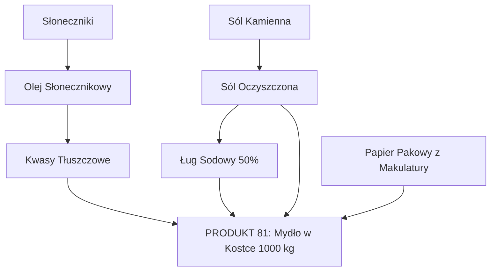
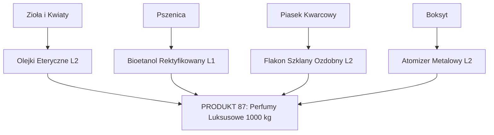
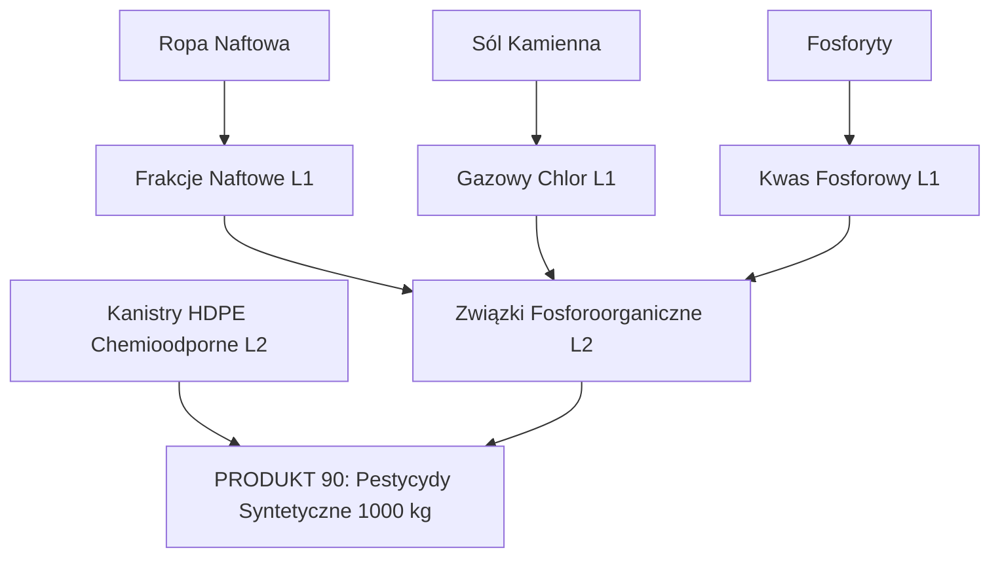
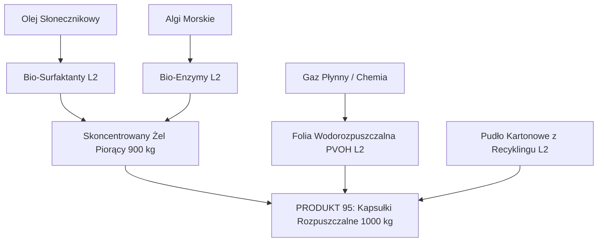
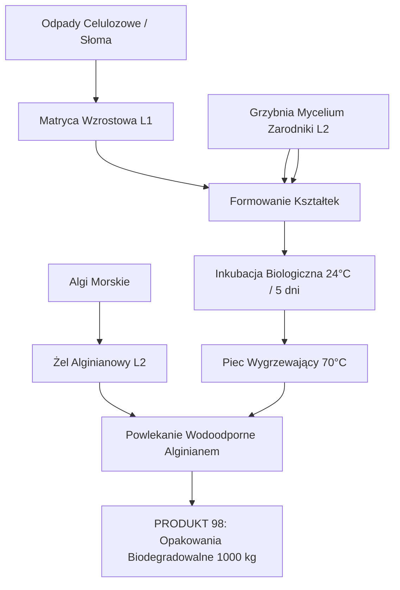
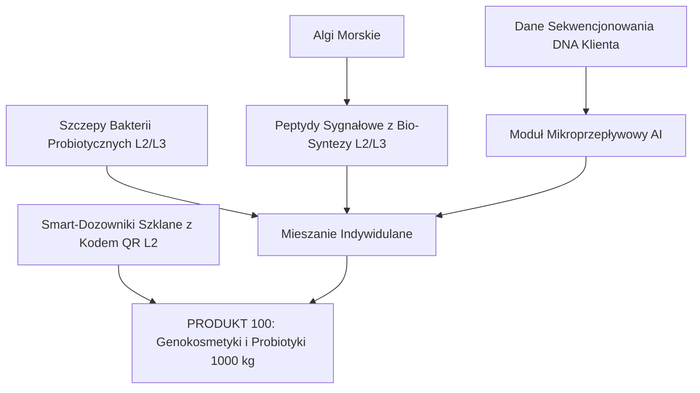

# Branża 5: Chemia Gospodarcza i Kosmetyki – Standard Receptur Przemysłowych, Bilansu Masowo-Energetycznego i Drzew Produkcyjnych

**Dokumentacja Technologiczna i Inżynieryjna (Game Engine Specification – v5.0 Final)**  
**Zakres:** 20 Produktów Końcowych (Produkty 81–100), Półprodukty Poziomu 1 (L1), Półprodukty Poziomu 2/3 (L2/L3), Surowce Bazowe (L0).

---

## 1. Wprowadzenie i Standard Bilansowy Symulatora

### 1.1. Podstawa Bilansowa (Standard Batch Basis)
Dla zapewnienia rygorystycznego zachowania masy i energii w silniku symulacji ekonomicznej:
* **Jednostka partii produkcyjnej (Batch Basis)**: $1\,000\text{ kg}$ ($1\text{ tona}$) czystego wyrobu gotowego lub $1\,000\text{ szt.}$ handlowych wyrobu konfekcjonowanego.
* **Zasada Zachowania Masy**:
  $$\sum m_{\text{surowce/półprodukty wejściowe}} = m_{\text{produkt główny}} + \sum m_{\text{produkty uboczne}} + \sum m_{\text{straty procesowe/ścieki}}$$
* **Jednostka Energii**: $\text{kWh}$ energii elektrycznej i cieplnej przypadająca na $1\text{ partię}$ ($1\text{ t}$).
* **Triada Wymogów Produkcyjnych**:
  * **Ludzie**: `[R]` (Robotnicy), `[M]` (Majstrowie / Inżynierowie procesu), `[E]` (Eksperci / Naukowcy R&D). Podano liczbę etatów na linię technologiczną.
  * **Energia**: Łączny pobór energii w $\text{kWh}$ na partię standardową.
  * **Licencja**: Kluczowa technologia z Drzewka Technologii odblokowująca proces.

---

## 2. Bilans Surowców Bazowych (Tier 0 -> L1)

Branża 5 bazuje na 7 kluczowych surowcach pierwotnych oraz 4 surowcach pomocniczych pozyskiwanych z Mapy Świata lub Miejskich Zakładów Recyklingu:

| Surowiec Bazowy (L0) | Kategoria | Źródło na Mapie | Przetwórstwo do L1 | Odzysk z Recyklingu / Miejski Obieg |
| :--- | :--- | :--- | :--- | :--- |
| **Słoneczniki** | Rolne | Wielkie Farmy | Olej Słonecznikowy, Biomasa | Kompost / Biogaz |
| **Sól Kamienna** | Mineralne | Kopalnie Soli | Sól Oczyszczona $\to$ Ług Sodowy, Chlor, Wodór | Solanki ściekowe (częściowy) |
| **Ropa Naftowa** | Kopalne/Chemiczne | Szyby Naftowe | Frakcje Naftowe (Olefiny, Parafiny) | Recykling chemiczny polimerów |
| **Wapień** | Mineralne | Kamieniołomy | Kreda Strącana (PCC), Wapno | Frakcja mineralna z gruzu |
| **Fosforyty** | Mineralne | Kopalnie Fosforytów | Fosforany Oczyszczone, Kwas Fosforowy | Odzysk fosforu z osadów ściekowych |
| **Algi Morskie** *(od E6)* | Biologiczne | Farmy Morskie | Alginian sodu, Biomasa algowa, Bio-surfaktanty | 100% biodegradowalny obieg organiczny |
| **Piasek Kwarcowy** | Mineralne | Kopalnie Odkrywkowe | Szkło Surowe, Krzemiany, Zeolity | Stłuczka szklana (100% odzysku) |
| *Boksyt* (Pomocniczy) | Rudy Metali | Kopalnie Odkrywkowe | Aluminium Hutnicze (puszki, tubki) | Puszki i złom aluminiowy (95% odzysku) |
| *Drewno Okrągłe* (Pom.) | Leśne | Lasy Państwowe | Celuloza Bielona, Karton | Makulatura i włókna wtórne |
| *Węgiel Kamienny* (Pom.) | Kopalne | Kopalnie Głębinowe | Węgiel Aktywny, Koks | Regeneracja termiczna złoża węglowego |
| *Zioła i Rośliny* (Pom.) | Rolne/Zbierackie | Farmy Specjalistyczne | Ekstrakty Roślinne, Olejki Eteryczne | Kompost organiczny |

---

## 3. Półprodukty Poziomu 1 (L1) – Receptury i Bilans Przetwórczy

### L1-01: Olej Słonecznikowy Rafinowany
* **Zakład**: Olejarnia Przemysłowa / Tłocznia
* **Wsady**: Słoneczniki $2\,500\text{ kg}$
* **Wyjście**: Olej Słonecznikowy $1\,000\text{ kg}$ + Wytłoki/Śruta słonecznikowa $1\,450\text{ kg}$ (do Branży 1: Pasze) + Ubytki wilgoci $50\text{ kg}$
* **Triada**: `[3R, 1M, 0E]`, **Energia**: $180\text{ kWh/t}$, **Licencja**: *Przetwórstwo Olejarskie (Era 1)*

### L1-02: Sól Oczyszczona (NaCl Przemysłowy)
* **Zakład**: Warzelnia Soli / Rafineria Chemiczna
* **Wsady**: Sól Kamienna $1\,050\text{ kg}$ + Woda procesowa
* **Wyjście**: Sól Oczyszczona $1\,000\text{ kg}$ + Odpad płuczkowy/ił $50\text{ kg}$
* **Triada**: `[2R, 1M, 0E]`, **Energia**: $90\text{ kWh/t}$, **Licencja**: *Oczyszczanie Minerałów Solnych (Era 1)*

### L1-03: Ług Sodowy (NaOH 50%) i Gaz Chlorowy (Elektroliza Chloro-Alkaliczna)
* **Reakcja**: $2\text{NaCl} + 2\text{H}_2\text{O} \to 2\text{NaOH} + \text{Cl}_2 \uparrow + \text{H}_2 \uparrow$
* **Zakład**: Zakład Elektrochemiczny (Elektroliza Membranowa)
* **Wsady**: Sól Oczyszczona $1\,500\text{ kg}$ + Woda zdemineralizowana $1\,000\text{ kg}$
* **Wyjście**: Ług Sodowy 50% $2\,000\text{ kg}$ (czysty $\text{NaOH}: 1\,000\text{ kg}$) + Gazowy Chlor $\text{Cl}_2$ $880\text{ kg}$ + Gazowy Wodór $\text{H}_2$ $25\text{ kg}$ (do sieci energetycznej/chemicznej) + Odpady $595\text{ kg}$
* **Triada**: `[4R, 2M, 0E]`, **Energia**: $1\,850\text{ kWh/t NaOH}$ (proces silnie energochłonny), **Licencja**: *Elektroliza Przemysłowa (Era 3)*

### L1-04: Kwas Siarkowy i Chemia Nieorganiczna
* **Zakład**: Zakłady Kwasu Siarkowego (Metoda Kontaktowa)
* **Wsady**: Siarka / Związki siarki z odsiarczania $340\text{ kg}$ + Powietrze/Woda $700\text{ kg}$
* **Wyjście**: Kwas Siarkowy techniczny ($\text{H}_2\text{SO}_4$ 96%) $1\,000\text{ kg}$
* **Triada**: `[3R, 2M, 0E]`, **Energia**: $70\text{ kWh/t}$ (reakcja silnie egzotermiczna, generuje nadwyżkę pary), **Licencja**: *Synteza Kwasów Mineralnych (Era 2)*

### L1-05: Fosforany Oczyszczone (Kwas Fosforowy / STPP)
* **Reakcja**: $\text{Ca}_5(\text{PO}_4)_3\text{F} + 5\text{H}_2\text{SO}_4 + 10\text{H}_2\text{O} \to 3\text{H}_3\text{PO}_4 + 5\text{CaSO}_4 \cdot 2\text{H}_2\text{O} + \text{HF}$
* **Zakład**: Fabryka Związków Fosforowych
* **Wsady**: Fosforyty $1\,200\text{ kg}$ + Kwas Siarkowy $850\text{ kg}$
* **Wyjście**: Fosforany Oczyszczone (w przeliczeniu na STPP / Kwas fosforowy) $1\,000\text{ kg}$ + Fosfogips $1\,020\text{ kg}$ (odpad/podbudowa drogowa) + Ubytki $30\text{ kg}$
* **Triada**: `[4R, 2M, 0E]`, **Energia**: $220\text{ kWh/t}$, **Licencja**: *Chemia Fosforowa (Era 3)*

### L1-06: Frakcje Naftowe (Olefiny, Parafiny i Węglowodory)
* **Zakład**: Rafineria Ropy Naftowej (Kraking Parowy i Destylacja Frakcyjna)
* **Wsady**: Ropa Naftowa $1\,050\text{ kg}$
* **Wyjście**: Frakcje Naftowe Przemysłowe $1\,000\text{ kg}$ (etylen, propylen, benzyny ciężkie, parafiny) + Gaz rafineryjny $30\text{ kg}$ + Asfalty $20\text{ kg}$
* **Triada**: `[3R, 2M, 0E]`, **Energia**: $210\text{ kWh/t}$, **Licencja**: *Petrochemia i Rafinacja (Era 3)*

### L1-07: Wapno Strącane i Kreda Kosmetyczna (PCC - Precipitated Calcium Carbonate)
* **Zakład**: Młyn Wapienniczy i Karbonatyzator
* **Wsady**: Wapień $1\,100\text{ kg}$ + Dwutlenek Węgla $\text{CO}_2$ (z kominów)
* **Wyjście**: Czysty Węglan Wapnia Kosmetyczny $1\,000\text{ kg}$ + Odrzut kamienny $100\text{ kg}$
* **Triada**: `[2R, 1M, 0E]`, **Energia**: $110\text{ kWh/t}$, **Licencja**: *Kruszywa i Węglany Precyzyjne (Era 2)*

### L1-08: Biomasa Przetworzona z Alg Morskich
* **Zakład**: Bio-Rafineria Algowa (Ekstrakcja i Liofilizacja)
* **Wsady**: Algi Morskie Mokre $5\,000\text{ kg}$
* **Wyjście**: Sucha Biomasa Algowa / Frakcja Polimeryczna $1\,000\text{ kg}$ + Odzyskana woda $3\,950\text{ kg}$ + Odpady organiczne $50\text{ kg}$
* **Triada**: `[2R, 2M, 1E]`, **Energia**: $160\text{ kWh/t}$, **Licencja**: *Bio-Rafinacja Algowa (Era 6)*

---

## 4. Półprodukty Poziomu 2 i 3 (L2/L3) – Formulacje i Syntezy

### L2-01: Kwasy Tłuszczowe Destylowane i Gliceryna Surowa
* **Reakcja**: Hydroliza trójglicerydów w autoklawie: $\text{Tłuszcz} + 3\text{H}_2\text{O} \to 3\text{R-COOH} + \text{Glicerol}$
* **Zakład**: Zakład Rozszczepiania Tłuszczów
* **Wsady**: Olej Słonecznikowy $1\,050\text{ kg}$ + Woda procesowa $200\text{ kg}$
* **Wyjście**: Kwasy Tłuszczowe Destylowane $950\text{ kg}$ + Gliceryna surowa $90\text{ kg}$ (kluczowy wsad do kremów i past L2) + Strata $10\text{ kg}$
* **Triada**: `[3R, 1M, 0E]`, **Energia**: $130\text{ kWh/t}$, **Licencja**: *Termoliza i Hydroliza Lipidów (Era 3)*

### L2-02: Surfaktanty Syntetyczne (LABS – Liniowy Alkilobenzenosulfonian)
* **Zakład**: Zakłady Sulfonacji
* **Wsady**: Frakcje Naftowe (Alkilobenzen) $550\text{ kg}$ + Kwas Siarkowy / Oleum $500\text{ kg}$
* **Wyjście**: Kwas Alkilobenzenosulfonowy (LABS) $1\,000\text{ kg}$ + Zużyty kwas siarkowy do regeneracji $50\text{ kg}$
* **Triada**: `[3R, 2M, 0E]`, **Energia**: $140\text{ kWh/t}$, **Licencja**: *Sulfonacja Chemiczna (Era 3)*

### L2-03: Bio-Surfaktanty (Alkilopoliglukozydy - APG)
* **Reakcja**: Reakcja kwasów tłuszczowych roślinnych z glukozą z biomasy
* **Zakład**: Zakład Zielonej Chemii
* **Wsady**: Olej Słonecznikowy / Kwasy Tłuszczowe $550\text{ kg}$ + Biomasa Przetworzona / Cukry $500\text{ kg}$
* **Wyjście**: Bio-Surfaktant APG (roztwór 70%) $1\,000\text{ kg}$ + Woda procesowa $50\text{ kg}$
* **Triada**: `[2R, 2M, 1E]`, **Energia**: $95\text{ kWh/t}$, **Licencja**: *Zielone Surfaktanty i Bioestry (Era 6)*

### L2-04: Zeolity Syntetyczne 4A (Zamiennik Fosforanów)
* **Reakcja**: Glino-krzemian sodowy: hydrotermalna synteza krzemionki i wodorotlenku sodu
* **Zakład**: Zakład Syntetycznych Minerałów
* **Wsady**: Piasek Kwarcowy $500\text{ kg}$ + Ług Sodowy 50% $400\text{ kg}$ + Wodorotlenek glinu $200\text{ kg}$
* **Wyjście**: Zeolit 4A proszkowy $1\,000\text{ kg}$ + Odciek solankowy $100\text{ kg}$
* **Triada**: `[3R, 2M, 0E]`, **Energia**: $190\text{ kWh/t}$, **Licencja**: *Katalizatory i Zeolity (Era 5)*

### L2-05: Bio-Enzymy Piorące (Proteazy, Amylazy, Lipazy)
* **Zakład**: Bio-Fermentor Przemysłowy
* **Wsady**: Biomasa Przetworzona $700\text{ kg}$ + Cukier / Pożywka $350\text{ kg}$ + Szczepy mikroorganizmów
* **Wyjście**: Koncentrat Enzymatyczny Płynny/Granulowany $1\,000\text{ kg}$ + Odpad pofermentacyjny (nawóz) $50\text{ kg}$
* **Triada**: `[1R, 3M, 2E]`, **Energia**: $220\text{ kWh/t}$, **Licencja**: *Biotechnologia Białek Przemysłowych (Era 6)*

### L2-06: Podchloryn Sodu (Wybielacz i Środek Bakteriobójczy)
* **Reakcja**: $\text{Cl}_2 + 2\text{NaOH} \to \text{NaClO} + \text{NaCl} + \text{H}_2\text{O}$
* **Zakład**: Reaktor Chlorowania Ługu
* **Wsady**: Gazowy Chlor (z elektrolizy L1) $500\text{ kg}$ + Ług Sodowy 50% $1\,150\text{ kg}$
* **Wyjście**: Podchloryn Sodu (roztwór techniczny 15% aktywnego chloru) $1\,600\text{ kg}$ + Odciek $50\text{ kg}$
* **Triada**: `[3R, 2M, 0E]`, **Energia**: $60\text{ kWh/t}$ (reakcja chłodzona wodą), **Licencja**: *Chemia Chlorowa i Dezynfekcja (Era 3)*

### L2-07: Granulat Tworzyw Polimerowych (LDPE / HDPE / PP)
* **Zakład**: Zakład Polimeryzacji
* **Wsady**: Frakcje Naftowe (Etylen/Propylen) $1\,020\text{ kg}$ + Katalizator
* **Wyjście**: Granulat Polimerowy $1\,000\text{ kg}$ + Gazy poprocesowe $20\text{ kg}$
* **Triada**: `[3R, 2M, 0E]`, **Energia**: $380\text{ kWh/t}$, **Licencja**: *Polimeryzacja Katalityczna (Era 4)*

### L2-08: Folia Wodorozpuszczalna PVOH (Polialkohol Winylowy)
* **Zakład**: Wytwórnia Folii Specjalistycznych
* **Wsady**: Octan winylu / Gaz $900\text{ kg}$ + Ług Sodowy 50% $150\text{ kg}$
* **Wyjście**: Folia PVOH degradowalna w wodzie $1\,000\text{ kg}$ + Octan sodu $50\text{ kg}$
* **Triada**: `[2R, 3M, 1E]`, **Energia**: $320\text{ kWh/t}$, **Licencja**: *Polimery Wodorozpuszczalne PVOH (Era 6)*

### L2-09: Żel Alginianowy i Bioplastik z Alg (Biopolimery Morskie)
* **Zakład**: Zakład Biopolimerów Naturalnych
* **Wsady**: Biomasa Przetworzona z Alg $800\text{ kg}$ + Wapno Strącane $100\text{ kg}$ + Kwas Cytrynowy $150\text{ kg}$
* **Wyjście**: Żel Alginianowy Czysty / Granulat Bioplastiku $1\,000\text{ kg}$ + Woda filtracyjna $50\text{ kg}$
* **Triada**: `[2R, 2M, 1E]`, **Energia**: $110\text{ kWh/t}$, **Licencja**: *Ekstrakcja Polimerów Naturalnych (Era 6)*

### L2-10: Baza Emulsyjna Kosmetyczna (Kremowa)
* **Zakład**: Mieszalnia Farmaceutyczno-Kosmetyczna
* **Wsady**: Olej Słonecznikowy Rafinowany $450\text{ kg}$ + Kwasy Tłuszczowe / Woski $250\text{ kg}$ + Gliceryna $200\text{ kg}$ + Emulgatory roślinne $100\text{ kg}$
* **Wyjście**: Gotowa Baza Emulsyjna $1\,000\text{ kg}$
* **Triada**: `[2R, 2M, 0E]`, **Energia**: $120\text{ kWh/t}$, **Licencja**: *Farmakopea Kosmetyczna (Era 3)*

### L2-11: Butelki Plastikowe HDPE / PET i Zamknięcia
* **Zakład**: Wytwórnia Opakowań z Tworzyw (Formowanie z Rozdmuchen)
* **Wsady**: Granulat Polimerowy HDPE/PET $1\,020\text{ kg}$
* **Wyjście**: Butelki i Korki $1\,000\text{ kg}$ ($\approx 25\,000\text{ szt.}$ butelek $1\text{ l}$ lub $40\,000\text{ szt.}$ butelek $500\text{ ml}$) + Wlewki do zmielenia $20\text{ kg}$
* **Triada**: `[3R, 1M, 0E]`, **Energia**: $340\text{ kWh/t}$, **Licencja**: *Wtrysk i Rozdmuch Tworzyw (Era 4)*

### L2-12: Puszka Aluminiowa Monoblok z Zaworem Aerozolowym
* **Zakład**: Tłocznia Puszek Aluminiowych
* **Wsady**: Aluminium Hutnicze $950\text{ kg}$ + Tworzywa polimerowe (zawory/uszczelki) $70\text{ kg}$
* **Wyjście**: Puszki Aerozolowe Kompletne $1\,000\text{ kg}$ ($\approx 15\,000\text{ szt.}$ puszek) + Ścinki aluminium $20\text{ kg}$ (do przetopu)
* **Triada**: `[3R, 2M, 0E]`, **Energia**: $420\text{ kWh/t}$, **Licencja**: *Obróbka Plastyczna Aluminium (Era 4)*

---

## 5. Katalog 20 Produktów Końcowych Branży 5 (Produkty 81–100)

---

### Produkt 81: Mydło Tradycyjne w Kostce (Epoka 3)
*Główny produkt higieniczny rewolucji sanitarnej. 100% biodegradowalny w środowisku wodnym.*

* **Jednostka partii**: $1\,000\text{ kg}$ (tj. $10\,000\text{ szt.}$ kostek po $100\text{ g}$)
* **Receptura i Bilans Masowy**:
  * Kwasy Tłuszczowe Destylowane (L2): $680\text{ kg}$
  * Ług Sodowy 50% (L1): $240\text{ kg}$ (stechiometryczna ilość $\text{NaOH}$ do zmydlenia)
  * Sól Oczyszczona (L1): $40\text{ kg}$ (proces wysalania mydła w kadzi)
  * Woda procesowa: $120\text{ kg}$
  * Papier Pakowy z Makulatury (Opakowanie L2): $15\text{ kg}$
  * *Wyjście*: Mydło w Kostce $1\,000\text{ kg}$ + Gliceryna pomyplana w ługu $75\text{ kg}$ (zawracana do rafinacji) + Para wodna $20\text{ kg}$
* **Bilans Energetyczny**:
  * Podgrzewanie kadzi parą do 95°C: $65\text{ kWh}$
  * Mieszadła i pompy ciśnieniowe: $25\text{ kWh}$
  * Wytłaczarka ślimakowa (plodder) i krajalnica: $35\text{ kWh}$
  * Linia zawijania w papier: $15\text{ kWh}$
  * **Łącznie Energia**: **$140\text{ kWh/t}$**
* **Triada Produkcyjna**:
  * **Ludzie**: `[4R, 1M, 0E]`
  * **Energia**: $140\text{ kWh}$
  * **Licencja**: *Zmydlanie Tłuszczów (Era 3)*
* **Parametry Eko**: Biodegradowalność 100%, Eko-Etyka: $78/100$, Emisja bazowa: $0.18\text{ t CO}_2\text{/t}$.

---

### Produkt 82: Proszki do Prania (Fosforanowe -> Enzymatyczne Bio) (Epoka 3 -> Epoka 6)
*Masowy detergent piorący. W Epoce 3 oparty na fosforanach powodujących eutrofizację; w Epoce 6 zastąpiony przez enzymy bio i zeolity.*

#### Wariant A: Proszek Fosforanowy (Epoka 3–5)
* **Jednostka partii**: $1\,000\text{ kg}$ (w pudłach tekturowych po $2\text{ kg}$)
* **Receptura i Bilans Masowy**:
  * Surfaktanty Syntetyczne LABS (L2): $180\text{ kg}$
  * Fosforany Oczyszczone STPP (L1): $320\text{ kg}$ (zmiękczanie wody i zapobieganie osadzaniu brudu)
  * Węglan Sodu (Soda kalcynowana L1): $250\text{ kg}$
  * Siarczan Sodu (Wypełniacz nieorganiczny): $180\text{ kg}$
  * Krzemian Sodu (Inhibitor korozji pralki): $40\text{ kg}$
  * Pudła Tekturowe (L2): $30\text{ kg}$
  * *Wyjście*: Proszek do Prania $1\,000\text{ kg}$
* **Bilans Energetyczny**:
  * Wieża suszarnicza rozpyłowa (przygotowanie gęstwy i rozpył w gorącym powietrzu 300°C): $290\text{ kWh}$
  * Przenośniki, sita wibracyjne i pakowanie: $70\text{ kWh}$
  * **Łącznie Energia**: **$360\text{ kWh/t}$**
* **Triada Produkcyjna**:
  * **Ludzie**: `[6R, 2M, 0E]`
  * **Energia**: $360\text{ kWh}$
  * **Licencja**: *Detergenty Syntetyczne (Era 3)*
* **Parametry Eko**: Ślad odpadowy wysoki (eutrofizacja rzek), Eko-Etyka: $35/100$, Emisja bazowa: $0.62\text{ t CO}_2\text{/t}$.

#### Wariant B: Bio-Proszek Enzymatyczny Zeolitowy (Od Epoki 6)
* **Receptura i Bilans Masowy**:
  * Bio-Surfaktanty APG (L2): $200\text{ kg}$
  * Zeolity Syntetyczne 4A (L2): $350\text{ kg}$ (bezpieczny dla wód zamiennik fosforanów)
  * Soda Oczyszczona / Cytryniany: $240\text{ kg}$
  * Bio-Enzymy Piorące (L2/L3): $40\text{ kg}$ (proteazy, lipazy piorące w 30°C)
  * Nadtlenek Węglanu Sodu (Ekologiczny wybielacz tlenowy): $140\text{ kg}$
  * Pudło z Kartonu Recyklingowanego (L2): $30\text{ kg}$
* **Bilans Energetyczny**:
  * Granulacja mieszalnikowa fluidalna na zimno (zamiast wieży cieplnej): $130\text{ kWh}$
  * Pakowanie i automatyka: $50\text{ kWh}$
  * **Łącznie Energia**: **$180\text{ kWh/t}$** (redukcja o 50%)
* **Triada Produkcyjna**:
  * **Ludzie**: `[3R, 3M, 1E]`
  * **Energia**: $180\text{ kWh}$
  * **Licencja**: *Ekoprojektowanie i Bio-Detergenty (Era 6)*
* **Parametry Eko**: Brak fosforanów, Eko-Etyka: $90/100$, Emisja: $0.19\text{ t CO}_2\text{/t}$.

---

### Produkt 83: Płyny do Mycia Naczyń / Koncentraty (Epoka 3 -> Epoka 7)
*Płynny środek dyspergujący tłuszcz spożywczy.*

#### Wariant A: Płyn Tradycyjny w Butelce Plastikowej (Epoka 3–6)
* **Jednostka partii**: $1\,000\text{ kg}$ ($1\,000\text{ szt.}$ butelek $1\text{ l}$)
* **Receptura i Bilans Masowy**:
  * Surfaktanty Syntetyczne LABS/SLES (L2): $160\text{ kg}$
  * Sól Oczyszczona (L1 - regulator lepkości): $25\text{ kg}$
  * Kompozycja zapachowa cytrynowa (L2): $5\text{ kg}$
  * Woda zdemineralizowana: $770\text{ kg}$
  * Butelki Plastikowe HDPE z korkiem push-pull (L2): $40\text{ kg}$
* **Bilans Energetyczny**:
  * Mieszanie dynamiczne w reaktorze: $35\text{ kWh}$
  * Linia rozlewu automatycznego, etykietowania i kartonowania: $50\text{ kWh}$
  * **Łącznie Energia**: **$85\text{ kWh/t}$**
* **Triada**: `[4R, 1M, 0E]`, **Energia**: $85\text{ kWh}$, **Licencja**: *Formulacje Odtłuszczające (Era 3)*
* **Parametry Eko**: Generuje odpady plastikowe butelek, Eko-Etyka: $48/100$.

#### Wariant B: Tabletki Koncentratu Refill Zero-Waste (Od Epoki 7)
* **Receptura i Bilans Masowy**:
  * Skoncentrowane Bio-Surfaktanty w proszku (L2): $650\text{ kg}$
  * Kwas cytrynowy i wodorowęglan sodu (baza musująca): $300\text{ kg}$
  * Naturalny olejek eteryczny (L2): $20\text{ kg}$
  * Saszetki z folii celulozowej biodegradowalnej (L2): $30\text{ kg}$
  * *(Użytkownik wrzuca tabletkę do wiecznej butelki i zalewa wodą kranową w domu)*
* **Bilans Energetyczny**: Mieszanie proszkowe i tabletkowanie rotacyjne: $110\text{ kWh/t}$
* **Triada**: `[2R, 2M, 1E]`, **Energia**: $110\text{ kWh}$, **Licencja**: *Systemy Cyrkularne i Refill (Era 7)*
* **Parametry Eko**: Eliminacja transportu wody i 100% redukcja plastiku jednorazowego. Eko-Etyka: $95/100$.

---

### Produkt 84: Środki Czyszczące i Dezynfekujące (Epoka 3)
*Chlorowe i kwasowe środki sanityzujące do łazienek, szpitali i powierzchni zmywalnych.*

* **Jednostka partii**: $1\,000\text{ kg}$ ($1\,000\text{ butelek } 1\text{ l}$)
* **Receptura i Bilans Masowy**:
  * Podchloryn Sodu roztwór techniczny (L2): $320\text{ kg}$ (daje $\approx 4.8\%$ aktywnego chloru)
  * Ług Sodowy 50% (L1 - stabilizator alkaliczny): $30\text{ kg}$
  * Surfaktanty stabilne w chlorze (aminotlenki L2): $25\text{ kg}$
  * Woda zdemineralizowana: $575\text{ kg}$
  * Butelki Plastikowe HDPE chemioodporne z bezpieczną zakrętką (L2): $50\text{ kg}$
* **Bilans Energetyczny**:
  * Chłodzony reaktor mieszalnikowy chemioodporny: $45\text{ kWh}$
  * Nalewak podciśnieniowy z odciągiem oparów i korkownica: $55\text{ kWh}$
  * **Łącznie Energia**: **$100\text{ kWh/t}$**
* **Triada Produkcyjna**:
  * **Ludzie**: `[4R, 1M, 0E]`
  * **Energia**: $100\text{ kWh}$
  * **Licencja**: *Dezynfekcja Sanitarna (Era 3)*
* **Parametry Eko**: Podnosi wskaźnik Zdrowia w miastach o $+15\%$, Eko-Etyka: $50/100$.

---

### Produkt 85: Pasta do Zębów i Higiena Jamy Ustnej (Epoka 3 -> Epoka 7)
*Środek ścierny i remineralizujący szkliwo zębów.*

#### Wariant A: Pasta w Tubce Aluminiowo-Laminatowej (Epoka 3–6)
* **Jednostka partii**: $1\,000\text{ kg}$ ($10\,000\text{ tubek}$ po $100\text{ g}$)
* **Receptura i Bilans Masowy**:
  * Wapno Strącane PCC / Kreda Kosmetyczna (L1): $420\text{ kg}$ (łagodne ścierniwo)
  * Gliceryna Surowa Oczyszczona (L2): $250\text{ kg}$ (humektant zapobiegający wysychaniu)
  * Woda zdemineralizowana: $240\text{ kg}$
  * Związki Fluoru (monofluorofosforan z L1): $15\text{ kg}$
  * Surfaktant SLS (L2): $15\text{ kg}$
  * Olejek miętowy naturalny (L2): $10\text{ kg}$
  * Tuby wielowarstwowe z zakrętką (L2): $50\text{ kg}$
* **Bilans Energetyczny**:
  * Homogenizator próżniowy z dyspergatorem: $85\text{ kWh}$
  * Automatyczna tubiarka, zgrzewanie ultradźwiękowe tub i kartonikowanie: $45\text{ kWh}$
  * **Łącznie Energia**: **$130\text{ kWh/t}$**
* **Triada**: `[4R, 2M, 0E]`, **Energia**: $130\text{ kWh}$, **Licencja**: *Profilaktyka Stomatologiczna (Era 3)*
* **Parametry Eko**: Tubki nienadające się do łatwego recyklingu, Eko-Etyka: $55/100$.

#### Wariant B: Tabletki do Mycia Zębów Zero-Waste (Od Epoki 7)
* **Receptura i Bilans Masowy**:
  * Hydroksyapatyt Wapnia i Węglan Wapnia (L1): $500\text{ kg}$
  * Ksylitol i Erytrytol (słodziki przeciwpróchnicze): $350\text{ kg}$
  * Suchy bio-surfaktant z oleju słonecznikowego: $50\text{ kg}$
  * Mentol i bio-olejek miętowy: $30\text{ kg}$
  * Słoiczki szklane z nakrętką aluminiową wielorazową (L2): $70\text{ kg}$
* **Bilans Energetyczny**: Granulacja na sucho i prasa tabletkowa: $80\text{ kWh/t}$
* **Triada**: `[2R, 2M, 1E]`, **Energia**: $80\text{ kWh}$, **Licencja**: *Kosmetyka Bezwodna Zero-Waste (Era 7)*
* **Parametry Eko**: 0% plastiku, 100% recykling opakowania, Eko-Etyka: $96/100$.

---

### Produkt 86: Szampony i Odżywki do Włosów (Epoka 3 -> Epoka 6)
*Formulacje myjące i kondycjonujące włókno włosa.*

#### Wariant A: Szampon Płynny w Butelce (Epoka 3–5)
* **Jednostka partii**: $1\,000\text{ kg}$ ($2\,500\text{ butelek}$ po $400\text{ ml}$)
* **Receptura i Bilans Masowy**:
  * Surfaktanty Pianotwórcze SLES (L2): $160\text{ kg}$
  * Ekstrakty Roślinne Odżywcze (L1/L2): $40\text{ kg}$
  * Chlorek sodu (regulator lepkości L1): $20\text{ kg}$
  * Kompozycja zapachowa i konserwanty: $10\text{ kg}$
  * Woda zdemineralizowana: $725\text{ kg}$
  * Butelki Plastikowe PET/HDPE (L2): $45\text{ kg}$
* **Bilans Energetyczny**: Mieszalnik wolnoobrotowy + rozlewaczka karuzelowa: $90\text{ kWh/t}$
* **Triada**: `[3R, 2M, 0E]`, **Energia**: $90\text{ kWh}$, **Licencja**: *Kosmetyka Pielęgnacyjna Włosów (Era 3)*
* **Parametry Eko**: Duża masa wody w transporcie, Eko-Etyka: $52/100$.

#### Wariant B: Szampon i Odżywka w Kostce Bio (Od Epoki 6)
* **Receptura i Bilans Masowy**:
  * Bio-surfaktant stały SCI (z oleju słonecznikowego L2): $550\text{ kg}$
  * Masło i Olej Słonecznikowy Nierafinowany (L1): $200\text{ kg}$
  * Glinka kosmetyczna i skrobia: $150\text{ kg}$
  * Olejki eteryczne z ziół i alginian (L2): $60\text{ kg}$
  * Pudełka z tektury falistej z recyklingu (L2): $40\text{ kg}$
* **Bilans Energetyczny**: Ugniatanie masy plastycznej, wytłaczanie i prasa kostkująca: $70\text{ kWh/t}$
* **Triada**: `[2R, 2M, 1E]`, **Energia**: $70\text{ kWh}$, **Licencja**: *Formulacje Kosmetyczne Bez Wody (Era 6)*
* **Parametry Eko**: Brak butelki, 80% lżejszy transport, Eko-Etyka: $94/100$.

---

### Produkt 87: Perfumy i Wody Toaletowe (Epoka 3)
*Wysokomarżowe kompozycje zapachowe w spirytusie szlachetnym.*

* **Jednostka partii**: $1\,000\text{ kg}$ ($10\,000\text{ flakonów}$ po $100\text{ ml}$)
* **Receptura i Bilans Masowy**:
  * Bioetanol / Spirytus rektyfikowany 96% (L1): $750\text{ kg}$
  * Olejki Eteryczne i Absoluty Kwiatowe (L2): $150\text{ kg}$ (stężenie wody perfumowanej $15\%$)
  * Woda zdemineralizowana ultra-czysta: $80\text{ kg}$
  * Utrwalacze zapachu i filtry UV: $20\text{ kg}$
  * Flakony Szklane Ozdobne (L2): $220\text{ kg}$ (dodatkowa masa opakowania jednostkowego)
  * Atomizery z pompką aluminiową (L2): $30\text{ kg}$
* **Bilans Energetyczny**:
  * Zbiorniki maceracyjne chłodzone do 4°C (dojrzewanie zapachu przez 21 dni): $95\text{ kWh}$
  * Filtracja seityczna na zimno: $25\text{ kWh}$
  * Nalewanie próżniowe, zaciskanie atomizerów i konfekcjonowanie: $40\text{ kWh}$
  * **Łącznie Energia**: **$160\text{ kWh/t}$**
* **Triada Produkcyjna**:
  * **Ludzie**: `[1R, 4M, 1E]` (kluczowa rola Mistrzów Perfumiarstwa – "Nosów")
  * **Energia**: $160\text{ kWh}$
  * **Licencja**: *Komponowanie Zapachów Szlachetnych (Era 3)*
* **Parametry Eko**: Flakon szklany w 100% zdatny do przetopu lub refillu, Eko-Etyka: $70/100$.

---

### Produkt 88: Kosmetyki Kolorowe (Makijaż Mineralny) (Epoka 3 -> Epoka 6)
*Pudry prasowane, podkłady, cienie do powiek i szminki.*

* **Jednostka partii**: $1\,000\text{ kg}$ ($\approx 50\,000\text{ szt.}$ kasetek lub sztyftów)
* **Receptura i Bilans Masowy**:
  * Minerały Mikronizowane (Mika, Talk kosmetyczny, Kaolin L1): $520\text{ kg}$
  * Pigmenty Mineralne (Tlenki żelaza, dwutlenek tytanu L1): $180\text{ kg}$
  * Woski Roślinne i Olej Słonecznikowy Rafinowany (L2): $200\text{ kg}$ (lepiszcze i baza szminek)
  * Witamina E i naturalne antyoksydanty: $20\text{ kg}$
  * Kasetki i etui aluminiowo-szklane wielokrotnego napełniania (L2): $80\text{ kg}$
* **Bilans Energetyczny**:
  * Młyn mikronizacyjny strumieniowy (rozdrobnienie do $5\,\mu\text{m}$): $110\text{ kWh}$
  * Mieszalnik stożkowy i prasa hydrauliczna formująca wypraski: $55\text{ kWh}$
  * Linia montażu: $15\text{ kWh}$
  * **Łącznie Energia**: **$180\text{ kWh/t}$**
* **Triada Produkcyjna**:
  * **Ludzie**: `[2R, 4M, 1E]`
  * **Energia**: $180\text{ kWh}$
  * **Licencja**: *Mikronizacja Minerałów Kosmetycznych (Era 3)* (w E6: *Formuły Wegańskie i Biozgodne*)
* **Parametry Eko**: 0% testów na zwierzętach (hodowle in vitro), Eko-Etyka: $85/100$.

---

### Produkt 89: Kremy do Skóry i Dermokosmetyki (Epoka 3)
*Emulsje typu olej-w-wodzie (O/W) i woda-w-oleju (W/O) odbudowujące barierę lipidową.*

* **Jednostka partii**: $1\,000\text{ kg}$ ($20\,000\text{ słoiczków}$ po $50\text{ ml}$)
* **Receptura i Bilans Masowy**:
  * Baza Emulsyjna Kosmetyczna (L2): $300\text{ kg}$ (olej słonecznikowy, woski, emulgatory)
  * Woda zdemineralizowana ultra-czysta: $600\text{ kg}$
  * Gliceryna Oczyszczona (L2): $50\text{ kg}$
  * Kompleks Składników Aktywnych (Kwas hialuronowy, witaminy A, C, E): $35\text{ kg}$
  * Konserwant mikrobiologiczny i kompozycja hipoalergiczna: $15\text{ kg}$
  * Słoiczki Szklane ze szklanymi wieczkami (L2): $250\text{ kg}$ (masa tary)
* **Bilans Energetyczny**:
  * Podgrzanie fazy wodnej i olejowej do 75°C: $90\text{ kWh}$
  * Homogenizator próżniowy wysokociśnieniowy (turbo-emulgator): $60\text{ kWh}$
  * Chłodzenie z kontrolowaną krystalizacją: $25\text{ kWh}$
  * Dozowanie aseptyczne w strefie czystej Cleanroom: $25\text{ kWh}$
  * **Łącznie Energia**: **$200\text{ kWh/t}$**
* **Triada Produkcyjna**:
  * **Ludzie**: `[2R, 4M, 1E]`
  * **Energia**: $200\text{ kWh}$
  * **Licencja**: *Farmakopea Kosmetyczna i Emulsje (Era 3)*
* **Parametry Eko**: Słoiczek szklany zwrotny, Eko-Etyka: $75/100$, Zdrowie konsumentów $+10\%$.

---

### Produkt 90: Środki Ochrony Roślin (Pestycydy Chemiczne Syntetyczne) (Epoka 3 – [Wygasają w Epoce 7])
*Syntetyczne insektycydy fosforoorganiczne i fungicydy chemiczne podnoszące plony w Epoce 3–5.*

* **Jednostka partii**: $1\,000\text{ kg}$ ($200\text{ kanistrów}$ po $5\text{ l}$)
* **Receptura i Bilans Masowy**:
  * Związki Fosforoorganiczne Aktywne (L2): $380\text{ kg}$
  * Rozpuszczalniki Aromatyczne Ropopochodne (L2): $420\text{ kg}$
  * Emulgatory i Surfaktanty Adiuwantowe (L2): $120\text{ kg}$
  * Stabilizatory chemiczne: $30\text{ kg}$
  * Kanistry HDPE Chemioodporne (L2): $50\text{ kg}$
* **Bilans Energetyczny**:
  * Reaktor ciśnieniowy syntezy chemicznej (wymuszone chłodzenie i neutralizacja gazów odlotowych): $240\text{ kWh}$
  * Konfekcjonowanie w hermetycznej komorze chemoodpornej: $80\text{ kWh}$
  * **Łącznie Energia**: **$320\text{ kWh/t}$**
* **Triada Produkcyjna**:
  * **Ludzie**: `[5R, 3M, 0E]` (wysokie ryzyko BHP, wymóg ubrań gazoszczelnych)
  * **Energia**: $320\text{ kWh}$
  * **Licencja**: *Synteza Chemiczna Pestycydów (Era 3)*
* **Wpływ Systemowy i Wycofanie**: Zwiększa plony na farmach o $+40\%$, lecz drastycznie obniża Bioróżnorodność Świata (giną owady zapylające) i nakłada kary ekologiczne od Epoki 5. **W Epoce 7 podlega całkowitej delegalizacji**. Eko-Etyka: $10/100$.

---

### Produkt 91: Worki i Opakowania Foliowe Jednorazowe (Epoka 4 – [Wygasają w Epoce 6])
*Cienkościenne folie polietylenowe LDPE na zakupy i śmieci. Symbol kryzysu odpadowego XX wieku.*

* **Jednostka partii**: $1\,000\text{ kg}$ ($\approx 100\,000\text{ szt.}$ torebek foliowych)
* **Receptura i Bilans Masowy**:
  * Granulat Polimerowy LDPE (L2): $970\text{ kg}$
  * Dodatki poślizgowe, antyblokingowe i barwniki: $30\text{ kg}$
  * *Wyjście*: Gotowa folia nawinięta i zgrzana $1\,000\text{ kg}$ + Odpady brzegowe do natychmiastowego przetopu $40\text{ kg}$
* **Bilans Energetyczny**:
  * Wytłaczarka ślimakowa z głowicą pierścieniową i wieżą rozdmuchu (temperatura stopu 190°C): $360\text{ kWh}$
  * Chłodzenie pierścieniowe i nawijarka: $70\text{ kWh}$
  * Automatyczna zgrzewarko-odcinarka z wykrojnikiem uszu: $60\text{ kWh}$
  * **Łącznie Energia**: **$490\text{ kWh/t}$**
* **Triada Produkcyjna**:
  * **Ludzie**: `[4R, 1M, 0E]`
  * **Energia**: $490\text{ kWh}$
  * **Licencja**: *Ekstruzja Polimerów Cienkich (Era 4)*
* **Wpływ Systemowy i Wycofanie**: Główny generator odpadów stałych w miastach i mikroplastiku w oceanach. **W Epoce 6 zostaje zakazany ustawowo i zastąpiony przez produkt 98**. Eko-Etyka: $15/100$.

---

### Produkt 92: Dezodoranty w Aerozolu (Epoka 4 -> Epoka 5)
*Kosmetyk odświeżający pod ciśnieniem gazu nośnego.*

#### Wariant A: Aerozol Freonowy CFC (Epoka 4)
* **Jednostka partii**: $1\,000\text{ kg}$ ($6\,500\text{ puszek}$ po $150\text{ ml}$)
* **Receptura i Bilans Masowy**:
  * Baza alkoholowa z kompozycją zapachową i solami glinu (L2): $500\text{ kg}$
  * Gaz Nośny CFC-11 / CFC-12 (Freon z L1/L2): $400\text{ kg}$
  * Puszki Aluminiowe Monoblok z Zaworem (L2): $100\text{ kg}$
* **Bilans Energetyczny**: Dozowanie koncentratu, gazowanie pod ciśnieniem i łaźnia wodna testu szczelności (50°C): $210\text{ kWh/t}$
* **Triada**: `[4R, 2M, 0E]`, **Energia**: $210\text{ kWh}$, **Licencja**: *Technologia Gazów Nośnych (Era 4)*
* **Parametry Eko**: Niszczenie warstwy ozonowej (ODP wysoki), Eko-Etyka: $20/100$.

#### Wariant B: Aerozol z Gazem Węglowodorowym Bezpiecznym (Od Epoki 5)
* **Receptura i Bilans Masowy**:
  * Baza alkoholowo-roślinna i rycynooleinian cynku (L2): $580\text{ kg}$
  * Oczyszczony Propan-Butan LPG (L1): $320\text{ kg}$ (zerowy wpływ na ozon)
  * Puszka Aluminiowa z Aluminium z Recyklingu (L2): $100\text{ kg}$
* **Bilans Energetyczny**: Linia przeciwwybuchowa Ex ATEX z testem szczelności: $190\text{ kWh/t}$
* **Triada**: `[3R, 2M, 0E]`, **Energia**: $190\text{ kWh}$, **Licencja**: *Aerozole Bezpieczne dla Warstwy Ozonowej (Era 5)*
* **Parametry Eko**: Bezpieczny dla ozonosfery, puszka w 100% zdatna do przetopu, Eko-Etyka: $72/100$.

---

### Produkt 93: Pieluchy Jednorazowe (Epoka 4 -> Epoka 6)
*Artykuł higieniczny o wysokiej chłonności płynów.*

#### Wariant A: Pielucha Polimerowa Tradycyjna (Epoka 4–5)
* **Jednostka partii**: $1\,000\text{ kg}$ ($\approx 25\,000\text{ szt.}$ pieluch dziecięcych)
* **Receptura i Bilans Masowy**:
  * Celuloza Bielona (Pulpa Fluff L1/L2): $450\text{ kg}$
  * Superabsorbent Poliakrylanowy SAP (L2 z ropy i sody): $280\text{ kg}$ (wiąże $300\times$ masę wody)
  * Włóknina Polipropylenowa Spunbond PP (L2): $150\text{ kg}$
  * Folia Polietylenowa Barierowa i Paski z Rzepem (L2): $120\text{ kg}$
* **Bilans Energetyczny**:
  * Rozwłóknianie celulozy (młyn młotkowy), dozowanie proszku SAP, zgrzewanie ultradźwiękowe: $290\text{ kWh}$
  * Pakowanie kompresyjne: $30\text{ kWh}$
  * **Łącznie Energia**: **$320\text{ kWh/t}$**
* **Triada**: `[5R, 2M, 0E]`, **Energia**: $320\text{ kWh}$, **Licencja**: *Superabsorbenty Polimerowe SAP (Era 4)*
* **Parametry Eko**: Ogromny wolumen na wysypiskach miejskich (czas rozkładu 500 lat), Eko-Etyka: $30/100$.

#### Wariant B: Pielucha Biodegradowalna Bio-Cell (Od Epoki 6)
* **Receptura i Bilans Masowy**:
  * Niebielona Celuloza Certyfikowana FSC (L1): $480\text{ kg}$
  * Bio-Superabsorbent Skrobiowo-Alginianowy (L2 z alg morskich): $270\text{ kg}$
  * Włóknina z Biopolimeru PLA / Kwasu Mlekowego (L2): $180\text{ kg}$
  * Kleje na bazie żywic roślinnych i zapięcia papierowe: $70\text{ kg}$
* **Bilans Energetyczny**: Linia formowania niskoenergetycznego: $230\text{ kWh/t}$
* **Triada**: `[3R, 3M, 0E]`, **Energia**: $230\text{ kWh}$, **Licencja**: *Biomateriały Higieniczne Biodegradowalne (Era 6)*
* **Parametry Eko**: 100% kompostowalna w warunkach przemysłowych, Eko-Etyka: $91/100$.

---

### Produkt 94: Odświeżacze Powietrza i Świece Zapachowe (Epoka 4)
*Preparaty do neutralizacji zapachów i aromaterapii wnętrz.*

* **Jednostka partii**: $1\,000\text{ kg}$ ($5\,000\text{ szt.}$ świec/dyfuzorów w szkle po $200\text{ g}$)
* **Receptura i Bilans Masowy**:
  * Wosk Parafinowy lub Wosk Sojowo-Słonecznikowy (L2): $680\text{ kg}$
  * Kompozycje Zapachowe i Olejki Eteryczne (L2): $80\text{ kg}$
  * Knoty Bawełniane z rdzeniem papierowym: $10\text{ kg}$
  * Słoje Szklane Ozdobne (L2): $230\text{ kg}$
* **Bilans Energetyczny**:
  * Topienie wosku w 65°C i homogenizacja z aromatem: $50\text{ kWh}$
  * Automatyczne knotowanie, nalewanie dwustopniowe i studzenie: $45\text{ kWh}$
  * **Łącznie Energia**: **$95\text{ kWh/t}$**
* **Triada Produkcyjna**:
  * **Ludzie**: `[3R, 1M, 0E]`
  * **Energia**: $95\text{ kWh}$
  * **Licencja**: *Aromatyzacja Przestrzeni Zamkniętych (Era 4)*
* **Parametry Eko**: Słoik szklany do recyklingu, Eko-Etyka: $65/100$.

---

### Produkt 95: Kapsułki Piorące Rozpuszczalne PVOH (Epoka 6)
*Wielokomorowe, skoncentrowane jednostki piorące w powłoce wodorozpuszczalnej.*

* **Jednostka partii**: $1\,000\text{ kg}$ ($40\,000\text{ kapsułek}$ po $25\text{ g}$)
* **Receptura i Bilans Masowy**:
  * Skoncentrowany Żel Piorący (Bio-surfaktanty $50\%$, Mydło potasowe $20\%$, Glikol $15\%$, Woda $15\%$): $880\text{ kg}$
  * Koncentrat Bio-Enzymów i Odplamiacza (L2/L3): $50\text{ kg}$
  * Folia Wodorozpuszczalna PVOH (L2): $40\text{ kg}$
  * Pudło Kartonowe z Zamknięciem Dziecioodpornym (L2): $30\text{ kg}$
* **Bilans Energetyczny**:
  * Termoformowanie próżniowe folii PVOH w gniazdach bębna rotacyjnego: $65\text{ kWh}$
  * Precyzyjne synchroniczne dozowanie mikro-komór: $40\text{ kWh}$
  * Zgrzewanie wodne folii (aktywacja mikro-kroplą wody zamiast ciepła): $30\text{ kWh}$
  * Pakowanie w kartoniki: $25\text{ kWh}$
  * **Łącznie Energia**: **$160\text{ kWh/t}$**
* **Triada Produkcyjna**:
  * **Ludzie**: `[2R, 4M, 1E]`
  * **Energia**: $160\text{ kWh}$
  * **Licencja**: *Polimery Wodorozpuszczalne PVOH (Era 6)*
* **Parametry Eko**: Zero plastiku w odpadach (PVOH ulega biodegradacji bakteryjnej w oczyszczalni), Eko-Etyka: $92/100$.

---

### Produkt 96: Filtry i Wkłady do Oczyszczania Wody Kranowej (Epoka 5)
*Wkłady filtrujące eliminujące chlor, metale ciężkie i mikroplastik.*

* **Jednostka partii**: $1\,000\text{ kg}$ ($5\,000\text{ wkładów}$ filtrujących po $200\text{ g}$)
* **Receptura i Bilans Masowy**:
  * Węgiel Aktywny o Wysokiej Powierzchni z Łupin/Węgla (L2): $450\text{ kg}$ (adsorpcja chloru i zanieczyszczeń organicznych)
  * Żywica Jonowymienna Kationitowa (L2): $300\text{ kg}$ (dekarbonizacja i zmiękczanie wody)
  * Granulat Obudowy Wkładu z Tworzywa Recyklingowanego rPP/rPET (L2): $200\text{ kg}$
  * Włóknina Filtracyjna Mikro-Siatkowa: $50\text{ kg}$
* **Bilans Energetyczny**:
  * Wtrysk obudów z tworzywa rPET: $65\text{ kWh}$
  * Mieszanie złoża, zasyp wibracyjny i zgrzewanie ultradźwiękowe pokryw: $45\text{ kWh}$
  * Pakowanie sterylne: $20\text{ kWh}$
  * **Łącznie Energia**: **$130\text{ kWh/t}$**
* **Triada Produkcyjna**:
  * **Ludzie**: `[2R, 3M, 1E]`
  * **Energia**: $130\text{ kWh}$
  * **Licencja**: *Filtracja Węglowa i Dejonizacja (Era 5)*
* **Wpływ Systemowy**: 1 wkład eliminuje $150\text{ plastikowych butelek PET}$ wody mineralnej z miejskiego strumienia odpadów. Eko-Etyka: $88/100$.

---

### Produkt 97: Kremy z Filtrem UV Bezpieczne dla Raf Koralowych (Mineralne) (Epoka 6)
*Fotoprotekcja mineralna oparta na tlenku cynku Non-Nano i biomasie algowej.*

* **Jednostka partii**: $1\,000\text{ kg}$ ($10\,000\text{ tubek}$ po $100\text{ ml}$)
* **Receptura i Bilans Masowy**:
  * Tlenek Cynku Niemikronizowany Non-Nano (L1/L2): $220\text{ kg}$ (fizyczna tarcza odbijająca promienie UVA/UVB)
  * Olej Słonecznikowy i Masła Roślinne (L1/L2): $280\text{ kg}$
  * Biomasa z Alg Morskich (Karotenoidy fotoochronne L1): $80\text{ kg}$
  * Baza Emulsyjna Wodoodporna z Wosków Roślinnych: $360\text{ kg}$
  * Tuby z Bioplastiku Trzcinowego / Alginianowego (L2): $60\text{ kg}$
* **Bilans Energetyczny**:
  * Dyspergowanie tlenku cynku w oleju na młynie trójwalcowym: $75\text{ kWh}$
  * Próżniowy proces emulgacji na zimno (ochrona bio-składników alg): $55\text{ kWh}$
  * Konfekcjonowanie w bioplastikowe tuby: $30\text{ kWh}$
  * **Łącznie Energia**: **$160\text{ kWh/t}$**
* **Triada Produkcyjna**:
  * **Ludzie**: `[1R, 4M, 1E]`
  * **Energia**: $160\text{ kWh}$
  * **Licencja**: *Mineralna Fotoprotekcja Biozgodna (Era 6)*
* **Parametry Eko**: 0% oksybenzonu i oktinoksatu niszczących koralowce. Ochrona biomów morskich na Mapie Świata, Eko-Etyka: $98/100$.

---

### Produkt 98: Opakowania Biodegradowalne z Alg i Grzybni (Epoka 6)
*Rewolucyjny bio-materiał zastępujący styropian (EPS) i jednorazowe tacki/wypełniacze.*

* **Jednostka partii**: $1\,000\text{ kg}$ ($\approx 10\,000\text{ wytłoczek/opakowań}$ ochronnych)
* **Receptura i Bilans Masowy**:
  * Odpady Rolne i Celulozowe (Słoma, łuski słonecznika L1): $600\text{ kg}$
  * Grzybnia Mycelium zarodniki i żywa kultura (L2): $120\text{ kg}$
  * Żel Alginianowy Powłokowy z Alg Morskich (L2): $180\text{ kg}$ (zapewnia wodoodporność)
  * Woda procesowa: $100\text{ kg}$
* **Bilans Energetyczny**:
  * Sterylizacja parowa substratu roślinnego (60°C): $25\text{ kWh}$
  * Pompy napowietrzające komory inkubacyjnej (stała temperatura 24°C przez 120 h): $20\text{ kWh}$
  * Termiczne suszenie wstrzymujące wzrost grzybni (70°C): $30\text{ kWh}$
  * Natrysk powłoki alginianowej: $10\text{ kWh}$
  * **Łącznie Energia**: **$85\text{ kWh/t}$** (jeden z najmniej energochłonnych materiałów świata!)
* **Triada Produkcyjna**:
  * **Ludzie**: `[2R, 3M, 1E]`
  * **Energia**: $85\text{ kWh}$
  * **Licencja**: *Materiały Grzybniowe i Alginianowe (Era 6)*
* **Parametry Eko**: Rozkłada się w domowym kompostowniku w $30\text{ dni}$, wzbogacając glebę w azot. Eko-Etyka: $100/100$.

---

### Produkt 99: Bio-Środki Ochrony Roślin i Biostymulatory (Epoka 6)
*Biologiczne preparaty oparte na bakteriach Bacillus thuringiensis, chitozanie i algach morskich.*

* **Jednostka partii**: $1\,000\text{ kg}$ ($200\text{ kanistrów}$ po $5\text{ l}$)
* **Receptura i Bilans Masowy**:
  * Biomasa z Alg Morskich (fitohormony auksyny i cytokininy L1): $380\text{ kg}$
  * Ferment Bakteryjny *Bacillus thuringiensis* (bio-insektycyd L2): $320\text{ kg}$
  * Chitozan Oczyszczony (induktor odporności roślin L2): $120\text{ kg}$
  * Ekstrakty ziołowe (czosnek, wrotycz) i emulgatory bio: $130\text{ kg}$
  * Kanistry z bioplastiku PLA/algowego (L2): $50\text{ kg}$
* **Bilans Energetyczny**:
  * Bioreaktor namnażający kultury bakteryjne (sterylne napowietrzanie): $55\text{ kWh}$
  * Mieszalnik homogenizujący i filtracja membranowa: $25\text{ kWh}$
  * Rozlew aseptyczny: $15\text{ kWh}$
  * **Łącznie Energia**: **$95\text{ kWh/t}$**
* **Triada Produkcyjna**:
  * **Ludzie**: `[1R, 3M, 2E]`
  * **Energia**: $95\text{ kWh}$
  * **Licencja**: *Biokontrola i Indukcja Odporności Roślin (Era 6)*
* **Wpływ Systemowy**: Zastępuje pestycydy syntetyczne (Produkt 90), podnosi plony bez niszczenia pszczół i podnosi Bioróżnorodność o $+25\%$. Eko-Etyka: $96/100$.

---

### Produkt 97 (100): Kosmetyki Personalizowane DNA i Probiotyki Czystości (Epoka 7)
*Szczyt biotechnologii: preparaty regenerujące mikrobiom skóry oraz czyszczenie enzymatyczno-bakteryjne bez chemii agresywnej.*

* **Jednostka partii**: $1\,000\text{ kg}$ ($10\,000\text{ zestawów}$ po $100\text{ ml}$)
* **Receptura i Bilans Masowy**:
  * Roztwór Nośny z Hydrolatu Algowego i Bio-Kwasu Hialuronowego (L1/L2): $650\text{ kg}$
  * Liofilizowane Żywe Kultury Bakterii Probiotycznych (*Lactobacillus, Cutibacterium* L2): $120\text{ kg}$
  * Bio-Peptydy Sygnałowe i Czynniki Wzrostu (L3 z syntezy enzymatycznej): $80\text{ kg}$
  * Witaminy i Bufory pH: $50\text{ kg}$
  * Smart-Dozowniki Szklane z chipem NFC / kodem QR (L2): $100\text{ kg}$
* **Bilans Energetyczny**:
  * Liofilizator próżniowy (temperatura $-50^\circ\text{C}$): $55\text{ kWh}$
  * Zrobotyzowana stacja mikroprzepływowa (synteza pod profil mikrobiomu klienta): $40\text{ kWh}$
  * Konfekcjonowanie w komorach laminarnych Cleanroom ISO 5: $25\text{ kWh}$
  * **Łącznie Energia**: **$120\text{ kWh/t}$**
* **Triada Produkcyjna**:
  * **Ludzie**: `[0R, 3M, 4E]` (pełna automatyzacja robotyczna, nadzór bioinżynierów i genetyków)
  * **Energia**: $120\text{ kWh}$
  * **Licencja**: *Kosmetyka Epigenetyczna i Mikrobiomowa (Era 7)*
* **Parametry Eko**: Środki czystości oparte na probiotykach po spłukaniu do kanalizacji oczyszczają rury i rzeki ze ścieków biologicznych. Eko-Etyka: $99/100$.

---

## 6. Zbiorcza Macierz Parametrów Wszystkich 20 Produktów Branży 5

Poniższa tabela stanowi bazę wejściową dla modułu symulacji produkcji fabrycznej silnika gry:

| # | Nazwa Produktu | Epoka | Główne Półprodukty (Wsady na 1 tonę / 1000 szt.) | Załoga [R/M/E] | Energia [kWh] | Wymagana Licencja Technologiczna | Eko-Etyka | Ślad Odpadowy |
| :---: | :--- | :---: | :--- | :---: | :---: | :--- | :---: | :--- |
| **81** | Mydło Tradycyjne w Kostce | 3 | Kwasy tłuszczowe 680 kg, Ług 240 kg, Sól 40 kg | `[4/1/0]` | 140 | Zmydlanie Tłuszczów (Era 3) | 78 | Niski (Bio) |
| **82A** | Proszki do Prania (Fosforanowe) | 3 | LABS 180 kg, Fosforany STPP 320 kg, Soda 250 kg | `[6/2/0]` | 360 | Detergenty Syntetyczne (Era 3) | 35 | Bardzo Wysoki |
| **82B** | Proszki do Prania (Enzymatyczne Bio) | 6 | Bio-surfaktant 200 kg, Zeolity 350 kg, Bio-enzymy 40 kg | `[3/3/1]` | 180 | Ekoprojektowanie i Bio-Detergenty (Era 6) | 90 | Znikomy |
| **83A** | Płyny do Mycia Naczyń (Klasyczne) | 3 | LABS 160 kg, Woda 770 kg, Butelki HDPE 40 kg | `[4/1/0]` | 85 | Formulacje Odtłuszczające (Era 3) | 48 | Średni (Plastik) |
| **83B** | Płyny do Mycia Naczyń (Refill Zero) | 7 | Bio-surfaktant proszek 650 kg, Cytrynian 300 kg | `[2/2/1]` | 110 | Systemy Cyrkularne i Refill (Era 7) | 95 | Zero Odpadów |
| **84** | Środki Czyszczące i Dezynfekujące | 3 | Podchloryn sodu 320 kg, Ług 30 kg, Butelki HDPE 50 kg | `[4/1/0]` | 100 | Dezynfekcja Sanitarna (Era 3) | 50 | Średni |
| **85A** | Pasta do Zębów (w Tubce) | 3 | Kreda PCC 420 kg, Gliceryna 250 kg, Tuby 50 kg | `[4/2/0]` | 130 | Profilaktyka Stomatologiczna (Era 3) | 55 | Średni |
| **85B** | Tabletki do Zębów Zero-Waste | 7 | Hydroksyapatyt 500 kg, Ksylitol 350 kg, Słoiczki 70 kg | `[2/2/1]` | 80 | Kosmetyka Bezwodna Zero-Waste (Era 7) | 96 | Zero Odpadów |
| **86A** | Szampony i Odżywki Płynne | 3 | SLES 160 kg, Ekstrakty 40 kg, Butelki PET 45 kg | `[3/2/0]` | 90 | Kosmetyka Pielęgnacyjna Włosów (Era 3) | 52 | Średni |
| **86B** | Szampony i Odżywki w Kostce Bio | 6 | Bio-surfaktant SCI 550 kg, Masła 200 kg, Karton 40 kg | `[2/2/1]` | 70 | Formulacje Kosmetyczne Bez Wody (Era 6) | 94 | Znikomy |
| **87** | Perfumy i Wody Toaletowe | 3 | Spirytus 750 kg, Olejki zapachowe 150 kg, Flakony 220 kg | `[1/4/1]` | 160 | Komponowanie Zapachów Szlachetnych (Era 3) | 70 | Niski (Szkło) |
| **88** | Kosmetyki Kolorowe (Makijaż) | 3 | Mika/Talk 520 kg, Pigmenty 180 kg, Woski 200 kg | `[2/4/1]` | 180 | Mikronizacja Minerałów Kosmetycznych (Era 3) | 85 | Niski |
| **89** | Kremy do Skóry i Dermokosmetyki | 3 | Baza emulsyjna 300 kg, Woda 600 kg, Słoiczki 250 kg | `[2/4/1]` | 200 | Farmakopea Kosmetyczna i Emulsje (Era 3) | 75 | Niski (Szkło) |
| **90** | Pestycydy Chemiczne Syntetyczne | 3 | Fosforoorganika 380 kg, Rozpuszczalniki 420 kg | `[5/3/0]` | 320 | Synteza Chemiczna Pestycydów (Era 3) [Wygasa E7] | 10 | Toksyczny |
| **91** | Worki i Opakowania Foliowe | 4 | Granulat LDPE 970 kg, Dodatki 30 kg | `[4/1/0]` | 490 | Ekstruzja Polimerów Cienkich (Era 4) [Wygasa E6] | 15 | Katastrofalny |
| **92A** | Dezodoranty w Aerozolu (Freon) | 4 | Baza alkoholowa 500 kg, Gaz CFC 400 kg, Puszki 100 kg | `[4/2/0]` | 210 | Technologia Gazów Nośnych (Era 4) [Wygasa E5] | 20 | Ozonobójczy |
| **92B** | Dezodoranty w Aerozolu (Bezpieczne)| 5 | Baza 580 kg, Propan-Butan LPG 320 kg, Puszki Alu 100 kg | `[3/2/0]` | 190 | Aerozole Bezpieczne dla Warstwy Ozonowej (Era 5)| 72 | Niski (Alu Rec) |
| **93A** | Pieluchy Jednorazowe (Polimerowe)| 4 | Pulpa celulozowa 450 kg, SAP 280 kg, Włóknina 150 kg | `[5/2/0]` | 320 | Superabsorbenty Polimerowe SAP (Era 4) | 30 | Olbrzymi |
| **93B** | Pieluchy Biodegradowalne Bio-Cell| 6 | Celuloza FSC 480 kg, Bio-SAP 270 kg, Bio-PLA 180 kg | `[3/3/0]` | 230 | Biomateriały Higieniczne Biodegradowalne (Era 6) | 91 | Zero (Kompost) |
| **94** | Odświeżacze Powietrza i Świece | 4 | Wosk 680 kg, Kompozycje zapachowe 80 kg, Słoje 230 kg | `[3/1/0]` | 95 | Aromatyzacja Przestrzeni Zamkniętych (Era 4) | 65 | Niski |
| **95** | Kapsułki Piorące Rozpuszczalne PVOH| 6 | Skoncentrowany żel 880 kg, Enzymy 50 kg, Folia PVOH 40 kg | `[2/4/1]` | 160 | Polimery Wodorozpuszczalne PVOH (Era 6) | 92 | Zero (PVOH) |
| **96** | Filtry i Wkłady Oczyszczania Wody | 5 | Węgiel aktywny 450 kg, Żywica 300 kg, Tworzywo rPP 200 kg | `[2/3/1]` | 130 | Filtracja Węglowa i Dejonizacja (Era 5) | 88 | Zastępuje butelki |
| **97** | Kremy z Filtrem UV Mineralne | 6 | Tlenek cynku 220 kg, Baza roślinna 280 kg, Algi 80 kg | `[1/4/1]` | 160 | Mineralna Fotoprotekcja Biozgodna (Era 6) | 98 | 0% szkód dla raf |
| **98** | Opakowania z Alg i Grzybni | 6 | Odpady rolne 600 kg, Grzybnia 120 kg, Żel alginianowy 180 kg | `[2/3/1]` | 85 | Materiały Grzybniowe i Alginianowe (Era 6) | 100 | Kompost 30 dni |
| **99** | Bio-Środki Ochrony Roślin | 6 | Biomasa z alg 380 kg, *Bacillus thur.* 320 kg, Chitozan 120 kg | `[1/3/2]` | 95 | Biokontrola i Indukcja Odporności Roślin (Era 6) | 96 | Bioróżnorodność+ |
| **100**| Kosmetyki DNA i Probiotyki Czystości| 7 | Nośnik algowy 650 kg, Probiotyki 120 kg, Bio-peptydy 80 kg | `[0/3/4]` | 120 | Kosmetyka Epigenetyczna i Mikrobiomowa (Era 7) | 99 | Ekologia czynna |

---

## 7. Wnioski Inżynieryjne i Zasady Balansu Gry

1. **Transformacja Energetyczna Branży**:
   * Epoka 3–4 charakteryzuje się procesami wysokotemperaturowymi (wieże suszarnicze rozpyłowe do proszków – $360\text{ kWh/t}$, wytłaczanie folii – $490\text{ kWh/t}$).
   * Epoki 6–7 przechodzą na biokatalizę, zjawiska fluidalne na zimno i formowanie grzybniowe ($70\text{–}120\text{ kWh/t}$), co drastycznie redukuje zapotrzebowanie fabryk na energię elektryczną i cieplną przy jednoczesnym wzroście wymogów kadrowych z klasy `[R]` (Robotnicy) do `[M]` i `[E]` (Inżynierowie i Naukowcy).
2. **Obieg Zamknięty i Pętla Surowcowa**:
   * Gliceryna będąca produktem ubocznym ze zmydlania mydła (Produkt 81) staje się bezpłatnym surowcem dla kremów (Produkt 89) oraz past do zębów (Produkt 85).
   * Algi morskie (dostępne od Epoki 6) stanowią uniwersalną bazę dla bio-surfaktantów, powłok alginianowych, bio-pestycydów i kremów UV, eliminując zapotrzebowanie na petrochemię.
3. **Wygaszanie Toksycznych Technologii**:
   * Pestycydy Syntetyczne (90) oraz Folie Jednorazowe (91) oferują wysokie zyski na początku, ale od Epoki 5 generują rosnące podatki ekologiczne $P_{\text{eko}}(e) \cdot \text{ŚladOdpadowy}$, zmuszając gracza do reorientacji linii technologicznych na produkty 98 i 99 przed nadejściem Epoki 7.
