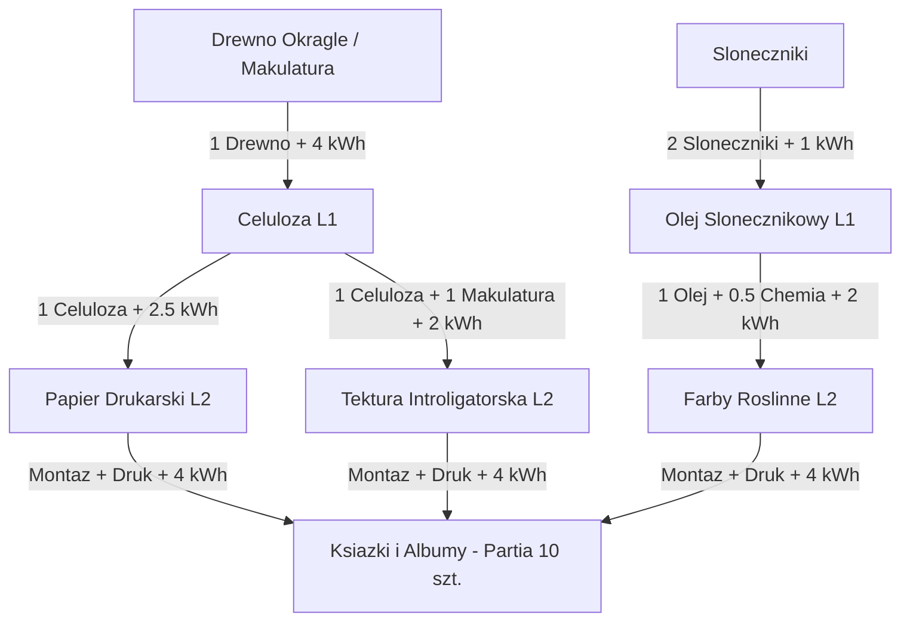

# Receptury i Bilans Masowo-Energetyczny: Branża 7 – Kultura, Zabawki i Sport
**Dokumentacja Technologiczna i Inżynieria Procesowa dla 20 Produktów Końcowych i Komponentów L1–L3**
*Załącznik do Game Design Document v5.0 i Katalogu Danych Gry Sustainable Economy*

---

## Wprowadzenie i Standard Bilansu Masowo-Energetycznego

Niniejsze opracowanie określa szczegółowe, zbalansowane fizycznie i ekonomicznie receptury produkcyjne dla **Branży 7: Kultura, Zabawki i Sport** (odblokowywanej historycznie w **Epoce 5: 1980–2005**, rozwijającej się przez Epokę 6, 7 i 8). 

### Standardy Zapisów i Jednostek:
1. **Jednostka Produktu / Partii**: Każda receptura odnosi się do standardowej jednostki handlowej gry (1 sztuka wyrobu gotowego lub 1 partia standardowa, np. 10 sztuk książek/czasopism, 1 instrument, 1 konsola, 1 symulator).
2. **Triada Wymogów Produkcyjnych**:
   - **LUDZIE**: Liczba i struktura załogi na linię produkcyjną: `[R]` Robotnicy (produkcja, montaż, logistyka magazynowa), `[M]` Klasa Średnia / Specjaliści (mistrzowie produkcji, technolodzy, lutnicy, serwisanci precyzyjni), `[E]` Elita / Naukowcy (inżynierowie systemowi, programiści, akustycy, fizycy kwantowi).
   - **ENERGIA (kWh)**: Sumaryczne zużycie energii elektrycznej i cieplnej w procesie wytwórczym na jednostkę wyrobu gotowego.
   - **LICENCJA (Technologia)**: Wymagany węzeł w Drzewku Technologii lub patent z R&D/Uniwersytetu.
3. **Alternatywne Profile Zasilania Zakładu**:
   - **Opcja Sieciowa**: Pobór prądu z miejskiej sieci elektroenergetycznej (emisyjność zależy od miksu energetycznego miasta).
   - **Opcja Kogeneracyjna / Autonomiczna**: Kocioł parowy/węglowy (wczesne epoki), kocioł na biomasę/biogaz z miejskich odpadów, instalacja OZE (panele PV na dachu hali) lub zasilanie wodorowe (Epoka 7–8).
4. **Zasada Zachowania Masy i Gospodarka Cyrkularna**:
   - Suma mas surowców wejściowych równa się masie produktu gotowego plus ewentualnym ścinkom technologicznym (odpady wiórowe, makulatura, zlewki tworzyw), które w 100% trafiają z powrotem do przetwórstwa (obieg zamknięty) lub miejskich Zakładów Recyklingu.

---

## CZĘŚĆ I: Receptury Półproduktów Poziomu 1 (L1) i Poziomu 2/3 (L2/L3)

Poniższe półprodukty stanowią bazę zasilającą linie produkcyjne Branży 7. Są one wytwarzane w dedykowanych zakładach przetwórczych, hutach, tartakach, fabrykach chemicznych i zakładach precyzyjnych.

### 1. Półprodukty Drewnopochodne i Celulozowe

#### [L1] Celuloza Przemysłowa
- **Drzewo procesu**: `1 Drewno Okrągłe + 4 kWh = 1 Celuloza`
- **Załoga**: 10 [R], 2 [M]
- **Licencja**: *Chemiczna Obróbka Drewna (Era 2)*
- **Profil energetyczny**: 4 kWh/j (rozwłóknianie mechaniczne i warniki ciśnieniowe; możliwość zasilania parą technologiczną ze spalania kory i ługów czarnych).

#### [L1] Tarcica Sezonowana
- **Drzewo procesu**: `1 Drewno Okrągłe + 2 kWh = 1 Tarcica`
- **Załoga**: 8 [R], 1 [M]
- **Licencja**: *Tartacznictwo Zmechanizowane (Era 1)*
- **Profil energetyczny**: 2 kWh/j (traki taśmowe i komory suszarnicze).

#### [L2] Papier Gazetowy Rolowy
- **Drzewo procesu**: `1 Celuloza (lub 1 Makulatura Recyklingowa) + 1.5 kWh = 1 Papier Gazetowy`
- **Załoga**: 6 [R], 2 [M]
- **Licencja**: *Produkcja Papieru Maszynowego (Era 3)*
- **Profil energetyczny**: 1.5 kWh/j (walce suszące, kalandrowanie).

#### [L2] Papier Książkowy Drukarski Bezdrzewny
- **Drzewo procesu**: `1 Celuloza + 1 Chemia Nieorganiczna (Wypełniacze Kredowe) + 2.5 kWh = 1 Papier Książkowy`
- **Załoga**: 6 [R], 3 [M]
- **Licencja**: *Papiernictwo Szlachetne (Era 4)*
- **Profil energetyczny**: 2.5 kWh/j (bielenie bezchlorowe TCF, powlekanie powierzchniowe).

#### [L2] Gruba Tektura Introligatorska / Karton Opakowaniowy
- **Drzewo procesu**: `1 Celuloza + 1 Makulatura Recyklingowa + 2 kWh = 1 Tektura Introligatorska`
- **Załoga**: 5 [R], 2 [M]
- **Licencja**: *Przetwórstwo Tektury Falistej (Era 4)*
- **Profil energetyczny**: 2 kWh/j (prasowanie wielowarstwowe i suszenie).

#### [L2] Sklejka i Płyty Klejone / Rezonansowe
- **Drzewo procesu**: `1 Tarcica + 0.5 Żywice Syntetyczne + 3 kWh = 1 Sklejka Przemysłowa`
- **Załoga**: 6 [R], 3 [M]
- **Licencja**: *Klejenie Warstwowe Drewna (Era 3)*
- **Profil energetyczny**: 3 kWh/j (prasy hydrauliczne na gorąco).

---

### 2. Półprodukty Polimerowe, Gumowe i Chemiczne

#### [L1] Frakcje Naftowe (Paliwa i Monomery)
- **Drzewo procesu**: `2 Ropa Naftowa + 3 kWh = 2 Frakcje Naftowe`
- **Załoga**: 8 [R], 4 [M]
- **Licencja**: *Destylacja Frakcyjna Ropy (Era 2)*
- **Profil energetyczny**: 3 kWh/partia (kolumny rektyfikacyjne).

#### [L1] Guma Surowa
- **Drzewo procesu**: `1 Kauczuk Naturalny + 1.5 kWh = 1 Guma Surowa`
- **Załoga**: 6 [R], 1 [M]
- **Licencja**: *Koagulacja Lateksu (Era 1)*
- **Profil energetyczny**: 1.5 kWh/j (walcowanie i suszenie koagulatów).

#### [L2] Plastik Ropopochodny (Granulat ABS / Poliwęglan / Poliuretan PU)
- **Drzewo procesu**: `1 Frakcje Naftowe + 3.5 kWh = 1 Granulat Tworzyw`
- **Załoga**: 6 [R], 3 [M], 1 [E]
- **Licencja**: *Polimeryzacja Ciśnieniowa (Era 4)*
- **Profil energetyczny**: 3.5 kWh/j (reaktory polimeryzacyjne i ekstrudery granulujące).

#### [L2] Bioplastik (PLA / PHA) – Alternatywa Cyrkularna
- **Drzewo procesu**: `1 Biomasa Przetworzona (ze Skrobi/Kukurydzy/Alg) + 2.5 kWh = 1 Bioplastik PLA`
- **Załoga**: 4 [R], 3 [M], 2 [E]
- **Licencja**: *Biopolimery Roślinne (Era 6)*
- **Profil energetyczny**: 2.5 kWh/j (fermentacja mlekowa i polikondensacja).

#### [L2] Wulkanizowana Guma Przemysłowa (Pęcherze, Pasy, Opony)
- **Drzewo procesu**: `1 Guma Surowa + 0.5 Chemia Nieorganiczna (Siarka) + 3 kWh = 1 Guma Wulkanizowana`
- **Załoga**: 7 [R], 2 [M]
- **Licencja**: *Wulkanizacja Siarkowa (Era 2)*
- **Profil energetyczny**: 3 kWh/j (mieszalniki Banbury'ego i autoklawy ciśnieniowe).

#### [L2] Farby Drukarskie i Barwniki Polimerowe
- **Drzewo procesu**: `1 Olej Słonecznikowy + 0.5 Chemia/Minerały + 2 kWh = 1 Farby Roślinne Drukarskie`
- **Załoga**: 4 [R], 3 [M]
- **Licencja**: *Pigmenty Organiczne i Farby Eko (Era 4)*
- **Profil energetyczny**: 2 kWh/j (młyny kulowe do dyspersji pigmentów).

---

### 3. Półprodukty Hutnicze, Metalowe i Kompozytowe

#### [L1] Surówka Hutnicza (Żelazo)
- **Drzewo procesu**: `2 Ruda Żelaza + 1 Koks Przemysłowy + 6 kWh = 1 Surówka Hutnicza`
- **Załoga**: 15 [R], 3 [M]
- **Licencja**: *Wielkie Piece Hutnicze (Era 1)*
- **Profil energetyczny**: 6 kWh/j (redukcja termiczna; alternatywa w Epoce 7: DRI na zielonym wodorze).

#### [L1] Miedź Rafinowana
- **Drzewo procesu**: `2 Ruda Miedzi + 4.5 kWh = 1 Miedź Rafinowana`
- **Załoga**: 8 [R], 3 [M]
- **Licencja**: *Elektrorafinacja Miedzi (Era 2)*
- **Profil energetyczny**: 4.5 kWh/j (wanny elektrolityczne).

#### [L1] Aluminium Hutnicze
- **Drzewo procesu**: `2 Boksyt + 12 kWh = 1 Aluminium Hutnicze`
- **Załoga**: 10 [R], 4 [M]
- **Licencja**: *Elektroliza Halla-Héroulta (Era 2)*
- **Profil energetyczny**: 12 kWh/j (proces wysoce energochłonny; kluczowy recykling złomu dający 95% oszczędności energii).

#### [L2] Stal Konstrukcyjna i Sprężynowa
- **Drzewo procesu**: `1 Surówka Hutnicza + 0.3 Koks + 4 kWh = 1 Stal`
  *(Ścieżka cyrkularna E7: `1 Złom Stalowy + 0.2 Wodór Bazowy + 2.5 kWh = 1 Stal Eko`)*
- **Załoga**: 10 [R], 3 [M]
- **Licencja**: *Konwertor Tlenowy / Piece Łukowe EAF (Era 3)*
- **Profil energetyczny**: 4 kWh/j (piec łukowy elektryczny).

#### [L2] Profile Aluminiowe Anodowane i Rurki
- **Drzewo procesu**: `1 Aluminium Hutnicze + 3.5 kWh = 1 Profile Aluminiowe`
- **Załoga**: 6 [R], 3 [M]
- **Licencja**: *Ekstruzja i Anodowanie Metali Lekkich (Era 4)*
- **Profil energetyczny**: 3.5 kWh/j (prasy wyciskające i kąpiele galwaniczne).

#### [L2] Włókna Węglowe i Nanomateriały (Prepreg Karbonowy)
- **Drzewo procesu**: `1 Granulat Tworzyw (Polakrylonitryl PAN) + 1 Żywice Syntetyczne + 9 kWh = 1 Włókna Węglowe`
- **Załoga**: 4 [R], 4 [M], 2 [E]
- **Licencja**: *Piroliza i Włókna Wysokomodułowe (Era 5/6)*
- **Profil energetyczny**: 9 kWh/j (piec karbonizacyjny w atmosferze gazu obojętnego w temperaturze 1500°C).

---

### 4. Półprodukty Elektroniczne, Optyczne i Złożone (L2/L3)

#### [L2] Krzem Monokrystaliczny (Wafle Krzemowe)
- **Drzewo procesu**: `2 Piasek Kwarcowy + 1 Chemia Nieorganiczna + 10 kWh = 1 Wafelek Krzemowy`
- **Załoga**: 4 [R], 4 [M], 3 [E]
- **Licencja**: *Metoda Czochralskiego i Wzrost Kryształów (Era 4)*
- **Profil energetyczny**: 10 kWh/j (piec indukcyjny próżniowy, cięcie drutem diamentowym).

#### [L2] Płytki Obwodów Drukowanych (PCB)
- **Drzewo procesu**: `0.5 Miedź Rafinowana + 0.5 Żywice Syntetyczne (z Frakcji Naftowych) + 3 kWh = 1 Płytka PCB`
- **Załoga**: 5 [R], 3 [M], 1 [E]
- **Licencja**: *Fotolitografia Obwodów Drukowanych (Era 4)*
- **Profil energetyczny**: 3 kWh/j (trawienie chemiczne, metalizacja otworów).

#### [L2] Mikroprocesory i Układy Scalone (CPU / GPU / Pamięci)
- **Drzewo procesu**: `1 Wafelek Krzemowy + 0.2 Złoto Czyste + 12 kWh = 1 Mikroprocesor`
- **Załoga**: 2 [R], 4 [M], 5 [E]
- **Licencja**: *Litografia Półprzewodnikowa VLSI (Era 5)*
- **Profil energetyczny**: 12 kWh/j (czyste pomieszczenia Cleanroom klasy 10, naświetlarki DUV/EUV).

#### [L3] Moduł Elektroniczny / Komputer Pokładowy
- **Drzewo procesu**: `1 Płytka PCB + 1 Mikroprocesor + 0.5 Kable Miedziane + 4 kWh = 1 Moduł Elektroniczny`
- **Załoga**: 3 [R], 4 [M], 2 [E]
- **Licencja**: *Montaż Powierzchniowy SMT (Era 5)*
- **Profil energetyczny**: 4 kWh/j (automatyczne układarki pick-and-place, piece rozpływowe).

#### [L3] Ekrany Wyświetlaczy (LCD / OLED / Micro-LED)
- **Drzewo procesu**: `1 Szkło Płaskie + 0.5 Wafelek Krzemowy + 0.2 Tlenki Neodymu + 6 kWh = 1 Ekran Wyświetlacza`
- **Załoga**: 3 [R], 4 [M], 3 [E]
- **Licencja**: *Wyświetlacze Ciekłokrystaliczne i Matryce Aktywne (Era 5)*
- **Profil energetyczny**: 6 kWh/j (napylanie próżniowe warstw emisyjnych).

#### [L3] Silniki Elektryczne / Prądnice Kinetyczne
- **Drzewo procesu**: `1 Stal + 0.5 Miedź Rafinowana + 0.2 Tlenki Neodymu + 5 kWh = 1 Silnik Elektryczny`
- **Załoga**: 5 [R], 3 [M], 1 [E]
- **Licencja**: *Maszyny Elektryczne z Magnesami Trwałymi (Era 5)*
- **Profil energetyczny**: 5 kWh/j (nawijarki uzwojeń, montaż wirników).

---

## CZĘŚĆ II: Szczegółowe Receptury 20 Produktów Końcowych Branży 7

Poniżej zestawiono 20 kompletnych receptur dla wszystkich produktów końcowych Branży 7, z zachowaniem pełnego bilansu surowcowego, energetycznego i kadrowego.

---

### Produkt 121: Książki Drukowane i Albumy (Epoka 5)
*Klasyczne wydawnictwa literackie, albumy sztuki oraz podręczniki w trwałej oprawie twardej.*

* **Receptura bilansowa (na 1 partię = 10 egzemplarzy albumów)**:
  - *Krok L1a*: `2 Drewno Okrągłe + 8 kWh = 2 Celuloza`
  - *Krok L1b*: `1 Słoneczniki + 1 kWh = 1 Olej Słonecznikowy`
  - *Krok L2a*: `1.5 Celuloza + 3.5 kWh = 1.5 Papier Drukarski Bezdrzewny`
  - *Krok L2b*: `0.5 Celuloza + 0.5 Makulatura + 1 kWh = 1 Tektura Introligatorska na Okładki`
  - *Krok L2c*: `0.5 Olej Słonecznikowy + 0.5 Pigmenty Minerałów + 1 kWh = 1 Farby Drukarskie Roślinne`
  - *Krok Końcowy (Wytwórnia Poligraficzna)*:
    `1.5 Papier Drukarski + 1 Tektura Introligatorska + 0.5 Farby Drukarskie + 4 kWh = 1 Partia Książek (10 szt.)`
* **Triada Produkcyjna**:
  - **LUDZIE**: `6 [R], 4 [M], 0 [E]` (drukarze offsetowi, introligatorzy, kontrolerzy jakości barwy).
  - **ENERGIA**: `18.5 kWh` łącznie na partię (w tym 4 kWh montażu końcowego w drukarni).
  - **LICENCJA**: *Druk Wysokonakładowy i Typografia (Era 5)*.
* **Opcja zasilania fabryki**: Zasilanie z sieci miejskiej lub lokalny kocioł na odpady papiernicze/biomasę do suszenia arkuszy offsetowych.
* **Cyrkularność / Odpady**: Ścinki papieru (makulatura technologiczna 8%) natychmiast zawracane do rozwłókniacza. Produkt końcowy w 100% zdatny do wielokrotnego recyklingu.

---

### Produkt 122: Prasa i Czasopisma (Epoka 5 – [Wygasa w Epoce 7])
*Dzienniki informacyjne, tygodniki opinii i magazyny ilustrowane drukowane w technologii rolowej.*

* **Receptura bilansowa (na 1 partię = 20 egzemplarzy gazet)**:
  - *Krok L1*: `1 Drewno Okrągłe (lub Makulatura) + 4 kWh = 1 Celuloza`
  - *Krok L2a*: `1 Celuloza + 1.5 kWh = 1 Papier Gazetowy Rolowy`
  - *Krok L2b*: `0.5 Olej Słonecznikowy + 0.5 Chemia + 1 kWh = 0.5 Farby Szybkoschnące`
  - *Krok Końcowy (Zakład Prasowy)*:
    `1 Papier Gazetowy Rolowy + 0.5 Farby Szybkoschnące + 2 kWh = 1 Partia Prasy (20 szt.)`
* **Triada Produkcyjna**:
  - **LUDZIE**: `7 [R], 2 [M], 0 [E]` (operatorzy maszyn rotacyjnych, ładowacze beli, spedycja).
  - **ENERGIA**: `8.5 kWh` łącznie na partię (w tym 2 kWh na falcowanie i cięcie ekspresowe).
  - **LICENCJA**: *Szybki Druk Gazetowy (Era 5)*.
* **Opcja zasilania fabryki**: Sieć miejska (praca w szczytach nocnych od 22:00 do 04:00 rano).
* **Cykl życia i Ewolucja**: Krótki czas użytkowania (1 dzień – 1 tydzień). W Epoce 7 popyt spada do zera na rzecz czytników cyfrowych i portali informacyjnych.

---

### Produkt 123: Gry Planszowe i Puzzle (Epoka 5)
*Wieloelementowe zestawy rozrywkowe z litej tektury, z toczonymi pionkami drewnianymi i kartami.*

* **Receptura bilansowa (na 1 pudełko kompletnej gry)**:
  - *Krok L1a*: `1 Drewno Okrągłe + 4 kWh = 1 Celuloza`
  - *Krok L1b*: `0.5 Drewno Okrągłe + 1 kWh = 0.5 Tarcica`
  - *Krok L2a*: `1 Celuloza + 1 Makulatura + 2 kWh = 1 Gruba Tektura Kaszerowana (Plansza + Pudełko)`
  - *Krok L2b*: `0.5 Tarcica + 1.5 kWh = 0.5 Pionki Drewniane Toczone i Kostki`
  - *Krok L2c*: `0.5 Celuloza + 1 kWh = 0.5 Talia Kart Drukarska`
  - *Krok Końcowy (Wytwórnia Gier)*:
    `1 Gruba Tektura + 0.5 Pionki Drewniane + 0.5 Talia Kart + 2.5 kWh = 1 Gra Planszowa / Puzzle`
* **Triada Produkcyjna**:
  - **LUDZIE**: `5 [R], 3 [M], 0 [E]` (operatorzy sztanc tyglowych, tokarze drewna, pakowacze).
  - **ENERGIA**: `12.0 kWh` łącznie w łańcuchu (w tym 2.5 kWh montażu i foliowania ekologicznego).
  - **LICENCJA**: *Projektowanie Gier i Mechanik Rozrywki (Era 5)*.
* **Opcja zasilania fabryki**: Standardowa sieć miejska lub lokalna farma PV na dachu zakładu.
* **Cyrkularność**: 95% surowców odnawialnych (drewno FSC, tektura makulaturowa), 0 plastiku w wersji Eko.

---

### Produkt 124: Zabawki Drewniane i Ekologiczne (Epoka 5)
*Tradycyjne klocki architektoniczne, drewniane pociągi, koniki i sortery sensoryczne.*

* **Receptura bilansowa (na 1 zestaw klocków/zabawek drewnianych)**:
  - *Krok L1a*: `1 Drewno Okrągłe (Buk/Lipa) + 2 kWh = 1 Tarcica Sezonowana`
  - *Krok L1b*: `0.5 Słoneczniki + 0.5 kWh = 0.5 Olej Słonecznikowy`
  - *Krok L2a*: `1 Tarcica Sezonowana + 1.5 kWh = 1 Elementy Drewniane Szlifowane`
  - *Krok L2b*: `0.5 Olej Słonecznikowy + 0.5 Minerały + 0.8 kWh = 0.5 Bezpieczne Barwniki Wodne Eko`
  - *Krok Końcowy (Fabryka Zabawek Tradycyjnych)*:
    `1 Elementy Drewniane Szlifowane + 0.5 Barwniki Wodne + 1.5 kWh = 1 Zestaw Zabawek Drewnianych`
* **Triada Produkcyjna**:
  - **LUDZIE**: `6 [R], 2 [M], 0 [E]` (stolarze maszynowi, szlifierze bębnowi, lakiernicy natryskowi).
  - **ENERGIA**: `6.3 kWh` łącznie w łańcuchu (w tym 1.5 kWh obróbki frezarskiej i polerowania).
  - **LICENCJA**: *Bezpieczeństwo Zabawek Naturalnych (Era 5)*.
* **Opcja zasilania fabryki**: Kocioł na trociny i zrębki własne (autoprodukcja ciepła i prądu).
* **Trwałość**: Wyjątkowo wysoka żywotność (pokoleniowa, ponad 20 lat). Zero mikroplastiku.

---

### Produkt 125: Zabawki Plastikowe i Klocki Konstrukcyjne (Epoka 5 -> E7: Bioplastik)
*Precyzyjne klocki modułowe z tolerancją mikrometryczną oraz plastikowe zestawy kreatywne.*

* **Receptura bilansowa (na 1 pudełko klocków konstrukcyjnych)**:
  - *Krok L1*: `1.5 Ropa Naftowa + 2.5 kWh = 1.5 Frakcje Naftowe`
    *(W Epoce 7 ścieżka Eko: `1.5 Biomasa ze Skrobi + 2 kWh = 1.5 Bioplastik PLA L1`)*
  - *Krok L2*: `1.5 Frakcje Naftowe + 0.2 Barwniki + 4 kWh = 1.5 Granulat Tworzywa ABS Barwiony`
  - *Krok Końcowy (Wtryskownia Wysokoprecyzyjna)*:
    `1.5 Granulat ABS (lub PLA) + 3.5 kWh = 1 Zestaw Klocków Konstrukcyjnych`
* **Triada Produkcyjna**:
  - **LUDZIE**: `4 [R], 4 [M], 1 [E]` (inżynierowie form wtryskowych, laboranci tworzyw).
  - **ENERGIA**: `10.0 kWh` łącznie (wysokie ciśnienie wtrysku 1500 bar i chłodzenie form chłodziarkami).
  - **LICENCJA**: *Formowanie Wtryskowe Wysokociśnieniowe (Era 5)* $\to$ *Biopolimery Precyzyjne (Era 7)*.
* **Opcja zasilania fabryki**: Zasilanie z sieci elektroenergetycznej z agregatem chłodniczym ze zmienną prędkością.
* **Cyrkularność**: Tworzywo ABS nadaje się do regranulacji po zużyciu; w Epoce 7 pełna biodegradowalność kompostowalna PLA.

---

### Produkt 126: Lalki i Figurki Kolekcjonerskie (Epoka 5)
*Figurki akcji, lalki przegubowe z syntetycznymi włosami i miniaturowymi ubrankami tekstylnymi.*

* **Receptura bilansowa (na 1 lalkę/figurkę kompletną)**:
  - *Krok L1a*: `1 Ropa Naftowa + 1.5 kWh = 1 Frakcje Naftowe`
  - *Krok L1b*: `0.5 Bawełna + 0.5 kWh = 0.5 Przędza Bawełniana`
  - *Krok L2a*: `0.8 Frakcje Naftowe + 2 kWh = 0.8 Winyl Miękki + Włosy Syntetyczne (Poliester)`
  - *Krok L2b*: `0.5 Przędza Bawełniana + 1.5 kWh = 0.5 Tkanina Odzieżowa Miniaturowa`
  - *Krok Końcowy (Zakład Lalkarski)*:
    `0.8 Winyl i Syntetyki + 0.5 Tkanina + 0.2 Barwniki + 2.5 kWh = 1 Lalka / Figurka Kolekcjonerska`
* **Triada Produkcyjna**:
  - **LUDZIE**: `7 [R], 2 [M], 0 [E]` (odlewnicy rotacyjni, maszynistki szwalni miniaturowej, malarze tamponowi).
  - **ENERGIA**: `8.0 kWh` łącznie (w tym 2.5 kWh zgrzewania i szycia).
  - **LICENCJA**: *Wzornictwo Zabawek Dziecięcych (Era 5)*.
* **Opcja zasilania fabryki**: Standardowa sieć miejska.

---

### Produkt 127: Instrumenty Muzyczne – Gitary, Pianina Cyfrowe (Epoka 5)
*Tradycyjne i hybrydowe instrumenty akustyczno-elektroniczne wymagające szlachetnego drewna i precyzji.*

* **Receptura bilansowa (na 1 instrument – gitarę koncertową lub pianino cyfrowe)**:
  - *Krok L1a*: `1 Drewno Okrągłe (Świerk/Palisander) + 2 kWh = 1 Tarcica Szlachetna Sezonowana`
  - *Krok L1b*: `0.5 Ruda Żelaza + 0.5 Ruda Miedzi + 3 kWh = 0.5 Stal i Miedź Rafinowana`
  - *Krok L2a*: `1 Tarcica Szlachetna + 2.5 kWh = 1 Płyta Rezonansowa Szlifowana i Gryf`
  - *Krok L2b*: `0.5 Stal i Miedź + 2 kWh = 0.5 Struny Stalowo-Niklowe, Progi i Klucze Mosiężne`
  - *Krok L2c*: `0.2 Krzem/Tworzywa + 1.5 kWh = 0.2 Przetworniki Elektromagnetyczne / Płytka Dźwiękowa`
  - *Krok Końcowy (Manufaktura Lutnicza)*:
    `1 Płyta Rezonansowa + 0.5 Osprzęt Strunowy + 0.2 Elektronika + 5 kWh = 1 Instrument Muzyczny`
* **Triada Produkcyjna**:
  - **LUDZIE**: `2 [R], 6 [M], 1 [E]` (mistrzowie lutnicy, korektorzy intonacji, elektronicy akustyczni).
  - **ENERGIA**: `16.0 kWh` łącznie w procesie (wielotygodniowe suszenie komorowe, precyzyjne frezowanie CNC i lakierowanie French Polish).
  - **LICENCJA**: *Akustyka Drewna i Strojenie Instrumentów (Era 5)*.
* **Opcja zasilania fabryki**: Zasilanie z sieci miejskiej z precyzyjną klimatyzacją wilgotnościową (stałe 45% RH).
* **Trwałość**: Instrumenty przetrwają dziesięciolecia przy wsparciu miejskiej gałęzi **Serwisantów**.

---

### Produkt 128: Konsole do Gier Wideo (Epoka 5 -> E7: Modułowe / Chmurowe)
*Platformy rozrywki domowej wyposażone w układy graficzne 3D, zasilacze i kontrolery bezprzewodowe.*

* **Receptura bilansowa (na 1 konsolę do gier z kontrolerem)**:
  - *Krok L1*: `1 Piasek Kwarcowy + 1 Ruda Miedzi + 1 Ropa Naftowa + 10 kWh = 0.5 Krzem + 0.5 Miedź + 0.5 Plastik`
  - *Krok L2a*: `0.5 Krzem + 0.1 Złoto + 8 kWh = 0.5 Układy Scalone GPU/CPU i Pamięci GDDR`
  - *Krok L2b*: `0.5 Miedź + 0.5 Żywice + 3 kWh = 0.5 Wielowarstwowa Płyta Główna PCB`
  - *Krok L2c*: `0.5 Plastik ABS + 0.2 Aluminium + 2.5 kWh = 0.5 Obudowa i Radiator Chłodzenia`
  - *Krok Końcowy (Fabryka Elektroniki Rozrywkowej)*:
    `0.5 GPU/CPU + 0.5 Płyta PCB + 0.5 Obudowa i Chłodzenie + 5 kWh = 1 Konsola do Gier Wideo`
* **Triada Produkcyjna**:
  - **LUDZIE**: `3 [R], 4 [M], 3 [E]` (programiści firmware, inżynierowie termiki, monterzy SMT).
  - **ENERGIA**: `28.5 kWh` łącznie w łańcuchu mikroelektronicznym.
  - **LICENCJA**: *Grafika Komputerowa Czasu Rzeczywistego 3D (Era 5)* $\to$ *Architektura Modułowa (Era 7)*.
* **Opcja zasilania fabryki**: Wysokostabilna linia zasilania z sieci miejskiej z podtrzymaniem UPS.
* **Cyrkularność / Odzysk**: Urban Mining w Zakładach Recyklingu pozwala odzyskać 98% miedzi, złota i krzemu.

---

### Produkt 129: Gry Wideo i Oprogramowanie Rozrywkowe (Epoka 5)
*Cyfrowe dzieła sztuki multimedialnej: silnik gry, scenariusz, muzyka, modele 3D oraz fizyczne lub chmurowe nośniki dystrybucji.*

* **Receptura bilansowa (na 1 licencję / pakiet oprogramowania z nośnikiem)**:
  - *Krok L1*: `1 Ropa Naftowa (Poliwęglan) + 2 kWh = 1 Nośnik Optyczny Czysty (CD/DVD/Blu-ray)`
    *(W Epoce 7/8 dystrybucja w 100% cyfrowa: zastąpienie plastiku przez przydział serwerowy IT)*
  - *Krok L2a*: `0.5 Celuloza + 1 kWh = 0.5 Pudełko i Poligrafia (lub Licencja Cyfrowa)`
  - *Krok L2b (Usługa R&D / IT)*: `Usługa IT (Moc Obliczeniowa Serwerów) + 5 kWh = Kod i Aktywa Cyfrowe Gry`
  - *Krok Końcowy (Studio Deweloperskie i Tłocznia)*:
    `1 Nośnik Czysty + 0.5 Pudełko + Kod Gry + 2 kWh = 1 Gra Wideo (Pakiet Nośnikowy / Cyfrowy)`
* **Triada Produkcyjna**:
  - **LUDZIE**: `1 [R], 3 [M], 6 [E]` (architekci oprogramowania, graficy 3D, reżyserzy dźwięku).
  - **ENERGIA**: `10.0 kWh` łącznie (większość to moc obliczeniowa stacji roboczych i render-farm).
  - **LICENCJA**: *Silniki Gier i Prawa Autorskie (Era 5)*.
* **Opcja zasilania fabryki / studia**: Zielona energia dla centrów danych (Data Center PUE < 1.15).
* **Ekonomia**: Znikome zużycie surowców fizycznych, ekstremalnie wysoka wartość dodana i marża operacyjna.

---

### Produkt 130: Piłki i Sprzęt do Gier Zespołowych (Epoka 5)
*Wytrzymałe piłki nożne, koszykowe i siatkowe o stałej aerodynamice i odporności na ścieranie.*

* **Receptura bilansowa (na 1 profesjonalną piłkę meczową)**:
  - *Krok L1a*: `1 Kauczuk Naturalny + 1.5 kWh = 1 Guma Surowa`
  - *Krok L1b*: `1 Ropa Naftowa + 1.5 kWh = 1 Frakcje Naftowe (Poliuretan PU)`
  - *Krok L2a*: `1 Guma Surowa + 0.2 Chemia + 2 kWh = 1 Pęcherz Butylowy Trzymający Ciśnienie`
  - *Krok L2b*: `1 Frakcje Naftowe + 2 kWh = 1 Panele Zewnętrzne z Syntetycznej Eko-Skóry PU`
  - *Krok Końcowy (Zakład Sprzętu Sportowego)*:
    `1 Pęcherz Butylowy + 1 Panele Poliuretanowe + 0.2 Kord Włókienniczy + 2.5 kWh = 1 Piłka Meczowa`
* **Triada Produkcyjna**:
  - **LUDZIE**: `6 [R], 2 [M], 0 [E]` (operatorzy zgrzewarek termicznych, klejarze, testerzy ciśnienia).
  - **ENERGIA**: `9.5 kWh` łącznie w cyklu produkcyjnym.
  - **LICENCJA**: *Aerodynamika Piłek Sportowych (Era 5)*.
* **Opcja zasilania fabryki**: Zasilanie z sieci miejskiej z odzyskiem ciepła z pieców termozgrzewania.
* **Serwisowalność**: Wymienne wentyle i dętki u miejskich **Serwisantów**.

---

### Produkt 131: Rakiety Tenisowe i Sprzęt Kompozytowy (Epoka 5)
*Zaawansowany sprzęt sportowy o wysokiej sztywności i tłumieniu drgań z włókien węglowo-epoksydowych.*

* **Receptura bilansowa (na 1 rakietę kompozytową z naciągiem)**:
  - *Krok L1*: `1.5 Ropa Naftowa + 2.5 kWh = 1.5 Frakcje Naftowe`
  - *Krok L2a*: `1 Frakcje Naftowe + 1 Żywice Syntetyczne + 8 kWh = 1 Włókna Węglowe (Prepreg Grafitowy)`
  - *Krok L2b*: `0.5 Frakcje Naftowe + 2 kWh = 0.5 Struny Poliamidowe Naciągu + Owijka PU`
  - *Krok Końcowy (Fabryka Kompozytów Sportowych)*:
    `1 Prepreg Węglowy + 0.5 Struny i Akcesoria + 4.5 kWh = 1 Rakieta Tenisowa Kompozytowa`
* **Triada Produkcyjna**:
  - **LUDZIE**: `3 [R], 5 [M], 1 [E]` (laminatorzy autoklawowi, serwisanci naciągów, inżynierowie kompozytów).
  - **ENERGIA**: `17.0 kWh` łącznie (nagrzewanie autoklawu do 180°C pod ciśnieniem 7 bar).
  - **LICENCJA**: *Kompozyty Węglowo-Żywiczne (Era 5)*.
* **Opcja zasilania fabryki**: Prąd sieciowy plus instalacja sprężonego powietrza i azotu technologicznego.
* **Regeneracja**: Wymiana owijek i naciągów u serwisantów; zużyte ramy trafiają do pirolizy włókien węglowych.

---

### Produkt 132: Narty, Snowboard i Sprzęt Zimowy (Epoka 5)
*Sprzęt zjazdowy o wielowarstwowej konstrukcji sandwich (rdzeń drewniany + krawędzie stalowe + ślizg PE).*

* **Receptura bilansowa (na 1 parę nart lub 1 deskę snowboardową)**:
  - *Krok L1a*: `1 Drewno Okrągłe (Jesion/Topola) + 2 kWh = 1 Tarcica`
  - *Krok L1b*: `1 Ruda Żelaza + 3 kWh = 0.5 Stal Stopowa`
  - *Krok L1c*: `1 Ropa Naftowa + 1.5 kWh = 1 Tworzywa PE/Epoksyd`
  - *Krok L2a*: `1 Tarcica + 2 kWh = 1 Rdzeń Drewniany Klejony Warstwowo`
  - *Krok L2b*: `0.5 Stal + 2 kWh = 0.5 Krawędzie Stalowe Hartowane`
  - *Krok L2c*: `1 Tworzywa + 2 kWh = 1 Spiekany Ślizg Polietylenowy UHMWPE + Laminat Szklany`
  - *Krok Końcowy (Fabryka Nart)*:
    `1 Rdzeń Drewniany + 0.5 Krawędzie Stalowe + 1 Ślizg i Laminat + 6 kWh = 1 Para Nart / Snowboard`
* **Triada Produkcyjna**:
  - **LUDZIE**: `4 [R], 5 [M], 1 [E]` (operatorzy pras termicznych sandwich, szlifierze krawędzi, technolodzy).
  - **ENERGIA**: `18.5 kWh` łącznie na parę (w tym 6 kWh prasy grzewczej i kamieni szlifierskich).
  - **LICENCJA**: *Konstrukcje Sandwichowe Nart (Era 5)*.
* **Opcja zasilania fabryki**: Zasilanie z sieci elektroenergetycznej, odzysk wiórów z frezowania rdzeni.
* **Serwisowalność**: Ostrzenie krawędzi, zalewanie ubytków ślizgu i smarowanie u miejskich **Serwisantów**.

---

### Produkt 133: Namioty i Sprzęt Turystyczny (Epoka 5)
*Lekkie, wiatroodporne i wodoodporne schronienia geodezyjne z masztami z duraluminium.*

* **Receptura bilansowa (na 1 kompletny namiot wyprawowy 3-osobowy)**:
  - *Krok L1a*: `1.5 Ropa Naftowa + 2.5 kWh = 1.5 Frakcje Naftowe (Poliester/Nylon)`
  - *Krok L1b*: `1 Boksyt + 6 kWh = 0.5 Aluminium Hutnicze`
  - *Krok L2a*: `1.5 Frakcje Naftowe + 3 kWh = 1.5 Tkanina Ripstop Wodoodporna z Powłoką PU`
  - *Krok L2b*: `0.5 Aluminium Hutnicze + 2 kWh = 0.5 Maszty Aluminiowe Anodowane i Szpilki`
  - *Krok Końcowy (Szwalnia Turystyczna)*:
    `1.5 Tkanina Ripstop + 0.5 Maszty i Szpilki + 2.5 kWh = 1 Namiot Turystyczny w Pokrowcu`
* **Triada Produkcyjna**:
  - **LUDZIE**: `6 [R], 3 [M], 0 [E]` (krojczy laserowi, szwaczki taśm uszczelniających, monterzy okuć).
  - **ENERGIA**: `16.0 kWh` łącznie (w tym 2.5 kWh szycia, zgrzewania ultradźwiękowego i pakowania).
  - **LICENCJA**: *Tkaniny Wodoodporne i Konstrukcje Geodezyjne (Era 5)*.
* **Opcja zasilania fabryki**: Zwykłe zasilanie sieciowe (niska energochłonność montażu końcowego).
* **Naprawialność**: Samoprzylepne łaty naprawcze ripstop i wymienne segmenty masztów.

---

### Produkt 134: Domowy Sprzęt Fitness – Bieżnie, Orbitreki (Epoka 5 -> E7: Generujące Prąd)
*Urządzenia kardio z monitorowaniem pulsu; w Epoce 7 wyposażone w prądnice oddające prąd do sieci domowej.*

* **Receptura bilansowa (na 1 bieżnię elektryczną / orbitrek ergometryczny)**:
  - *Krok L1a*: `2 Ruda Żelaza + 1 Koks + 6 kWh = 1 Stal Konstrukcyjna`
  - *Krok L1b*: `1 Ruda Miedzi + 1 Kauczuk + 4 kWh = 0.5 Miedź + 0.5 Guma`
  - *Krok L2a*: `1 Stal Konstrukcyjna + 3 kWh = 1 Spawana Rama Stalowa Malowana Proszkowo`
  - *Krok L2b*: `0.5 Miedź + 0.5 Stal + 3 kWh = 1 Silnik Elektryczny Napędu (w E7: Prądnica Kinetyczna)`
  - *Krok L2c*: `0.5 Guma + 0.5 Tworzywa + 2 kWh = 1 Antypoślizgowy Pas Biegowy i Płyta Tłumiąca`
  - *Krok L2d*: `0.2 Krzem/Miedź + 1.5 kWh = 0.2 Komputer Treningowy z Wyświetlaczem`
  - *Krok Końcowy (Fabryka Sprzętu Treningowego)*:
    `1 Rama Stalowa + 1 Silnik/Prądnica + 1 Pas Biegowy + 0.2 Komputer + 5.5 kWh = 1 Bieżnia / Orbitrek`
* **Triada Produkcyjna**:
  - **LUDZIE**: `5 [R], 4 [M], 1 [E]` (spawacze maszynowi, mechatronicy, monterzy okablowania).
  - **ENERGIA**: `25.0 kWh` łącznie na sztukę (ciężka obróbka stali i montaż silnika).
  - **LICENCJA**: *Biomechanika Treningowa i Prądnice Kinetyczne (Era 5/7)*.
* **Opcja zasilania fabryki**: Sieć miejska 400V trójfazowa; w hali hamownia testowa odzyskuje energię z testów obciążeniowych.
* **Ewolucja w Epoce 7**: Sprzęt fitness generuje 150–300 W energii na godzinę ćwiczeń mieszkańca, zasilając lokalne mikrosieci.

---

### Produkt 135: Wędki i Sprzęt Wodniacki – Kajaki, Deski SUP (Epoka 6)
*Lekki, odporny na uderzenia i promieniowanie UV sprzęt rekreacyjny z włókien węglowych i polimerów drop-stitch.*

* **Receptura bilansowa (na 1 kajak polietylenowy lub deskę SUP / zestaw wędek carbon)**:
  - *Krok L1a*: `1.5 Ropa Naftowa + 2.5 kWh = 1.5 Frakcje Naftowe (Polietylen HDPE / PVC Drop-Stitch)`
  - *Krok L1b*: `1 Ropa Naftowa (PAN) + 3 kWh = 0.5 Włókna Węglowe Wysokomodułowe`
  - *Krok L2a*: `1.5 Frakcje Naftowe + 3.5 kWh = 1.5 Kadłub Kajaka Rotomoulding (lub Deska SUP)`
  - *Krok L2b*: `0.5 Włókna Węglowe + 0.2 Żywice + 3 kWh = 0.5 Wiosło Karbonowe i Blanki Wędkarskie`
  - *Krok Końcowy (Zakład Sprzętu Wodniackiego i Wędkarskiego)*:
    `1.5 Kadłub/SUP + 0.5 Wiosło i Osprzęt + 3 kWh = 1 Kompletny Kajak / Deska SUP / Zestaw Wędkarski`
* **Triada Produkcyjna**:
  - **LUDZIE**: `4 [R], 4 [M], 1 [E]` (operatorzy pieca rotacyjnego, monterzy osprzętu szczelnego).
  - **ENERGIA**: `15.0 kWh` łącznie (ogrzewanie wielkich form pieca rotacyjnego do 250°C).
  - **LICENCJA**: *Włókna Węglowe Wysokomodułowe i Rotomoulding (Era 6)*.
* **Opcja zasilania fabryki**: Zasilanie gazem ziemnym/biometanem lub elektrycznymi piecami oporowymi.
* **Cyrkularność**: Kadłuby HDPE nadają się w 100% do powtórnego zmielenia i ponownego formowania.

---

### Produkt 136: Zestawy Edukacyjne STEM i Robotyka dla Dzieci (Epoka 6)
*Zestawy modułowych klocków elektronicznych, czujników i mikrokontrolerów uczące kodowania i automatyki.*

* **Receptura bilansowa (na 1 walizkę edukacyjną robota STEM)**:
  - *Krok L1*: `1 Piasek Kwarcowy + 1 Ruda Miedzi + 1 Ropa + 8 kWh = 0.5 Krzem + 0.5 Miedź + 0.5 Plastik`
  - *Krok L2a*: `0.5 Krzem + 0.1 Złoto + 6 kWh = 0.5 Płytka Mikrokontrolera z Wi-Fi/Bluetooth`
  - *Krok L2b*: `0.5 Miedź + 0.2 Neodym + 0.3 Stal + 3 kWh = 0.5 Zestaw Miniserwomechanizmów i Czujników`
  - *Krok L2c*: `0.5 Plastik + 1.5 kWh = 0.5 Klocki Konstrukcyjne Modułowe z Tworzywa Eko`
  - *Krok Końcowy (Wytwórnia Zabawek Naukowych)*:
    `0.5 Mikrokontroler + 0.5 Sensory i Silniczki + 0.5 Elementy Mechaniczne + 2.5 kWh = 1 Zestaw Edukacyjny STEM`
* **Triada Produkcyjna**:
  - **LUDZIE**: `2 [R], 4 [M], 4 [E]` (dydaktycy programowania, inżynierowie elektronicy, testerzy bezpieczeństwa zabawek).
  - **ENERGIA**: `21.0 kWh` łącznie w łańcuchu mikroelektroniki i wtrysku.
  - **LICENCJA**: *Dydaktyka Robotyki i Kodowania (Era 6)*.
* **Opcja zasilania fabryki**: Czysty montaż laboratoryjny zasilany z miejskiej sieci OZE.
* **Wpływ na miasto**: Podnosi wskaźnik Edukacji dzieci i przyspiesza generowanie Punktów Nauki na uniwersytetach o +15%.

---

### Produkt 137: Fotele Gamingowe i Ergonomiczne (Epoka 6)
*Fotele kubełkowe i stanowiska pracy z mechanizmem synchronicznym, siłownikiem gazowym klasy 4 i zimną pianką.*

* **Receptura bilansowa (na 1 fotel gamingowy / ergonomiczny)**:
  - *Krok L1a*: `1.5 Ruda Żelaza + 0.5 Boksyt + 5 kWh = 1 Stal + 0.3 Aluminium`
  - *Krok L1b*: `1.5 Ropa Naftowa + 2.5 kWh = 1.5 Tworzywa PU/Poliester (w E7: Eko-Skóra Grzybowa)`
  - *Krok L2a*: `1 Stal + 0.3 Aluminium + 3.5 kWh = 1 Wewnętrzna Rama Stalowa + Podstawa Aluminiowa`
  - *Krok L2b*: `0.5 Stal + 0.1 Azot + 2 kWh = 0.5 Siłownik Gazowy Klasy 4 + Mechanizm Multiblock`
  - *Krok L2c*: `1.5 Tworzywa + 2 kWh = 1.5 Pianka Formowana na Zimno + Tapicerka Oddychająca`
  - *Krok Końcowy (Fabryka Mebli Gamingowych)*:
    `1 Rama i Podstawa + 0.5 Siłownik + 1.5 Pianka i Tapicerka + 4 kWh = 1 Fotel Ergonomiczny`
* **Triada Produkcyjna**:
  - **LUDZIE**: `4 [R], 5 [M], 1 [E]` (tapicerzy pneumatyczni, spawacze ram, inżynierowie ergonomii).
  - **ENERGIA**: `19.0 kWh` łącznie na fotel.
  - **LICENCJA**: *Ergonomia Stanowisk Siedzących (Era 6)*.
* **Opcja zasilania fabryki**: Sieć miejska; instalacja pneumatyczna zasilana z kompresorów śrubowych z inwerterem.
* **Modułowość**: Wymienne kółka, podłokietniki i podnośniki gazowe wydłużają cykl życia do 12 lat.

---

### Produkt 138: Symulatory Sportowe i Komory Imersyjne VR (Epoka 7)
*Wielomilionowe kapsuły treningowe z platformą heksapod Stewart 6DoF, sferycznymi ekranami Micro-LED i kombinezonem haptycznym.*

* **Receptura bilansowa (na 1 komorę symulatora imersyjnego)**:
  - *Krok L1a*: `2 Boksyt + 1 Piasek Kwarcowy + 15 kWh = 1 Stopy Aluminium-Magnez + 0.5 Krzem`
  - *Krok L1b*: `1 Neodym i Ziemie Rzadkie + 1 Ruda Złota + 10 kWh = 0.5 Tlenki Neodymu + 0.1 Złoto Czyste`
  - *Krok L2a*: `1 Stopy Lekkie + 0.5 Tlenki Neodymu + 8 kWh = 1 Platforma Ruchoma 6DoF z Siłownikami Liniowymi`
  - *Krok L2b*: `0.5 Krzem + 0.5 Szkło + 0.2 Tlenki Neodymu + 7 kWh = 1 Sferyczna Kopuła Wizualna Micro-LED`
  - *Krok L2c*: `0.5 Krzem + 0.1 Złoto + 1 Kompozyty + 9 kWh = 1 Komputer Obliczeń Fizyki Czasu Rzeczywistego + Haptyka`
  - *Krok Końcowy (Zakłady Zaawansowanych Symulatorów)*:
    `1 Platforma 6DoF + 1 Kopuła Micro-LED + 1 Komputer i Sensory + 12 kWh = 1 Komora Symulatora Imersyjnego`
* **Triada Produkcyjna**:
  - **LUDZIE**: `2 [R], 4 [M], 8 [E]` (programiści kinematyki odwróconej, mechatronicy precyzyjni, fizycy optoelektronicy).
  - **ENERGIA**: `61.0 kWh` łącznie w procesie wytwarzania i wielodniowego testowania kalibracyjnego.
  - **LICENCJA**: *Kinematyka Odwrócona i Rzeczywistość Wirtualna (Era 7)*.
* **Opcja zasilania fabryki**: Dedykowane zasilanie 15 kV z sieci miejskiej z kompensacją mocy biernej.
* **Efekt ekologiczny**: Redukuje konieczność dalekich podróży lotniczych na stoki i tory wyścigowe (oszczędność paliwa w mieście).

---

### Produkt 139: Instrumenty Holograficzne i Syntezatory AI (Epoka 8)
*Niematerialne instrumenty muzyczne generujące w powietrzu interaktywne wiązki laserowe z dotykowym sprzężeniem ultradźwiękowym.*

* **Receptura bilansowa (na 1 konsolę holograficzną instrumentu AI)**:
  - *Krok L1*: `1 Piasek Kwarcowy + 1 Neodym + 1 Ruda Złota + 12 kWh = 0.5 Krzem Fotonowy + 0.3 Ziemie Rzadkie + 0.1 Złoto`
  - *Krok L2a*: `0.5 Krzem Fotonowy + 0.1 Złoto + 8 kWh = 0.5 Laserowy Projektor Holograficzny RGB 3D`
  - *Krok L2b*: `0.3 Ziemie Rzadkie + 0.2 Ceramika Piezokrystaliczna + 5 kWh = 0.5 Emiter Fali Ultradźwiękowej Haptyki Powietrznej`
  - *Krok L2c*: `0.5 Włókna Węglowe/Grafen + 0.5 Koprocesor Fotonowy + 7 kWh = 1 Moduł Syntezy Dźwięku i Generacji AI`
  - *Krok Końcowy (Laboratorium Dźwięku Przyszłości)*:
    `0.5 Projektor Holograficzny + 0.5 Emiter Haptyczny + 1 Moduł AI + 6 kWh = 1 Instrument Holograficzny AI`
* **Triada Produkcyjna**:
  - **LUDZIE**: `1 [R], 3 [M], 10 [E]` (inżynierowie fotoniki kwantowej, kompozytorzy algorytmów AI, neuroakustycy).
  - **ENERGIA**: `38.0 kWh` łącznie (wytwarzanie matryc laserowych i kalibracja zbieżności fotonów).
  - **LICENCJA**: *Fotonika Akustyczna i Generatywna Muzyka AI (Era 8)*.
* **Opcja zasilania fabryki**: Zasilanie wyłącznie ze stabilnych miejskich reaktorów termojądrowych lub hubów solarnych OZE.
* **Rewolucja materiałowa**: Całkowity brak zużycia rzadkich gatunków drewna rezonansowego; 0 odpadów mechanicznych.

---

### Produkt 140: Komplety Rekreacyjne z Lewitacją / Jet-Boardy (Epoka 8)
*Indywidualne deski lewitujące nad wodą i lądem o napędzie magneto-plazmowym ze stabilizacją neurologiczną.*

* **Receptura bilansowa (na 1 deskę lewitującą Jet-Board)**:
  - *Krok L1a*: `2 Granulat Tworzyw Specjalnych + 12 kWh = 1 Nanowłókna Węglowe (Grafen / Nanorurki)`
  - *Krok L1b*: `2 Woda (Elektroliza OZE) + 15 kWh = 1 Wodór Bazowy Wysokiej Czystości`
  - *Krok L1c*: `1 Neodym i Ziemie Rzadkie + 6 kWh = 0.5 Magnesy Nadprzewodnikowe`
  - *Krok L2a*: `1 Nanowłókna Węglowe + 0.5 Żywice Eko + 8 kWh = 1 Skorupa Nośna Monocoque Aerodynamiczna`
  - *Krok L2b*: `0.5 Magnesy + 0.5 Krzem + 10 kWh = 1 Mini-Turbiny Jonowe Ciągu Plazmowego`
  - *Krok L2c*: `1 Wodór Bazowy + 0.5 Metale Lekkie + 8 kWh = 1 Bateria Wodorowa Solid-State Ogniw Paliwowych`
  - *Krok Końcowy (Fabryka Zaawansowanego Sprzętu Sportowego)*:
    `1 Skorupa Nośna + 1 Turbiny Jonowe + 1 Bateria Wodorowa + 10 kWh = 1 Deska Lewitująca Jet-Board`
* **Triada Produkcyjna**:
  - **LUDZIE**: `1 [R], 3 [M], 12 [E]` (fizycy plazmy, inżynierowie napędów nadprzewodnikowych, testerzy aerodynamiki).
  - **ENERGIA**: `69.0 kWh` łącznie na jednostkę (wysokoenergetyczna synteza grafenu i formowanie plazmowe).
  - **LICENCJA**: *Elektro-Aerodynamika Plazmowa (Era 8)*.
* **Opcja zasilania fabryki**: Zasilanie wodorowo-termojądrowe z miejskiego węzła energetycznego.
* **Emisje w użytkowaniu**: 0 emisji spalin; napęd cichy, bezpieczny dla flory i fauny morskiej.

---

## CZĘŚĆ III: Zbiorcza Matryca Masowo-Energetyczna i Przepływów

Poniższa tabela stanowi kompendium danych wejściowych do silnika symulacji ekonomicznej:

| # | Produkt Końcowy | Epoka | Wsady Surowcowe Pierwotne | Składniki Pośrednie (L1 / L2 / L3) | Załoga [R/M/E] | Suma Energii [kWh] | Licencja Technologiczna | Współczynnik Cyrkularności |
|:---:|:---|:---:|:---|:---|:---:|:---:|:---|:---:|
| **121** | Książki Drukowane i Albumy | 5 | Drewno Okrągłe, Słoneczniki | Papier Drukarski L2, Tektura L2, Farby L2 | `6 / 4 / 0` | 18.5 kWh | Druk Wysokonakładowy i Typografia | 95% (recykling do 7x) |
| **122** | Prasa i Czasopisma | 5 | Drewno Okrągłe, Makulatura | Papier Gazetowy Rolowy L2, Farby L2 | `7 / 2 / 0` | 8.5 kWh | Szybki Druk Gazetowy | 98% (krótki obieg) |
| **123** | Gry Planszowe i Puzzle | 5 | Drewno Okrągłe, Makulatura | Tektura Kaszerowana L2, Elementy Drewniane L2 | `5 / 3 / 0` | 12.0 kWh | Projektowanie Gier i Rozrywki | 95% (drewno FSC) |
| **124** | Zabawki Drewniane Eko | 5 | Drewno Okrągłe, Słoneczniki | Tarcica Szlifowana L2, Barwniki Eko L2 | `6 / 2 / 0` | 6.3 kWh | Bezpieczeństwo Zabawek Naturalnych | 100% (biodegradacja) |
| **125** | Zabawki Plastikowe / Klocki | 5->7 | Ropa (E5) / Biomasa (E7) | Granulat ABS L2 / Bioplastik PLA L2 | `4 / 4 / 1` | 10.0 kWh | Formowanie Wtryskowe / Biopolimery | 60% (E5) -> 100% (E7) |
| **126** | Lalki i Figurki Kolekcjonerskie | 5 | Ropa Naftowa, Bawełna | Winyl L2, Tkanina Miniaturowa L2 | `7 / 2 / 0` | 8.0 kWh | Wzornictwo Zabawek Dziecięcych | 50% (selektywny odzysk) |
| **127** | Instrumenty Muzyczne | 5 | Drewno Szlachetne, Żelazo, Miedź | Płyta Rezonansowa L2, Struny L2, Klucze L2 | `2 / 6 / 1` | 16.0 kWh | Akustyka Drewna i Strojenie | 85% (serwis wieloletni) |
| **128** | Konsole do Gier Wideo | 5->7 | Piasek Kwarcowy, Miedź, Złoto, Ropa | Płyta PCB L2, GPU/CPU L2, Obudowa L2 | `3 / 4 / 3` | 28.5 kWh | Grafika 3D / Modułowość | 90% (urban mining) |
| **129** | Gry Wideo i Pakiety Oprogramowania | 5 | Ropa (Nośnik E5) / Serwery IT (E7) | Pudełko L2, Kod Gry (Usługa R&D/IT) | `1 / 3 / 6` | 10.0 kWh | Silniki Gier i Prawa Autorskie | 100% (forma cyfrowa) |
| **130** | Piłki i Sprzęt do Gier Zespołowych | 5 | Kauczuk Naturalny, Ropa Naftowa | Pęcherz Butylowy L2, Eko-Skóra PU L2 | `6 / 2 / 0` | 9.5 kWh | Aerodynamika Piłek Sportowych | 70% (wymienne dętki) |
| **131** | Rakiety Tenisowe Kompozytowe | 5 | Ropa Naftowa (PAN), Żywice | Włókna Węglowe L2, Struny Poliamid L2 | `3 / 5 / 1` | 17.0 kWh | Kompozyty Węglowo-Żywiczne | 65% (piroliza włókien) |
| **132** | Narty i Snowboard | 5 | Drewno, Żelazo, Ropa Naftowa | Rdzeń Klejony L2, Krawędzie L2, Ślizg PE L2 | `4 / 5 / 1` | 18.5 kWh | Konstrukcje Sandwichowe Nart | 75% (serwisowanie ślizgu) |
| **133** | Namioty i Sprzęt Turystyczny | 5 | Ropa Naftowa, Boksyt | Tkanina Ripstop L2, Maszty Aluminiowe L2 | `6 / 3 / 0` | 16.0 kWh | Tkaniny Wodoodporne i Geodezja | 85% (łatwa naprawialność) |
| **134** | Sprzęt Fitness Kardio | 5->7 | Żelazo, Miedź, Kauczuk | Rama Stalowa L2, Silnik L3 / Prądnica L3 | `5 / 4 / 1` | 25.0 kWh | Biomechanika i Prądnice Kinetyczne | 92% (odzysk metali + prąd) |
| **135** | Wędki i Sprzęt Wodniacki (SUP) | 6 | Ropa Naftowa (HDPE / Włókna) | Kadłub Polietylen L2, Blank Węglowy L2 | `4 / 4 / 1` | 15.0 kWh | Włókna Wysokomodułowe i Rotomoulding | 85% (regranulacja HDPE) |
| **136** | Zestawy Edukacyjne STEM | 6 | Piasek Kwarcowy, Miedź, Tworzywa | Mikrokontroler L2, Sensory L2, Klocki L2 | `2 / 4 / 4` | 21.0 kWh | Dydaktyka Robotyki i Kodowania | 80% (modułowy recykling) |
| **137** | Fotele Gamingowe i Ergonomiczne | 6 | Żelazo, Boksyt, Ropa Naftowa | Rama Stalowa L2, Podstawa Aluminiowa L2 | `4 / 5 / 1` | 19.0 kWh | Ergonomia Stanowisk Siedzących | 88% (modułowe części) |
| **138** | Symulatory i Komory Imersyjne VR | 7 | Boksyt, Piasek Kwarcowy, Neodym | Platforma 6DoF L3, Ekrany Micro-LED L3 | `2 / 4 / 8` | 61.0 kWh | Kinematyka Odwrócona i VR | 85% (modernizacje HW) |
| **139** | Instrumenty Holograficzne AI | 8 | Piasek Kwarcowy, Neodym, Złoto | Projektor Fotonowy L3, Haptyka L3, Koprocesor AI | `1 / 3 / 10` | 38.0 kWh | Fotonika Akustyczna i Muzyka AI | 95% (trwałość niematerialna) |
| **140** | Jet-Boardy Rekreacyjne | 8 | Włókna Węglowe, Wodór, Neodym | Monocoque Grafenowy L3, Turbina Plazmowa L3 | `1 / 3 / 12` | 69.0 kWh | Elektro-Aerodynamika Plazmowa | 90% (obieg wodorowy) |

---

## CZĘŚĆ IV: Wymogi Środowiskowe, Recykling i Zależności Systemowe

### 1. Zależności międzybranżowe
- **Zasilanie z Branży 3 (Drewno i Budownictwo)**: Dostawy celulozy wysokiej czystości i tarcicy szlachetnej.
- **Zasilanie z Branży 4 (Transport i Hutnictwo)**: Dostawy profili aluminiowych, rur stalowych i odlewów.
- **Zasilanie z Branży 5 (Chemia)**: Granulaty tworzyw termoplastycznych, kleje bezformaldehydowe i pigmenty.
- **Zasilanie z Branży 6 (Elektronika)**: Wafle krzemowe, moduły SMT, wyświetlacze ciekłokrystaliczne i sensory.
- **Wsparcie Usługi R&D i Uniwersytetów**: Konieczne do licencjonowania technologii Epoki 5–8 oraz dostarczania wysoko wykwalifikowanej kadry `[M]` i `[E]`.

### 2. Ślad Węglowy i Kwalifikacja Eko-Etyki
- **Wysoka Eko-Etyka (90–100 pkt)**: Produkty naturalne (drewniane klocki, gry planszowe), sprzęt generujący prąd (bieżnie E7) oraz oprogramowanie cyfrowe.
- **Kompensacja Śladu Emisyjnego**: Zakłady wtryskowe i autoklawy kompozytowe mogą zredukować emisje o 80% poprzez instalację miejskich filtrów elektrostatycznych oraz zasilanie fabryk zieloną energią z elektrowni wiatrowych/słonecznych.

### 3. Rola Miejskich Zakładów Recyklingu i Serwisantów
- Wprowadzenie sieci **Serwisantów** w mieście zmniejsza generowanie odpadów z Branży 7 o **70%** (naprawa nart, wymiana strun w gitarach, wymiana siłowników w fotelach, łatanie pianek SUP).
- Zużyte konsole, komputery symulatorów i roboty STEM trafiają do frakcji **Elektroodpadów**, skąd odzyskiwane jest 95% złota, miedzi i neodymu, zasilając bezpośrednio huty metali szlachetnych bez konieczności eksploatacji nowych kopalń głębinowych.
